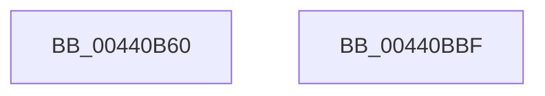

# NtAccessCheck

- RVA: `0x00440B60`–`0x00440BC0` (길이 `96` bytes)
- VA: `0x0000000140440B60`
- 실행 섹션: `.text`
- PDB 이름 있음: `예`; PDB Function 태그: `아니요`
- unwind 정보 RVA: `0x0006E590`
- 디코드: `21`개 명령, `96/96` bytes 표시
- 미해석 바이트: `0` (있으면 어셈블리에 `.byte`로 보존)

> 이 문서는 커널 이미지의 기계어와 PDB 기호를 분석해 생성했습니다. 4번과 5번은 함수 원형과 자료형을 바이너리 사용 방식에서 추정한 C 해석이며 원본 소스 복구 결과는 아닙니다.

## 1. Dependencies

- 직접 호출 지점: **1**; 고유 호출 대상: **1**
- 직접 호출자로 확인된 함수: **0**
- RIP 상대 이미지 참조: **0**

### Outgoing calls
- `0x00440BB5` → [SeAccessCheckByType](SeAccessCheckByType_function_00440BC8.md) (function, `0x00440BC8`)

### Direct callers
- 이 함수 시작 RVA로 연결되는 직접 call은 확인되지 않았습니다. 간접 호출은 완전히 역산할 수 없습니다.

### Static image references
- 디코드된 RIP-relative 메모리 참조가 없습니다.

## 2. Other-region calls and transfers

- 다른 실행 섹션으로 향하는 call: **0**
- 별도 외부 분기/꼬리 이동을 확인하지 못했습니다.

## 3. Assembly (complete function range)

```asm
00440B60  48 83 EC 68                     sub rsp, 0x68
00440B64  48 8B 84 24 A8 00 00 00         mov rax, qword ptr [rsp + 0xa8]
00440B6C  C6 44 24 58 00                  mov byte ptr [rsp + 0x58], 0
00440B71  48 89 44 24 50                  mov qword ptr [rsp + 0x50], rax
00440B76  48 8B 84 24 A0 00 00 00         mov rax, qword ptr [rsp + 0xa0]
00440B7E  48 89 44 24 48                  mov qword ptr [rsp + 0x48], rax
00440B83  48 8B 84 24 98 00 00 00         mov rax, qword ptr [rsp + 0x98]
00440B8B  48 89 44 24 40                  mov qword ptr [rsp + 0x40], rax
00440B90  48 8B 84 24 90 00 00 00         mov rax, qword ptr [rsp + 0x90]
00440B98  48 89 44 24 38                  mov qword ptr [rsp + 0x38], rax
00440B9D  33 C0                           xor eax, eax
00440B9F  4C 89 4C 24 30                  mov qword ptr [rsp + 0x30], r9
00440BA4  45 8B C8                        mov r9d, r8d
00440BA7  4C 8B C2                        mov r8, rdx
00440BAA  89 44 24 28                     mov dword ptr [rsp + 0x28], eax
00440BAE  33 D2                           xor edx, edx
00440BB0  48 89 44 24 20                  mov qword ptr [rsp + 0x20], rax
00440BB5  E8 0E 00 00 00                  call 0x140440bc8
00440BBA  48 83 C4 68                     add rsp, 0x68
00440BBE  C3                              ret
00440BBF  CC                              int3
```

## 4. C-style interpretation (structured pseudocode)

```c
__int64 __fastcall NtAccessCheck(__int64 a1, __int64 a2, int a3, __int64 a4, __int64 a5, __int64 a6, __int64 a7, __int64 a8)
{
    __int64 result;
    __int64 v_rsp;
    unsigned __int8 v_stack_m10;
    unsigned __int64 v_stack_m18;
    unsigned __int64 v_stack_m20;
    unsigned __int64 v_stack_m28;
    unsigned __int64 v_stack_m30;
    unsigned __int64 v_stack_m38;
    unsigned int v_stack_m40;
    unsigned __int64 v_stack_m48;

    v_rsp = (v_rsp) - (104);
    v_stack_m10 = 0;
    v_stack_m18 = a8;
    v_stack_m20 = a7;
    v_stack_m28 = a6;
    v_stack_m30 = a5;
    result = 0;
    v_stack_m38 = a4;
    v_stack_m40 = 0;
    a2 = 0;
    v_stack_m48 = 0;
    result = SeAccessCheckByType(a1, a2, a2, (unsigned int)(a3));
    v_rsp = (v_rsp) + (104);
    return result;
}
```

## 5. (Beta) C Style

```c
int64_t NtAccessCheck(int64_t Arg1, int64_t Arg2, int32_t Arg3, int64_t Arg4, int64_t Arg5, int64_t Arg6, int64_t Arg7, int64_t Arg8)
{
    int64_t result;
    int64_t local_rsp;
    uint8_t v_stack_m10;
    uint64_t v_stack_m18;
    uint64_t v_stack_m20;
    uint64_t v_stack_m28;
    uint64_t v_stack_m30;
    uint64_t v_stack_m38;
    uint32_t v_stack_m40;
    uint64_t v_stack_m48;

    local_rsp = (local_rsp) - (104);
    v_stack_m10 = 0;
    v_stack_m18 = Arg8;
    v_stack_m20 = Arg7;
    v_stack_m28 = Arg6;
    v_stack_m30 = Arg5;
    result = 0;
    v_stack_m38 = Arg4;
    v_stack_m40 = 0;
    Arg2 = 0;
    v_stack_m48 = 0;
    result = SeAccessCheckByType(Arg1, Arg2, Arg2, (uint32_t)(Arg3));
    local_rsp = (local_rsp) + (104);
    return result;
}
```

## 6. Execution-region graph

[열기: 2D/3D 그래프와 함수 탐색 컨트롤 패널](../../../control-panel.html?section=text&rva=0x00440B60&view=graph)

- 2D 그래프는 위에서 아래로 흐르고, 3D 그래프는 빈 공간을 드래그해 회전합니다. Shift+드래그는 이동, 휠은 확대·축소, 함수 노드 선택은 대상 보고서 이동입니다.

### Static fallback


