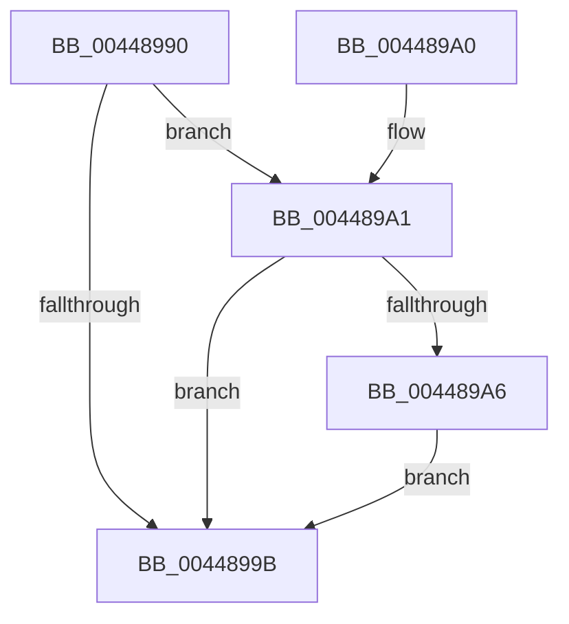

# PiControlFreeUserModeCallersBuffer

- RVA: `0x00448990`–`0x004489B2` (길이 `34` bytes)
- VA: `0x0000000140448990`
- 실행 섹션: `.text`
- PDB 이름 있음: `예`; PDB Function 태그: `아니요`
- unwind 정보 RVA: `0x00063CEC`
- 디코드: `13`개 명령, `34/34` bytes 표시
- 미해석 바이트: `0` (있으면 어셈블리에 `.byte`로 보존)

> 이 문서는 커널 이미지의 기계어와 PDB 기호를 분석해 생성했습니다. 4번과 5번은 함수 원형과 자료형을 바이너리 사용 방식에서 추정한 C 해석이며 원본 소스 복구 결과는 아닙니다.

## 1. Dependencies

- 직접 호출 지점: **1**; 고유 호출 대상: **1**
- 직접 호출자로 확인된 함수: **35**
- RIP 상대 이미지 참조: **0**

### Outgoing calls
- `0x004489AB` → [ExFreePoolWithTag](../../poolcode/B8/ExFreePoolWithTag_function_00B82870.md) (function, `0x00B82870`)

### Direct callers
- [PiCMDeleteDeviceInterfaceKey](../../page/70/PiCMDeleteDeviceInterfaceKey_function_007014E4.md) at `0x007015C7`
- [PiCMCreateObject](../../page/70/PiCMCreateObject_function_007015EC.md) at `0x0070177D`
- [PiCMDeleteDevice](../../page/70/PiCMDeleteDevice_function_007017A4.md) at `0x00701875`
- [PiCMCaptureObjectInputData](../../page/8E/PiCMCaptureObjectInputData_function_008E8220.md) at `0x008E835B`
- [PiCMHandleIoctl](../../page/8E/PiCMHandleIoctl_function_008EB880.md) at `0x008EC065`
- [PiCMCaptureRegistryPropertyInputData](../../page/8E/PiCMCaptureRegistryPropertyInputData_function_008ED078.md) at `0x008ED38F`
- [PiCMCapturePropertyInputData](../../page/8E/PiCMCapturePropertyInputData_function_008ED3A0.md) at `0x008ED6B9`
- [PiControlGetPropertyData](../../page/8F/PiControlGetPropertyData_function_008FA330.md) at `0x008FA3DA`
- [PiControlGetPropertyData](../../page/8F/PiControlGetPropertyData_function_008FA330.md) at `0x008FA497`
- [PiCMOpenClassKey](../../page/96/PiCMOpenClassKey_function_009617A8.md) at `0x00961945`
- [PiCMOpenDeviceInterfaceKey](../../page/96/PiCMOpenDeviceInterfaceKey_function_00961A3C.md) at `0x00961B8D`
- [PiCMCaptureRegistryInputData](../../page/96/PiCMCaptureRegistryInputData_function_00962108.md) at `0x00962308`
- [PiCMRegisterDeviceInterface](../../page/96/PiCMRegisterDeviceInterface_function_00962A94.md) at `0x00962C7E`
- [PiCMRegisterDeviceInterface](../../page/96/PiCMRegisterDeviceInterface_function_00962A94.md) at `0x00962C87`
- [PiCMCaptureRegisterInterfaceInputData](../../page/96/PiCMCaptureRegisterInterfaceInputData_function_00962C94.md) at `0x00962F14`
- [PiCMCaptureRegisterInterfaceInputData](../../page/96/PiCMCaptureRegisterInterfaceInputData_function_00962C94.md) at `0x00962F29`
- [PiCMReleaseRegistryPropertyInputData](../../page/96/PiCMReleaseRegistryPropertyInputData_function_00963568.md) at `0x009635B3`
- [PiCMDeviceAction](../../page/96/PiCMDeviceAction_function_0096488C.md) at `0x0096494B`
- [PiCMGetDeviceStatus](../../page/9D/PiCMGetDeviceStatus_function_009D136C.md) at `0x009D146C`
- [PiCMGetDeviceInterfaceList](../../page/A1/PiCMGetDeviceInterfaceList_function_00A163D0.md) at `0x00A164DA`
- [PiCMCaptureInterfaceListInputData](../../page/A1/PiCMCaptureInterfaceListInputData_function_00A165D4.md) at `0x00A1678A`
- [PiCMGetDeviceIdList](../../page/A2/PiCMGetDeviceIdList_function_00A2BAAC.md) at `0x00A2BC8B`
- [PiCMCaptureDeviceListInputData](../../page/A2/PiCMCaptureDeviceListInputData_function_00A2BD70.md) at `0x00A2C00C`
- [PiCMGetDeviceInterfaceAlias](../../page/A4/PiCMGetDeviceInterfaceAlias_function_00A47904.md) at `0x00A47A67`
- [PiCMCaptureInterfaceAliasInputData](../../page/A4/PiCMCaptureInterfaceAliasInputData_function_00A47B18.md) at `0x00A47DC0`
- [PiControlQueryDeviceRelations](../../page/A4/PiControlQueryDeviceRelations_function_00A4BD20.md) at `0x00A4BDEE`
- [PiControlQueryDeviceRelations](../../page/A4/PiControlQueryDeviceRelations_function_00A4BD20.md) at `0x00A4BDFB`
- [PiControlGetDeviceDepth](../../page/A5/PiControlGetDeviceDepth_function_00A5EB00.md) at `0x00A5EB7D`
- [PiCMGetObjectPropertyKeys](../../page/A7/PiCMGetObjectPropertyKeys_function_00A7C554.md) at `0x00A7C712`
- [PiCMGetDeviceDepth](../../page/A9/PiCMGetDeviceDepth_function_00A96B98.md) at `0x00A96C0B`
- [PiCMCreateDevice](../../page/AC/PiCMCreateDevice_function_00ACB824.md) at `0x00ACBE3C`
- [PiCMCreateDevice](../../page/AC/PiCMCreateDevice_function_00ACB824.md) at `0x00ACBE4C`
- [PiCMCaptureCreateDeviceInputData](../../page/AC/PiCMCaptureCreateDeviceInputData_function_00ACBFA8.md) at `0x00ACC215`
- [PiCMCaptureCreateDeviceInputData](../../page/AC/PiCMCaptureCreateDeviceInputData_function_00ACBFA8.md) at `0x00ACC22A`
- [PiCMQueryRemove](../../page/AD/PiCMQueryRemove_function_00AD43F4.md) at `0x00AD481D`
- [PiCMDeleteDeviceKey](../../page/AD/PiCMDeleteDeviceKey_function_00AD6780.md) at `0x00AD698F`
- [PiCMUnregisterDeviceInterface](../../page/AD/PiCMUnregisterDeviceInterface_function_00AD9758.md) at `0x00AD9905`
- [PiCMDeleteClassKey](../../page/AD/PiCMDeleteClassKey_function_00AD9EB4.md) at `0x00AD9FAE`
- [PiCMDeleteObject](../../page/AD/PiCMDeleteObject_function_00AD9FE4.md) at `0x00ADA16E`
- [sub_00B1D8AA](../../page/B1/Unknown_function_00B1D8AA.md) at `0x00B1D98E`
- [sub_00B1D9AC](../../page/B1/Unknown_function_00B1D9AC.md) at `0x00B1DAAE`

### Static image references
- 디코드된 RIP-relative 메모리 참조가 없습니다.

## 2. Other-region calls and transfers

- 다른 실행 섹션으로 향하는 call: **1**
  - `0x004489AB` → [ExFreePoolWithTag](../../poolcode/B8/ExFreePoolWithTag_function_00B82870.md) (`.text` → `POOLCODE`)
- 별도 외부 분기/꼬리 이동을 확인하지 못했습니다.

## 3. Assembly (complete function range)

```asm
00448990  48 83 EC 28                     sub rsp, 0x28
00448994  48 8B C2                        mov rax, rdx
00448997  84 C9                           test cl, cl
00448999  75 06                           jne 0x1404489a1
0044899B  48 83 C4 28                     add rsp, 0x28
0044899F  C3                              ret
004489A0  CC                              int3
004489A1  48 85 C0                        test rax, rax
004489A4  74 F5                           je 0x14044899b
004489A6  33 D2                           xor edx, edx
004489A8  48 8B C8                        mov rcx, rax
004489AB  E8 C0 9E 73 00                  call 0x140b82870
004489B0  EB E9                           jmp 0x14044899b
```

## 4. C-style interpretation (structured pseudocode)

```c
__int64 __fastcall PiControlFreeUserModeCallersBuffer(unsigned __int8 a1, __int64 a2)
{
    __int64 result;
    __int64 v_rsp;

    v_rsp = (v_rsp) - (40);
    if (a1 != 0) goto loc_004489A1;
loc_0044899B:
    v_rsp = (v_rsp) + (40);
    return a2;
loc_004489A1:
    if (a2 == 0) goto loc_0044899B;
    a2 = 0;
    result = ExFreePoolWithTag(0, a2, a3, a4);
    goto loc_0044899B;
}
```

## 5. (Beta) C Style

```c
int64_t PiControlFreeUserModeCallersBuffer(uint8_t Arg1, int64_t Arg2)
{
    int64_t result;
    int64_t local_rsp;

    local_rsp = (local_rsp) - (40);
    if (Arg1 != 0) goto loc_004489A1;
loc_0044899B:
    local_rsp = (local_rsp) + (40);
    return Arg2;
loc_004489A1:
    if (Arg2 == 0) goto loc_0044899B;
    Arg2 = 0;
    result = ExFreePoolWithTag(0, Arg2, a3, a4);
    goto loc_0044899B;
}
```

## 6. Execution-region graph

[열기: 2D/3D 그래프와 함수 탐색 컨트롤 패널](../../../control-panel.html?section=text&rva=0x00448990&view=graph)

- 2D 그래프는 위에서 아래로 흐르고, 3D 그래프는 빈 공간을 드래그해 회전합니다. Shift+드래그는 이동, 휠은 확대·축소, 함수 노드 선택은 대상 보고서 이동입니다.

### Static fallback


