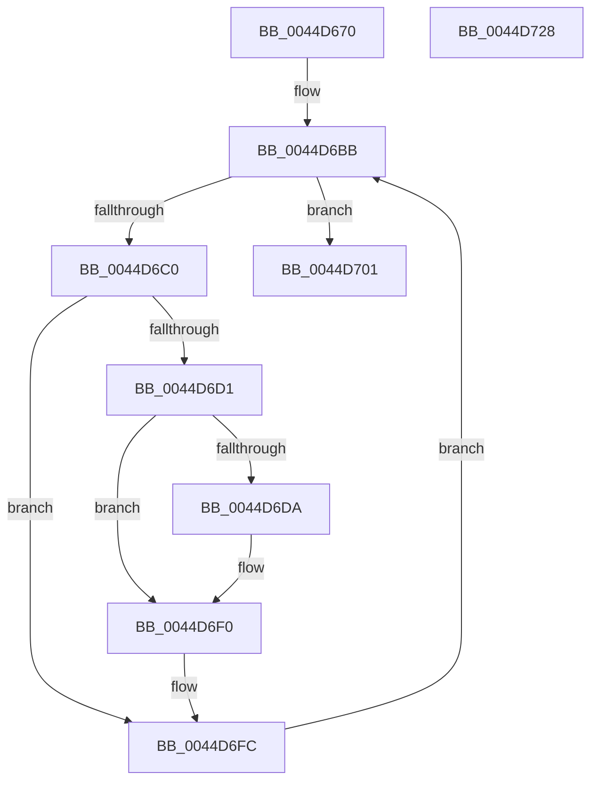

# PoIssueCoalescingNotification

- RVA: `0x0044D670`–`0x0044D729` (길이 `185` bytes)
- VA: `0x000000014044D670`
- 실행 섹션: `.text`
- PDB 이름 있음: `예`; PDB Function 태그: `아니요`
- unwind 정보 RVA: `0x0005D7BC`
- 디코드: `48`개 명령, `185/185` bytes 표시
- 미해석 바이트: `0` (있으면 어셈블리에 `.byte`로 보존)

> 이 문서는 커널 이미지의 기계어와 PDB 기호를 분석해 생성했습니다. 4번과 5번은 함수 원형과 자료형을 바이너리 사용 방식에서 추정한 C 해석이며 원본 소스 복구 결과는 아닙니다.

## 1. Dependencies

- 직접 호출 지점: **5**; 고유 호출 대상: **5**
- 직접 호출자로 확인된 함수: **2**
- RIP 상대 이미지 참조: **2**

### Outgoing calls
- `0x0044D6A8` → [PopAcquireRwLockShared](../2D/PopAcquireRwLockShared_function_002D9A40.md) (function, `0x002D9A40`)
- `0x0044D6C4` → [ExReferenceCallBackBlock](../2F/ExReferenceCallBackBlock_function_002F0040.md) (function, `0x002F0040`)
- `0x0044D6EB` → [guard_dispatch_icall](../6B/guard_dispatch_icall_function_006BAAD0.md) (function, `0x006BAAD0`)
- `0x0044D6F7` → [ExDereferenceCallBackBlock](ExDereferenceCallBackBlock_function_0044D730.md) (function, `0x0044D730`)
- `0x0044D708` → [PopReleaseRwLock](../2D/PopReleaseRwLock_function_002DFBBC.md) (function, `0x002DFBBC`)

### Direct callers
- [CmpIssueNewDirtyCallback](../../page/A6/CmpIssueNewDirtyCallback_function_00A6F050.md) at `0x00A6F076`
- [PopCoalescingCallbackWorker](../../page/A8/PopCoalescingCallbackWorker_function_00A8DA40.md) at `0x00A8DA9E`

### Static image references
- `0x0044D69D` → RVA `0x00F0E070` (`.data`; read)
- `0x0044D6AD` → RVA `0x00E07510` (`.data`; read)

## 2. Other-region calls and transfers

- 다른 실행 섹션으로 향하는 call: **0**
- 별도 외부 분기/꼬리 이동을 확인하지 못했습니다.

## 3. Assembly (complete function range)

```asm
0044D670  48 8B C4                        mov rax, rsp
0044D673  48 89 58 08                     mov qword ptr [rax + 8], rbx
0044D677  48 89 68 10                     mov qword ptr [rax + 0x10], rbp
0044D67B  48 89 70 18                     mov qword ptr [rax + 0x18], rsi
0044D67F  48 89 78 20                     mov qword ptr [rax + 0x20], rdi
0044D683  41 56                           push r14
0044D685  48 83 EC 30                     sub rsp, 0x30
0044D689  33 ED                           xor ebp, ebp
0044D68B  89 50 EC                        mov dword ptr [rax - 0x14], edx
0044D68E  66 89 68 E9                     mov word ptr [rax - 0x17], bp
0044D692  40 88 68 EB                     mov byte ptr [rax - 0x15], bpl
0044D696  48 89 68 F0                     mov qword ptr [rax - 0x10], rbp
0044D69A  8A 41 20                        mov al, byte ptr [rcx + 0x20]
0044D69D  48 8D 0D CC 09 AC 00            lea rcx, [rip + 0xac09cc]
0044D6A4  88 44 24 20                     mov byte ptr [rsp + 0x20], al
0044D6A8  E8 93 C3 E8 FF                  call 0x1402d9a40
0044D6AD  48 8B 1D 5C 9E 9B 00            mov rbx, qword ptr [rip + 0x9b9e5c]
0044D6B4  4C 8D 35 55 9E 9B 00            lea r14, [rip + 0x9b9e55]
0044D6BB  49 3B DE                        cmp rbx, r14
0044D6BE  74 41                           je 0x14044d701
0044D6C0  48 8D 4B 10                     lea rcx, [rbx + 0x10]
0044D6C4  E8 77 29 EA FF                  call 0x1402f0040
0044D6C9  48 8B F8                        mov rdi, rax
0044D6CC  48 85 C0                        test rax, rax
0044D6CF  74 2B                           je 0x14044d6fc
0044D6D1  8A 54 24 20                     mov dl, byte ptr [rsp + 0x20]
0044D6D5  38 53 F0                        cmp byte ptr [rbx - 0x10], dl
0044D6D8  74 16                           je 0x14044d6f0
0044D6DA  48 8B 40 08                     mov rax, qword ptr [rax + 8]
0044D6DE  48 8D 54 24 20                  lea rdx, [rsp + 0x20]
0044D6E3  4C 8B 44 24 28                  mov r8, qword ptr [rsp + 0x28]
0044D6E8  48 8B CF                        mov rcx, rdi
0044D6EB  E8 E0 D3 26 00                  call 0x1406baad0
0044D6F0  48 8B D7                        mov rdx, rdi
0044D6F3  48 8D 4B 10                     lea rcx, [rbx + 0x10]
0044D6F7  E8 34 00 00 00                  call 0x14044d730
0044D6FC  48 8B 1B                        mov rbx, qword ptr [rbx]
0044D6FF  EB BA                           jmp 0x14044d6bb
0044D701  48 8D 0D 68 09 AC 00            lea rcx, [rip + 0xac0968]
0044D708  E8 AF 24 E9 FF                  call 0x1402dfbbc
0044D70D  48 8B 5C 24 40                  mov rbx, qword ptr [rsp + 0x40]
0044D712  48 8B 6C 24 48                  mov rbp, qword ptr [rsp + 0x48]
0044D717  48 8B 74 24 50                  mov rsi, qword ptr [rsp + 0x50]
0044D71C  48 8B 7C 24 58                  mov rdi, qword ptr [rsp + 0x58]
0044D721  48 83 C4 30                     add rsp, 0x30
0044D725  41 5E                           pop r14
0044D727  C3                              ret
0044D728  CC                              int3
```

## 4. C-style interpretation (structured pseudocode)

```c
__int64 __fastcall PoIssueCoalescingNotification(__int64 a1, int a2)
{
    __int64 result;
    __int64 v_rbp;
    __int64 v_rsp;
    unsigned __int64 v_stack_m10;
    unsigned __int8 v_stack_m18;
    unsigned __int64 v_stack_p10;
    unsigned __int64 v_stack_p18;
    unsigned __int64 v_stack_p20;
    unsigned __int64 v_stack_p8;

    *(unsigned __int64 *)(v_rsp + 8) = v_rbx;
    *(unsigned __int64 *)(v_rsp + 16) = v_rbp;
    *(unsigned __int64 *)(v_rsp + 24) = v_rsi;
    *(unsigned __int64 *)(v_rsp + 32) = v_rdi;
    v_rsp = (v_rsp) - (48);
    v_rbp = 0;
    *(unsigned int *)(v_rsp - 20) = a2;
    *(unsigned __int16 *)(v_rsp - 23) = 0;
    *(unsigned __int8 *)(v_rsp - 21) = 0;
    *(unsigned __int64 *)(v_rsp - 16) = 0;
    v_stack_m18 = (unsigned __int8)(*(unsigned __int8 *)(a1 + 32));
    result = PopAcquireRwLockShared(v_rip + 11274700, a2, a3, a4);
loc_0044D6BB:
    if ((*(unsigned __int64 *)(v_rip + 10198620)) == (v_rip + 10198613)) goto loc_0044D701;
    result = ExReferenceCallBackBlock(*(unsigned __int64 *)(v_rip + 10198620) + 16, a2, a3, a4);
    if (result == 0) goto loc_0044D6FC;
    if ((*(unsigned __int8 *)(*(unsigned __int64 *)(v_rip + 10198620) - 16)) != ((unsigned __int8)(v_stack_m18))) {
        result = *(unsigned __int64 *)(result + 8);
        a2 = v_stack_m18;
        a3 = v_stack_m10;
        a1 = result;
        result = guard_dispatch_icall(a1, a2, a3, a4);
    }
    result = ExDereferenceCallBackBlock(*(unsigned __int64 *)(v_rip + 10198620) + 16, result, a3, a4);
loc_0044D6FC:
    goto loc_0044D6BB;
loc_0044D701:
    result = PopReleaseRwLock(v_rip + 11274600, result, a3, a4);
    v_rsp = (v_rsp) + (48);
    return result;
}
```

## 5. (Beta) C Style

```c
int64_t PoIssueCoalescingNotification(void *Arg1, int32_t Arg2)
{
    uint8_t *arg1 = (uint8_t *)Arg1;

    int64_t result;
    int64_t local_rbp;
    int64_t local_rsp;
    uint64_t v_stack_m10;
    uint8_t v_stack_m18;
    uint64_t v_stack_p10;
    uint64_t v_stack_p18;
    uint64_t v_stack_p20;
    uint64_t v_stack_p8;

    *(uint64_t *)(local_rsp + 0x8) = local_rbx;
    *(uint64_t *)(local_rsp + 0x10) = local_rbp;
    *(uint64_t *)(local_rsp + 0x18) = local_rsi;
    *(uint64_t *)(local_rsp + 0x20) = local_rdi;
    local_rsp = (local_rsp) - (48);
    local_rbp = 0;
    *(uint32_t *)(local_rsp - 0x14) = Arg2;
    *(uint16_t *)(local_rsp - 0x17) = 0;
    *(uint8_t *)(local_rsp - 0x15) = 0;
    *(uint64_t *)(local_rsp - 0x10) = 0;
    v_stack_m18 = (uint8_t)(*(uint8_t *)(arg1 + 0x20));
    result = PopAcquireRwLockShared(v_rip + 11274700, Arg2, a3, a4);
loc_0044D6BB:
    if ((*(uint64_t *)(v_rip + 0x9B9E5C)) == (v_rip + 10198613)) goto loc_0044D701;
    result = ExReferenceCallBackBlock(*(uint64_t *)(v_rip + 0x9B9E5C) + 16, Arg2, a3, a4);
    if (result == 0) goto loc_0044D6FC;
    if ((*(uint8_t *)(*(uint64_t *)(v_rip + 0x9B9E5C) - 0x10)) != ((uint8_t)(v_stack_m18))) {
        result = *(uint64_t *)(result + 0x8);
        Arg2 = v_stack_m18;
        a3 = v_stack_m10;
        Arg1 = result;
        result = guard_dispatch_icall(Arg1, Arg2, a3, a4);
    }
    result = ExDereferenceCallBackBlock(*(uint64_t *)(v_rip + 0x9B9E5C) + 16, result, a3, a4);
loc_0044D6FC:
    goto loc_0044D6BB;
loc_0044D701:
    result = PopReleaseRwLock(v_rip + 11274600, result, a3, a4);
    local_rsp = (local_rsp) + (48);
    return result;
}
```

### 관측된 메모리 오프셋

구조체 형식이 확인되지 않은 접근은 인자 기준의 오프셋으로만 기록했습니다.

| 기준 인자 | 오프셋 표현 | 폭 (bit) | 접근 |
|---|---:|---:|---|
| `Arg1` | `+ 0x20` | `8` | `R` |

## 6. Execution-region graph

[열기: 2D/3D 그래프와 함수 탐색 컨트롤 패널](../../../control-panel.html?section=text&rva=0x0044D670&view=graph)

- 2D 그래프는 위에서 아래로 흐르고, 3D 그래프는 빈 공간을 드래그해 회전합니다. Shift+드래그는 이동, 휠은 확대·축소, 함수 노드 선택은 대상 보고서 이동입니다.

### Static fallback


