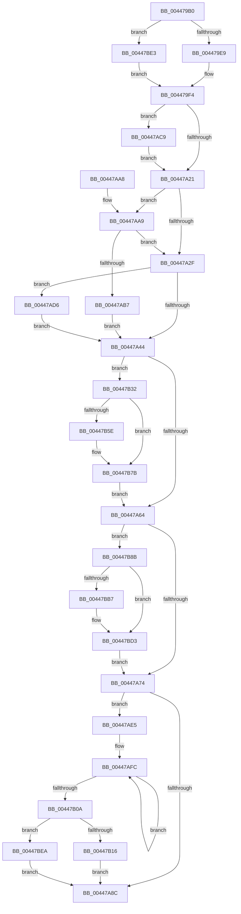

# PoQueryWatchdogTime

- RVA: `0x004479B0`–`0x00447BF3` (길이 `579` bytes)
- VA: `0x00000001404479B0`
- 실행 섹션: `.text`
- PDB 이름 있음: `예`; PDB Function 태그: `아니요`
- unwind 정보 RVA: `0x000A5F80`
- 디코드: `132`개 명령, `579/579` bytes 표시
- 미해석 바이트: `0` (있으면 어셈블리에 `.byte`로 보존)

> 이 문서는 커널 이미지의 기계어와 PDB 기호를 분석해 생성했습니다. 4번과 5번은 함수 원형과 자료형을 바이너리 사용 방식에서 추정한 C 해석이며 원본 소스 복구 결과는 아닙니다.

## 1. Dependencies

- 직접 호출 지점: **10**; 고유 호출 대상: **7**
- 직접 호출자로 확인된 함수: **0**
- RIP 상대 이미지 참조: **7**

### Outgoing calls
- `0x00447A81` → [KeReleaseInStackQueuedSpinLock](../34/KeReleaseInStackQueuedSpinLock_function_00342CE0.md) (function, `0x00342CE0`)
- `0x00447ABF` → [KiAcquireQueuedSpinLockInstrumented](../27/KiAcquireQueuedSpinLockInstrumented_function_00275850.md) (function, `0x00275850`)
- `0x00447ACC` → [KiRaiseIrqlProcessIrqlFlags](../4F/KiRaiseIrqlProcessIrqlFlags_function_004F56FC.md) (function, `0x004F56FC`)
- `0x00447ADB` → [KxWaitForLockOwnerShip](../25/KxWaitForLockOwnerShip_function_00257EB0.md) (function, `0x00257EB0`)
- `0x00447B4D` → [KeAcquireSpinLockRaiseToDpc](../20/KeAcquireSpinLockRaiseToDpc_function_00208470.md) (function, `0x00208470`)
- `0x00447B61` → [PopComputeWatchdogTimeout](PopComputeWatchdogTimeout_function_00447D54.md) (function, `0x00447D54`)
- `0x00447B81` → [KeReleaseSpinLock](../39/KeReleaseSpinLock_function_00392BA0.md) (function, `0x00392BA0`)
- `0x00447BA6` → [KeAcquireSpinLockRaiseToDpc](../20/KeAcquireSpinLockRaiseToDpc_function_00208470.md) (function, `0x00208470`)
- `0x00447BBA` → [PopComputeWatchdogTimeout](PopComputeWatchdogTimeout_function_00447D54.md) (function, `0x00447D54`)
- `0x00447BD9` → [KeReleaseSpinLock](../39/KeReleaseSpinLock_function_00392BA0.md) (function, `0x00392BA0`)

### Direct callers
- 이 함수 시작 RVA로 연결되는 직접 call은 확인되지 않았습니다. 간접 호출은 완전히 역산할 수 없습니다.

### Static image references
- `0x004479FA` → RVA `0x00F0CA50` (`.data`; read)
- `0x00447A14` → RVA `0x00FC6D20` (`ALMOSTRO`; read)
- `0x00447A21` → RVA `0x00FC6B06` (`ALMOSTRO`; read)
- `0x00447A34` → RVA `0x00F0CA50` (`.data`; read/write)
- `0x00447A54` → RVA `0x00F0BD28` (`.data`; write)
- `0x00447A74` → RVA `0x00F0BD28` (`.data`; read/write)
- `0x00447AA9` → RVA `0x00F0DE58` (`.data`; read)

## 2. Other-region calls and transfers

- 다른 실행 섹션으로 향하는 call: **0**
- 별도 외부 분기/꼬리 이동을 확인하지 못했습니다.

## 3. Assembly (complete function range)

```asm
004479B0  4C 8B DC                        mov r11, rsp
004479B3  49 89 5B 08                     mov qword ptr [r11 + 8], rbx
004479B7  49 89 6B 10                     mov qword ptr [r11 + 0x10], rbp
004479BB  49 89 73 18                     mov qword ptr [r11 + 0x18], rsi
004479BF  57                              push rdi
004479C0  41 56                           push r14
004479C2  41 57                           push r15
004479C4  48 83 EC 40                     sub rsp, 0x40
004479C8  33 C0                           xor eax, eax
004479CA  0F 57 C0                        xorps xmm0, xmm0
004479CD  48 83 CB FF                     or rbx, 0xffffffffffffffff
004479D1  45 32 F6                        xor r14b, r14b
004479D4  4C 8B FA                        mov r15, rdx
004479D7  0F 11 44 24 20                  movups xmmword ptr [rsp + 0x20], xmm0
004479DC  49 89 43 D8                     mov qword ptr [r11 - 0x28], rax
004479E0  48 85 C9                        test rcx, rcx
004479E3  0F 84 FA 01 00 00               je 0x140447be3
004479E9  48 8B 81 38 01 00 00            mov rax, qword ptr [rcx + 0x138]
004479F0  48 8B 78 28                     mov rdi, qword ptr [rax + 0x28]
004479F4  48 83 64 24 20 00               and qword ptr [rsp + 0x20], 0
004479FA  48 8D 2D 4F 50 AC 00            lea rbp, [rip + 0xac504f]
00447A01  48 89 6C 24 28                  mov qword ptr [rsp + 0x28], rbp
00447A06  90                              nop
00447A07  44 0F 20 C6                     mov rsi, cr8
00447A0B  BA 02 00 00 00                  mov edx, 2
00447A10  44 0F 22 C2                     mov cr8, rdx
00447A14  83 3D 05 F3 B7 00 00            cmp dword ptr [rip + 0xb7f305], 0
00447A1B  0F 85 A8 00 00 00               jne 0x140447ac9
00447A21  F6 05 DE F0 B7 00 21            test byte ptr [rip + 0xb7f0de], 0x21
00447A28  40 88 74 24 30                  mov byte ptr [rsp + 0x30], sil
00447A2D  75 7A                           jne 0x140447aa9
00447A2F  48 8D 54 24 20                  lea rdx, [rsp + 0x20]
00447A34  48 87 15 15 50 AC 00            xchg qword ptr [rip + 0xac5015], rdx
00447A3B  48 85 D2                        test rdx, rdx
00447A3E  0F 85 92 00 00 00               jne 0x140447ad6
00447A44  65 48 8B 04 25 88 01 00 00      mov rax, qword ptr gs:[0x188]
00447A4D  48 8B 97 08 01 00 00            mov rdx, qword ptr [rdi + 0x108]
00447A54  48 89 05 CD 42 AC 00            mov qword ptr [rip + 0xac42cd], rax
00447A5B  48 85 D2                        test rdx, rdx
00447A5E  0F 85 CE 00 00 00               jne 0x140447b32
00447A64  48 8B 97 18 01 00 00            mov rdx, qword ptr [rdi + 0x118]
00447A6B  48 85 D2                        test rdx, rdx
00447A6E  0F 85 17 01 00 00               jne 0x140447b8b
00447A74  48 83 25 AC 42 AC 00 00         and qword ptr [rip + 0xac42ac], 0
00447A7C  48 8D 4C 24 20                  lea rcx, [rsp + 0x20]
00447A81  E8 5A B2 EF FF                  call 0x140342ce0
00447A86  48 83 FB FF                     cmp rbx, -1
00447A8A  75 59                           jne 0x140447ae5
00447A8C  48 8B 5C 24 60                  mov rbx, qword ptr [rsp + 0x60]
00447A91  41 8A C6                        mov al, r14b
00447A94  48 8B 6C 24 68                  mov rbp, qword ptr [rsp + 0x68]
00447A99  48 8B 74 24 70                  mov rsi, qword ptr [rsp + 0x70]
00447A9E  48 83 C4 40                     add rsp, 0x40
00447AA2  41 5F                           pop r15
00447AA4  41 5E                           pop r14
00447AA6  5F                              pop rdi
00447AA7  C3                              ret
00447AA8  CC                              int3
00447AA9  8B 05 A9 63 AC 00               mov eax, dword ptr [rip + 0xac63a9]
00447AAF  85 C0                           test eax, eax
00447AB1  0F 85 78 FF FF FF               jne 0x140447a2f
00447AB7  48 8B D5                        mov rdx, rbp
00447ABA  48 8D 4C 24 20                  lea rcx, [rsp + 0x20]
00447ABF  E8 8C DD E2 FF                  call 0x140275850
00447AC4  E9 7B FF FF FF                  jmp 0x140447a44
00447AC9  40 8A CE                        mov cl, sil
00447ACC  E8 2B DC 0A 00                  call 0x1404f56fc
00447AD1  E9 4B FF FF FF                  jmp 0x140447a21
00447AD6  48 8D 4C 24 20                  lea rcx, [rsp + 0x20]
00447ADB  E8 D0 03 E1 FF                  call 0x140257eb0
00447AE0  E9 5F FF FF FF                  jmp 0x140447a44
00447AE5  41 B6 01                        mov r14b, 1
00447AE8  49 B8 B0 03 00 00 80 F7 FF FF   movabs r8, 0xfffff780000003b0
00447AF2  49 B9 08 00 00 00 80 F7 FF FF   movabs r9, 0xfffff78000000008
00447AFC  49 8B 10                        mov rdx, qword ptr [r8]
00447AFF  49 8B 09                        mov rcx, qword ptr [r9]
00447B02  49 8B 00                        mov rax, qword ptr [r8]
00447B05  48 3B D0                        cmp rdx, rax
00447B08  75 F2                           jne 0x140447afc
00447B0A  48 2B CA                        sub rcx, rdx
00447B0D  48 3B CB                        cmp rcx, rbx
00447B10  0F 87 D4 00 00 00               ja 0x140447bea
00447B16  48 2B D9                        sub rbx, rcx
00447B19  48 B8 BD 42 7A E5 D5 94 BF D6   movabs rax, 0xd6bf94d5e57a42bd
00447B23  48 F7 E3                        mul rbx
00447B26  48 C1 EA 17                     shr rdx, 0x17
00447B2A  41 89 17                        mov dword ptr [r15], edx
00447B2D  E9 5A FF FF FF                  jmp 0x140447a8c
00447B32  48 0F BE 42 42                  movsx rax, byte ptr [rdx + 0x42]
00447B37  48 8D 0C C0                     lea rcx, [rax + rax*8]
00447B3B  48 8B B4 CA C8 00 00 00         mov rsi, qword ptr [rdx + rcx*8 + 0xc8]
00447B43  48 8D AE 20 01 00 00            lea rbp, [rsi + 0x120]
00447B4A  48 8B CD                        mov rcx, rbp
00447B4D  E8 1E 09 DC FF                  call 0x140208470
00447B52  83 BE 28 01 00 00 01            cmp dword ptr [rsi + 0x128], 1
00447B59  44 8A C0                        mov r8b, al
00447B5C  75 1D                           jne 0x140447b7b
00447B5E  48 8B CE                        mov rcx, rsi
00447B61  E8 EE 01 00 00                  call 0x140447d54
00447B66  8B D0                           mov edx, eax
00447B68  48 69 C2 80 96 98 00            imul rax, rdx, 0x989680
00447B6F  48 03 46 30                     add rax, qword ptr [rsi + 0x30]
00447B73  48 83 F8 FF                     cmp rax, -1
00447B77  48 0F 42 D8                     cmovb rbx, rax
00447B7B  41 8A D0                        mov dl, r8b
00447B7E  48 8B CD                        mov rcx, rbp
00447B81  E8 1A B0 F4 FF                  call 0x140392ba0
00447B86  E9 D9 FE FF FF                  jmp 0x140447a64
00447B8B  48 0F BE 42 42                  movsx rax, byte ptr [rdx + 0x42]
00447B90  48 8D 0C C0                     lea rcx, [rax + rax*8]
00447B94  48 8B BC CA C8 00 00 00         mov rdi, qword ptr [rdx + rcx*8 + 0xc8]
00447B9C  48 8D B7 20 01 00 00            lea rsi, [rdi + 0x120]
00447BA3  48 8B CE                        mov rcx, rsi
00447BA6  E8 C5 08 DC FF                  call 0x140208470
00447BAB  83 BF 28 01 00 00 01            cmp dword ptr [rdi + 0x128], 1
00447BB2  44 8A C0                        mov r8b, al
00447BB5  75 1C                           jne 0x140447bd3
00447BB7  48 8B CF                        mov rcx, rdi
00447BBA  E8 95 01 00 00                  call 0x140447d54
00447BBF  8B D0                           mov edx, eax
00447BC1  48 69 C2 80 96 98 00            imul rax, rdx, 0x989680
00447BC8  48 03 47 30                     add rax, qword ptr [rdi + 0x30]
00447BCC  48 3B C3                        cmp rax, rbx
00447BCF  48 0F 42 D8                     cmovb rbx, rax
00447BD3  41 8A D0                        mov dl, r8b
00447BD6  48 8B CE                        mov rcx, rsi
00447BD9  E8 C2 AF F4 FF                  call 0x140392ba0
00447BDE  E9 91 FE FF FF                  jmp 0x140447a74
00447BE3  33 FF                           xor edi, edi
00447BE5  E9 0A FE FF FF                  jmp 0x1404479f4
00447BEA  41 83 27 00                     and dword ptr [r15], 0
00447BEE  E9 99 FE FF FF                  jmp 0x140447a8c
```

## 4. C-style interpretation (structured pseudocode)

```c
__int64 __fastcall PoQueryWatchdogTime(__int64 a1, __int64 a2)
{
    __int64 result;
    __int64 v_r14;
    __int64 v_rbx;
    __int64 v_rdi;
    __int64 v_rsp;
    unsigned __int8 v_stack_m28;
    unsigned __int64 v_stack_m30;
    unsigned __int64 v_stack_m38;
    unsigned __int64 v_stack_p10;
    unsigned __int64 v_stack_p18;
    unsigned __int64 v_stack_p20;
    unsigned __int64 v_stack_p8;

    *(unsigned __int64 *)(v_rsp + 8) = v_rbx;
    *(unsigned __int64 *)(v_rsp + 16) = v_rbp;
    *(unsigned __int64 *)(v_rsp + 24) = v_rsi;
    v_rsp = (v_rsp) - (64);
    result = 0;
    v_rbx = (v_rbx) | (-1);
    v_r14 = 0;
    v_stack_m38 = v_xmm0;
    *(unsigned __int64 *)(v_rsp - 40) = 0;
    if (a1 == 0) goto loc_00447BE3;
loc_004479F4:
    v_stack_m30 = v_rip + 11292751;
    if ((*(unsigned int *)(v_rip + 12055301)) != 0) goto loc_00447AC9;
loc_00447A21:
    v_stack_m28 = (unsigned __int8)(v_cr8);
    if (((*(unsigned __int8 *)(v_rip + 12054750)) & (33)) != 0) goto loc_00447AA9;
loc_00447A2F:
    if (v_stack_m38 != 0) goto loc_00447AD6;
loc_00447A44:
    *(unsigned __int64 *)(v_rip + 11289293) = *(unsigned __int64 *)(gs_base + (0 + 392));
    if (*(unsigned __int64 *)(*(unsigned __int64 *)(*(unsigned __int64 *)(a1 + 312) + 40) + 264) != 0) goto loc_00447B32;
loc_00447A64:
    if (*(unsigned __int64 *)(*(unsigned __int64 *)(*(unsigned __int64 *)(a1 + 312) + 40) + 280) != 0) goto loc_00447B8B;
loc_00447A74:
    result = KeReleaseInStackQueuedSpinLock(v_stack_m38, *(unsigned __int64 *)(*(unsigned __int64 *)(*(unsigned __int64 *)(a1 + 312) + 40) + 280), a3, a4);
    if (v_rbx != -1) goto loc_00447AE5;
loc_00447A8C:
    v_rsp = (v_rsp) + (64);
    return 0;
loc_00447AA9:
    if ((unsigned int)((unsigned int)(*(unsigned int *)(v_rip + 11297705))) != 0) goto loc_00447A2F;
    result = KiAcquireQueuedSpinLockInstrumented(v_stack_p20, v_stack_p10, a3, a4);
    goto loc_00447A44;
loc_00447AC9:
    result = KiRaiseIrqlProcessIrqlFlags((unsigned __int8)(v_stack_p18), v_stack_p10, a3, a4);
    goto loc_00447A21;
loc_00447AD6:
    result = KxWaitForLockOwnerShip(v_stack_p20, v_stack_p10, a3, a4);
    goto loc_00447A44;
loc_00447AE5:
loc_00447AFC:
    if ((*(unsigned __int64 *)(a3)) != (*(unsigned __int64 *)(a3))) goto loc_00447AFC;
    a1 = (*(unsigned __int64 *)(a4)) - (*(unsigned __int64 *)(a3));
    if (a1 > v_stack_p8) goto loc_00447BEA;
    v_rbx = (v_stack_p8) - (a1);
    a2 = (*(unsigned __int64 *)(a3)) >> (23);
    *(unsigned int *)(a2) = (unsigned int)(a2);
    goto loc_00447A8C;
loc_00447B32:
    result = KeAcquireSpinLockRaiseToDpc(*(unsigned __int64 *)(a2 + (__int8)(*(unsigned __int8 *)(a2 + 66)) + (__int8)(*(unsigned __int8 *)(a2 + 66)) * 8 * 8 + 200) + 288, a2, a3, a4);
    if ((*(unsigned int *)(*(unsigned __int64 *)(a2 + (__int8)(*(unsigned __int8 *)(a2 + 66)) + (__int8)(*(unsigned __int8 *)(a2 + 66)) * 8 * 8 + 200) + 296)) == 1) {
        a1 = *(unsigned __int64 *)(a2 + (__int8)(*(unsigned __int8 *)(a2 + 66)) + (__int8)(*(unsigned __int8 *)(a2 + 66)) * 8 * 8 + 200);
        result = PopComputeWatchdogTimeout(a1, a2, (unsigned __int8)(result), a4);
        a2 = (unsigned int)(result);
        result = (result) * (a2);
        result = (result) + (*(unsigned __int64 *)(*(unsigned __int64 *)(a2 + (__int8)(*(unsigned __int8 *)(a2 + 66)) + (__int8)(*(unsigned __int8 *)(a2 + 66)) * 8 * 8 + 200) + 48));
        if (result < -1) { v_rbx = result; }
    }
    result = KeReleaseSpinLock(*(unsigned __int64 *)(a2 + (__int8)(*(unsigned __int8 *)(a2 + 66)) + (__int8)(*(unsigned __int8 *)(a2 + 66)) * 8 * 8 + 200) + 288, (unsigned __int8)((unsigned __int8)(result)), (unsigned __int8)(result), a4);
    goto loc_00447A64;
loc_00447B8B:
    result = KeAcquireSpinLockRaiseToDpc(*(unsigned __int64 *)((unsigned __int8)((unsigned __int8)(result)) + (__int8)(*(unsigned __int8 *)((unsigned __int8)((unsigned __int8)(result)) + 66)) + (__int8)(*(unsigned __int8 *)((unsigned __int8)((unsigned __int8)(result)) + 66)) * 8 * 8 + 200) + 288, (unsigned __int8)((unsigned __int8)(result)), (unsigned __int8)(result), a4);
    if ((*(unsigned int *)(*(unsigned __int64 *)((unsigned __int8)((unsigned __int8)(result)) + (__int8)(*(unsigned __int8 *)((unsigned __int8)((unsigned __int8)(result)) + 66)) + (__int8)(*(unsigned __int8 *)((unsigned __int8)((unsigned __int8)(result)) + 66)) * 8 * 8 + 200) + 296)) == 1) {
        a1 = *(unsigned __int64 *)((unsigned __int8)((unsigned __int8)(result)) + (__int8)(*(unsigned __int8 *)((unsigned __int8)((unsigned __int8)(result)) + 66)) + (__int8)(*(unsigned __int8 *)((unsigned __int8)((unsigned __int8)(result)) + 66)) * 8 * 8 + 200);
        result = PopComputeWatchdogTimeout(a1, (unsigned __int8)((unsigned __int8)(result)), (unsigned __int8)(result), a4);
        a2 = (unsigned int)(result);
        result = (result) * (a2);
        result = (result) + (*(unsigned __int64 *)(*(unsigned __int64 *)((unsigned __int8)((unsigned __int8)(result)) + (__int8)(*(unsigned __int8 *)((unsigned __int8)((unsigned __int8)(result)) + 66)) + (__int8)(*(unsigned __int8 *)((unsigned __int8)((unsigned __int8)(result)) + 66)) * 8 * 8 + 200) + 48));
        if (result < v_rbx) { v_rbx = result; }
    }
    result = KeReleaseSpinLock(*(unsigned __int64 *)((unsigned __int8)((unsigned __int8)(result)) + (__int8)(*(unsigned __int8 *)((unsigned __int8)((unsigned __int8)(result)) + 66)) + (__int8)(*(unsigned __int8 *)((unsigned __int8)((unsigned __int8)(result)) + 66)) * 8 * 8 + 200) + 288, (unsigned __int8)((unsigned __int8)(result)), (unsigned __int8)(result), a4);
    goto loc_00447A74;
loc_00447BE3:
    v_rdi = 0;
    goto loc_004479F4;
loc_00447BEA:
    goto loc_00447A8C;
}
```

## 5. (Beta) C Style

```c
int64_t PoQueryWatchdogTime(int64_t Arg1, void *Arg2)
{
    uint8_t *arg2 = (uint8_t *)Arg2;

    int64_t result;
    int64_t local_r14;
    int64_t local_rbx;
    int64_t local_rdi;
    int64_t local_rsp;
    uint8_t v_stack_m28;
    uint64_t v_stack_m30;
    uint64_t v_stack_m38;
    uint64_t v_stack_p10;
    uint64_t v_stack_p18;
    uint64_t v_stack_p20;
    uint64_t v_stack_p8;

    *(uint64_t *)(local_rsp + 0x8) = local_rbx;
    *(uint64_t *)(local_rsp + 0x10) = local_rbp;
    *(uint64_t *)(local_rsp + 0x18) = local_rsi;
    local_rsp = (local_rsp) - (64);
    result = 0;
    local_rbx = (local_rbx) | (-1);
    local_r14 = 0;
    v_stack_m38 = v_xmm0;
    *(uint64_t *)(local_rsp - 0x28) = 0;
    if (Arg1 == 0) goto loc_00447BE3;
loc_004479F4:
    v_stack_m30 = v_rip + 11292751;
    if ((*(uint32_t *)(v_rip + 0xB7F305)) != 0) goto loc_00447AC9;
loc_00447A21:
    v_stack_m28 = (uint8_t)(v_cr8);
    if (((*(uint8_t *)(v_rip + 0xB7F0DE)) & (33)) != 0) goto loc_00447AA9;
loc_00447A2F:
    if (v_stack_m38 != 0) goto loc_00447AD6;
loc_00447A44:
    *(uint64_t *)(v_rip + 0xAC42CD) = *(uint64_t *)(gs_base + (0 + 0x188));
    if (*(uint64_t *)(*(uint64_t *)(*(uint64_t *)(Arg1 + 0x138) + 0x28) + 0x108) != 0) goto loc_00447B32;
loc_00447A64:
    if (*(uint64_t *)(*(uint64_t *)(*(uint64_t *)(Arg1 + 0x138) + 0x28) + 0x118) != 0) goto loc_00447B8B;
loc_00447A74:
    result = KeReleaseInStackQueuedSpinLock(v_stack_m38, *(uint64_t *)(*(uint64_t *)(*(uint64_t *)(Arg1 + 0x138) + 0x28) + 0x118), a3, a4);
    if (local_rbx != -1) goto loc_00447AE5;
loc_00447A8C:
    local_rsp = (local_rsp) + (64);
    return 0;
loc_00447AA9:
    if ((uint32_t)((uint32_t)(*(uint32_t *)(v_rip + 0xAC63A9))) != 0) goto loc_00447A2F;
    result = KiAcquireQueuedSpinLockInstrumented(v_stack_p20, v_stack_p10, a3, a4);
    goto loc_00447A44;
loc_00447AC9:
    result = KiRaiseIrqlProcessIrqlFlags((uint8_t)(v_stack_p18), v_stack_p10, a3, a4);
    goto loc_00447A21;
loc_00447AD6:
    result = KxWaitForLockOwnerShip(v_stack_p20, v_stack_p10, a3, a4);
    goto loc_00447A44;
loc_00447AE5:
loc_00447AFC:
    if ((*(uint64_t *)(a3)) != (*(uint64_t *)(a3))) goto loc_00447AFC;
    Arg1 = (*(uint64_t *)(a4)) - (*(uint64_t *)(a3));
    if (Arg1 > v_stack_p8) goto loc_00447BEA;
    local_rbx = (v_stack_p8) - (Arg1);
    Arg2 = (*(uint64_t *)(a3)) >> (23);
    *(uint32_t *)(arg2) = (uint32_t)(Arg2);
    goto loc_00447A8C;
loc_00447B32:
    result = KeAcquireSpinLockRaiseToDpc(*(uint64_t *)(arg2 + (int8_t)(*(uint8_t *)(arg2 + 0x42)) + (int8_t)(*(uint8_t *)(arg2 + 0x42)) * 8 * 8 + 0xC8) + 288, Arg2, a3, a4);
    if ((*(uint32_t *)(*(uint64_t *)(arg2 + (int8_t)(*(uint8_t *)(arg2 + 0x42)) + (int8_t)(*(uint8_t *)(arg2 + 0x42)) * 8 * 8 + 0xC8) + 0x128)) == 1) {
        Arg1 = *(uint64_t *)(arg2 + (int8_t)(*(uint8_t *)(arg2 + 0x42)) + (int8_t)(*(uint8_t *)(arg2 + 0x42)) * 8 * 8 + 0xC8);
        result = PopComputeWatchdogTimeout(Arg1, Arg2, (uint8_t)(result), a4);
        Arg2 = (uint32_t)(result);
        result = (result) * (Arg2);
        result = (result) + (*(uint64_t *)(*(uint64_t *)(arg2 + (int8_t)(*(uint8_t *)(arg2 + 0x42)) + (int8_t)(*(uint8_t *)(arg2 + 0x42)) * 8 * 8 + 0xC8) + 0x30));
        if (result < -1) { local_rbx = result; }
    }
    result = KeReleaseSpinLock(*(uint64_t *)(arg2 + (int8_t)(*(uint8_t *)(arg2 + 0x42)) + (int8_t)(*(uint8_t *)(arg2 + 0x42)) * 8 * 8 + 0xC8) + 288, (uint8_t)((uint8_t)(result)), (uint8_t)(result), a4);
    goto loc_00447A64;
loc_00447B8B:
    result = KeAcquireSpinLockRaiseToDpc(*(uint64_t *)((uint8_t)((uint8_t)(result)) + (int8_t)(*(uint8_t *)((uint8_t)((uint8_t)(result)) + 0x42)) + (int8_t)(*(uint8_t *)((uint8_t)((uint8_t)(result)) + 0x42)) * 8 * 8 + 0xC8) + 288, (uint8_t)((uint8_t)(result)), (uint8_t)(result), a4);
    if ((*(uint32_t *)(*(uint64_t *)((uint8_t)((uint8_t)(result)) + (int8_t)(*(uint8_t *)((uint8_t)((uint8_t)(result)) + 0x42)) + (int8_t)(*(uint8_t *)((uint8_t)((uint8_t)(result)) + 0x42)) * 8 * 8 + 0xC8) + 0x128)) == 1) {
        Arg1 = *(uint64_t *)((uint8_t)((uint8_t)(result)) + (int8_t)(*(uint8_t *)((uint8_t)((uint8_t)(result)) + 0x42)) + (int8_t)(*(uint8_t *)((uint8_t)((uint8_t)(result)) + 0x42)) * 8 * 8 + 0xC8);
        result = PopComputeWatchdogTimeout(Arg1, (uint8_t)((uint8_t)(result)), (uint8_t)(result), a4);
        Arg2 = (uint32_t)(result);
        result = (result) * (Arg2);
        result = (result) + (*(uint64_t *)(*(uint64_t *)((uint8_t)((uint8_t)(result)) + (int8_t)(*(uint8_t *)((uint8_t)((uint8_t)(result)) + 0x42)) + (int8_t)(*(uint8_t *)((uint8_t)((uint8_t)(result)) + 0x42)) * 8 * 8 + 0xC8) + 0x30));
        if (result < local_rbx) { local_rbx = result; }
    }
    result = KeReleaseSpinLock(*(uint64_t *)((uint8_t)((uint8_t)(result)) + (int8_t)(*(uint8_t *)((uint8_t)((uint8_t)(result)) + 0x42)) + (int8_t)(*(uint8_t *)((uint8_t)((uint8_t)(result)) + 0x42)) * 8 * 8 + 0xC8) + 288, (uint8_t)((uint8_t)(result)), (uint8_t)(result), a4);
    goto loc_00447A74;
loc_00447BE3:
    local_rdi = 0;
    goto loc_004479F4;
loc_00447BEA:
    goto loc_00447A8C;
}
```

### 관측된 메모리 오프셋

구조체 형식이 확인되지 않은 접근은 인자 기준의 오프셋으로만 기록했습니다.

| 기준 인자 | 오프셋 표현 | 폭 (bit) | 접근 |
|---|---:|---:|---|
| `Arg2` | `+ 0x0` | `32` | `R/W` |
| `Arg2` | `+ 0x0` | `32` | `W` |

## 6. Execution-region graph

[열기: 2D/3D 그래프와 함수 탐색 컨트롤 패널](../../../control-panel.html?section=text&rva=0x004479B0&view=graph)

- 2D 그래프는 위에서 아래로 흐르고, 3D 그래프는 빈 공간을 드래그해 회전합니다. Shift+드래그는 이동, 휠은 확대·축소, 함수 노드 선택은 대상 보고서 이동입니다.

### Static fallback


