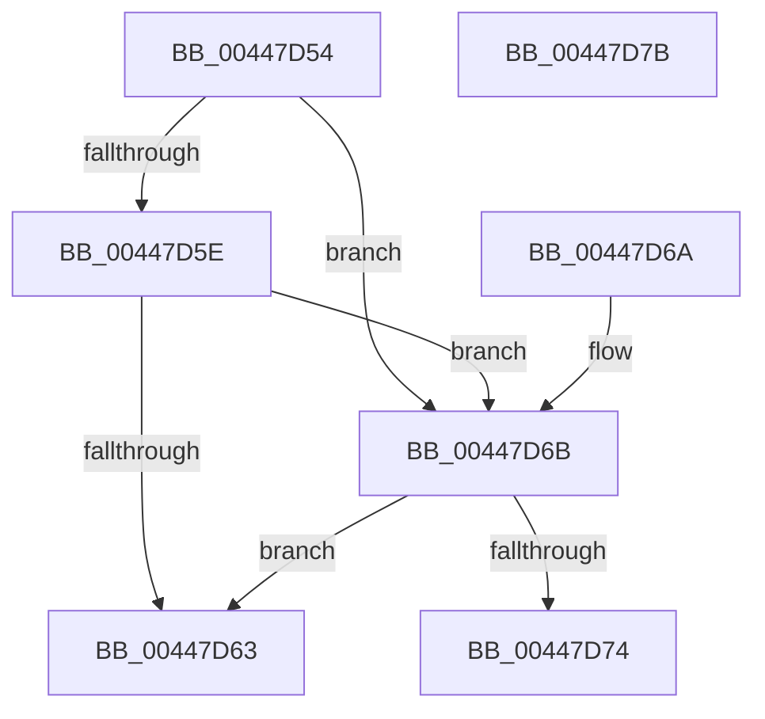

# PopComputeWatchdogTimeout

- RVA: `0x00447D54`–`0x00447D7C` (길이 `40` bytes)
- VA: `0x0000000140447D54`
- 실행 섹션: `.text`
- PDB 이름 있음: `예`; PDB Function 태그: `아니요`
- unwind 정보 RVA: `0x000DB714`
- 디코드: `13`개 명령, `40/40` bytes 표시
- 미해석 바이트: `0` (있으면 어셈블리에 `.byte`로 보존)

> 이 문서는 커널 이미지의 기계어와 PDB 기호를 분석해 생성했습니다. 4번과 5번은 함수 원형과 자료형을 바이너리 사용 방식에서 추정한 C 해석이며 원본 소스 복구 결과는 아닙니다.

## 1. Dependencies

- 직접 호출 지점: **0**; 고유 호출 대상: **0**
- 직접 호출자로 확인된 함수: **3**
- RIP 상대 이미지 참조: **2**

### Outgoing calls
- 직접 디코드된 call 명령이 없습니다.

### Direct callers
- [PoQueryWatchdogTime](PoQueryWatchdogTime_function_004479B0.md) at `0x00447B61`
- [PoQueryWatchdogTime](PoQueryWatchdogTime_function_004479B0.md) at `0x00447BBA`
- [PopEnableIrpWatchdog](PopEnableIrpWatchdog_function_00447BFC.md) at `0x00447C8D`
- [sub_006D9F1A](../6D/Unknown_function_006D9F1A.md) at `0x006D9F1D`

### Static image references
- `0x00447D63` → RVA `0x00FC5090` (`ALMOSTRO`; read)
- `0x00447D74` → RVA `0x00FC5174` (`ALMOSTRO`; read)

## 2. Other-region calls and transfers

- 다른 실행 섹션으로 향하는 call: **0**
- 별도 외부 분기/꼬리 이동을 확인하지 못했습니다.

## 3. Assembly (complete function range)

```asm
00447D54  8B 81 BC 00 00 00               mov eax, dword ptr [rcx + 0xbc]
00447D5A  85 C0                           test eax, eax
00447D5C  74 0D                           je 0x140447d6b
00447D5E  83 F8 01                        cmp eax, 1
00447D61  74 08                           je 0x140447d6b
00447D63  8B 05 27 D3 B7 00               mov eax, dword ptr [rip + 0xb7d327]
00447D69  C3                              ret
00447D6A  CC                              int3
00447D6B  83 B9 C0 00 00 00 01            cmp dword ptr [rcx + 0xc0], 1
00447D72  75 EF                           jne 0x140447d63
00447D74  8B 05 FA D3 B7 00               mov eax, dword ptr [rip + 0xb7d3fa]
00447D7A  C3                              ret
00447D7B  CC                              int3
```

## 4. C-style interpretation (structured pseudocode)

```c
__int64 __fastcall PopComputeWatchdogTimeout(__int64 a1)
{
    if ((unsigned int)((unsigned int)(*(unsigned int *)(a1 + 188))) == 0) goto loc_00447D6B;
    if (((unsigned int)((unsigned int)(*(unsigned int *)(a1 + 188)))) == 1) goto loc_00447D6B;
loc_00447D63:
    return (unsigned int)(*(unsigned int *)(v_rip + 12047143));
loc_00447D6B:
    if ((*(unsigned int *)(a1 + 192)) != 1) goto loc_00447D63;
    return (unsigned int)(*(unsigned int *)(v_rip + 12047354));
}
```

## 5. (Beta) C Style

```c
int64_t PopComputeWatchdogTimeout(void *Arg1)
{
    uint8_t *arg1 = (uint8_t *)Arg1;

    if ((uint32_t)((uint32_t)(*(uint32_t *)(arg1 + 0xBC))) == 0) goto loc_00447D6B;
    if (((uint32_t)((uint32_t)(*(uint32_t *)(arg1 + 0xBC)))) == 1) goto loc_00447D6B;
loc_00447D63:
    return (uint32_t)(*(uint32_t *)(v_rip + 0xB7D327));
loc_00447D6B:
    if ((*(uint32_t *)(arg1 + 0xC0)) != 1) goto loc_00447D63;
    return (uint32_t)(*(uint32_t *)(v_rip + 0xB7D3FA));
}
```

### 관측된 메모리 오프셋

구조체 형식이 확인되지 않은 접근은 인자 기준의 오프셋으로만 기록했습니다.

| 기준 인자 | 오프셋 표현 | 폭 (bit) | 접근 |
|---|---:|---:|---|
| `Arg1` | `+ 0xBC` | `32` | `R` |
| `Arg1` | `+ 0xC0` | `32` | `R` |

## 6. Execution-region graph

[열기: 2D/3D 그래프와 함수 탐색 컨트롤 패널](../../../control-panel.html?section=text&rva=0x00447D54&view=graph)

- 2D 그래프는 위에서 아래로 흐르고, 3D 그래프는 빈 공간을 드래그해 회전합니다. Shift+드래그는 이동, 휠은 확대·축소, 함수 노드 선택은 대상 보고서 이동입니다.

### Static fallback


