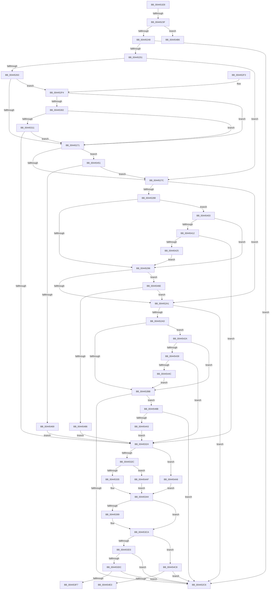

# PopDiagTraceFxDefaultPepWorkerEnd

- RVA: `0x004451E8`–`0x004454EF` (길이 `775` bytes)
- VA: `0x00000001404451E8`
- 실행 섹션: `.text`
- PDB 이름 있음: `예`; PDB Function 태그: `예`
- unwind 정보 RVA: `0x000A587C`
- 디코드: `185`개 명령, `775/775` bytes 표시
- 미해석 바이트: `0` (있으면 어셈블리에 `.byte`로 보존)

> 이 문서는 커널 이미지의 기계어와 PDB 기호를 분석해 생성했습니다. 4번과 5번은 함수 원형과 자료형을 바이너리 사용 방식에서 추정한 C 해석이며 원본 소스 복구 결과는 아닙니다.

## 1. Dependencies

- 직접 호출 지점: **8**; 고유 호출 대상: **4**
- 직접 호출자로 확인된 함수: **1**
- RIP 상대 이미지 참조: **7**

### Outgoing calls
- `0x004452CD` → [_security_check_cookie](../6A/_security_check_cookie_function_006AC640.md) (function, `0x006AC640`)
- `0x00445390` → [EtwEventEnabled](../39/EtwEventEnabled_function_00392450.md) (function, `0x00392450`)
- `0x004453C5` → [EtwWriteEx](../25/EtwWriteEx_function_0025F0D0.md) (function, `0x0025F0D0`)
- `0x004453EA` → [EtwEventEnabled](../39/EtwEventEnabled_function_00392450.md) (function, `0x00392450`)
- `0x0044545C` → [EtwpLevelKeywordEnabled](../2F/EtwpLevelKeywordEnabled_function_002FD110.md) (function, `0x002FD110`)
- `0x00445479` → [EtwpLevelKeywordEnabled](../2F/EtwpLevelKeywordEnabled_function_002FD110.md) (function, `0x002FD110`)
- `0x00445496` → [EtwpLevelKeywordEnabled](../2F/EtwpLevelKeywordEnabled_function_002FD110.md) (function, `0x002FD110`)
- `0x004454D6` → [EtwEventEnabled](../39/EtwEventEnabled_function_00392450.md) (function, `0x00392450`)

### Direct callers
- [PopPepWork](../2B/PopPepWork_function_002BCBC0.md) at `0x002BCEAE`

### Static image references
- `0x0044520F` → RVA `0x00E0A740` (`.data`; read)
- `0x00445248` → RVA `0x00E67858` (`.data`; read)
- `0x00445251` → RVA `0x00F0B408` (`.data`; read)
- `0x0044534B` → RVA `0x000147B0` (`.rdata`; read)
- `0x004453E3` → RVA `0x00020D50` (`.rdata`; read)
- `0x004454B6` → RVA `0x00E0B590` (`.data`; read)
- `0x004454CF` → RVA `0x00021D68` (`.rdata`; read)

## 2. Other-region calls and transfers

- 다른 실행 섹션으로 향하는 call: **0**
- call이 아닌 외부 분기/꼬리 이동: **4**
  - `0x00445239` → [sub_006EFD18](../6E/Unknown_function_006EFD18.md) (`tail-transfer`)
  - `0x004453FE` → [sub_006EFD18 + 0xE0](../6E/Unknown_function_006EFD18.md) (`tail-transfer`)
  - `0x004454C3` → [sub_006EFD18 + 0x4D](../6E/Unknown_function_006EFD18.md) (`tail-transfer`)
  - `0x004454EA` → [sub_006EFD18 + 0xE0](../6E/Unknown_function_006EFD18.md) (`tail-transfer`)

## 3. Assembly (complete function range)

```asm
004451E8  48 8B C4                        mov rax, rsp
004451EB  48 89 58 10                     mov qword ptr [rax + 0x10], rbx
004451EF  48 89 70 18                     mov qword ptr [rax + 0x18], rsi
004451F3  48 89 78 20                     mov qword ptr [rax + 0x20], rdi
004451F7  48 89 48 08                     mov qword ptr [rax + 8], rcx
004451FB  55                              push rbp
004451FC  41 54                           push r12
004451FE  41 55                           push r13
00445200  41 56                           push r14
00445202  41 57                           push r15
00445204  48 8D 68 A9                     lea rbp, [rax - 0x57]
00445208  48 81 EC E0 00 00 00            sub rsp, 0xe0
0044520F  48 8B 05 2A 55 9C 00            mov rax, qword ptr [rip + 0x9c552a]
00445216  48 33 C4                        xor rax, rsp
00445219  48 89 45 1F                     mov qword ptr [rbp + 0x1f], rax
0044521D  8B 75 7F                        mov esi, dword ptr [rbp + 0x7f]
00445220  41 BD 04 00 00 00               mov r13d, 4
00445226  45 33 FF                        xor r15d, r15d
00445229  41 8B D9                        mov ebx, r9d
0044522C  45 8B F0                        mov r14d, r8d
0044522F  8B FA                           mov edi, edx
00445231  45 8D 65 FD                     lea r12d, [r13 - 3]
00445235  41 83 F9 02                     cmp r9d, 2
00445239  0F 84 D9 AA 2A 00               je 0x1406efd18
0044523F  83 FB 03                        cmp ebx, 3
00445242  0F 84 6E 02 00 00               je 0x1404454b6
00445248  44 38 3D 09 26 A2 00            cmp byte ptr [rip + 0xa22609], r15b
0044524F  74 75                           je 0x1404452c6
00445251  48 8B 15 B0 61 AC 00            mov rdx, qword ptr [rip + 0xac61b0]
00445258  41 B8 00 01 00 00               mov r8d, 0x100
0044525E  48 85 D2                        test rdx, rdx
00445261  74 19                           je 0x14044527c
00445263  48 8B 4A 20                     mov rcx, qword ptr [rdx + 0x20]
00445267  44 39 79 60                     cmp dword ptr [rcx + 0x60], r15d
0044526B  0F 85 83 00 00 00               jne 0x1404452f4
00445271  66 44 39 7A 66                  cmp word ptr [rdx + 0x66], r15w
00445276  0F 85 D5 01 00 00               jne 0x140445451
0044527C  48 8B 15 85 61 AC 00            mov rdx, qword ptr [rip + 0xac6185]
00445283  48 85 D2                        test rdx, rdx
00445286  74 19                           je 0x1404452a1
00445288  48 8B 4A 20                     mov rcx, qword ptr [rdx + 0x20]
0044528C  44 39 79 60                     cmp dword ptr [rcx + 0x60], r15d
00445290  0F 85 6D 01 00 00               jne 0x140445403
00445296  66 44 39 7A 66                  cmp word ptr [rdx + 0x66], r15w
0044529B  0F 85 CD 01 00 00               jne 0x14044546e
004452A1  48 8B 15 60 61 AC 00            mov rdx, qword ptr [rip + 0xac6160]
004452A8  48 85 D2                        test rdx, rdx
004452AB  74 19                           je 0x1404452c6
004452AD  48 8B 4A 20                     mov rcx, qword ptr [rdx + 0x20]
004452B1  44 39 79 60                     cmp dword ptr [rcx + 0x60], r15d
004452B5  0F 85 6F 01 00 00               jne 0x14044542a
004452BB  66 44 39 7A 66                  cmp word ptr [rdx + 0x66], r15w
004452C0  0F 85 C5 01 00 00               jne 0x14044548b
004452C6  48 8B 4D 1F                     mov rcx, qword ptr [rbp + 0x1f]
004452CA  48 33 CC                        xor rcx, rsp
004452CD  E8 6E 73 26 00                  call 0x1406ac640
004452D2  4C 8D 9C 24 E0 00 00 00         lea r11, [rsp + 0xe0]
004452DA  49 8B 5B 38                     mov rbx, qword ptr [r11 + 0x38]
004452DE  49 8B 73 40                     mov rsi, qword ptr [r11 + 0x40]
004452E2  49 8B 7B 48                     mov rdi, qword ptr [r11 + 0x48]
004452E6  49 8B E3                        mov rsp, r11
004452E9  41 5F                           pop r15
004452EB  41 5E                           pop r14
004452ED  41 5D                           pop r13
004452EF  41 5C                           pop r12
004452F1  5D                              pop rbp
004452F2  C3                              ret
004452F3  CC                              int3
004452F4  8A 41 64                        mov al, byte ptr [rcx + 0x64]
004452F7  41 2A C4                        sub al, r12b
004452FA  3C 02                           cmp al, 2
004452FC  0F 86 6F FF FF FF               jbe 0x140445271
00445302  8B 41 68                        mov eax, dword ptr [rcx + 0x68]
00445305  8B 41 70                        mov eax, dword ptr [rcx + 0x70]
00445308  49 85 C0                        test r8, rax
0044530B  0F 84 60 FF FF FF               je 0x140445271
00445311  48 8B 49 78                     mov rcx, qword ptr [rcx + 0x78]
00445315  48 8B C1                        mov rax, rcx
00445318  49 23 C0                        and rax, r8
0044531B  48 3B C1                        cmp rax, rcx
0044531E  0F 85 4D FF FF FF               jne 0x140445271
00445324  85 FF                           test edi, edi
00445326  0F 84 7C 01 00 00               je 0x1404454a8
0044532C  41 3B FC                        cmp edi, r12d
0044532F  0F 84 7A 01 00 00               je 0x1404454af
00445335  83 FF 03                        cmp edi, 3
00445338  41 0F B6 C6                     movzx eax, r14b
0044533C  B9 FE FF FF FF                  mov ecx, 0xfffffffe
00445341  0F 44 C1                        cmove eax, ecx
00445344  48 8B 0D BD 60 AC 00            mov rcx, qword ptr [rip + 0xac60bd]
0044534B  48 8D 15 5E F4 BC FF            lea rdx, [rip - 0x430ba2]
00445352  88 45 8F                        mov byte ptr [rbp - 0x71], al
00445355  48 8D 45 5F                     lea rax, [rbp + 0x5f]
00445359  48 89 45 9F                     mov qword ptr [rbp - 0x61], rax
0044535D  48 8D 45 8F                     lea rax, [rbp - 0x71]
00445361  48 89 45 AF                     mov qword ptr [rbp - 0x51], rax
00445365  48 8D 45 90                     lea rax, [rbp - 0x70]
00445369  48 89 45 BF                     mov qword ptr [rbp - 0x41], rax
0044536D  48 8D 45 91                     lea rax, [rbp - 0x6f]
00445371  48 89 45 CF                     mov qword ptr [rbp - 0x31], rax
00445375  88 5D 90                        mov byte ptr [rbp - 0x70], bl
00445378  40 88 75 91                     mov byte ptr [rbp - 0x6f], sil
0044537C  48 C7 45 A7 08 00 00 00         mov qword ptr [rbp - 0x59], 8
00445384  4C 89 65 B7                     mov qword ptr [rbp - 0x49], r12
00445388  4C 89 65 C7                     mov qword ptr [rbp - 0x39], r12
0044538C  4C 89 65 D7                     mov qword ptr [rbp - 0x29], r12
00445390  E8 BB D0 F4 FF                  call 0x140392450
00445395  84 C0                           test al, al
00445397  74 31                           je 0x1404453ca
00445399  48 8B 0D 68 60 AC 00            mov rcx, qword ptr [rip + 0xac6068]
004453A0  48 8D 45 9F                     lea rax, [rbp - 0x61]
004453A4  48 89 44 24 38                  mov qword ptr [rsp + 0x38], rax
004453A9  48 8D 15 00 F4 BC FF            lea rdx, [rip - 0x430c00]
004453B0  44 89 6C 24 30                  mov dword ptr [rsp + 0x30], r13d
004453B5  45 8B CC                        mov r9d, r12d
004453B8  4C 89 7C 24 28                  mov qword ptr [rsp + 0x28], r15
004453BD  45 33 C0                        xor r8d, r8d
004453C0  4C 89 7C 24 20                  mov qword ptr [rsp + 0x20], r15
004453C5  E8 06 9D E1 FF                  call 0x14025f0d0
004453CA  83 FB 02                        cmp ebx, 2
004453CD  0F 84 F5 00 00 00               je 0x1404454c8
004453D3  83 FB 03                        cmp ebx, 3
004453D6  0F 85 EA FE FF FF               jne 0x1404452c6
004453DC  48 8B 0D 25 60 AC 00            mov rcx, qword ptr [rip + 0xac6025]
004453E3  48 8D 15 66 B9 BD FF            lea rdx, [rip - 0x42469a]
004453EA  E8 61 D0 F4 FF                  call 0x140392450
004453EF  84 C0                           test al, al
004453F1  0F 84 CF FE FF FF               je 0x1404452c6
004453F7  48 8D 15 52 B9 BD FF            lea rdx, [rip - 0x4246ae]
004453FE  E9 F5 A9 2A 00                  jmp 0x1406efdf8
00445403  8B 41 68                        mov eax, dword ptr [rcx + 0x68]
00445406  8B 41 70                        mov eax, dword ptr [rcx + 0x70]
00445409  49 85 C0                        test r8, rax
0044540C  0F 84 84 FE FF FF               je 0x140445296
00445412  48 8B 49 78                     mov rcx, qword ptr [rcx + 0x78]
00445416  48 8B C1                        mov rax, rcx
00445419  49 23 C0                        and rax, r8
0044541C  48 3B C1                        cmp rax, rcx
0044541F  0F 84 FF FE FF FF               je 0x140445324
00445425  E9 6C FE FF FF                  jmp 0x140445296
0044542A  8B 41 68                        mov eax, dword ptr [rcx + 0x68]
0044542D  8B 41 70                        mov eax, dword ptr [rcx + 0x70]
00445430  49 85 C0                        test r8, rax
00445433  0F 84 82 FE FF FF               je 0x1404452bb
00445439  48 8B 49 78                     mov rcx, qword ptr [rcx + 0x78]
0044543D  48 8B C1                        mov rax, rcx
00445440  49 23 C0                        and rax, r8
00445443  48 3B C1                        cmp rax, rcx
00445446  0F 84 D8 FE FF FF               je 0x140445324
0044544C  E9 6A FE FF FF                  jmp 0x1404452bb
00445451  48 8B 4A 28                     mov rcx, qword ptr [rdx + 0x28]
00445455  41 8A D5                        mov dl, r13b
00445458  48 83 C1 60                     add rcx, 0x60
0044545C  E8 AF 7C EB FF                  call 0x1402fd110
00445461  84 C0                           test al, al
00445463  0F 84 13 FE FF FF               je 0x14044527c
00445469  E9 B6 FE FF FF                  jmp 0x140445324
0044546E  48 8B 4A 28                     mov rcx, qword ptr [rdx + 0x28]
00445472  41 8A D4                        mov dl, r12b
00445475  48 83 C1 60                     add rcx, 0x60
00445479  E8 92 7C EB FF                  call 0x1402fd110
0044547E  84 C0                           test al, al
00445480  0F 84 1B FE FF FF               je 0x1404452a1
00445486  E9 99 FE FF FF                  jmp 0x140445324
0044548B  48 8B 4A 28                     mov rcx, qword ptr [rdx + 0x28]
0044548F  41 8A D4                        mov dl, r12b
00445492  48 83 C1 60                     add rcx, 0x60
00445496  E8 75 7C EB FF                  call 0x1402fd110
0044549B  84 C0                           test al, al
0044549D  0F 84 23 FE FF FF               je 0x1404452c6
004454A3  E9 7C FE FF FF                  jmp 0x140445324
004454A8  B0 FD                           mov al, 0xfd
004454AA  E9 95 FE FF FF                  jmp 0x140445344
004454AF  B0 FF                           mov al, 0xff
004454B1  E9 8E FE FF FF                  jmp 0x140445344
004454B6  0F 0D 0D D3 60 9C 00            prefetchw byte ptr [rip + 0x9c60d3]
004454BD  8B 05 CD 60 9C 00               mov eax, dword ptr [rip + 0x9c60cd]
004454C3  E9 9D A8 2A 00                  jmp 0x1406efd65
004454C8  48 8B 0D 39 5F AC 00            mov rcx, qword ptr [rip + 0xac5f39]
004454CF  48 8D 15 92 C8 BD FF            lea rdx, [rip - 0x42376e]
004454D6  E8 75 CF F4 FF                  call 0x140392450
004454DB  84 C0                           test al, al
004454DD  0F 84 E3 FD FF FF               je 0x1404452c6
004454E3  48 8D 15 7E C8 BD FF            lea rdx, [rip - 0x423782]
004454EA  E9 09 A9 2A 00                  jmp 0x1406efdf8
```

## 4. C-style interpretation (structured pseudocode)

```c
__int64 __fastcall PopDiagTraceFxDefaultPepWorkerEnd(__int64 a1, int a2, int a3, int a4)
{
    __int64 result;
    __int64 v_r15;
    __int64 v_rsp;
    unsigned __int64 v_stack_m28;
    unsigned __int64 v_stack_mA8;
    unsigned int v_stack_mB0;
    unsigned __int64 v_stack_mB8;
    unsigned __int64 v_stack_mC0;

    *(unsigned __int64 *)(v_rsp + 16) = v_rbx;
    *(unsigned __int64 *)(v_rsp + 24) = v_rsi;
    *(unsigned __int64 *)(v_rsp + 32) = v_rdi;
    *(unsigned __int64 *)(v_rsp + 8) = a1;
    v_rsp = (v_rsp) - (224);
    result = (*(unsigned __int64 *)(v_rip + 10245418)) ^ (v_rsp);
    *(unsigned __int64 *)(v_rsp - 87 + 31) = result;
    v_r15 = 0;
    if (((unsigned int)((unsigned int)(a4))) == 3) goto loc_004454B6;
    if ((*(unsigned __int8 *)(v_rip + 10626569)) == 0) goto loc_004452C6;
    if (*(unsigned __int64 *)(v_rip + 11297200) == 0) goto loc_0044527C;
    if ((*(unsigned int *)(*(unsigned __int64 *)(*(unsigned __int64 *)(v_rip + 11297200) + 32) + 96)) != 0) goto loc_004452F4;
loc_00445271:
    if ((*(unsigned __int16 *)(*(unsigned __int64 *)(v_rip + 11297200) + 102)) != 0) goto loc_00445451;
loc_0044527C:
    if (*(unsigned __int64 *)(v_rip + 11297157) == 0) goto loc_004452A1;
    if ((*(unsigned int *)(*(unsigned __int64 *)(*(unsigned __int64 *)(v_rip + 11297157) + 32) + 96)) != 0) goto loc_00445403;
loc_00445296:
    if ((*(unsigned __int16 *)(*(unsigned __int64 *)(v_rip + 11297157) + 102)) != 0) goto loc_0044546E;
loc_004452A1:
    if (*(unsigned __int64 *)(v_rip + 11297120) == 0) goto loc_004452C6;
    if ((*(unsigned int *)(*(unsigned __int64 *)(*(unsigned __int64 *)(v_rip + 11297120) + 32) + 96)) != 0) goto loc_0044542A;
loc_004452BB:
    if ((*(unsigned __int16 *)(*(unsigned __int64 *)(v_rip + 11297120) + 102)) != 0) goto loc_0044548B;
loc_004452C6:
    a1 = (*(unsigned __int64 *)(v_rsp - 87 + 31)) ^ (v_rsp);
    result = _security_check_cookie(a1, *(unsigned __int64 *)(v_rip + 11297120), 256, a4);
    return result;
loc_004452F4:
    result = (unsigned __int8)((*(unsigned __int8 *)(a1 + 100)) - ((unsigned __int8)(4 - 3)));
    if (((unsigned __int8)(result)) <= 2) goto loc_00445271;
    if (((256) & ((unsigned int)(*(unsigned int *)(a1 + 112)))) == 0) goto loc_00445271;
    result = (*(unsigned __int64 *)(a1 + 120)) & (256);
    if (result != (*(unsigned __int64 *)(a1 + 120))) goto loc_00445271;
loc_00445324:
    if ((unsigned int)(*(unsigned __int64 *)(v_stack_m28 + 72)) == 0) goto loc_004454A8;
    if (((unsigned int)(*(unsigned __int64 *)(v_stack_m28 + 72))) == ((unsigned int)(4 - 3))) goto loc_004454AF;
    result = (unsigned __int8)((unsigned int)(a3));
    if (((unsigned int)(*(unsigned __int64 *)(v_stack_m28 + 72))) == 3) { result = (unsigned int)((unsigned int)(0xFFFFFFFEULL)); }
loc_00445344:
    *(unsigned __int8 *)(v_rsp - 87 - 113) = (unsigned __int8)(result);
    *(unsigned __int64 *)(v_rsp - 87 - 97) = v_rsp - 87 + 95;
    *(unsigned __int64 *)(v_rsp - 87 - 81) = v_rsp - 87 - 113;
    *(unsigned __int64 *)(v_rsp - 87 - 65) = v_rsp - 87 - 112;
    *(unsigned __int64 *)(v_rsp - 87 - 49) = v_rsp - 87 - 111;
    *(unsigned __int8 *)(v_rsp - 87 - 112) = (unsigned __int8)(*(unsigned __int64 *)(v_stack_m28 + 56));
    *(unsigned __int8 *)(v_rsp - 87 - 111) = (unsigned __int8)(*(unsigned __int64 *)(v_stack_m28 + 64));
    *(unsigned __int64 *)(v_rsp - 87 - 89) = 8;
    *(unsigned __int64 *)(v_rsp - 87 - 73) = 4 - 3;
    *(unsigned __int64 *)(v_rsp - 87 - 57) = 4 - 3;
    *(unsigned __int64 *)(v_rsp - 87 - 41) = 4 - 3;
    result = EtwEventEnabled(*(unsigned __int64 *)(v_rip + 11296957), v_rip - 4393890, 256, a4);
    if ((unsigned __int8)(result) != 0) {
        a1 = *(unsigned __int64 *)(v_rip + 11296872);
        result = v_rsp - 87 - 97;
        v_stack_mA8 = result;
        a2 = v_rip - 4393984;
        v_stack_mB0 = 4;
        a4 = (unsigned int)(4 - 3);
        v_stack_mB8 = 0;
        a3 = 0;
        v_stack_mC0 = 0;
        result = EtwWriteEx(a1, a2, a3, a4);
    }
    if (((unsigned int)(*(unsigned __int64 *)(v_stack_m28 + 56))) == 2) goto loc_004454C8;
    if (((unsigned int)(*(unsigned __int64 *)(v_stack_m28 + 56))) != 3) goto loc_004452C6;
    result = EtwEventEnabled(*(unsigned __int64 *)(v_rip + 11296805), v_rip - 4343450, a3, a4);
    if ((unsigned __int8)(result) == 0) goto loc_004452C6;
loc_00445403:
    if (((0) & ((unsigned int)(*(unsigned int *)(*(unsigned __int64 *)(v_rip + 11296805) + 112)))) == 0) goto loc_00445296;
    result = (*(unsigned __int64 *)(*(unsigned __int64 *)(v_rip + 11296805) + 120)) & (0);
    if (result == (*(unsigned __int64 *)(*(unsigned __int64 *)(v_rip + 11296805) + 120))) goto loc_00445324;
    goto loc_00445296;
loc_0044542A:
    if (((0) & ((unsigned int)(*(unsigned int *)(*(unsigned __int64 *)(*(unsigned __int64 *)(v_rip + 11296805) + 120) + 112)))) == 0) goto loc_004452BB;
    result = (*(unsigned __int64 *)(*(unsigned __int64 *)(*(unsigned __int64 *)(v_rip + 11296805) + 120) + 120)) & (0);
    if (result == (*(unsigned __int64 *)(*(unsigned __int64 *)(*(unsigned __int64 *)(v_rip + 11296805) + 120) + 120))) goto loc_00445324;
    goto loc_004452BB;
loc_00445451:
    a1 = (*(unsigned __int64 *)(v_rip - 4343470 + 40)) + (96);
    result = EtwpLevelKeywordEnabled(a1, 4, a3, a4);
    if ((unsigned __int8)(result) == 0) goto loc_0044527C;
    goto loc_00445324;
loc_0044546E:
    a1 = (*(unsigned __int64 *)(4 + 40)) + (96);
    result = EtwpLevelKeywordEnabled(a1, (unsigned __int8)(4 - 3), a3, a4);
    if ((unsigned __int8)(result) == 0) goto loc_004452A1;
    goto loc_00445324;
loc_0044548B:
    a1 = (*(unsigned __int64 *)((unsigned __int8)(4 - 3) + 40)) + (96);
    result = EtwpLevelKeywordEnabled(a1, (unsigned __int8)(4 - 3), a3, a4);
    if ((unsigned __int8)(result) == 0) goto loc_004452C6;
    goto loc_00445324;
loc_004454A8:
    goto loc_00445344;
loc_004454AF:
    goto loc_00445344;
loc_004454B6:
loc_004454C8:
    result = EtwEventEnabled(*(unsigned __int64 *)(v_rip + 11296569), v_rip - 4339566, a3, a4);
    if ((unsigned __int8)(result) == 0) goto loc_004452C6;
}
```

## 5. (Beta) C Style

```c
int64_t PopDiagTraceFxDefaultPepWorkerEnd(int64_t Arg1, int32_t Arg2, int32_t Arg3, int32_t Arg4)
{
    int64_t result;
    int64_t local_r15;
    int64_t local_rsp;
    uint64_t v_stack_m28;
    uint64_t v_stack_mA8;
    uint32_t v_stack_mB0;
    uint64_t v_stack_mB8;
    uint64_t v_stack_mC0;

    *(uint64_t *)(local_rsp + 0x10) = local_rbx;
    *(uint64_t *)(local_rsp + 0x18) = local_rsi;
    *(uint64_t *)(local_rsp + 0x20) = local_rdi;
    *(uint64_t *)(local_rsp + 0x8) = Arg1;
    local_rsp = (local_rsp) - (224);
    result = (*(uint64_t *)(v_rip + 0x9C552A)) ^ (local_rsp);
    *(uint64_t *)(local_rsp - 0x57 + 0x1F) = result;
    local_r15 = 0;
    if (((uint32_t)((uint32_t)(Arg4))) == 3) goto loc_004454B6;
    if ((*(uint8_t *)(v_rip + 0xA22609)) == 0) goto loc_004452C6;
    if (*(uint64_t *)(v_rip + 0xAC61B0) == 0) goto loc_0044527C;
    if ((*(uint32_t *)(*(uint64_t *)(*(uint64_t *)(v_rip + 0xAC61B0) + 0x20) + 0x60)) != 0) goto loc_004452F4;
loc_00445271:
    if ((*(uint16_t *)(*(uint64_t *)(v_rip + 0xAC61B0) + 0x66)) != 0) goto loc_00445451;
loc_0044527C:
    if (*(uint64_t *)(v_rip + 0xAC6185) == 0) goto loc_004452A1;
    if ((*(uint32_t *)(*(uint64_t *)(*(uint64_t *)(v_rip + 0xAC6185) + 0x20) + 0x60)) != 0) goto loc_00445403;
loc_00445296:
    if ((*(uint16_t *)(*(uint64_t *)(v_rip + 0xAC6185) + 0x66)) != 0) goto loc_0044546E;
loc_004452A1:
    if (*(uint64_t *)(v_rip + 0xAC6160) == 0) goto loc_004452C6;
    if ((*(uint32_t *)(*(uint64_t *)(*(uint64_t *)(v_rip + 0xAC6160) + 0x20) + 0x60)) != 0) goto loc_0044542A;
loc_004452BB:
    if ((*(uint16_t *)(*(uint64_t *)(v_rip + 0xAC6160) + 0x66)) != 0) goto loc_0044548B;
loc_004452C6:
    Arg1 = (*(uint64_t *)(local_rsp - 0x57 + 0x1F)) ^ (local_rsp);
    result = _security_check_cookie(Arg1, *(uint64_t *)(v_rip + 0xAC6160), 256, Arg4);
    return result;
loc_004452F4:
    result = (uint8_t)((*(uint8_t *)(Arg1 + 0x64)) - ((uint8_t)(4 - 3)));
    if (((uint8_t)(result)) <= 2) goto loc_00445271;
    if (((256) & ((uint32_t)(*(uint32_t *)(Arg1 + 0x70)))) == 0) goto loc_00445271;
    result = (*(uint64_t *)(Arg1 + 0x78)) & (256);
    if (result != (*(uint64_t *)(Arg1 + 0x78))) goto loc_00445271;
loc_00445324:
    if ((uint32_t)(*(uint64_t *)(v_stack_m28 + 0x48)) == 0) goto loc_004454A8;
    if (((uint32_t)(*(uint64_t *)(v_stack_m28 + 0x48))) == ((uint32_t)(4 - 3))) goto loc_004454AF;
    result = (uint8_t)((uint32_t)(Arg3));
    if (((uint32_t)(*(uint64_t *)(v_stack_m28 + 0x48))) == 3) { result = (uint32_t)((uint32_t)(0xFFFFFFFEULL)); }
loc_00445344:
    *(uint8_t *)(local_rsp - 0x57 - 0x71) = (uint8_t)(result);
    *(uint64_t *)(local_rsp - 0x57 - 0x61) = local_rsp - 87 + 95;
    *(uint64_t *)(local_rsp - 0x57 - 0x51) = local_rsp - 87 - 113;
    *(uint64_t *)(local_rsp - 0x57 - 0x41) = local_rsp - 87 - 112;
    *(uint64_t *)(local_rsp - 0x57 - 0x31) = local_rsp - 87 - 111;
    *(uint8_t *)(local_rsp - 0x57 - 0x70) = (uint8_t)(*(uint64_t *)(v_stack_m28 + 0x38));
    *(uint8_t *)(local_rsp - 0x57 - 0x6F) = (uint8_t)(*(uint64_t *)(v_stack_m28 + 0x40));
    *(uint64_t *)(local_rsp - 0x57 - 0x59) = 8;
    *(uint64_t *)(local_rsp - 0x57 - 0x49) = 4 - 3;
    *(uint64_t *)(local_rsp - 0x57 - 0x39) = 4 - 3;
    *(uint64_t *)(local_rsp - 0x57 - 0x29) = 4 - 3;
    result = EtwEventEnabled(*(uint64_t *)(v_rip + 0xAC60BD), v_rip - 4393890, 256, Arg4);
    if ((uint8_t)(result) != 0) {
        Arg1 = *(uint64_t *)(v_rip + 0xAC6068);
        result = local_rsp - 87 - 97;
        v_stack_mA8 = result;
        Arg2 = v_rip - 4393984;
        v_stack_mB0 = 4;
        Arg4 = (uint32_t)(4 - 3);
        v_stack_mB8 = 0;
        Arg3 = 0;
        v_stack_mC0 = 0;
        result = EtwWriteEx(Arg1, Arg2, Arg3, Arg4);
    }
    if (((uint32_t)(*(uint64_t *)(v_stack_m28 + 0x38))) == 2) goto loc_004454C8;
    if (((uint32_t)(*(uint64_t *)(v_stack_m28 + 0x38))) != 3) goto loc_004452C6;
    result = EtwEventEnabled(*(uint64_t *)(v_rip + 0xAC6025), v_rip - 4343450, Arg3, Arg4);
    if ((uint8_t)(result) == 0) goto loc_004452C6;
loc_00445403:
    if (((0) & ((uint32_t)(*(uint32_t *)(*(uint64_t *)(v_rip + 0xAC6025) + 0x70)))) == 0) goto loc_00445296;
    result = (*(uint64_t *)(*(uint64_t *)(v_rip + 0xAC6025) + 0x78)) & (0);
    if (result == (*(uint64_t *)(*(uint64_t *)(v_rip + 0xAC6025) + 0x78))) goto loc_00445324;
    goto loc_00445296;
loc_0044542A:
    if (((0) & ((uint32_t)(*(uint32_t *)(*(uint64_t *)(*(uint64_t *)(v_rip + 0xAC6025) + 0x78) + 0x70)))) == 0) goto loc_004452BB;
    result = (*(uint64_t *)(*(uint64_t *)(*(uint64_t *)(v_rip + 0xAC6025) + 0x78) + 0x78)) & (0);
    if (result == (*(uint64_t *)(*(uint64_t *)(*(uint64_t *)(v_rip + 0xAC6025) + 0x78) + 0x78))) goto loc_00445324;
    goto loc_004452BB;
loc_00445451:
    Arg1 = (*(uint64_t *)(v_rip - 0x4246AE + 0x28)) + (96);
    result = EtwpLevelKeywordEnabled(Arg1, 4, Arg3, Arg4);
    if ((uint8_t)(result) == 0) goto loc_0044527C;
    goto loc_00445324;
loc_0044546E:
    Arg1 = (*(uint64_t *)(4 + 0x28)) + (96);
    result = EtwpLevelKeywordEnabled(Arg1, (uint8_t)(4 - 3), Arg3, Arg4);
    if ((uint8_t)(result) == 0) goto loc_004452A1;
    goto loc_00445324;
loc_0044548B:
    Arg1 = (*(uint64_t *)((uint8_t)(4 - 0x3) + 0x28)) + (96);
    result = EtwpLevelKeywordEnabled(Arg1, (uint8_t)(4 - 3), Arg3, Arg4);
    if ((uint8_t)(result) == 0) goto loc_004452C6;
    goto loc_00445324;
loc_004454A8:
    goto loc_00445344;
loc_004454AF:
    goto loc_00445344;
loc_004454B6:
loc_004454C8:
    result = EtwEventEnabled(*(uint64_t *)(v_rip + 0xAC5F39), v_rip - 4339566, Arg3, Arg4);
    if ((uint8_t)(result) == 0) goto loc_004452C6;
}
```

## 6. Execution-region graph

[열기: 2D/3D 그래프와 함수 탐색 컨트롤 패널](../../../control-panel.html?section=text&rva=0x004451E8&view=graph)

- 2D 그래프는 위에서 아래로 흐르고, 3D 그래프는 빈 공간을 드래그해 회전합니다. Shift+드래그는 이동, 휠은 확대·축소, 함수 노드 선택은 대상 보고서 이동입니다.

### Static fallback


