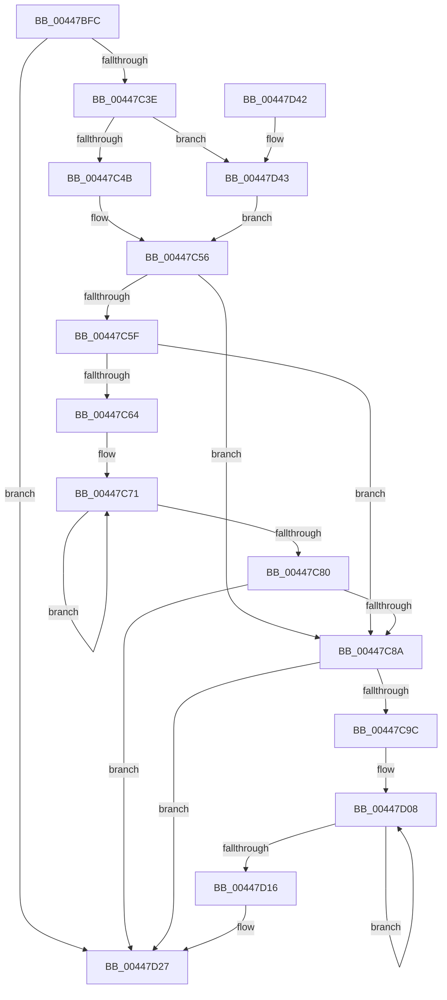

# PopEnableIrpWatchdog

- RVA: `0x00447BFC`–`0x00447D4B` (길이 `335` bytes)
- VA: `0x0000000140447BFC`
- 실행 섹션: `.text`
- PDB 이름 있음: `예`; PDB Function 태그: `아니요`
- unwind 정보 RVA: `0x000A5F9C`
- 디코드: `77`개 명령, `335/335` bytes 표시
- 미해석 바이트: `0` (있으면 어셈블리에 `.byte`로 보존)

> 이 문서는 커널 이미지의 기계어와 PDB 기호를 분석해 생성했습니다. 4번과 5번은 함수 원형과 자료형을 바이너리 사용 방식에서 추정한 C 해석이며 원본 소스 복구 결과는 아닙니다.

## 1. Dependencies

- 직접 호출 지점: **4**; 고유 호출 대상: **4**
- 직접 호출자로 확인된 함수: **3**
- RIP 상대 이미지 참조: **1**

### Outgoing calls
- `0x00447C26` → [KeAcquireSpinLockRaiseToDpc](../20/KeAcquireSpinLockRaiseToDpc_function_00208470.md) (function, `0x00208470`)
- `0x00447C8D` → [PopComputeWatchdogTimeout](PopComputeWatchdogTimeout_function_00447D54.md) (function, `0x00447D54`)
- `0x00447CEF` → [KiSetTimerEx](../23/KiSetTimerEx_function_00232CB0.md) (function, `0x00232CB0`)
- `0x00447D2D` → [KeReleaseSpinLock](../39/KeReleaseSpinLock_function_00392BA0.md) (function, `0x00392BA0`)

### Direct callers
- [PopDequeueQuerySetIrp](../26/PopDequeueQuerySetIrp_function_0026EC34.md) at `0x0026EECA`
- [PopQueueQuerySetIrp](../2B/PopQueueQuerySetIrp_function_002BEF18.md) at `0x002BF093`
- [PoHandleIrp](../47/PoHandleIrp_function_004709D0.md) at `0x00470BAC`

### Static image references
- `0x00447CAF` → RVA `0x005CE850` (`PopIrpWatchdog`; read)

## 2. Other-region calls and transfers

- 다른 실행 섹션으로 향하는 call: **0**
- 별도 외부 분기/꼬리 이동을 확인하지 못했습니다.

## 3. Assembly (complete function range)

```asm
00447BFC  48 89 5C 24 08                  mov qword ptr [rsp + 8], rbx
00447C01  48 89 74 24 10                  mov qword ptr [rsp + 0x10], rsi
00447C06  57                              push rdi
00447C07  48 83 EC 30                     sub rsp, 0x30
00447C0B  48 0F BE 41 42                  movsx rax, byte ptr [rcx + 0x42]
00447C10  48 8D 14 C0                     lea rdx, [rax + rax*8]
00447C14  48 8B 9C D1 C8 00 00 00         mov rbx, qword ptr [rcx + rdx*8 + 0xc8]
00447C1C  48 8D BB 20 01 00 00            lea rdi, [rbx + 0x120]
00447C23  48 8B CF                        mov rcx, rdi
00447C26  E8 45 08 DC FF                  call 0x140208470
00447C2B  45 33 C9                        xor r9d, r9d
00447C2E  40 8A F0                        mov sil, al
00447C31  44 39 8B 28 01 00 00            cmp dword ptr [rbx + 0x128], r9d
00447C38  0F 85 E9 00 00 00               jne 0x140447d27
00447C3E  48 8B 4B 18                     mov rcx, qword ptr [rbx + 0x18]
00447C42  48 85 C9                        test rcx, rcx
00447C45  0F 84 F8 00 00 00               je 0x140447d43
00447C4B  48 8B 89 38 01 00 00            mov rcx, qword ptr [rcx + 0x138]
00447C52  48 8B 51 28                     mov rdx, qword ptr [rcx + 0x28]
00447C56  83 BB BC 00 00 00 01            cmp dword ptr [rbx + 0xbc], 1
00447C5D  75 2B                           jne 0x140447c8a
00447C5F  48 85 D2                        test rdx, rdx
00447C62  74 26                           je 0x140447c8a
00447C64  0F 0D 8A 28 01 00 00            prefetchw byte ptr [rdx + 0x128]
00447C6B  8B 82 28 01 00 00               mov eax, dword ptr [rdx + 0x128]
00447C71  8B C8                           mov ecx, eax
00447C73  41 0B C9                        or ecx, r9d
00447C76  F0 0F B1 8A 28 01 00 00         lock cmpxchg dword ptr [rdx + 0x128], ecx
00447C7E  75 F1                           jne 0x140447c71
00447C80  0F BA E0 0F                     bt eax, 0xf
00447C84  0F 82 9D 00 00 00               jb 0x140447d27
00447C8A  48 8B CB                        mov rcx, rbx
00447C8D  E8 C2 00 00 00                  call 0x140447d54
00447C92  8B D0                           mov edx, eax
00447C94  85 C0                           test eax, eax
00447C96  0F 84 8B 00 00 00               je 0x140447d27
00447C9C  4C 8D 43 78                     lea r8, [rbx + 0x78]
00447CA0  41 C7 00 13 01 00 00            mov dword ptr [r8], 0x113
00447CA7  48 8D 4B 38                     lea rcx, [rbx + 0x38]
00447CAB  49 89 58 20                     mov qword ptr [r8 + 0x20], rbx
00447CAF  48 8D 05 9A 6B 18 00            lea rax, [rip + 0x186b9a]
00447CB6  49 89 40 18                     mov qword ptr [r8 + 0x18], rax
00447CBA  48 8D 41 08                     lea rax, [rcx + 8]
00447CBE  4D 89 48 38                     mov qword ptr [r8 + 0x38], r9
00447CC2  4D 89 48 10                     mov qword ptr [r8 + 0x10], r9
00447CC6  4C 89 09                        mov qword ptr [rcx], r9
00447CC9  C6 01 08                        mov byte ptr [rcx], 8
00447CCC  48 89 40 08                     mov qword ptr [rax + 8], rax
00447CD0  48 89 00                        mov qword ptr [rax], rax
00447CD3  4C 89 44 24 20                  mov qword ptr [rsp + 0x20], r8
00447CD8  45 33 C0                        xor r8d, r8d
00447CDB  48 69 D2 80 69 67 FF            imul rdx, rdx, -0x989680
00447CE2  4C 89 49 18                     mov qword ptr [rcx + 0x18], r9
00447CE6  44 89 49 3C                     mov dword ptr [rcx + 0x3c], r9d
00447CEA  66 44 89 49 38                  mov word ptr [rcx + 0x38], r9w
00447CEF  E8 BC AF DE FF                  call 0x140232cb0
00447CF4  48 B9 B0 03 00 00 80 F7 FF FF   movabs rcx, 0xfffff780000003b0
00447CFE  49 B9 08 00 00 00 80 F7 FF FF   movabs r9, 0xfffff78000000008
00447D08  4C 8B 01                        mov r8, qword ptr [rcx]
00447D0B  49 8B 11                        mov rdx, qword ptr [r9]
00447D0E  48 8B 01                        mov rax, qword ptr [rcx]
00447D11  4C 3B C0                        cmp r8, rax
00447D14  75 F2                           jne 0x140447d08
00447D16  49 2B D0                        sub rdx, r8
00447D19  C7 83 28 01 00 00 01 00 00 00   mov dword ptr [rbx + 0x128], 1
00447D23  48 89 53 30                     mov qword ptr [rbx + 0x30], rdx
00447D27  40 8A D6                        mov dl, sil
00447D2A  48 8B CF                        mov rcx, rdi
00447D2D  E8 6E AE F4 FF                  call 0x140392ba0
00447D32  48 8B 5C 24 40                  mov rbx, qword ptr [rsp + 0x40]
00447D37  48 8B 74 24 48                  mov rsi, qword ptr [rsp + 0x48]
00447D3C  48 83 C4 30                     add rsp, 0x30
00447D40  5F                              pop rdi
00447D41  C3                              ret
00447D42  CC                              int3
00447D43  49 8B D1                        mov rdx, r9
00447D46  E9 0B FF FF FF                  jmp 0x140447c56
```

## 4. C-style interpretation (structured pseudocode)

```c
__int64 __fastcall PopEnableIrpWatchdog(__int64 a1, __int64 a2, __int64 a3, int a4)
{
    __int64 result;
    __int64 v_rsp;
    unsigned __int64 v_stack_m18;
    unsigned __int64 v_stack_p10;
    unsigned __int64 v_stack_p8;

    v_stack_p8 = v_rbx;
    v_stack_p10 = v_rsi;
    v_rsp = (v_rsp) - (48);
    result = KeAcquireSpinLockRaiseToDpc(*(unsigned __int64 *)(a1 + (__int8)(*(unsigned __int8 *)(a1 + 66)) + (__int8)(*(unsigned __int8 *)(a1 + 66)) * 8 * 8 + 200) + 288, (__int8)(*(unsigned __int8 *)(a1 + 66)) + (__int8)(*(unsigned __int8 *)(a1 + 66)) * 8, a3, a4);
    a4 = 0;
    if ((*(unsigned int *)(*(unsigned __int64 *)(a1 + (__int8)(*(unsigned __int8 *)(a1 + 66)) + (__int8)(*(unsigned __int8 *)(a1 + 66)) * 8 * 8 + 200) + 296)) != 0) goto loc_00447D27;
    if (*(unsigned __int64 *)(*(unsigned __int64 *)(a1 + (__int8)(*(unsigned __int8 *)(a1 + 66)) + (__int8)(*(unsigned __int8 *)(a1 + 66)) * 8 * 8 + 200) + 24) == 0) goto loc_00447D43;
loc_00447C56:
    if ((*(unsigned int *)(*(unsigned __int64 *)(a1 + (__int8)(*(unsigned __int8 *)(a1 + 66)) + (__int8)(*(unsigned __int8 *)(a1 + 66)) * 8 * 8 + 200) + 188)) != 1) goto loc_00447C8A;
    if (*(unsigned __int64 *)(*(unsigned __int64 *)(*(unsigned __int64 *)(*(unsigned __int64 *)(a1 + (__int8)(*(unsigned __int8 *)(a1 + 66)) + (__int8)(*(unsigned __int8 *)(a1 + 66)) * 8 * 8 + 200) + 24) + 312) + 40) == 0) goto loc_00447C8A;
loc_00447C71:
    a1 = (unsigned int)(((unsigned int)((unsigned int)((unsigned int)(*(unsigned int *)(*(unsigned __int64 *)(*(unsigned __int64 *)(*(unsigned __int64 *)(*(unsigned __int64 *)(a1 + (__int8)(*(unsigned __int8 *)(a1 + 66)) + (__int8)(*(unsigned __int8 *)(a1 + 66)) * 8 * 8 + 200) + 24) + 312) + 40) + 296))))) | (0));
    if (condition_is_not_equal) goto loc_00447C71;
    if (condition_is_below) goto loc_00447D27;
loc_00447C8A:
    result = PopComputeWatchdogTimeout(*(unsigned __int64 *)(a1 + (__int8)(*(unsigned __int8 *)(a1 + 66)) + (__int8)(*(unsigned __int8 *)(a1 + 66)) * 8 * 8 + 200), *(unsigned __int64 *)(*(unsigned __int64 *)(*(unsigned __int64 *)(*(unsigned __int64 *)(a1 + (__int8)(*(unsigned __int8 *)(a1 + 66)) + (__int8)(*(unsigned __int8 *)(a1 + 66)) * 8 * 8 + 200) + 24) + 312) + 40), a3, a4);
    if ((unsigned int)(result) == 0) goto loc_00447D27;
    *(unsigned int *)(*(unsigned __int64 *)(a1 + (__int8)(*(unsigned __int8 *)(a1 + 66)) + (__int8)(*(unsigned __int8 *)(a1 + 66)) * 8 * 8 + 200) + 120) = 275;
    *(unsigned __int64 *)(*(unsigned __int64 *)(a1 + (__int8)(*(unsigned __int8 *)(a1 + 66)) + (__int8)(*(unsigned __int8 *)(a1 + 66)) * 8 * 8 + 200) + 120 + 32) = *(unsigned __int64 *)(a1 + (__int8)(*(unsigned __int8 *)(a1 + 66)) + (__int8)(*(unsigned __int8 *)(a1 + 66)) * 8 * 8 + 200);
    *(unsigned __int64 *)(*(unsigned __int64 *)(a1 + (__int8)(*(unsigned __int8 *)(a1 + 66)) + (__int8)(*(unsigned __int8 *)(a1 + 66)) * 8 * 8 + 200) + 120 + 24) = v_rip + 1600410;
    *(unsigned __int64 *)(*(unsigned __int64 *)(a1 + (__int8)(*(unsigned __int8 *)(a1 + 66)) + (__int8)(*(unsigned __int8 *)(a1 + 66)) * 8 * 8 + 200) + 120 + 56) = 0;
    *(unsigned __int64 *)(*(unsigned __int64 *)(a1 + (__int8)(*(unsigned __int8 *)(a1 + 66)) + (__int8)(*(unsigned __int8 *)(a1 + 66)) * 8 * 8 + 200) + 120 + 16) = 0;
    *(unsigned __int64 *)(*(unsigned __int64 *)(a1 + (__int8)(*(unsigned __int8 *)(a1 + 66)) + (__int8)(*(unsigned __int8 *)(a1 + 66)) * 8 * 8 + 200) + 56) = 0;
    *(unsigned __int8 *)(*(unsigned __int64 *)(a1 + (__int8)(*(unsigned __int8 *)(a1 + 66)) + (__int8)(*(unsigned __int8 *)(a1 + 66)) * 8 * 8 + 200) + 56) = 8;
    *(unsigned __int64 *)(*(unsigned __int64 *)(a1 + (__int8)(*(unsigned __int8 *)(a1 + 66)) + (__int8)(*(unsigned __int8 *)(a1 + 66)) * 8 * 8 + 200) + 56 + 8 + 8) = *(unsigned __int64 *)(a1 + (__int8)(*(unsigned __int8 *)(a1 + 66)) + (__int8)(*(unsigned __int8 *)(a1 + 66)) * 8 * 8 + 200) + 56 + 8;
    *(unsigned __int64 *)(*(unsigned __int64 *)(a1 + (__int8)(*(unsigned __int8 *)(a1 + 66)) + (__int8)(*(unsigned __int8 *)(a1 + 66)) * 8 * 8 + 200) + 56 + 8) = *(unsigned __int64 *)(a1 + (__int8)(*(unsigned __int8 *)(a1 + 66)) + (__int8)(*(unsigned __int8 *)(a1 + 66)) * 8 * 8 + 200) + 56 + 8;
    v_stack_m18 = *(unsigned __int64 *)(a1 + (__int8)(*(unsigned __int8 *)(a1 + 66)) + (__int8)(*(unsigned __int8 *)(a1 + 66)) * 8 * 8 + 200) + 120;
    a3 = 0;
    a2 = ((unsigned int)((unsigned int)(result))) * ((unsigned int)((unsigned int)(result)));
    *(unsigned __int64 *)(*(unsigned __int64 *)(a1 + (__int8)(*(unsigned __int8 *)(a1 + 66)) + (__int8)(*(unsigned __int8 *)(a1 + 66)) * 8 * 8 + 200) + 56 + 24) = 0;
    *(unsigned int *)(*(unsigned __int64 *)(a1 + (__int8)(*(unsigned __int8 *)(a1 + 66)) + (__int8)(*(unsigned __int8 *)(a1 + 66)) * 8 * 8 + 200) + 56 + 60) = 0;
    *(unsigned __int16 *)(*(unsigned __int64 *)(a1 + (__int8)(*(unsigned __int8 *)(a1 + 66)) + (__int8)(*(unsigned __int8 *)(a1 + 66)) * 8 * 8 + 200) + 56 + 56) = 0;
    result = KiSetTimerEx(*(unsigned __int64 *)(a1 + (__int8)(*(unsigned __int8 *)(a1 + 66)) + (__int8)(*(unsigned __int8 *)(a1 + 66)) * 8 * 8 + 200) + 56, a2, a3, a4);
loc_00447D08:
    if ((*(unsigned __int64 *)(*(unsigned __int64 *)(a1 + (__int8)(*(unsigned __int8 *)(a1 + 66)) + (__int8)(*(unsigned __int8 *)(a1 + 66)) * 8 * 8 + 200) + 56)) != (*(unsigned __int64 *)(*(unsigned __int64 *)(a1 + (__int8)(*(unsigned __int8 *)(a1 + 66)) + (__int8)(*(unsigned __int8 *)(a1 + 66)) * 8 * 8 + 200) + 56))) goto loc_00447D08;
    a2 = (*(unsigned __int64 *)(a4)) - (*(unsigned __int64 *)(*(unsigned __int64 *)(a1 + (__int8)(*(unsigned __int8 *)(a1 + 66)) + (__int8)(*(unsigned __int8 *)(a1 + 66)) * 8 * 8 + 200) + 56));
    *(unsigned int *)(*(unsigned __int64 *)(a1 + (__int8)(*(unsigned __int8 *)(a1 + 66)) + (__int8)(*(unsigned __int8 *)(a1 + 66)) * 8 * 8 + 200) + 296) = 1;
    *(unsigned __int64 *)(*(unsigned __int64 *)(a1 + (__int8)(*(unsigned __int8 *)(a1 + 66)) + (__int8)(*(unsigned __int8 *)(a1 + 66)) * 8 * 8 + 200) + 48) = a2;
loc_00447D27:
    result = KeReleaseSpinLock(*(unsigned __int64 *)(a1 + (__int8)(*(unsigned __int8 *)(a1 + 66)) + (__int8)(*(unsigned __int8 *)(a1 + 66)) * 8 * 8 + 200) + 288, (unsigned __int8)((unsigned __int8)(result)), *(unsigned __int64 *)(*(unsigned __int64 *)(a1 + (__int8)(*(unsigned __int8 *)(a1 + 66)) + (__int8)(*(unsigned __int8 *)(a1 + 66)) * 8 * 8 + 200) + 56), a4);
    v_rsp = (v_rsp) + (48);
    return result;
loc_00447D43:
    goto loc_00447C56;
}
```

## 5. (Beta) C Style

```c
int64_t PopEnableIrpWatchdog(void *Arg1, int64_t Arg2, int64_t Arg3, int32_t Arg4)
{
    uint8_t *arg1 = (uint8_t *)Arg1;

    int64_t result;
    int64_t local_rsp;
    uint64_t v_stack_m18;
    uint64_t v_stack_p10;
    uint64_t v_stack_p8;

    v_stack_p8 = local_rbx;
    v_stack_p10 = local_rsi;
    local_rsp = (local_rsp) - (48);
    result = KeAcquireSpinLockRaiseToDpc(*(uint64_t *)(arg1 + (int8_t)(*(uint8_t *)(arg1 + 0x42)) + (int8_t)(*(uint8_t *)(arg1 + 0x42)) * 8 * 8 + 0xC8) + 288, (int8_t)(*(uint8_t *)(arg1 + 0x42)) + (int8_t)(*(uint8_t *)(arg1 + 0x42)) * 8, Arg3, Arg4);
    Arg4 = 0;
    if ((*(uint32_t *)(*(uint64_t *)(arg1 + (int8_t)(*(uint8_t *)(arg1 + 0x42)) + (int8_t)(*(uint8_t *)(arg1 + 0x42)) * 8 * 8 + 0xC8) + 0x128)) != 0) goto loc_00447D27;
    if (*(uint64_t *)(*(uint64_t *)(arg1 + (int8_t)(*(uint8_t *)(arg1 + 0x42)) + (int8_t)(*(uint8_t *)(arg1 + 0x42)) * 8 * 8 + 0xC8) + 0x18) == 0) goto loc_00447D43;
loc_00447C56:
    if ((*(uint32_t *)(*(uint64_t *)(arg1 + (int8_t)(*(uint8_t *)(arg1 + 0x42)) + (int8_t)(*(uint8_t *)(arg1 + 0x42)) * 8 * 8 + 0xC8) + 0xBC)) != 1) goto loc_00447C8A;
    if (*(uint64_t *)(*(uint64_t *)(*(uint64_t *)(*(uint64_t *)(arg1 + (int8_t)(*(uint8_t *)(arg1 + 0x42)) + (int8_t)(*(uint8_t *)(arg1 + 0x42)) * 8 * 8 + 0xC8) + 0x18) + 0x138) + 0x28) == 0) goto loc_00447C8A;
loc_00447C71:
    Arg1 = (uint32_t)(((uint32_t)((uint32_t)((uint32_t)(*(uint32_t *)(*(uint64_t *)(*(uint64_t *)(*(uint64_t *)(*(uint64_t *)(arg1 + (int8_t)(*(uint8_t *)(arg1 + 0x42)) + (int8_t)(*(uint8_t *)(arg1 + 0x42)) * 8 * 8 + 0xC8) + 0x18) + 0x138) + 0x28) + 0x128))))) | (0));
    if (condition_is_not_equal) goto loc_00447C71;
    if (condition_is_below) goto loc_00447D27;
loc_00447C8A:
    result = PopComputeWatchdogTimeout(*(uint64_t *)(arg1 + (int8_t)(*(uint8_t *)(arg1 + 0x42)) + (int8_t)(*(uint8_t *)(arg1 + 0x42)) * 8 * 8 + 0xC8), *(uint64_t *)(*(uint64_t *)(*(uint64_t *)(*(uint64_t *)(arg1 + (int8_t)(*(uint8_t *)(arg1 + 0x42)) + (int8_t)(*(uint8_t *)(arg1 + 0x42)) * 8 * 8 + 0xC8) + 0x18) + 0x138) + 0x28), Arg3, Arg4);
    if ((uint32_t)(result) == 0) goto loc_00447D27;
    *(uint32_t *)(*(uint64_t *)(arg1 + (int8_t)(*(uint8_t *)(arg1 + 0x42)) + (int8_t)(*(uint8_t *)(arg1 + 0x42)) * 8 * 8 + 0xC8) + 0x78) = 275;
    *(uint64_t *)(*(uint64_t *)(arg1 + (int8_t)(*(uint8_t *)(arg1 + 0x42)) + (int8_t)(*(uint8_t *)(arg1 + 0x42)) * 8 * 8 + 0xC8) + 0x78 + 0x20) = *(uint64_t *)(arg1 + (int8_t)(*(uint8_t *)(arg1 + 0x42)) + (int8_t)(*(uint8_t *)(arg1 + 0x42)) * 8 * 8 + 0xC8);
    *(uint64_t *)(*(uint64_t *)(arg1 + (int8_t)(*(uint8_t *)(arg1 + 0x42)) + (int8_t)(*(uint8_t *)(arg1 + 0x42)) * 8 * 8 + 0xC8) + 0x78 + 0x18) = v_rip + 1600410;
    *(uint64_t *)(*(uint64_t *)(arg1 + (int8_t)(*(uint8_t *)(arg1 + 0x42)) + (int8_t)(*(uint8_t *)(arg1 + 0x42)) * 8 * 8 + 0xC8) + 0x78 + 0x38) = 0;
    *(uint64_t *)(*(uint64_t *)(arg1 + (int8_t)(*(uint8_t *)(arg1 + 0x42)) + (int8_t)(*(uint8_t *)(arg1 + 0x42)) * 8 * 8 + 0xC8) + 0x78 + 0x10) = 0;
    *(uint64_t *)(*(uint64_t *)(arg1 + (int8_t)(*(uint8_t *)(arg1 + 0x42)) + (int8_t)(*(uint8_t *)(arg1 + 0x42)) * 8 * 8 + 0xC8) + 0x38) = 0;
    *(uint8_t *)(*(uint64_t *)(arg1 + (int8_t)(*(uint8_t *)(arg1 + 0x42)) + (int8_t)(*(uint8_t *)(arg1 + 0x42)) * 8 * 8 + 0xC8) + 0x38) = 8;
    *(uint64_t *)(*(uint64_t *)(arg1 + (int8_t)(*(uint8_t *)(arg1 + 0x42)) + (int8_t)(*(uint8_t *)(arg1 + 0x42)) * 8 * 8 + 0xC8) + 0x38 + 0x8 + 0x8) = *(uint64_t *)(arg1 + (int8_t)(*(uint8_t *)(arg1 + 0x42)) + (int8_t)(*(uint8_t *)(arg1 + 0x42)) * 8 * 8 + 0xC8) + 56 + 8;
    *(uint64_t *)(*(uint64_t *)(arg1 + (int8_t)(*(uint8_t *)(arg1 + 0x42)) + (int8_t)(*(uint8_t *)(arg1 + 0x42)) * 8 * 8 + 0xC8) + 0x38 + 0x8) = *(uint64_t *)(arg1 + (int8_t)(*(uint8_t *)(arg1 + 0x42)) + (int8_t)(*(uint8_t *)(arg1 + 0x42)) * 8 * 8 + 0xC8) + 56 + 8;
    v_stack_m18 = *(uint64_t *)(arg1 + (int8_t)(*(uint8_t *)(arg1 + 0x42)) + (int8_t)(*(uint8_t *)(arg1 + 0x42)) * 8 * 8 + 0xC8) + 120;
    Arg3 = 0;
    Arg2 = ((uint32_t)((uint32_t)(result))) * ((uint32_t)((uint32_t)(result)));
    *(uint64_t *)(*(uint64_t *)(arg1 + (int8_t)(*(uint8_t *)(arg1 + 0x42)) + (int8_t)(*(uint8_t *)(arg1 + 0x42)) * 8 * 8 + 0xC8) + 0x38 + 0x18) = 0;
    *(uint32_t *)(*(uint64_t *)(arg1 + (int8_t)(*(uint8_t *)(arg1 + 0x42)) + (int8_t)(*(uint8_t *)(arg1 + 0x42)) * 8 * 8 + 0xC8) + 0x38 + 0x3C) = 0;
    *(uint16_t *)(*(uint64_t *)(arg1 + (int8_t)(*(uint8_t *)(arg1 + 0x42)) + (int8_t)(*(uint8_t *)(arg1 + 0x42)) * 8 * 8 + 0xC8) + 0x38 + 0x38) = 0;
    result = KiSetTimerEx(*(uint64_t *)(arg1 + (int8_t)(*(uint8_t *)(arg1 + 0x42)) + (int8_t)(*(uint8_t *)(arg1 + 0x42)) * 8 * 8 + 0xC8) + 56, Arg2, Arg3, Arg4);
loc_00447D08:
    if ((*(uint64_t *)(*(uint64_t *)(arg1 + (int8_t)(*(uint8_t *)(arg1 + 0x42)) + (int8_t)(*(uint8_t *)(arg1 + 0x42)) * 8 * 8 + 0xC8) + 0x38)) != (*(uint64_t *)(*(uint64_t *)(arg1 + (int8_t)(*(uint8_t *)(arg1 + 0x42)) + (int8_t)(*(uint8_t *)(arg1 + 0x42)) * 8 * 8 + 0xC8) + 0x38))) goto loc_00447D08;
    Arg2 = (*(uint64_t *)(Arg4)) - (*(uint64_t *)(*(uint64_t *)(arg1 + (int8_t)(*(uint8_t *)(arg1 + 0x42)) + (int8_t)(*(uint8_t *)(arg1 + 0x42)) * 8 * 8 + 0xC8) + 0x38));
    *(uint32_t *)(*(uint64_t *)(arg1 + (int8_t)(*(uint8_t *)(arg1 + 0x42)) + (int8_t)(*(uint8_t *)(arg1 + 0x42)) * 8 * 8 + 0xC8) + 0x128) = 1;
    *(uint64_t *)(*(uint64_t *)(arg1 + (int8_t)(*(uint8_t *)(arg1 + 0x42)) + (int8_t)(*(uint8_t *)(arg1 + 0x42)) * 8 * 8 + 0xC8) + 0x30) = Arg2;
loc_00447D27:
    result = KeReleaseSpinLock(*(uint64_t *)(arg1 + (int8_t)(*(uint8_t *)(arg1 + 0x42)) + (int8_t)(*(uint8_t *)(arg1 + 0x42)) * 8 * 8 + 0xC8) + 288, (uint8_t)((uint8_t)(result)), *(uint64_t *)(*(uint64_t *)(arg1 + (int8_t)(*(uint8_t *)(arg1 + 0x42)) + (int8_t)(*(uint8_t *)(arg1 + 0x42)) * 8 * 8 + 0xC8) + 0x38), Arg4);
    local_rsp = (local_rsp) + (48);
    return result;
loc_00447D43:
    goto loc_00447C56;
}
```

### 관측된 메모리 오프셋

구조체 형식이 확인되지 않은 접근은 인자 기준의 오프셋으로만 기록했습니다.

| 기준 인자 | 오프셋 표현 | 폭 (bit) | 접근 |
|---|---:|---:|---|
| `Arg1` | `+ 0x42` | `8` | `R` |
| `Arg1` | `+ 0xC8 + rdx*8` | `64` | `R` |

## 6. Execution-region graph

[열기: 2D/3D 그래프와 함수 탐색 컨트롤 패널](../../../control-panel.html?section=text&rva=0x00447BFC&view=graph)

- 2D 그래프는 위에서 아래로 흐르고, 3D 그래프는 빈 공간을 드래그해 회전합니다. Shift+드래그는 이동, 휠은 확대·축소, 함수 노드 선택은 대상 보고서 이동입니다.

### Static fallback


