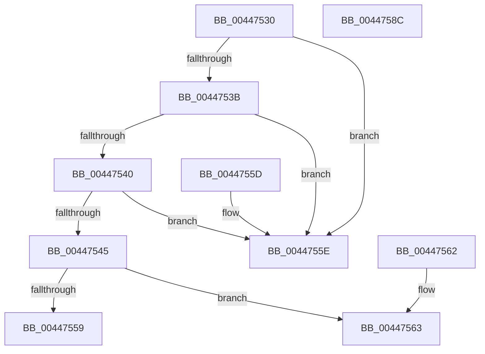

# PpmConvertTime

- RVA: `0x00447530`–`0x0044758D` (길이 `93` bytes)
- VA: `0x0000000140447530`
- 실행 섹션: `.text`
- PDB 이름 있음: `예`; PDB Function 태그: `아니요`
- unwind 정보 RVA: `0x000DB714`
- 디코드: `34`개 명령, `93/93` bytes 표시
- 미해석 바이트: `0` (있으면 어셈블리에 `.byte`로 보존)

> 이 문서는 커널 이미지의 기계어와 PDB 기호를 분석해 생성했습니다. 4번과 5번은 함수 원형과 자료형을 바이너리 사용 방식에서 추정한 C 해석이며 원본 소스 복구 결과는 아닙니다.

## 1. Dependencies

- 직접 호출 지점: **0**; 고유 호출 대상: **0**
- 직접 호출자로 확인된 함수: **11**
- RIP 상대 이미지 참조: **0**

### Outgoing calls
- 직접 디코드된 call 명령이 없습니다.

### Direct callers
- [PpmPerfSnapDeliveredPerformance](../2D/PpmPerfSnapDeliveredPerformance_function_002D7F30.md) at `0x002D8241`
- [PpmPerfSnapDeliveredPerformance](../2D/PpmPerfSnapDeliveredPerformance_function_002D7F30.md) at `0x002D8270`
- [PpmConvertTimeFrom](PpmConvertTimeFrom_function_00447510.md) at `0x0044751B`
- [PpmHvSnapPerformanceAccumulation](PpmHvSnapPerformanceAccumulation_function_0044FA34.md) at `0x0044FEE4`
- [PpmParkApplyPolicy](../4B/PpmParkApplyPolicy_function_004B613C.md) at `0x004B683B`
- [PoNotifySystemTimeSet](../4D/PoNotifySystemTimeSet_function_004D4F7C.md) at `0x004D4FCC`
- [PpmParkApplyPolicyEx](../4F/PpmParkApplyPolicyEx_function_004F3090.md) at `0x004F3908`
- [PopCalculateWakeTimeAdjustment](../../page/75/PopCalculateWakeTimeAdjustment_function_0075C4EC.md) at `0x0075C547`
- [PopDiagTraceHiberStats](../../page/A7/PopDiagTraceHiberStats_function_00A72FB4.md) at `0x00A73102`
- [PopPotsLogHibernatePerformance](../../page/A7/PopPotsLogHibernatePerformance_function_00A73834.md) at `0x00A7389E`
- [PopPotsLogHibernatePerformance](../../page/A7/PopPotsLogHibernatePerformance_function_00A73834.md) at `0x00A73929`
- [PopPotsLogHibernatePerformance](../../page/A7/PopPotsLogHibernatePerformance_function_00A73834.md) at `0x00A73947`
- [PopPotsLogHibernatePerformance](../../page/A7/PopPotsLogHibernatePerformance_function_00A73834.md) at `0x00A73976`
- [PopPotsLogHibernatePerformance](../../page/A7/PopPotsLogHibernatePerformance_function_00A73834.md) at `0x00A73A0F`
- [PopSstDiagInitializeResumeTimer](../../pagelk/B7/PopSstDiagInitializeResumeTimer_function_00B776FC.md) at `0x00B77785`
- [PopSstDiagInitializeResumeTimer](../../pagelk/B7/PopSstDiagInitializeResumeTimer_function_00B776FC.md) at `0x00B777B1`
- [PopDiagComputeEarlyHiberStats](../../pagelk/B7/PopDiagComputeEarlyHiberStats_function_00B7D920.md) at `0x00B7D9AA`

### Static image references
- 디코드된 RIP-relative 메모리 참조가 없습니다.

## 2. Other-region calls and transfers

- 다른 실행 섹션으로 향하는 call: **0**
- 별도 외부 분기/꼬리 이동을 확인하지 못했습니다.

## 3. Assembly (complete function range)

```asm
00447530  4D 8B D0                        mov r10, r8
00447533  4C 8B CA                        mov r9, rdx
00447536  48 85 C9                        test rcx, rcx
00447539  74 23                           je 0x14044755e
0044753B  48 85 D2                        test rdx, rdx
0044753E  74 1E                           je 0x14044755e
00447540  49 3B D0                        cmp rdx, r8
00447543  74 19                           je 0x14044755e
00447545  49 8B C0                        mov rax, r8
00447548  48 C7 44 24 08 00 00 00 00      mov qword ptr [rsp + 8], 0
00447551  48 F7 E1                        mul rcx
00447554  48 85 D2                        test rdx, rdx
00447557  75 0A                           jne 0x140447563
00447559  49 F7 F1                        div r9
0044755C  C3                              ret
0044755D  CC                              int3
0044755E  48 8B C1                        mov rax, rcx
00447561  C3                              ret
00447562  CC                              int3
00447563  33 D2                           xor edx, edx
00447565  48 8B C1                        mov rax, rcx
00447568  49 F7 F1                        div r9
0044756B  48 8B D0                        mov rdx, rax
0044756E  4C 8B C0                        mov r8, rax
00447571  49 0F AF D1                     imul rdx, r9
00447575  4D 0F AF C2                     imul r8, r10
00447579  48 2B CA                        sub rcx, rdx
0044757C  33 D2                           xor edx, edx
0044757E  49 0F AF CA                     imul rcx, r10
00447582  48 8B C1                        mov rax, rcx
00447585  49 F7 F1                        div r9
00447588  49 03 C0                        add rax, r8
0044758B  C3                              ret
0044758C  CC                              int3
```

## 4. C-style interpretation (structured pseudocode)

```c
__int64 __fastcall PpmConvertTime(__int64 a1, __int64 a2, __int64 a3)
{
    __int64 result;
    unsigned __int64 v_stack_p8;

    if (a1 == 0) goto loc_0044755E;
    if (a2 == 0) goto loc_0044755E;
    if (a2 == a3) goto loc_0044755E;
    v_stack_p8 = 0;
    if (a2 != 0) goto loc_00447563;
    return a3;
loc_0044755E:
    return a1;
loc_00447563:
    a2 = 0;
    a2 = (a1) * (0);
    a3 = (a1) * (a3);
    a1 = (a1) - (a2);
    a2 = 0;
    a1 = (a1) * (a3);
    result = (a1) + (a3);
    return result;
}
```

## 5. (Beta) C Style

```c
int64_t PpmConvertTime(int64_t Arg1, int64_t Arg2, int64_t Arg3)
{
    int64_t result;
    uint64_t v_stack_p8;

    if (Arg1 == 0) goto loc_0044755E;
    if (Arg2 == 0) goto loc_0044755E;
    if (Arg2 == Arg3) goto loc_0044755E;
    v_stack_p8 = 0;
    if (Arg2 != 0) goto loc_00447563;
    return Arg3;
loc_0044755E:
    return Arg1;
loc_00447563:
    Arg2 = 0;
    Arg2 = (Arg1) * (0);
    Arg3 = (Arg1) * (Arg3);
    Arg1 = (Arg1) - (Arg2);
    Arg2 = 0;
    Arg1 = (Arg1) * (Arg3);
    result = (Arg1) + (Arg3);
    return result;
}
```

## 6. Execution-region graph

[열기: 2D/3D 그래프와 함수 탐색 컨트롤 패널](../../../control-panel.html?section=text&rva=0x00447530&view=graph)

- 2D 그래프는 위에서 아래로 흐르고, 3D 그래프는 빈 공간을 드래그해 회전합니다. Shift+드래그는 이동, 휠은 확대·축소, 함수 노드 선택은 대상 보고서 이동입니다.

### Static fallback


