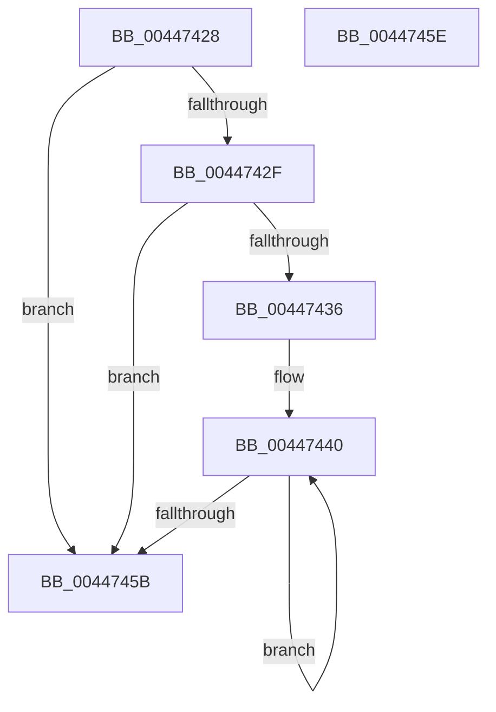

# PpmDeepestHardwareIdleState

- RVA: `0x00447428`–`0x0044745F` (길이 `55` bytes)
- VA: `0x0000000140447428`
- 실행 섹션: `.text`
- PDB 이름 있음: `예`; PDB Function 태그: `아니요`
- unwind 정보 RVA: `0x000DB714`
- 디코드: `19`개 명령, `55/55` bytes 표시
- 미해석 바이트: `0` (있으면 어셈블리에 `.byte`로 보존)

> 이 문서는 커널 이미지의 기계어와 PDB 기호를 분석해 생성했습니다. 4번과 5번은 함수 원형과 자료형을 바이너리 사용 방식에서 추정한 C 해석이며 원본 소스 복구 결과는 아닙니다.

## 1. Dependencies

- 직접 호출 지점: **0**; 고유 호출 대상: **0**
- 직접 호출자로 확인된 함수: **1**
- RIP 상대 이미지 참조: **0**

### Outgoing calls
- 직접 디코드된 call 명령이 없습니다.

### Direct callers
- [PpmInstallNewIdleStates](PpmInstallNewIdleStates_function_00446E80.md) at `0x004472A1`

### Static image references
- 디코드된 RIP-relative 메모리 참조가 없습니다.

## 2. Other-region calls and transfers

- 다른 실행 섹션으로 향하는 call: **0**
- 별도 외부 분기/꼬리 이동을 확인하지 못했습니다.

## 3. Assembly (complete function range)

```asm
00447428  B2 01                           mov dl, 1
0044742A  48 85 C9                        test rcx, rcx
0044742D  74 2C                           je 0x14044745b
0044742F  8B 41 28                        mov eax, dword ptr [rcx + 0x28]
00447432  85 C0                           test eax, eax
00447434  74 25                           je 0x14044745b
00447436  4C 8D 81 70 05 00 00            lea r8, [rcx + 0x570]
0044743D  44 8B C8                        mov r9d, eax
00447440  41 0F B6 08                     movzx ecx, byte ptr [r8]
00447444  4D 8D 80 58 01 00 00            lea r8, [r8 + 0x158]
0044744B  3A CA                           cmp cl, dl
0044744D  0F B6 C2                        movzx eax, dl
00447450  0F 46 C8                        cmovbe ecx, eax
00447453  8A D1                           mov dl, cl
00447455  49 83 E9 01                     sub r9, 1
00447459  75 E5                           jne 0x140447440
0044745B  8A C2                           mov al, dl
0044745D  C3                              ret
0044745E  CC                              int3
```

## 4. C-style interpretation (structured pseudocode)

```c
__int64 __fastcall PpmDeepestHardwareIdleState(__int64 a1)
{
    if (a1 == 0) goto loc_0044745B;
    if ((unsigned int)((unsigned int)(*(unsigned int *)(a1 + 40))) == 0) goto loc_0044745B;
loc_00447440:
    a1 = *(unsigned __int8 *)(a1 + 1392);
    if (((unsigned __int8)(*(unsigned __int8 *)(a1 + 1392))) <= 1) { a1 = 1; }
    a4 = ((unsigned int)((unsigned int)((unsigned int)(*(unsigned int *)(a1 + 40))))) - (1);
    if (condition_is_not_equal) goto loc_00447440;
loc_0044745B:
    return (unsigned __int8)((unsigned __int8)(a1));
}
```

## 5. (Beta) C Style

```c
int64_t PpmDeepestHardwareIdleState(int64_t Arg1)
{
    if (Arg1 == 0) goto loc_0044745B;
    if ((uint32_t)((uint32_t)(*(uint32_t *)(Arg1 + 0x28))) == 0) goto loc_0044745B;
loc_00447440:
    Arg1 = *(uint8_t *)(Arg1 + 0x570);
    if (((uint8_t)(*(uint8_t *)(Arg1 + 0x570))) <= 1) { Arg1 = 1; }
    a4 = ((uint32_t)((uint32_t)((uint32_t)(*(uint32_t *)(Arg1 + 0x28))))) - (1);
    if (condition_is_not_equal) goto loc_00447440;
loc_0044745B:
    return (uint8_t)((uint8_t)(Arg1));
}
```

## 6. Execution-region graph

[열기: 2D/3D 그래프와 함수 탐색 컨트롤 패널](../../../control-panel.html?section=text&rva=0x00447428&view=graph)

- 2D 그래프는 위에서 아래로 흐르고, 3D 그래프는 빈 공간을 드래그해 회전합니다. Shift+드래그는 이동, 휠은 확대·축소, 함수 노드 선택은 대상 보고서 이동입니다.

### Static fallback


