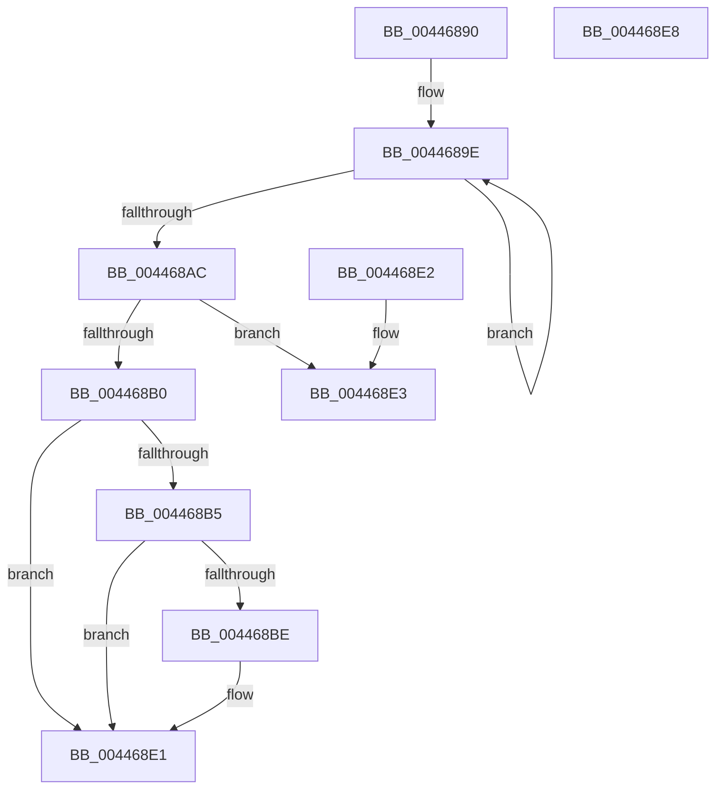

# PpmGetIdleGenerationCounter

- RVA: `0x00446890`–`0x004468E9` (길이 `89` bytes)
- VA: `0x0000000140446890`
- 실행 섹션: `.text`
- PDB 이름 있음: `예`; PDB Function 태그: `아니요`
- unwind 정보 RVA: `0x000DB714`
- 디코드: `25`개 명령, `89/89` bytes 표시
- 미해석 바이트: `0` (있으면 어셈블리에 `.byte`로 보존)

> 이 문서는 커널 이미지의 기계어와 PDB 기호를 분석해 생성했습니다. 4번과 5번은 함수 원형과 자료형을 바이너리 사용 방식에서 추정한 C 해석이며 원본 소스 복구 결과는 아닙니다.

## 1. Dependencies

- 직접 호출 지점: **0**; 고유 호출 대상: **0**
- 직접 호출자로 확인된 함수: **1**
- RIP 상대 이미지 참조: **1**

### Outgoing calls
- 직접 디코드된 call 명령이 없습니다.

### Direct callers
- [PpmContinueTimeAccumulation](../2D/PpmContinueTimeAccumulation_function_002DC5A8.md) at `0x002DC5D6`
- [PpmContinueTimeAccumulation](../2D/PpmContinueTimeAccumulation_function_002DC5A8.md) at `0x002DC600`

### Static image references
- `0x004468C5` → RVA `0x00E3EDD8` (`.data`; read)

## 2. Other-region calls and transfers

- 다른 실행 섹션으로 향하는 call: **0**
- 별도 외부 분기/꼬리 이동을 확인하지 못했습니다.

## 3. Assembly (complete function range)

```asm
00446890  0F 0D 89 60 88 00 00            prefetchw byte ptr [rcx + 0x8860]
00446897  48 8B 81 60 88 00 00            mov rax, qword ptr [rcx + 0x8860]
0044689E  48 8B D0                        mov rdx, rax
004468A1  F0 48 0F B1 91 60 88 00 00      lock cmpxchg qword ptr [rcx + 0x8860], rdx
004468AA  75 F2                           jne 0x14044689e
004468AC  A8 01                           test al, 1
004468AE  74 33                           je 0x1404468e3
004468B0  48 85 C0                        test rax, rax
004468B3  74 2C                           je 0x1404468e1
004468B5  83 B9 20 89 00 00 03            cmp dword ptr [rcx + 0x8920], 3
004468BC  75 23                           jne 0x1404468e1
004468BE  48 8B 81 D0 8B 00 00            mov rax, qword ptr [rcx + 0x8bd0]
004468C5  8B 15 0D 85 9F 00               mov edx, dword ptr [rip + 0x9f850d]
004468CB  48 8B 0C D0                     mov rcx, qword ptr [rax + rdx*8]
004468CF  48 8B C1                        mov rax, rcx
004468D2  48 D1 E8                        shr rax, 1
004468D5  F6 C1 01                        test cl, 1
004468D8  B9 00 00 00 00                  mov ecx, 0
004468DD  48 0F 44 C1                     cmove rax, rcx
004468E1  C3                              ret
004468E2  CC                              int3
004468E3  33 C9                           xor ecx, ecx
004468E5  8B C1                           mov eax, ecx
004468E7  C3                              ret
004468E8  CC                              int3
```

## 4. C-style interpretation (structured pseudocode)

```c
__int64 __fastcall PpmGetIdleGenerationCounter(__int64 a1)
{
    __int64 result;

loc_0044689E:
    if (condition_is_not_equal) goto loc_0044689E;
    if ((((unsigned __int8)(*(unsigned __int64 *)(a1 + 34912))) & (1)) == 0) goto loc_004468E3;
    if (*(unsigned __int64 *)(a1 + 34912) == 0) goto loc_004468E1;
    result = *(unsigned __int64 *)(a1 + 34912);
    if ((*(unsigned int *)(a1 + 35104)) == 3) {
        result = *(unsigned __int64 *)(a1 + 35792);
        a2 = *(unsigned int *)(v_rip + 10454285);
        a1 = *(unsigned __int64 *)(result + a2 * 8);
        result = a1;
        result = (result) >> (1);
        a1 = 0;
        if ((((unsigned __int8)(a1)) & (1)) == 0) { result = a1; }
    }
    return result;
loc_004468E3:
    a1 = 0;
    return 0;
}
```

## 5. (Beta) C Style

```c
int64_t PpmGetIdleGenerationCounter(void *Arg1)
{
    uint8_t *arg1 = (uint8_t *)Arg1;

    int64_t result;

loc_0044689E:
    if (condition_is_not_equal) goto loc_0044689E;
    if ((((uint8_t)(*(uint64_t *)(arg1 + 0x8860))) & (1)) == 0) goto loc_004468E3;
    if (*(uint64_t *)(arg1 + 0x8860) == 0) goto loc_004468E1;
    result = *(uint64_t *)(arg1 + 0x8860);
    if ((*(uint32_t *)(arg1 + 0x8920)) == 3) {
        result = *(uint64_t *)(arg1 + 0x8BD0);
        a2 = *(uint32_t *)(v_rip + 0x9F850D);
        Arg1 = *(uint64_t *)(result + a2 * 8);
        result = Arg1;
        result = (result) >> (1);
        Arg1 = 0;
        if ((((uint8_t)(Arg1)) & (1)) == 0) { result = Arg1; }
    }
    return result;
loc_004468E3:
    Arg1 = 0;
    return 0;
}
```

### 관측된 메모리 오프셋

구조체 형식이 확인되지 않은 접근은 인자 기준의 오프셋으로만 기록했습니다.

| 기준 인자 | 오프셋 표현 | 폭 (bit) | 접근 |
|---|---:|---:|---|
| `Arg1` | `+ 0x8860` | `8` | `R` |
| `Arg1` | `+ 0x8860` | `64` | `R` |
| `Arg1` | `+ 0x8920` | `32` | `R` |
| `Arg1` | `+ 0x8BD0` | `64` | `R` |

## 6. Execution-region graph

[열기: 2D/3D 그래프와 함수 탐색 컨트롤 패널](../../../control-panel.html?section=text&rva=0x00446890&view=graph)

- 2D 그래프는 위에서 아래로 흐르고, 3D 그래프는 빈 공간을 드래그해 회전합니다. Shift+드래그는 이동, 휠은 확대·축소, 함수 노드 선택은 대상 보고서 이동입니다.

### Static fallback


