# PpmHvSnapPerformanceAccumulation

- RVA: `0x0044FA34`–`0x0044FF97` (길이 `1,379` bytes)
- VA: `0x000000014044FA34`
- 실행 섹션: `.text`
- PDB 이름 있음: `예`; PDB Function 태그: `아니요`
- unwind 정보 RVA: `0x000A6D48`
- 디코드: `332`개 명령, `1,379/1,379` bytes 표시
- 미해석 바이트: `0` (있으면 어셈블리에 `.byte`로 보존)

> 이 문서는 커널 이미지의 기계어와 PDB 기호를 분석해 생성했습니다. 4번과 5번은 함수 원형과 자료형을 바이너리 사용 방식에서 추정한 C 해석이며 원본 소스 복구 결과는 아닙니다.

## 1. Dependencies

- 직접 호출 지점: **9**; 고유 호출 대상: **6**
- 직접 호출자로 확인된 함수: **2**
- RIP 상대 이미지 참조: **8**

### Outgoing calls
- `0x0044FAAB` → [HvlpGetLpcbByLpIndex](HvlpGetLpcbByLpIndex_function_0044FFA0.md) (function, `0x0044FFA0`)
- `0x0044FAE5` → [HvlGetReferenceTime](../2D/HvlGetReferenceTime_function_002DDB88.md) (function, `0x002DDB88`)
- `0x0044FAF2` → [HvlpGetLpcbByLpIndex](HvlpGetLpcbByLpIndex_function_0044FFA0.md) (function, `0x0044FFA0`)
- `0x0044FB68` → [guard_dispatch_icall](../6B/guard_dispatch_icall_function_006BAAD0.md) (function, `0x006BAAD0`)
- `0x0044FB79` → [guard_dispatch_icall](../6B/guard_dispatch_icall_function_006BAAD0.md) (function, `0x006BAAD0`)
- `0x0044FBB9` → [HvlpGetLpcbByLpIndex](HvlpGetLpcbByLpIndex_function_0044FFA0.md) (function, `0x0044FFA0`)
- `0x0044FE2B` → [tlgWriteTransfer_EtwWriteTransfer](../42/tlgWriteTransfer_EtwWriteTransfer_function_004260E0.md) (function, `0x004260E0`)
- `0x0044FEE4` → [PpmConvertTime](PpmConvertTime_function_00447530.md) (function, `0x00447530`)
- `0x0044FF76` → [_security_check_cookie](../6A/_security_check_cookie_function_006AC640.md) (function, `0x006AC640`)

### Direct callers
- [PpmResetPerfTimes](PpmResetPerfTimes_function_0044F8EC.md) at `0x0044F9CD`
- [sub_006DDCB6](../6D/Unknown_function_006DDCB6.md) at `0x006DDCC6`

### Static image references
- `0x0044FA53` → RVA `0x00E0A740` (`.data`; read)
- `0x0044FAB9` → RVA `0x00E3EDF8` (`.data`; read)
- `0x0044FAC3` → RVA `0x00E3EDD8` (`.data`; read)
- `0x0044FACD` → RVA `0x00E3EDFC` (`.data`; read)
- `0x0044FB0C` → RVA `0x00E3EE00` (`.data`; read)
- `0x0044FB16` → RVA `0x00E3EE04` (`.data`; read)
- `0x0044FCC4` → RVA `0x00E076A0` (`.data`; read)
- `0x0044FCDC` → RVA `0x0004FF8E` (`.rdata`; read)

## 2. Other-region calls and transfers

- 다른 실행 섹션으로 향하는 call: **0**
- 별도 외부 분기/꼬리 이동을 확인하지 못했습니다.

## 3. Assembly (complete function range)

```asm
0044FA34  48 89 5C 24 18                  mov qword ptr [rsp + 0x18], rbx
0044FA39  55                              push rbp
0044FA3A  56                              push rsi
0044FA3B  57                              push rdi
0044FA3C  41 54                           push r12
0044FA3E  41 55                           push r13
0044FA40  41 56                           push r14
0044FA42  41 57                           push r15
0044FA44  48 8D AC 24 20 FF FF FF         lea rbp, [rsp - 0xe0]
0044FA4C  48 81 EC E0 01 00 00            sub rsp, 0x1e0
0044FA53  48 8B 05 E6 AC 9B 00            mov rax, qword ptr [rip + 0x9bace6]
0044FA5A  48 33 C4                        xor rax, rsp
0044FA5D  48 89 85 D0 00 00 00            mov qword ptr [rbp + 0xd0], rax
0044FA64  48 8B 85 40 01 00 00            mov rax, qword ptr [rbp + 0x140]
0044FA6B  33 DB                           xor ebx, ebx
0044FA6D  48 89 45 A0                     mov qword ptr [rbp - 0x60], rax
0044FA71  48 8B F9                        mov rdi, rcx
0044FA74  48 8B 41 08                     mov rax, qword ptr [rcx + 8]
0044FA78  44 8A FB                        mov r15b, bl
0044FA7B  4C 89 4C 24 58                  mov qword ptr [rsp + 0x58], r9
0044FA80  4C 89 45 90                     mov qword ptr [rbp - 0x70], r8
0044FA84  44 8D 63 18                     lea r12d, [rbx + 0x18]
0044FA88  88 54 24 30                     mov byte ptr [rsp + 0x30], dl
0044FA8C  44 8B 68 14                     mov r13d, dword ptr [rax + 0x14]
0044FA90  44 89 6C 24 34                  mov dword ptr [rsp + 0x34], r13d
0044FA95  48 89 5C 24 38                  mov qword ptr [rsp + 0x38], rbx
0044FA9A  48 89 5C 24 48                  mov qword ptr [rsp + 0x48], rbx
0044FA9F  48 C7 44 24 70 02 00 00 00      mov qword ptr [rsp + 0x70], 2
0044FAA8  41 8B CD                        mov ecx, r13d
0044FAAB  E8 F0 04 00 00                  call 0x14044ffa0
0044FAB0  48 85 C0                        test rax, rax
0044FAB3  74 30                           je 0x14044fae5
0044FAB5  48 8B 48 18                     mov rcx, qword ptr [rax + 0x18]
0044FAB9  8B 05 39 F3 9E 00               mov eax, dword ptr [rip + 0x9ef339]
0044FABF  48 8B 14 C1                     mov rdx, qword ptr [rcx + rax*8]
0044FAC3  8B 05 0F F3 9E 00               mov eax, dword ptr [rip + 0x9ef30f]
0044FAC9  4C 8B 3C C1                     mov r15, qword ptr [rcx + rax*8]
0044FACD  8B 05 29 F3 9E 00               mov eax, dword ptr [rip + 0x9ef329]
0044FAD3  41 80 E7 01                     and r15b, 1
0044FAD7  4C 8B 04 C1                     mov r8, qword ptr [rcx + rax*8]
0044FADB  4C 89 44 24 38                  mov qword ptr [rsp + 0x38], r8
0044FAE0  F6 C2 01                        test dl, 1
0044FAE3  75 C3                           jne 0x14044faa8
0044FAE5  E8 9E E0 E8 FF                  call 0x1402ddb88
0044FAEA  41 8B CD                        mov ecx, r13d
0044FAED  48 89 44 24 68                  mov qword ptr [rsp + 0x68], rax
0044FAF2  E8 A9 04 00 00                  call 0x14044ffa0
0044FAF7  48 85 C0                        test rax, rax
0044FAFA  75 0C                           jne 0x14044fb08
0044FAFC  48 89 5C 24 50                  mov qword ptr [rsp + 0x50], rbx
0044FB01  48 89 5C 24 60                  mov qword ptr [rsp + 0x60], rbx
0044FB06  EB 22                           jmp 0x14044fb2a
0044FB08  48 8B 48 18                     mov rcx, qword ptr [rax + 0x18]
0044FB0C  8B 05 EE F2 9E 00               mov eax, dword ptr [rip + 0x9ef2ee]
0044FB12  48 8B 14 C1                     mov rdx, qword ptr [rcx + rax*8]
0044FB16  8B 05 E8 F2 9E 00               mov eax, dword ptr [rip + 0x9ef2e8]
0044FB1C  48 89 54 24 50                  mov qword ptr [rsp + 0x50], rdx
0044FB21  48 8B 04 C1                     mov rax, qword ptr [rcx + rax*8]
0044FB25  48 89 44 24 60                  mov qword ptr [rsp + 0x60], rax
0044FB2A  44 8A 74 24 30                  mov r14b, byte ptr [rsp + 0x30]
0044FB2F  48 8D B5 A8 00 00 00            lea rsi, [rbp + 0xa8]
0044FB36  B9 02 00 00 00                  mov ecx, 2
0044FB3B  4C 8D 6F 60                     lea r13, [rdi + 0x60]
0044FB3F  48 89 4C 24 40                  mov qword ptr [rsp + 0x40], rcx
0044FB44  49 8B 55 00                     mov rdx, qword ptr [r13]
0044FB48  4C 8B 54 24 38                  mov r10, qword ptr [rsp + 0x38]
0044FB4D  48 85 D2                        test rdx, rdx
0044FB50  74 4D                           je 0x14044fb9f
0044FB52  4C 3B 57 50                     cmp r10, qword ptr [rdi + 0x50]
0044FB56  76 32                           jbe 0x14044fb8a
0044FB58  48 8B 4A 28                     mov rcx, qword ptr [rdx + 0x28]
0044FB5C  48 8B 02                        mov rax, qword ptr [rdx]
0044FB5F  38 5A 21                        cmp byte ptr [rdx + 0x21], bl
0044FB62  75 0B                           jne 0x14044fb6f
0044FB64  48 8D 56 08                     lea rdx, [rsi + 8]
0044FB68  E8 63 AF 26 00                  call 0x1406baad0
0044FB6D  EB 0F                           jmp 0x14044fb7e
0044FB6F  4C 8D 46 F8                     lea r8, [rsi - 8]
0044FB73  4C 8B CE                        mov r9, rsi
0044FB76  41 8A D6                        mov dl, r14b
0044FB79  E8 52 AF 26 00                  call 0x1406baad0
0044FB7E  48 8B 4C 24 40                  mov rcx, qword ptr [rsp + 0x40]
0044FB83  4C 8B 54 24 38                  mov r10, qword ptr [rsp + 0x38]
0044FB88  EB 15                           jmp 0x14044fb9f
0044FB8A  8B 42 18                        mov eax, dword ptr [rdx + 0x18]
0044FB8D  89 46 08                        mov dword ptr [rsi + 8], eax
0044FB90  48 8B 42 10                     mov rax, qword ptr [rdx + 0x10]
0044FB94  48 89 46 F8                     mov qword ptr [rsi - 8], rax
0044FB98  48 8B 42 08                     mov rax, qword ptr [rdx + 8]
0044FB9C  48 89 06                        mov qword ptr [rsi], rax
0044FB9F  49 83 C5 08                     add r13, 8
0044FBA3  49 03 F4                        add rsi, r12
0044FBA6  48 83 E9 01                     sub rcx, 1
0044FBAA  48 89 4C 24 40                  mov qword ptr [rsp + 0x40], rcx
0044FBAF  75 93                           jne 0x14044fb44
0044FBB1  44 8B 6C 24 34                  mov r13d, dword ptr [rsp + 0x34]
0044FBB6  41 8B CD                        mov ecx, r13d
0044FBB9  E8 E2 03 00 00                  call 0x14044ffa0
0044FBBE  4C 8B 74 24 48                  mov r14, qword ptr [rsp + 0x48]
0044FBC3  48 85 C0                        test rax, rax
0044FBC6  74 34                           je 0x14044fbfc
0044FBC8  48 8B 48 18                     mov rcx, qword ptr [rax + 0x18]
0044FBCC  8B 05 26 F2 9E 00               mov eax, dword ptr [rip + 0x9ef226]
0044FBD2  48 8B 14 C1                     mov rdx, qword ptr [rcx + rax*8]
0044FBD6  8B 05 FC F1 9E 00               mov eax, dword ptr [rip + 0x9ef1fc]
0044FBDC  4C 8B 3C C1                     mov r15, qword ptr [rcx + rax*8]
0044FBE0  8B 05 16 F2 9E 00               mov eax, dword ptr [rip + 0x9ef216]
0044FBE6  41 80 E7 01                     and r15b, 1
0044FBEA  4C 8B 34 C1                     mov r14, qword ptr [rcx + rax*8]
0044FBEE  4C 89 74 24 48                  mov qword ptr [rsp + 0x48], r14
0044FBF3  F6 C2 01                        test dl, 1
0044FBF6  0F 85 AC FE FF FF               jne 0x14044faa8
0044FBFC  4D 3B F2                        cmp r14, r10
0044FBFF  0F 85 A3 FE FF FF               jne 0x14044faa8
0044FC05  8B 8F 88 00 00 00               mov ecx, dword ptr [rdi + 0x88]
0044FC0B  8D 41 01                        lea eax, [rcx + 1]
0044FC0E  48 8D 34 89                     lea rsi, [rcx + rcx*4]
0044FC12  89 87 88 00 00 00               mov dword ptr [rdi + 0x88], eax
0044FC18  48 C1 E6 04                     shl rsi, 4
0044FC1C  48 81 C6 90 00 00 00            add rsi, 0x90
0044FC23  48 03 F7                        add rsi, rdi
0044FC26  48 89 75 98                     mov qword ptr [rbp - 0x68], rsi
0044FC2A  83 F8 08                        cmp eax, 8
0044FC2D  75 06                           jne 0x14044fc35
0044FC2F  89 9F 88 00 00 00               mov dword ptr [rdi + 0x88], ebx
0044FC35  65 8B 04 25 A4 01 00 00         mov eax, dword ptr gs:[0x1a4]
0044FC3D  48 8D 8D A8 00 00 00            lea rcx, [rbp + 0xa8]
0044FC44  4C 8B 4C 24 68                  mov r9, qword ptr [rsp + 0x68]
0044FC49  48 8D 56 28                     lea rdx, [rsi + 0x28]
0044FC4D  4C 8B 44 24 50                  mov r8, qword ptr [rsp + 0x50]
0044FC52  4C 8B EF                        mov r13, rdi
0044FC55  89 06                           mov dword ptr [rsi], eax
0044FC57  41 BB 02 00 00 00               mov r11d, 2
0044FC5D  8A 44 24 30                     mov al, byte ptr [rsp + 0x30]
0044FC61  88 46 05                        mov byte ptr [rsi + 5], al
0044FC64  48 8B 44 24 60                  mov rax, qword ptr [rsp + 0x60]
0044FC69  48 89 46 20                     mov qword ptr [rsi + 0x20], rax
0044FC6D  44 88 7E 06                     mov byte ptr [rsi + 6], r15b
0044FC71  4C 89 76 08                     mov qword ptr [rsi + 8], r14
0044FC75  4C 89 4E 10                     mov qword ptr [rsi + 0x10], r9
0044FC79  4C 89 46 18                     mov qword ptr [rsi + 0x18], r8
0044FC7D  4C 3B 57 50                     cmp r10, qword ptr [rdi + 0x50]
0044FC81  4C 8D 56 48                     lea r10, [rsi + 0x48]
0044FC85  0F 96 C0                        setbe al
0044FC88  4C 2B EE                        sub r13, rsi
0044FC8B  88 46 04                        mov byte ptr [rsi + 4], al
0044FC8E  4A 8B 44 2A 38                  mov rax, qword ptr [rdx + r13 + 0x38]
0044FC93  48 85 C0                        test rax, rax
0044FC96  74 1B                           je 0x14044fcb3
0044FC98  38 58 21                        cmp byte ptr [rax + 0x21], bl
0044FC9B  75 08                           jne 0x14044fca5
0044FC9D  8B 41 08                        mov eax, dword ptr [rcx + 8]
0044FCA0  41 89 02                        mov dword ptr [r10], eax
0044FCA3  EB 0E                           jmp 0x14044fcb3
0044FCA5  48 8B 41 F8                     mov rax, qword ptr [rcx - 8]
0044FCA9  48 89 02                        mov qword ptr [rdx], rax
0044FCAC  48 8B 01                        mov rax, qword ptr [rcx]
0044FCAF  48 89 42 10                     mov qword ptr [rdx + 0x10], rax
0044FCB3  49 83 C2 04                     add r10, 4
0044FCB7  48 83 C2 08                     add rdx, 8
0044FCBB  49 03 CC                        add rcx, r12
0044FCBE  49 83 EB 01                     sub r11, 1
0044FCC2  75 CA                           jne 0x14044fc8e
0044FCC4  83 3D D5 79 9B 00 05            cmp dword ptr [rip + 0x9b79d5], 5
0044FCCB  44 8B 6C 24 34                  mov r13d, dword ptr [rsp + 0x34]
0044FCD0  0F 86 64 01 00 00               jbe 0x14044fe3a
0044FCD6  8B 87 88 00 00 00               mov eax, dword ptr [rdi + 0x88]
0044FCDC  48 8D 15 AB 02 C0 FF            lea rdx, [rip - 0x3ffd55]
0044FCE3  89 44 24 34                     mov dword ptr [rsp + 0x34], eax
0044FCE7  48 8D 0D B2 79 9B 00            lea rcx, [rip + 0x9b79b2]
0044FCEE  48 8D 44 24 34                  lea rax, [rsp + 0x34]
0044FCF3  48 C7 45 D8 04 00 00 00         mov qword ptr [rbp - 0x28], 4
0044FCFB  48 89 45 D0                     mov qword ptr [rbp - 0x30], rax
0044FCFF  45 33 C9                        xor r9d, r9d
0044FD02  48 8D 44 24 40                  lea rax, [rsp + 0x40]
0044FD07  44 89 6C 24 40                  mov dword ptr [rsp + 0x40], r13d
0044FD0C  48 89 45 E0                     mov qword ptr [rbp - 0x20], rax
0044FD10  45 33 C0                        xor r8d, r8d
0044FD13  8B 06                           mov eax, dword ptr [rsi]
0044FD15  89 44 24 38                     mov dword ptr [rsp + 0x38], eax
0044FD19  48 8D 44 24 38                  lea rax, [rsp + 0x38]
0044FD1E  48 89 45 F0                     mov qword ptr [rbp - 0x10], rax
0044FD22  8A 46 05                        mov al, byte ptr [rsi + 5]
0044FD25  88 44 24 30                     mov byte ptr [rsp + 0x30], al
0044FD29  48 8D 44 24 30                  lea rax, [rsp + 0x30]
0044FD2E  48 89 45 00                     mov qword ptr [rbp], rax
0044FD32  8A 46 06                        mov al, byte ptr [rsi + 6]
0044FD35  88 44 24 31                     mov byte ptr [rsp + 0x31], al
0044FD39  48 8D 44 24 31                  lea rax, [rsp + 0x31]
0044FD3E  48 89 45 10                     mov qword ptr [rbp + 0x10], rax
0044FD42  48 8B 46 08                     mov rax, qword ptr [rsi + 8]
0044FD46  48 89 44 24 48                  mov qword ptr [rsp + 0x48], rax
0044FD4B  48 8D 44 24 48                  lea rax, [rsp + 0x48]
0044FD50  48 89 45 20                     mov qword ptr [rbp + 0x20], rax
0044FD54  48 8B 46 10                     mov rax, qword ptr [rsi + 0x10]
0044FD58  48 89 44 24 78                  mov qword ptr [rsp + 0x78], rax
0044FD5D  48 8D 44 24 78                  lea rax, [rsp + 0x78]
0044FD62  48 89 45 30                     mov qword ptr [rbp + 0x30], rax
0044FD66  48 8B 46 18                     mov rax, qword ptr [rsi + 0x18]
0044FD6A  48 89 45 80                     mov qword ptr [rbp - 0x80], rax
0044FD6E  48 8D 45 80                     lea rax, [rbp - 0x80]
0044FD72  48 89 45 40                     mov qword ptr [rbp + 0x40], rax
0044FD76  48 8B 46 20                     mov rax, qword ptr [rsi + 0x20]
0044FD7A  48 89 45 88                     mov qword ptr [rbp - 0x78], rax
0044FD7E  48 8D 45 88                     lea rax, [rbp - 0x78]
0044FD82  48 89 45 50                     mov qword ptr [rbp + 0x50], rax
0044FD86  8A 46 04                        mov al, byte ptr [rsi + 4]
0044FD89  88 44 24 32                     mov byte ptr [rsp + 0x32], al
0044FD8D  48 8D 44 24 32                  lea rax, [rsp + 0x32]
0044FD92  48 89 45 60                     mov qword ptr [rbp + 0x60], rax
0044FD96  48 8D 46 48                     lea rax, [rsi + 0x48]
0044FD9A  48 89 45 70                     mov qword ptr [rbp + 0x70], rax
0044FD9E  48 8D 46 28                     lea rax, [rsi + 0x28]
0044FDA2  48 89 85 80 00 00 00            mov qword ptr [rbp + 0x80], rax
0044FDA9  48 8D 46 38                     lea rax, [rsi + 0x38]
0044FDAD  48 89 85 90 00 00 00            mov qword ptr [rbp + 0x90], rax
0044FDB4  48 8D 45 B0                     lea rax, [rbp - 0x50]
0044FDB8  48 89 44 24 28                  mov qword ptr [rsp + 0x28], rax
0044FDBD  C7 44 24 20 0F 00 00 00         mov dword ptr [rsp + 0x20], 0xf
0044FDC5  48 C7 45 E8 04 00 00 00         mov qword ptr [rbp - 0x18], 4
0044FDCD  48 C7 45 F8 04 00 00 00         mov qword ptr [rbp - 8], 4
0044FDD5  48 C7 45 08 01 00 00 00         mov qword ptr [rbp + 8], 1
0044FDDD  48 C7 45 18 01 00 00 00         mov qword ptr [rbp + 0x18], 1
0044FDE5  48 C7 45 28 08 00 00 00         mov qword ptr [rbp + 0x28], 8
0044FDED  48 C7 45 38 08 00 00 00         mov qword ptr [rbp + 0x38], 8
0044FDF5  48 C7 45 48 08 00 00 00         mov qword ptr [rbp + 0x48], 8
0044FDFD  48 C7 45 58 08 00 00 00         mov qword ptr [rbp + 0x58], 8
0044FE05  48 C7 45 68 01 00 00 00         mov qword ptr [rbp + 0x68], 1
0044FE0D  48 C7 45 78 08 00 00 00         mov qword ptr [rbp + 0x78], 8
0044FE15  48 C7 85 88 00 00 00 10 00 00 00  mov qword ptr [rbp + 0x88], 0x10
0044FE20  48 C7 85 98 00 00 00 10 00 00 00  mov qword ptr [rbp + 0x98], 0x10
0044FE2B  E8 B0 62 FD FF                  call 0x1404260e0
0044FE30  4C 8B 44 24 50                  mov r8, qword ptr [rsp + 0x50]
0044FE35  4C 8B 4C 24 68                  mov r9, qword ptr [rsp + 0x68]
0044FE3A  45 84 FF                        test r15b, r15b
0044FE3D  74 11                           je 0x14044fe50
0044FE3F  4D 3B CE                        cmp r9, r14
0044FE42  76 0C                           jbe 0x14044fe50
0044FE44  49 8B C1                        mov rax, r9
0044FE47  49 2B C6                        sub rax, r14
0044FE4A  4D 8B F1                        mov r14, r9
0044FE4D  4C 03 C0                        add r8, rax
0044FE50  4C 3B 75 90                     cmp r14, qword ptr [rbp - 0x70]
0044FE54  73 07                           jae 0x14044fe5d
0044FE56  B3 01                           mov bl, 1
0044FE58  E9 07 01 00 00                  jmp 0x14044ff64
0044FE5D  4D 8B FE                        mov r15, r14
0044FE60  4C 89 77 50                     mov qword ptr [rdi + 0x50], r14
0044FE64  4D 2B F8                        sub r15, r8
0044FE67  4D 8B EF                        mov r13, r15
0044FE6A  4C 2B 6F 58                     sub r13, qword ptr [rdi + 0x58]
0044FE6E  4C 89 7F 58                     mov qword ptr [rdi + 0x58], r15
0044FE72  0F 84 9C 00 00 00               je 0x14044ff14
0044FE78  48 8D 77 78                     lea rsi, [rdi + 0x78]
0044FE7C  B8 02 00 00 00                  mov eax, 2
0044FE81  4C 8D 9D B0 00 00 00            lea r11, [rbp + 0xb0]
0044FE88  4C 8B 46 E8                     mov r8, qword ptr [rsi - 0x18]
0044FE8C  4D 85 C0                        test r8, r8
0044FE8F  74 69                           je 0x14044fefa
0044FE91  41 38 58 21                     cmp byte ptr [r8 + 0x21], bl
0044FE95  74 54                           je 0x14044feeb
0044FE97  4D 8B 4B F0                     mov r9, qword ptr [r11 - 0x10]
0044FE9B  49 8B 50 10                     mov rdx, qword ptr [r8 + 0x10]
0044FE9F  4C 3B CA                        cmp r9, rdx
0044FEA2  74 28                           je 0x14044fecc
0044FEA4  49 8B 4B F8                     mov rcx, qword ptr [r11 - 8]
0044FEA8  49 2B 48 08                     sub rcx, qword ptr [r8 + 8]
0044FEAC  4D 89 48 10                     mov qword ptr [r8 + 0x10], r9
0044FEB0  4C 2B CA                        sub r9, rdx
0044FEB3  49 8B 43 F8                     mov rax, qword ptr [r11 - 8]
0044FEB7  33 D2                           xor edx, edx
0044FEB9  49 89 40 08                     mov qword ptr [r8 + 8], rax
0044FEBD  41 8B 40 24                     mov eax, dword ptr [r8 + 0x24]
0044FEC1  48 0F AF C1                     imul rax, rcx
0044FEC5  49 F7 F1                        div r9
0044FEC8  41 89 40 18                     mov dword ptr [r8 + 0x18], eax
0044FECC  41 8B 40 18                     mov eax, dword ptr [r8 + 0x18]
0044FED0  BA 00 00 01 00                  mov edx, 0x10000
0044FED5  8B C8                           mov ecx, eax
0044FED7  41 89 03                        mov dword ptr [r11], eax
0044FEDA  49 0F AF CD                     imul rcx, r13
0044FEDE  41 B8 64 00 00 00               mov r8d, 0x64
0044FEE4  E8 47 76 FF FF                  call 0x140447530
0044FEE9  EB 07                           jmp 0x14044fef2
0044FEEB  41 8B 03                        mov eax, dword ptr [r11]
0044FEEE  49 0F AF C5                     imul rax, r13
0044FEF2  48 01 06                        add qword ptr [rsi], rax
0044FEF5  48 8B 44 24 70                  mov rax, qword ptr [rsp + 0x70]
0044FEFA  48 83 C6 08                     add rsi, 8
0044FEFE  4D 03 DC                        add r11, r12
0044FF01  48 83 E8 01                     sub rax, 1
0044FF05  48 89 44 24 70                  mov qword ptr [rsp + 0x70], rax
0044FF0A  0F 85 78 FF FF FF               jne 0x14044fe88
0044FF10  48 8B 75 98                     mov rsi, qword ptr [rbp - 0x68]
0044FF14  48 39 5F 60                     cmp qword ptr [rdi + 0x60], rbx
0044FF18  74 06                           je 0x14044ff20
0044FF1A  48 8B 47 78                     mov rax, qword ptr [rdi + 0x78]
0044FF1E  EB 14                           jmp 0x14044ff34
0044FF20  48 39 5F 68                     cmp qword ptr [rdi + 0x68], rbx
0044FF24  74 09                           je 0x14044ff2f
0044FF26  48 8B 87 80 00 00 00            mov rax, qword ptr [rdi + 0x80]
0044FF2D  EB 05                           jmp 0x14044ff34
0044FF2F  48 6B 47 70 64                  imul rax, qword ptr [rdi + 0x70], 0x64
0044FF34  48 8B 54 24 58                  mov rdx, qword ptr [rsp + 0x58]
0044FF39  48 8B CA                        mov rcx, rdx
0044FF3C  49 89 04 14                     mov qword ptr [r12 + rdx], rax
0044FF40  48 39 5F 68                     cmp qword ptr [rdi + 0x68], rbx
0044FF44  74 07                           je 0x14044ff4d
0044FF46  48 8B 87 80 00 00 00            mov rax, qword ptr [rdi + 0x80]
0044FF4D  48 8B 4D A0                     mov rcx, qword ptr [rbp - 0x60]
0044FF51  48 89 42 20                     mov qword ptr [rdx + 0x20], rax
0044FF55  48 8B 44 24 60                  mov rax, qword ptr [rsp + 0x60]
0044FF5A  4C 89 32                        mov qword ptr [rdx], r14
0044FF5D  4C 89 7A 08                     mov qword ptr [rdx + 8], r15
0044FF61  48 89 01                        mov qword ptr [rcx], rax
0044FF64  88 5E 07                        mov byte ptr [rsi + 7], bl
0044FF67  80 F3 01                        xor bl, 1
0044FF6A  8A C3                           mov al, bl
0044FF6C  48 8B 8D D0 00 00 00            mov rcx, qword ptr [rbp + 0xd0]
0044FF73  48 33 CC                        xor rcx, rsp
0044FF76  E8 C5 C6 25 00                  call 0x1406ac640
0044FF7B  48 8B 9C 24 30 02 00 00         mov rbx, qword ptr [rsp + 0x230]
0044FF83  48 81 C4 E0 01 00 00            add rsp, 0x1e0
0044FF8A  41 5F                           pop r15
0044FF8C  41 5E                           pop r14
0044FF8E  41 5D                           pop r13
0044FF90  41 5C                           pop r12
0044FF92  5F                              pop rdi
0044FF93  5E                              pop rsi
0044FF94  5D                              pop rbp
0044FF95  C3                              ret
0044FF96  CC                              int3
```

## 4. C-style interpretation (structured pseudocode)

```c
__int64 __fastcall PpmHvSnapPerformanceAccumulation(__int64 a1, unsigned __int8 a2, __int64 a3, __int64 a4, __int64 a5)
{
    __int64 result;
    __int64 v_r10;
    __int64 v_r11;
    __int64 v_r13;
    __int64 v_r14;
    __int64 v_r15;
    __int64 v_rbx;
    __int64 v_rsi;
    __int64 v_rsp;
    unsigned __int64 v_stack_m100;
    unsigned __int64 v_stack_m108;
    unsigned __int64 v_stack_m110;
    unsigned __int64 v_stack_m118;
    unsigned __int64 v_stack_m120;
    unsigned __int64 v_stack_m128;
    unsigned __int64 v_stack_m130;
    unsigned __int64 v_stack_m138;
    unsigned __int64 v_stack_m140;
    unsigned __int64 v_stack_m148;
    unsigned __int64 v_stack_m168;
    unsigned __int64 v_stack_m178;
    unsigned __int64 v_stack_m180;
    unsigned __int64 v_stack_m188;
    unsigned __int64 v_stack_m190;
    unsigned __int64 v_stack_m198;
    unsigned __int64 v_stack_m1A0;
    unsigned __int64 v_stack_m1A8;
    unsigned __int64 v_stack_m1B0;
    unsigned __int64 v_stack_m1B8;
    unsigned __int64 v_stack_m1C0;
    unsigned __int64 v_stack_m1C8;
    unsigned __int64 v_stack_m1D0;
    unsigned __int64 v_stack_m1D8;
    unsigned __int64 v_stack_m1E0;
    unsigned int v_stack_m1E4;
    unsigned __int8 v_stack_m1E6;
    unsigned __int8 v_stack_m1E7;
    unsigned __int8 v_stack_m1E8;
    unsigned __int64 v_stack_m1F0;
    unsigned int v_stack_m1F8;
    unsigned __int64 v_stack_m48;
    unsigned __int64 v_stack_m68;
    unsigned __int64 v_stack_m70;
    unsigned __int64 v_stack_m80;
    unsigned __int64 v_stack_m88;
    unsigned __int64 v_stack_m90;
    unsigned __int64 v_stack_m98;
    unsigned __int64 v_stack_mA0;
    unsigned __int64 v_stack_mA8;
    unsigned __int64 v_stack_mB0;
    unsigned __int64 v_stack_mB8;
    unsigned __int64 v_stack_mC0;
    unsigned __int64 v_stack_mC8;
    unsigned __int64 v_stack_mD0;
    unsigned __int64 v_stack_mD8;
    unsigned __int64 v_stack_mE0;
    unsigned __int64 v_stack_mE8;
    unsigned __int64 v_stack_mF0;
    unsigned __int64 v_stack_mF8;
    unsigned __int64 v_stack_p18;

    v_stack_p18 = v_rbx;
    v_rsp = (v_rsp) - (480);
    result = (*(unsigned __int64 *)(v_rip + 10202342)) ^ (v_rsp);
    v_stack_m48 = result;
    v_rbx = 0;
    v_stack_m178 = a5;
    v_stack_m1C0 = a4;
    v_stack_m188 = a3;
    v_stack_m1E8 = a2;
    v_stack_m1E4 = (unsigned int)((unsigned int)(*(unsigned int *)(*(unsigned __int64 *)(a1 + 8) + 20)));
    v_stack_m1E0 = 0;
    v_stack_m1D0 = 0;
    v_stack_m1A8 = 2;
loc_0044FAA8:
    result = HvlpGetLpcbByLpIndex((unsigned int)((unsigned int)((unsigned int)(*(unsigned int *)(*(unsigned __int64 *)(a1 + 8) + 20)))), a2, a3, a4);
    if (result == 0) goto loc_0044FAE5;
    v_r15 = (unsigned __int8)((*(unsigned __int64 *)(*(unsigned __int64 *)(result + 24) + (unsigned int)(*(unsigned int *)(v_rip + 10416911)) * 8)) & (1));
    v_stack_m1E0 = *(unsigned __int64 *)(*(unsigned __int64 *)(result + 24) + (unsigned int)(*(unsigned int *)(v_rip + 10416937)) * 8);
    if ((((unsigned __int8)(*(unsigned __int64 *)(*(unsigned __int64 *)(result + 24) + (unsigned int)(*(unsigned int *)(v_rip + 10416953)) * 8))) & (1)) != 0) goto loc_0044FAA8;
loc_0044FAE5:
    result = HvlGetReferenceTime(*(unsigned __int64 *)(result + 24), *(unsigned __int64 *)(*(unsigned __int64 *)(result + 24) + (unsigned int)(*(unsigned int *)(v_rip + 10416953)) * 8), *(unsigned __int64 *)(*(unsigned __int64 *)(result + 24) + (unsigned int)(*(unsigned int *)(v_rip + 10416937)) * 8), a4);
    v_stack_m1B0 = result;
    result = HvlpGetLpcbByLpIndex((unsigned int)((unsigned int)((unsigned int)(*(unsigned int *)(*(unsigned __int64 *)(a1 + 8) + 20)))), *(unsigned __int64 *)(*(unsigned __int64 *)(result + 24) + (unsigned int)(*(unsigned int *)(v_rip + 10416953)) * 8), *(unsigned __int64 *)(*(unsigned __int64 *)(result + 24) + (unsigned int)(*(unsigned int *)(v_rip + 10416937)) * 8), a4);
    if (result != 0) goto loc_0044FB08;
    v_stack_m1C8 = 0;
    v_stack_m1B8 = 0;
    goto loc_0044FB2A;
loc_0044FB08:
    v_stack_m1C8 = *(unsigned __int64 *)(*(unsigned __int64 *)(result + 24) + (unsigned int)(*(unsigned int *)(v_rip + 10416878)) * 8);
    v_stack_m1B8 = *(unsigned __int64 *)(*(unsigned __int64 *)(result + 24) + (unsigned int)(*(unsigned int *)(v_rip + 10416872)) * 8);
loc_0044FB2A:
    v_stack_m1D8 = 2;
loc_0044FB44:
    if (*(unsigned __int64 *)(a1 + 96) == 0) goto loc_0044FB9F;
    if (v_stack_m1E0 <= (*(unsigned __int64 *)(a1 + 80))) goto loc_0044FB8A;
    if ((*(unsigned __int8 *)(*(unsigned __int64 *)(a1 + 96) + 33)) != 0) goto loc_0044FB6F;
    result = guard_dispatch_icall(*(unsigned __int64 *)(*(unsigned __int64 *)(a1 + 96) + 40), v_stack_m70 + 8, *(unsigned __int64 *)(*(unsigned __int64 *)(result + 24) + (unsigned int)(*(unsigned int *)(v_rip + 10416937)) * 8), a4);
    goto loc_0044FB7E;
loc_0044FB6F:
    result = guard_dispatch_icall(*(unsigned __int64 *)(*(unsigned __int64 *)(a1 + 96) + 40), (unsigned __int8)(v_stack_m1E8), v_stack_m70 - 8, v_stack_m70);
loc_0044FB7E:
    goto loc_0044FB9F;
loc_0044FB8A:
    *(unsigned int *)(v_stack_m70 + 8) = (unsigned int)((unsigned int)(*(unsigned int *)((unsigned __int8)(v_stack_m1E8) + 24)));
    *(unsigned __int64 *)(v_stack_m70 - 8) = *(unsigned __int64 *)((unsigned __int8)(v_stack_m1E8) + 16);
    *(unsigned __int64 *)(v_stack_m70) = *(unsigned __int64 *)((unsigned __int8)(v_stack_m1E8) + 8);
loc_0044FB9F:
    v_r13 = (a1 + 96) + (8);
    v_rsi = (v_stack_m70) + (v_rbx + 24);
    a1 = (v_stack_m1D8) - (1);
    v_stack_m1D8 = a1;
    if (condition_is_not_equal) goto loc_0044FB44;
    result = HvlpGetLpcbByLpIndex((unsigned int)((unsigned int)((unsigned int)(v_stack_m1E4))), (unsigned __int8)(v_stack_m1E8), v_stack_m70 - 8, v_stack_m70);
    if (result == 0) goto loc_0044FBFC;
    v_r15 = (unsigned __int8)((*(unsigned __int64 *)(*(unsigned __int64 *)(result + 24) + (unsigned int)(*(unsigned int *)(v_rip + 10416636)) * 8)) & (1));
    v_stack_m1D0 = *(unsigned __int64 *)(*(unsigned __int64 *)(result + 24) + (unsigned int)(*(unsigned int *)(v_rip + 10416662)) * 8);
    if ((((unsigned __int8)(*(unsigned __int64 *)(*(unsigned __int64 *)(result + 24) + (unsigned int)(*(unsigned int *)(v_rip + 10416678)) * 8))) & (1)) != 0) goto loc_0044FAA8;
loc_0044FBFC:
    if ((*(unsigned __int64 *)(*(unsigned __int64 *)(result + 24) + (unsigned int)(*(unsigned int *)(v_rip + 10416662)) * 8)) != v_stack_m1E0) goto loc_0044FAA8;
    *(unsigned int *)(a1 + 136) = (unsigned int)((unsigned int)(*(unsigned int *)(a1 + 136)) + 1);
    v_rsi = ((unsigned int)(*(unsigned int *)(a1 + 136)) + (unsigned int)(*(unsigned int *)(a1 + 136)) * 4) << (4);
    v_rsi = (v_rsi) + (144);
    v_rsi = (v_rsi) + (a1);
    v_stack_m180 = v_rsi;
    if (((unsigned int)((unsigned int)(*(unsigned int *)(a1 + 136)) + 1)) == 8) {
        *(unsigned int *)(a1 + 136) = 0;
    }
    *(unsigned int *)(v_rsi) = (unsigned int)((unsigned int)(*(unsigned int *)(gs_base + (0 + 420))));
    *(unsigned __int8 *)(v_rsi + 5) = (unsigned __int8)(v_stack_m1E8);
    *(unsigned __int64 *)(v_rsi + 32) = v_stack_m1B8;
    *(unsigned __int8 *)(v_rsi + 6) = (unsigned __int8)(v_r15);
    *(unsigned __int64 *)(v_rsi + 8) = *(unsigned __int64 *)(*(unsigned __int64 *)(result + 24) + (unsigned int)(*(unsigned int *)(v_rip + 10416662)) * 8);
    *(unsigned __int64 *)(v_rsi + 16) = v_stack_m1B0;
    *(unsigned __int64 *)(v_rsi + 24) = v_stack_m1C8;
    result = (v_stack_m1E0 <= (*(unsigned __int64 *)(a1 + 80))) ? 1 : 0;
    v_r13 = (a1) - (v_rsi);
    *(unsigned __int8 *)(v_rsi + 4) = (unsigned __int8)(result);
loc_0044FC8E:
    if (*(unsigned __int64 *)(v_rsi + 40 + v_r13 * 1 + 56) == 0) goto loc_0044FCB3;
    if ((*(unsigned __int8 *)(*(unsigned __int64 *)(v_rsi + 40 + v_r13 * 1 + 56) + 33)) != 0) goto loc_0044FCA5;
    *(unsigned int *)(v_rsi + 72) = (unsigned int)((unsigned int)(*(unsigned int *)(v_stack_m70 + 8)));
    goto loc_0044FCB3;
loc_0044FCA5:
    *(unsigned __int64 *)(v_rsi + 40) = *(unsigned __int64 *)(v_stack_m70 - 8);
    *(unsigned __int64 *)(v_rsi + 40 + 16) = *(unsigned __int64 *)(v_stack_m70);
loc_0044FCB3:
    v_r10 = (v_rsi + 72) + (4);
    a2 = (v_rsi + 40) + (8);
    a1 = (v_stack_m70) + (v_rbx + 24);
    v_r11 = (2) - (1);
    if (condition_is_not_equal) goto loc_0044FC8E;
    result = *(unsigned __int64 *)(v_stack_m70);
    if ((*(unsigned int *)(v_rip + 10189269)) >= = 5) {
        result = *(unsigned int *)(a1 + 136);
        a2 = v_rip - 4193621;
        v_stack_m1E4 = (unsigned int)(result);
        a1 = v_rip + 10189234;
        result = v_stack_m1E4;
        v_stack_m140 = 4;
        v_stack_m148 = result;
        a4 = 0;
        result = v_stack_m1D8;
        v_stack_m1D8 = (unsigned int)((unsigned int)(v_stack_m1E4));
        v_stack_m138 = result;
        a3 = 0;
        result = *(unsigned int *)(v_rsi);
        v_stack_m1E0 = (unsigned int)(result);
        result = v_stack_m1E0;
        v_stack_m128 = result;
        result = *(unsigned __int8 *)(v_rsi + 5);
        v_stack_m1E8 = (unsigned __int8)(result);
        result = v_stack_m1E8;
        v_stack_m118 = result;
        result = *(unsigned __int8 *)(v_rsi + 6);
        v_stack_m1E7 = (unsigned __int8)(result);
        result = v_stack_m1E7;
        v_stack_m108 = result;
        result = *(unsigned __int64 *)(v_rsi + 8);
        v_stack_m1D0 = result;
        result = v_stack_m1D0;
        v_stack_mF8 = result;
        result = *(unsigned __int64 *)(v_rsi + 16);
        v_stack_m1A0 = result;
        result = v_stack_m1A0;
        v_stack_mE8 = result;
        result = *(unsigned __int64 *)(v_rsi + 24);
        v_stack_m198 = result;
        result = v_stack_m198;
        v_stack_mD8 = result;
        result = *(unsigned __int64 *)(v_rsi + 32);
        v_stack_m190 = result;
        result = v_stack_m190;
        v_stack_mC8 = result;
        result = *(unsigned __int8 *)(v_rsi + 4);
        v_stack_m1E6 = (unsigned __int8)(result);
        result = v_stack_m1E6;
        v_stack_mB8 = result;
        result = v_rsi + 72;
        v_stack_mA8 = result;
        result = v_rsi + 40;
        v_stack_m98 = result;
        result = v_rsi + 56;
        v_stack_m88 = result;
        result = v_stack_m168;
        v_stack_m1F0 = result;
        v_stack_m1F8 = 15;
        v_stack_m130 = 4;
        v_stack_m120 = 4;
        v_stack_m110 = 1;
        v_stack_m100 = 1;
        v_stack_mF0 = 8;
        v_stack_mE0 = 8;
        v_stack_mD0 = 8;
        v_stack_mC0 = 8;
        v_stack_mB0 = 1;
        v_stack_mA0 = 8;
        v_stack_m90 = 16;
        v_stack_m80 = 16;
        result = tlgWriteTransfer_EtwWriteTransfer(a1, a2, a3, a4);
        a3 = v_stack_m1C8;
        a4 = v_stack_m1B0;
    }
    if ((unsigned __int8)(v_r15) == 0) goto loc_0044FE50;
    v_r14 = *(unsigned __int64 *)(*(unsigned __int64 *)(result + 24) + (unsigned int)(*(unsigned int *)(v_rip + 10416662)) * 8);
    if (a4 >= = (*(unsigned __int64 *)(*(unsigned __int64 *)(result + 24) + (unsigned int)(*(unsigned int *)(v_rip + 10416662)) * 8))) {
        result = a4;
        result = (result) - (*(unsigned __int64 *)(*(unsigned __int64 *)(result + 24) + (unsigned int)(*(unsigned int *)(v_rip + 10416662)) * 8));
        v_r14 = a4;
        a3 = (a3) + (result);
    }
    if (v_r14 >= v_stack_m188) goto loc_0044FE5D;
    goto loc_0044FF64;
loc_0044FE5D:
    *(unsigned __int64 *)(a1 + 80) = v_r14;
    v_r15 = (v_r14) - (a3);
    v_r13 = (v_r15) - (*(unsigned __int64 *)(a1 + 88));
    *(unsigned __int64 *)(a1 + 88) = v_r15;
    if (condition_is_equal) goto loc_0044FF14;
loc_0044FE88:
    if (*(unsigned __int64 *)(a1 + 120 - 24) == 0) goto loc_0044FEFA;
    if ((*(unsigned __int8 *)(*(unsigned __int64 *)(a1 + 120 - 24) + 33)) == 1) goto loc_0044FEEB;
    result = 2;
    if ((*(unsigned __int64 *)(v_stack_m68 - 16)) != (*(unsigned __int64 *)(*(unsigned __int64 *)(a1 + 120 - 24) + 16))) {
        a1 = *(unsigned __int64 *)(v_stack_m68 - 8);
        a1 = (a1) - (*(unsigned __int64 *)(*(unsigned __int64 *)(a1 + 120 - 24) + 8));
        *(unsigned __int64 *)(*(unsigned __int64 *)(a1 + 120 - 24) + 16) = *(unsigned __int64 *)(v_stack_m68 - 16);
        a4 = (*(unsigned __int64 *)(v_stack_m68 - 16)) - (*(unsigned __int64 *)(*(unsigned __int64 *)(a1 + 120 - 24) + 16));
        result = *(unsigned __int64 *)(v_stack_m68 - 8);
        a2 = 0;
        *(unsigned __int64 *)(*(unsigned __int64 *)(a1 + 120 - 24) + 8) = result;
        result = *(unsigned int *)(*(unsigned __int64 *)(a1 + 120 - 24) + 36);
        result = (result) * (a1);
        *(unsigned int *)(*(unsigned __int64 *)(a1 + 120 - 24) + 24) = (unsigned int)(result);
    }
    *(unsigned int *)(v_stack_m68) = (unsigned int)((unsigned int)(*(unsigned int *)(*(unsigned __int64 *)(a1 + 120 - 24) + 24)));
    a1 = ((unsigned int)((unsigned int)((unsigned int)(*(unsigned int *)(*(unsigned __int64 *)(a1 + 120 - 24) + 24))))) * (v_r13);
    result = PpmConvertTime(a1, (unsigned int)(0x10000ULL), 100, a4);
    goto loc_0044FEF2;
loc_0044FEEB:
    result = ((unsigned int)(*(unsigned int *)(v_stack_m68))) * (v_r13);
loc_0044FEF2:
loc_0044FEFA:
    v_rsi = (a1 + 120) + (8);
    v_r11 = (v_stack_m68) + (v_rbx + 24);
    result = (v_stack_m1A8) - (1);
    v_stack_m1A8 = result;
    if (condition_is_not_equal) goto loc_0044FE88;
loc_0044FF14:
    if ((*(unsigned __int64 *)(a1 + 96)) == 1) goto loc_0044FF20;
    goto loc_0044FF34;
loc_0044FF20:
    if ((*(unsigned __int64 *)(a1 + 104)) == 1) goto loc_0044FF2F;
    goto loc_0044FF34;
loc_0044FF2F:
    result = (*(unsigned __int64 *)(a1 + 128)) * (*(unsigned __int64 *)(a1 + 112));
loc_0044FF34:
    *(unsigned __int64 *)(v_rbx + 24 + v_stack_m1C0 * 1) = result;
    if ((*(unsigned __int64 *)(a1 + 104)) != 1) {
        result = *(unsigned __int64 *)(a1 + 128);
    }
    *(unsigned __int64 *)(v_stack_m1C0 + 32) = result;
    *(unsigned __int64 *)(v_stack_m1C0) = v_r14;
    *(unsigned __int64 *)(v_stack_m1C0 + 8) = v_r15;
    *(unsigned __int64 *)(v_stack_m178) = v_stack_m1B8;
loc_0044FF64:
    *(unsigned __int8 *)(v_stack_m180 + 7) = 1;
    v_rbx = (unsigned __int8)((1) ^ (1));
    a1 = (v_stack_m48) ^ (v_rsp);
    result = _security_check_cookie(a1, v_stack_m1C0, 100, a4);
    v_rsp = (v_rsp) + (480);
    return result;
}
```

## 5. (Beta) C Style

```c
int64_t PpmHvSnapPerformanceAccumulation(void *Arg1, uint8_t Arg2, int64_t Arg3, int64_t Arg4, int64_t Arg5)
{
    uint8_t *arg1 = (uint8_t *)Arg1;

    int64_t result;
    int64_t local_r10;
    int64_t local_r11;
    int64_t local_r13;
    int64_t local_r14;
    int64_t local_r15;
    int64_t local_rbx;
    int64_t local_rsi;
    int64_t local_rsp;
    uint64_t v_stack_m100;
    uint64_t v_stack_m108;
    uint64_t v_stack_m110;
    uint64_t v_stack_m118;
    uint64_t v_stack_m120;
    uint64_t v_stack_m128;
    uint64_t v_stack_m130;
    uint64_t v_stack_m138;
    uint64_t v_stack_m140;
    uint64_t v_stack_m148;
    uint64_t v_stack_m168;
    uint64_t v_stack_m178;
    uint64_t v_stack_m180;
    uint64_t v_stack_m188;
    uint64_t v_stack_m190;
    uint64_t v_stack_m198;
    uint64_t v_stack_m1A0;
    uint64_t v_stack_m1A8;
    uint64_t v_stack_m1B0;
    uint64_t v_stack_m1B8;
    uint64_t v_stack_m1C0;
    uint64_t v_stack_m1C8;
    uint64_t v_stack_m1D0;
    uint64_t v_stack_m1D8;
    uint64_t v_stack_m1E0;
    uint32_t v_stack_m1E4;
    uint8_t v_stack_m1E6;
    uint8_t v_stack_m1E7;
    uint8_t v_stack_m1E8;
    uint64_t v_stack_m1F0;
    uint32_t v_stack_m1F8;
    uint64_t v_stack_m48;
    uint64_t v_stack_m68;
    uint64_t v_stack_m70;
    uint64_t v_stack_m80;
    uint64_t v_stack_m88;
    uint64_t v_stack_m90;
    uint64_t v_stack_m98;
    uint64_t v_stack_mA0;
    uint64_t v_stack_mA8;
    uint64_t v_stack_mB0;
    uint64_t v_stack_mB8;
    uint64_t v_stack_mC0;
    uint64_t v_stack_mC8;
    uint64_t v_stack_mD0;
    uint64_t v_stack_mD8;
    uint64_t v_stack_mE0;
    uint64_t v_stack_mE8;
    uint64_t v_stack_mF0;
    uint64_t v_stack_mF8;
    uint64_t v_stack_p18;

    v_stack_p18 = local_rbx;
    local_rsp = (local_rsp) - (480);
    result = (*(uint64_t *)(v_rip + 0x9BACE6)) ^ (local_rsp);
    v_stack_m48 = result;
    local_rbx = 0;
    v_stack_m178 = Arg5;
    v_stack_m1C0 = Arg4;
    v_stack_m188 = Arg3;
    v_stack_m1E8 = Arg2;
    v_stack_m1E4 = (uint32_t)((uint32_t)(*(uint32_t *)(*(uint64_t *)(arg1 + 0x8) + 0x14)));
    v_stack_m1E0 = 0;
    v_stack_m1D0 = 0;
    v_stack_m1A8 = 2;
loc_0044FAA8:
    result = HvlpGetLpcbByLpIndex((uint32_t)((uint32_t)((uint32_t)(*(uint32_t *)(*(uint64_t *)(arg1 + 0x8) + 0x14)))), Arg2, Arg3, Arg4);
    if (result == 0) goto loc_0044FAE5;
    local_r15 = (uint8_t)((*(uint64_t *)(*(uint64_t *)(result + 0x18) + (uint32_t)(*(uint32_t *)(v_rip + 0x9EF30F)) * 8)) & (1));
    v_stack_m1E0 = *(uint64_t *)(*(uint64_t *)(result + 0x18) + (uint32_t)(*(uint32_t *)(v_rip + 0x9EF329)) * 8);
    if ((((uint8_t)(*(uint64_t *)(*(uint64_t *)(result + 0x18) + (uint32_t)(*(uint32_t *)(v_rip + 0x9EF339)) * 8))) & (1)) != 0) goto loc_0044FAA8;
loc_0044FAE5:
    result = HvlGetReferenceTime(*(uint64_t *)(result + 0x18), *(uint64_t *)(*(uint64_t *)(result + 0x18) + (uint32_t)(*(uint32_t *)(v_rip + 0x9EF339)) * 8), *(uint64_t *)(*(uint64_t *)(result + 0x18) + (uint32_t)(*(uint32_t *)(v_rip + 0x9EF329)) * 8), Arg4);
    v_stack_m1B0 = result;
    result = HvlpGetLpcbByLpIndex((uint32_t)((uint32_t)((uint32_t)(*(uint32_t *)(*(uint64_t *)(arg1 + 0x8) + 0x14)))), *(uint64_t *)(*(uint64_t *)(result + 0x18) + (uint32_t)(*(uint32_t *)(v_rip + 0x9EF339)) * 8), *(uint64_t *)(*(uint64_t *)(result + 0x18) + (uint32_t)(*(uint32_t *)(v_rip + 0x9EF329)) * 8), Arg4);
    if (result != 0) goto loc_0044FB08;
    v_stack_m1C8 = 0;
    v_stack_m1B8 = 0;
    goto loc_0044FB2A;
loc_0044FB08:
    v_stack_m1C8 = *(uint64_t *)(*(uint64_t *)(result + 0x18) + (uint32_t)(*(uint32_t *)(v_rip + 0x9EF2EE)) * 8);
    v_stack_m1B8 = *(uint64_t *)(*(uint64_t *)(result + 0x18) + (uint32_t)(*(uint32_t *)(v_rip + 0x9EF2E8)) * 8);
loc_0044FB2A:
    v_stack_m1D8 = 2;
loc_0044FB44:
    if (*(uint64_t *)(arg1 + 0x60) == 0) goto loc_0044FB9F;
    if (v_stack_m1E0 <= (*(uint64_t *)(arg1 + 0x50))) goto loc_0044FB8A;
    if ((*(uint8_t *)(*(uint64_t *)(arg1 + 0x60) + 0x21)) != 0) goto loc_0044FB6F;
    result = guard_dispatch_icall(*(uint64_t *)(*(uint64_t *)(arg1 + 0x60) + 0x28), v_stack_m70 + 8, *(uint64_t *)(*(uint64_t *)(result + 0x18) + (uint32_t)(*(uint32_t *)(v_rip + 0x9EF329)) * 8), Arg4);
    goto loc_0044FB7E;
loc_0044FB6F:
    result = guard_dispatch_icall(*(uint64_t *)(*(uint64_t *)(arg1 + 0x60) + 0x28), (uint8_t)(v_stack_m1E8), v_stack_m70 - 8, v_stack_m70);
loc_0044FB7E:
    goto loc_0044FB9F;
loc_0044FB8A:
    *(uint32_t *)(v_stack_m70 + 0x8) = (uint32_t)((uint32_t)(*(uint32_t *)((uint8_t)(v_stack_m1E8) + 0x18)));
    *(uint64_t *)(v_stack_m70 - 0x8) = *(uint64_t *)((uint8_t)(v_stack_m1E8) + 0x10);
    *(uint64_t *)(v_stack_m70) = *(uint64_t *)((uint8_t)(v_stack_m1E8) + 0x8);
loc_0044FB9F:
    local_r13 = (Arg1 + 96) + (8);
    local_rsi = (v_stack_m70) + (local_rbx + 24);
    Arg1 = (v_stack_m1D8) - (1);
    v_stack_m1D8 = Arg1;
    if (condition_is_not_equal) goto loc_0044FB44;
    result = HvlpGetLpcbByLpIndex((uint32_t)((uint32_t)((uint32_t)(v_stack_m1E4))), (uint8_t)(v_stack_m1E8), v_stack_m70 - 8, v_stack_m70);
    if (result == 0) goto loc_0044FBFC;
    local_r15 = (uint8_t)((*(uint64_t *)(*(uint64_t *)(result + 0x18) + (uint32_t)(*(uint32_t *)(v_rip + 0x9EF1FC)) * 8)) & (1));
    v_stack_m1D0 = *(uint64_t *)(*(uint64_t *)(result + 0x18) + (uint32_t)(*(uint32_t *)(v_rip + 0x9EF216)) * 8);
    if ((((uint8_t)(*(uint64_t *)(*(uint64_t *)(result + 0x18) + (uint32_t)(*(uint32_t *)(v_rip + 0x9EF226)) * 8))) & (1)) != 0) goto loc_0044FAA8;
loc_0044FBFC:
    if ((*(uint64_t *)(*(uint64_t *)(result + 0x18) + (uint32_t)(*(uint32_t *)(v_rip + 0x9EF216)) * 8)) != v_stack_m1E0) goto loc_0044FAA8;
    *(uint32_t *)(arg1 + 0x88) = (uint32_t)((uint32_t)(*(uint32_t *)(arg1 + 0x88)) + 1);
    local_rsi = ((uint32_t)(*(uint32_t *)(arg1 + 0x88)) + (uint32_t)(*(uint32_t *)(arg1 + 0x88)) * 4) << (4);
    local_rsi = (local_rsi) + (144);
    local_rsi = (local_rsi) + (Arg1);
    v_stack_m180 = local_rsi;
    if (((uint32_t)((uint32_t)(*(uint32_t *)(arg1 + 0x88)) + 1)) == 8) {
        *(uint32_t *)(arg1 + 0x88) = 0;
    }
    *(uint32_t *)(local_rsi) = (uint32_t)((uint32_t)(*(uint32_t *)(gs_base + (0 + 0x1A4))));
    *(uint8_t *)(local_rsi + 0x5) = (uint8_t)(v_stack_m1E8);
    *(uint64_t *)(local_rsi + 0x20) = v_stack_m1B8;
    *(uint8_t *)(local_rsi + 0x6) = (uint8_t)(local_r15);
    *(uint64_t *)(local_rsi + 0x8) = *(uint64_t *)(*(uint64_t *)(result + 0x18) + (uint32_t)(*(uint32_t *)(v_rip + 0x9EF216)) * 8);
    *(uint64_t *)(local_rsi + 0x10) = v_stack_m1B0;
    *(uint64_t *)(local_rsi + 0x18) = v_stack_m1C8;
    result = (v_stack_m1E0 <= (*(uint64_t *)(arg1 + 0x50))) ? 1 : 0;
    local_r13 = (Arg1) - (local_rsi);
    *(uint8_t *)(local_rsi + 0x4) = (uint8_t)(result);
loc_0044FC8E:
    if (*(uint64_t *)(local_rsi + 0x28 + local_r13 * 1 + 0x38) == 0) goto loc_0044FCB3;
    if ((*(uint8_t *)(*(uint64_t *)(local_rsi + 0x28 + local_r13 * 1 + 0x38) + 0x21)) != 0) goto loc_0044FCA5;
    *(uint32_t *)(local_rsi + 0x48) = (uint32_t)((uint32_t)(*(uint32_t *)(v_stack_m70 + 0x8)));
    goto loc_0044FCB3;
loc_0044FCA5:
    *(uint64_t *)(local_rsi + 0x28) = *(uint64_t *)(v_stack_m70 - 0x8);
    *(uint64_t *)(local_rsi + 0x28 + 0x10) = *(uint64_t *)(v_stack_m70);
loc_0044FCB3:
    local_r10 = (local_rsi + 72) + (4);
    Arg2 = (local_rsi + 40) + (8);
    Arg1 = (v_stack_m70) + (local_rbx + 24);
    local_r11 = (2) - (1);
    if (condition_is_not_equal) goto loc_0044FC8E;
    result = *(uint64_t *)(v_stack_m70);
    if ((*(uint32_t *)(v_rip + 0x9B79D5)) >= = 5) {
        result = *(uint32_t *)(arg1 + 0x88);
        Arg2 = v_rip - 4193621;
        v_stack_m1E4 = (uint32_t)(result);
        Arg1 = v_rip + 10189234;
        result = v_stack_m1E4;
        v_stack_m140 = 4;
        v_stack_m148 = result;
        Arg4 = 0;
        result = v_stack_m1D8;
        v_stack_m1D8 = (uint32_t)((uint32_t)(v_stack_m1E4));
        v_stack_m138 = result;
        Arg3 = 0;
        result = *(uint32_t *)(local_rsi);
        v_stack_m1E0 = (uint32_t)(result);
        result = v_stack_m1E0;
        v_stack_m128 = result;
        result = *(uint8_t *)(local_rsi + 0x5);
        v_stack_m1E8 = (uint8_t)(result);
        result = v_stack_m1E8;
        v_stack_m118 = result;
        result = *(uint8_t *)(local_rsi + 0x6);
        v_stack_m1E7 = (uint8_t)(result);
        result = v_stack_m1E7;
        v_stack_m108 = result;
        result = *(uint64_t *)(local_rsi + 0x8);
        v_stack_m1D0 = result;
        result = v_stack_m1D0;
        v_stack_mF8 = result;
        result = *(uint64_t *)(local_rsi + 0x10);
        v_stack_m1A0 = result;
        result = v_stack_m1A0;
        v_stack_mE8 = result;
        result = *(uint64_t *)(local_rsi + 0x18);
        v_stack_m198 = result;
        result = v_stack_m198;
        v_stack_mD8 = result;
        result = *(uint64_t *)(local_rsi + 0x20);
        v_stack_m190 = result;
        result = v_stack_m190;
        v_stack_mC8 = result;
        result = *(uint8_t *)(local_rsi + 0x4);
        v_stack_m1E6 = (uint8_t)(result);
        result = v_stack_m1E6;
        v_stack_mB8 = result;
        result = local_rsi + 72;
        v_stack_mA8 = result;
        result = local_rsi + 40;
        v_stack_m98 = result;
        result = local_rsi + 56;
        v_stack_m88 = result;
        result = v_stack_m168;
        v_stack_m1F0 = result;
        v_stack_m1F8 = 15;
        v_stack_m130 = 4;
        v_stack_m120 = 4;
        v_stack_m110 = 1;
        v_stack_m100 = 1;
        v_stack_mF0 = 8;
        v_stack_mE0 = 8;
        v_stack_mD0 = 8;
        v_stack_mC0 = 8;
        v_stack_mB0 = 1;
        v_stack_mA0 = 8;
        v_stack_m90 = 16;
        v_stack_m80 = 16;
        result = tlgWriteTransfer_EtwWriteTransfer(Arg1, Arg2, Arg3, Arg4);
        Arg3 = v_stack_m1C8;
        Arg4 = v_stack_m1B0;
    }
    if ((uint8_t)(local_r15) == 0) goto loc_0044FE50;
    local_r14 = *(uint64_t *)(*(uint64_t *)(result + 0x18) + (uint32_t)(*(uint32_t *)(v_rip + 0x9EF216)) * 8);
    if (Arg4 >= = (*(uint64_t *)(*(uint64_t *)(result + 0x18) + (uint32_t)(*(uint32_t *)(v_rip + 0x9EF216)) * 8))) {
        result = Arg4;
        result = (result) - (*(uint64_t *)(*(uint64_t *)(result + 0x18) + (uint32_t)(*(uint32_t *)(v_rip + 0x9EF216)) * 8));
        local_r14 = Arg4;
        Arg3 = (Arg3) + (result);
    }
    if (local_r14 >= v_stack_m188) goto loc_0044FE5D;
    goto loc_0044FF64;
loc_0044FE5D:
    *(uint64_t *)(arg1 + 0x50) = local_r14;
    local_r15 = (local_r14) - (Arg3);
    local_r13 = (local_r15) - (*(uint64_t *)(arg1 + 0x58));
    *(uint64_t *)(arg1 + 0x58) = local_r15;
    if (condition_is_equal) goto loc_0044FF14;
loc_0044FE88:
    if (*(uint64_t *)(arg1 + 0x78 - 0x18) == 0) goto loc_0044FEFA;
    if ((*(uint8_t *)(*(uint64_t *)(arg1 + 0x78 - 0x18) + 0x21)) == 1) goto loc_0044FEEB;
    result = 2;
    if ((*(uint64_t *)(v_stack_m68 - 0x10)) != (*(uint64_t *)(*(uint64_t *)(arg1 + 0x78 - 0x18) + 0x10))) {
        Arg1 = *(uint64_t *)(v_stack_m68 - 0x8);
        Arg1 = (Arg1) - (*(uint64_t *)(*(uint64_t *)(arg1 + 0x78 - 0x18) + 0x8));
        *(uint64_t *)(*(uint64_t *)(arg1 + 0x78 - 0x18) + 0x10) = *(uint64_t *)(v_stack_m68 - 0x10);
        Arg4 = (*(uint64_t *)(v_stack_m68 - 0x10)) - (*(uint64_t *)(*(uint64_t *)(arg1 + 0x78 - 0x18) + 0x10));
        result = *(uint64_t *)(v_stack_m68 - 0x8);
        Arg2 = 0;
        *(uint64_t *)(*(uint64_t *)(arg1 + 0x78 - 0x18) + 0x8) = result;
        result = *(uint32_t *)(*(uint64_t *)(arg1 + 0x78 - 0x18) + 0x24);
        result = (result) * (Arg1);
        *(uint32_t *)(*(uint64_t *)(arg1 + 0x78 - 0x18) + 0x18) = (uint32_t)(result);
    }
    *(uint32_t *)(v_stack_m68) = (uint32_t)((uint32_t)(*(uint32_t *)(*(uint64_t *)(arg1 + 0x78 - 0x18) + 0x18)));
    Arg1 = ((uint32_t)((uint32_t)((uint32_t)(*(uint32_t *)(*(uint64_t *)(arg1 + 0x78 - 0x18) + 0x18))))) * (local_r13);
    result = PpmConvertTime(Arg1, (uint32_t)(0x10000ULL), 100, Arg4);
    goto loc_0044FEF2;
loc_0044FEEB:
    result = ((uint32_t)(*(uint32_t *)(v_stack_m68))) * (local_r13);
loc_0044FEF2:
loc_0044FEFA:
    local_rsi = (Arg1 + 120) + (8);
    local_r11 = (v_stack_m68) + (local_rbx + 24);
    result = (v_stack_m1A8) - (1);
    v_stack_m1A8 = result;
    if (condition_is_not_equal) goto loc_0044FE88;
loc_0044FF14:
    if ((*(uint64_t *)(arg1 + 0x60)) == 1) goto loc_0044FF20;
    goto loc_0044FF34;
loc_0044FF20:
    if ((*(uint64_t *)(arg1 + 0x68)) == 1) goto loc_0044FF2F;
    goto loc_0044FF34;
loc_0044FF2F:
    result = (*(uint64_t *)(arg1 + 0x80)) * (*(uint64_t *)(arg1 + 0x70));
loc_0044FF34:
    *(uint64_t *)(local_rbx + 0x18 + v_stack_m1C0 * 1) = result;
    if ((*(uint64_t *)(arg1 + 0x68)) != 1) {
        result = *(uint64_t *)(arg1 + 0x80);
    }
    *(uint64_t *)(v_stack_m1C0 + 0x20) = result;
    *(uint64_t *)(v_stack_m1C0) = local_r14;
    *(uint64_t *)(v_stack_m1C0 + 0x8) = local_r15;
    *(uint64_t *)(v_stack_m178) = v_stack_m1B8;
loc_0044FF64:
    *(uint8_t *)(v_stack_m180 + 0x7) = 1;
    local_rbx = (uint8_t)((1) ^ (1));
    Arg1 = (v_stack_m48) ^ (local_rsp);
    result = _security_check_cookie(Arg1, v_stack_m1C0, 100, Arg4);
    local_rsp = (local_rsp) + (480);
    return result;
}
```

### 관측된 메모리 오프셋

구조체 형식이 확인되지 않은 접근은 인자 기준의 오프셋으로만 기록했습니다.

| 기준 인자 | 오프셋 표현 | 폭 (bit) | 접근 |
|---|---:|---:|---|
| `Arg1` | `- 0x18` | `64` | `R` |
| `Arg1` | `+ 0x0` | `64` | `R` |
| `Arg1` | `+ 0x0` | `64` | `R/W` |
| `Arg1` | `+ 0x8` | `64` | `R` |
| `Arg1` | `+ 0x50` | `64` | `R` |
| `Arg1` | `+ 0x50` | `64` | `W` |
| `Arg1` | `+ 0x58` | `64` | `R` |
| `Arg1` | `+ 0x58` | `64` | `W` |
| `Arg1` | `+ 0x60` | `64` | `R` |
| `Arg1` | `+ 0x68` | `64` | `R` |
| `Arg1` | `+ 0x70` | `64` | `R` |
| `Arg1` | `+ 0x78` | `64` | `R` |
| `Arg1` | `+ 0x80` | `64` | `R` |
| `Arg1` | `+ 0x88` | `32` | `R` |
| `Arg1` | `+ 0x88` | `32` | `W` |

## 6. Execution-region graph

[열기: 2D/3D 그래프와 함수 탐색 컨트롤 패널](../../../control-panel.html?section=text&rva=0x0044FA34&view=graph)

- 2D 그래프는 위에서 아래로 흐르고, 3D 그래프는 빈 공간을 드래그해 회전합니다. Shift+드래그는 이동, 휠은 확대·축소, 함수 노드 선택은 대상 보고서 이동입니다.

### Static fallback

```mermaid
flowchart TD
  bb_0044FA34[BB_0044FA34]
  bb_0044FAA8[BB_0044FAA8]
  bb_0044FAB5[BB_0044FAB5]
  bb_0044FAE5[BB_0044FAE5]
  bb_0044FAFC[BB_0044FAFC]
  bb_0044FB08[BB_0044FB08]
  bb_0044FB2A[BB_0044FB2A]
  bb_0044FB44[BB_0044FB44]
  bb_0044FB52[BB_0044FB52]
  bb_0044FB58[BB_0044FB58]
  bb_0044FB64[BB_0044FB64]
  bb_0044FB6F[BB_0044FB6F]
  bb_0044FB7E[BB_0044FB7E]
  bb_0044FB8A[BB_0044FB8A]
  bb_0044FB9F[BB_0044FB9F]
  bb_0044FBB1[BB_0044FBB1]
  bb_0044FBC8[BB_0044FBC8]
  bb_0044FBFC[BB_0044FBFC]
  bb_0044FC05[BB_0044FC05]
  bb_0044FC2F[BB_0044FC2F]
  bb_0044FC35[BB_0044FC35]
  bb_0044FC8E[BB_0044FC8E]
  bb_0044FC98[BB_0044FC98]
  bb_0044FC9D[BB_0044FC9D]
  bb_0044FCA5[BB_0044FCA5]
  bb_0044FCB3[BB_0044FCB3]
  bb_0044FCC4[BB_0044FCC4]
  bb_0044FCD6[BB_0044FCD6]
  bb_0044FE3A[BB_0044FE3A]
  bb_0044FE3F[BB_0044FE3F]
  bb_0044FE44[BB_0044FE44]
  bb_0044FE50[BB_0044FE50]
  bb_0044FE56[BB_0044FE56]
  bb_0044FE5D[BB_0044FE5D]
  bb_0044FE78[BB_0044FE78]
  bb_0044FE88[BB_0044FE88]
  bb_0044FE91[BB_0044FE91]
  bb_0044FE97[BB_0044FE97]
  bb_0044FEA4[BB_0044FEA4]
  bb_0044FECC[BB_0044FECC]
  bb_0044FEEB[BB_0044FEEB]
  bb_0044FEF2[BB_0044FEF2]
  bb_0044FEFA[BB_0044FEFA]
  bb_0044FF10[BB_0044FF10]
  bb_0044FF14[BB_0044FF14]
  bb_0044FF1A[BB_0044FF1A]
  bb_0044FF20[BB_0044FF20]
  bb_0044FF26[BB_0044FF26]
  bb_0044FF2F[BB_0044FF2F]
  bb_0044FF34[BB_0044FF34]
  bb_0044FF46[BB_0044FF46]
  bb_0044FF4D[BB_0044FF4D]
  bb_0044FF64[BB_0044FF64]
  bb_0044FF96[BB_0044FF96]
  bb_0044FA34 -->|flow| bb_0044FAA8
  bb_0044FAA8 -->|branch| bb_0044FAE5
  bb_0044FAA8 -->|fallthrough| bb_0044FAB5
  bb_0044FAB5 -->|branch| bb_0044FAA8
  bb_0044FAB5 -->|fallthrough| bb_0044FAE5
  bb_0044FAE5 -->|branch| bb_0044FB08
  bb_0044FAE5 -->|fallthrough| bb_0044FAFC
  bb_0044FAFC -->|branch| bb_0044FB2A
  bb_0044FB08 -->|flow| bb_0044FB2A
  bb_0044FB2A -->|flow| bb_0044FB44
  bb_0044FB44 -->|branch| bb_0044FB9F
  bb_0044FB44 -->|fallthrough| bb_0044FB52
  bb_0044FB52 -->|branch| bb_0044FB8A
  bb_0044FB52 -->|fallthrough| bb_0044FB58
  bb_0044FB58 -->|branch| bb_0044FB6F
  bb_0044FB58 -->|fallthrough| bb_0044FB64
  bb_0044FB64 -->|branch| bb_0044FB7E
  bb_0044FB6F -->|flow| bb_0044FB7E
  bb_0044FB7E -->|branch| bb_0044FB9F
  bb_0044FB8A -->|flow| bb_0044FB9F
  bb_0044FB9F -->|branch| bb_0044FB44
  bb_0044FB9F -->|fallthrough| bb_0044FBB1
  bb_0044FBB1 -->|branch| bb_0044FBFC
  bb_0044FBB1 -->|fallthrough| bb_0044FBC8
  bb_0044FBC8 -->|branch| bb_0044FAA8
  bb_0044FBC8 -->|fallthrough| bb_0044FBFC
  bb_0044FBFC -->|branch| bb_0044FAA8
  bb_0044FBFC -->|fallthrough| bb_0044FC05
  bb_0044FC05 -->|branch| bb_0044FC35
  bb_0044FC05 -->|fallthrough| bb_0044FC2F
  bb_0044FC2F -->|flow| bb_0044FC35
  bb_0044FC35 -->|flow| bb_0044FC8E
  bb_0044FC8E -->|branch| bb_0044FCB3
  bb_0044FC8E -->|fallthrough| bb_0044FC98
  bb_0044FC98 -->|branch| bb_0044FCA5
  bb_0044FC98 -->|fallthrough| bb_0044FC9D
  bb_0044FC9D -->|branch| bb_0044FCB3
  bb_0044FCA5 -->|flow| bb_0044FCB3
  bb_0044FCB3 -->|branch| bb_0044FC8E
  bb_0044FCB3 -->|fallthrough| bb_0044FCC4
  bb_0044FCC4 -->|branch| bb_0044FE3A
  bb_0044FCC4 -->|fallthrough| bb_0044FCD6
  bb_0044FCD6 -->|flow| bb_0044FE3A
  bb_0044FE3A -->|branch| bb_0044FE50
  bb_0044FE3A -->|fallthrough| bb_0044FE3F
  bb_0044FE3F -->|branch| bb_0044FE50
  bb_0044FE3F -->|fallthrough| bb_0044FE44
  bb_0044FE44 -->|flow| bb_0044FE50
  bb_0044FE50 -->|branch| bb_0044FE5D
  bb_0044FE50 -->|fallthrough| bb_0044FE56
  bb_0044FE56 -->|branch| bb_0044FF64
  bb_0044FE5D -->|branch| bb_0044FF14
  bb_0044FE5D -->|fallthrough| bb_0044FE78
  bb_0044FE78 -->|flow| bb_0044FE88
  bb_0044FE88 -->|branch| bb_0044FEFA
  bb_0044FE88 -->|fallthrough| bb_0044FE91
  bb_0044FE91 -->|branch| bb_0044FEEB
  bb_0044FE91 -->|fallthrough| bb_0044FE97
  bb_0044FE97 -->|branch| bb_0044FECC
  bb_0044FE97 -->|fallthrough| bb_0044FEA4
  bb_0044FEA4 -->|flow| bb_0044FECC
  bb_0044FECC -->|branch| bb_0044FEF2
  bb_0044FEEB -->|flow| bb_0044FEF2
  bb_0044FEF2 -->|flow| bb_0044FEFA
  bb_0044FEFA -->|branch| bb_0044FE88
  bb_0044FEFA -->|fallthrough| bb_0044FF10
  bb_0044FF10 -->|flow| bb_0044FF14
  bb_0044FF14 -->|branch| bb_0044FF20
  bb_0044FF14 -->|fallthrough| bb_0044FF1A
  bb_0044FF1A -->|branch| bb_0044FF34
  bb_0044FF20 -->|branch| bb_0044FF2F
  bb_0044FF20 -->|fallthrough| bb_0044FF26
  bb_0044FF26 -->|branch| bb_0044FF34
  bb_0044FF2F -->|flow| bb_0044FF34
  bb_0044FF34 -->|branch| bb_0044FF4D
  bb_0044FF34 -->|fallthrough| bb_0044FF46
  bb_0044FF46 -->|flow| bb_0044FF4D
  bb_0044FF4D -->|flow| bb_0044FF64
```


