# PpmInstallNewIdleStates

- RVA: `0x00446E80`–`0x00447420` (길이 `1,440` bytes)
- VA: `0x0000000140446E80`
- 실행 섹션: `.text`
- PDB 이름 있음: `예`; PDB Function 태그: `예`
- unwind 정보 RVA: `0x000A5E58`
- 디코드: `347`개 명령, `1,440/1,440` bytes 표시
- 미해석 바이트: `0` (있으면 어셈블리에 `.byte`로 보존)

> 이 문서는 커널 이미지의 기계어와 PDB 기호를 분석해 생성했습니다. 4번과 5번은 함수 원형과 자료형을 바이너리 사용 방식에서 추정한 C 해석이며 원본 소스 복구 결과는 아닙니다.

## 1. Dependencies

- 직접 호출 지점: **14**; 고유 호출 대상: **11**
- 직접 호출자로 확인된 함수: **1**
- RIP 상대 이미지 참조: **8**

### Outgoing calls
- `0x00446EC7` → [memset](../6C/memset_function_006C6C40.md) (function, `0x006C6C40`)
- `0x00446EFC` → [PpmUpdateProcessorIdleAccounting](../2C/PpmUpdateProcessorIdleAccounting_function_002CFF18.md) (function, `0x002CFF18`)
- `0x00446F7C` → [ExAllocatePool2](../../poolcode/B8/ExAllocatePool2_function_00B820F0.md) (function, `0x00B820F0`)
- `0x00447050` → [memset](../6C/memset_function_006C6C40.md) (function, `0x006C6C40`)
- `0x004470A2` → [memset](../6C/memset_function_006C6C40.md) (function, `0x006C6C40`)
- `0x00447125` → [PpmIdleIsStateDisabled](../4F/PpmIdleIsStateDisabled_function_004FD2E0.md) (function, `0x004FD2E0`)
- `0x004471B6` → [KeAcquireSpinLockAtDpcLevel](../20/KeAcquireSpinLockAtDpcLevel_function_00208430.md) (function, `0x00208430`)
- `0x004471C8` → [KxReleaseSpinLock](../20/KxReleaseSpinLock_function_00206670.md) (function, `0x00206670`)
- `0x00447236` → [PpmResetIdlePolicy](PpmResetIdlePolicy_function_00447468.md) (function, `0x00447468`)
- `0x00447260` → [memset](../6C/memset_function_006C6C40.md) (function, `0x006C6C40`)
- `0x004472A1` → [PpmDeepestHardwareIdleState](PpmDeepestHardwareIdleState_function_00447428.md) (function, `0x00447428`)
- `0x004472B4` → [guard_dispatch_icall](../6B/guard_dispatch_icall_function_006BAAD0.md) (function, `0x006BAAD0`)
- `0x004472CC` → [ExFreePoolWithTag](../../poolcode/B8/ExFreePoolWithTag_function_00B82870.md) (function, `0x00B82870`)
- `0x004472DE` → [_security_check_cookie](../6A/_security_check_cookie_function_006AC640.md) (function, `0x006AC640`)

### Direct callers
- [PpmIdleInstallDefaultStates](../5C/PpmIdleInstallDefaultStates_function_005CFE70.md) at `0x005CFE7F`

### Static image references
- `0x00446E97` → RVA `0x00E0A740` (`.data`; read)
- `0x00446F5B` → RVA `0x00E67678` (`.data`; read)
- `0x004471AF` → RVA `0x00F0CA68` (`.data`; read)
- `0x00447269` → RVA `0x00F231B0` (`.data`; read)
- `0x004472AD` → RVA `0x00E00908` (`.data`; read)
- `0x0044730E` → RVA `0x00FC6AA0` (`ALMOSTRO`; read)
- `0x00447325` → RVA `0x00FC5268` (`ALMOSTRO`; read)
- `0x00447330` → RVA `0x00FC6F60` (`ALMOSTRO`; write)

## 2. Other-region calls and transfers

- 다른 실행 섹션으로 향하는 call: **2**
  - `0x00446F7C` → [ExAllocatePool2](../../poolcode/B8/ExAllocatePool2_function_00B820F0.md) (`.text` → `POOLCODE`)
  - `0x004472CC` → [ExFreePoolWithTag](../../poolcode/B8/ExFreePoolWithTag_function_00B82870.md) (`.text` → `POOLCODE`)
- call이 아닌 외부 분기/꼬리 이동: **2**
  - `0x00447383` → [sub_006F01BE](../6F/Unknown_function_006F01BE.md) (`tail-transfer`)
  - `0x00447410` → [sub_006F01BE + 0x1C](../6F/Unknown_function_006F01BE.md) (`tail-transfer`)

## 3. Assembly (complete function range)

```asm
00446E80  48 89 5C 24 18                  mov qword ptr [rsp + 0x18], rbx
00446E85  55                              push rbp
00446E86  56                              push rsi
00446E87  57                              push rdi
00446E88  41 54                           push r12
00446E8A  41 55                           push r13
00446E8C  41 56                           push r14
00446E8E  41 57                           push r15
00446E90  48 81 EC 70 01 00 00            sub rsp, 0x170
00446E97  48 8B 05 A2 38 9C 00            mov rax, qword ptr [rip + 0x9c38a2]
00446E9E  48 33 C4                        xor rax, rsp
00446EA1  48 89 84 24 60 01 00 00         mov qword ptr [rsp + 0x160], rax
00446EA9  4D 8B E8                        mov r13, r8
00446EAC  48 89 4C 24 38                  mov qword ptr [rsp + 0x38], rcx
00446EB1  48 8B EA                        mov rbp, rdx
00446EB4  48 8B F9                        mov rdi, rcx
00446EB7  41 BC 00 01 00 00               mov r12d, 0x100
00446EBD  48 8D 4C 24 58                  lea rcx, [rsp + 0x58]
00446EC2  45 8B C4                        mov r8d, r12d
00446EC5  33 D2                           xor edx, edx
00446EC7  E8 74 FD 27 00                  call 0x1406c6c40
00446ECC  33 DB                           xor ebx, ebx
00446ECE  4C 8D BF 40 88 00 00            lea r15, [rdi + 0x8840]
00446ED5  4C 89 7C 24 48                  mov qword ptr [rsp + 0x48], r15
00446EDA  41 83 FD 01                     cmp r13d, 1
00446EDE  0F 84 77 04 00 00               je 0x14044735b
00446EE4  49 8B 07                        mov rax, qword ptr [r15]
00446EE7  48 85 C0                        test rax, rax
00446EEA  0F 84 79 04 00 00               je 0x140447369
00446EF0  40 8A 78 01                     mov dil, byte ptr [rax + 1]
00446EF4  49 8B CF                        mov rcx, r15
00446EF7  40 88 7C 24 20                  mov byte ptr [rsp + 0x20], dil
00446EFC  E8 17 90 E8 FF                  call 0x1402cff18
00446F01  8B 75 60                        mov esi, dword ptr [rbp + 0x60]
00446F04  85 F6                           test esi, esi
00446F06  0F 84 66 04 00 00               je 0x140447372
00446F0C  44 8B F3                        mov r14d, ebx
00446F0F  41 B8 20 00 00 00               mov r8d, 0x20
00446F15  85 F6                           test esi, esi
00446F17  0F 85 5F 04 00 00               jne 0x14044737c
00446F1D  BA F8 FF FF FF                  mov edx, 0xfffffff8
00446F22  44 69 E6 58 01 00 00            imul r12d, esi, 0x158
00446F29  43 8D 04 76                     lea eax, [r14 + r14*2]
00446F2D  41 81 C4 27 04 00 00            add r12d, 0x427
00446F34  44 23 E2                        and r12d, edx
00446F37  41 8D 0C C4                     lea ecx, [r12 + rax*8]
00446F3B  69 C6 F8 03 00 00               imul eax, esi, 0x3f8
00446F41  89 4C 24 34                     mov dword ptr [rsp + 0x34], ecx
00446F45  83 C0 2F                        add eax, 0x2f
00446F48  03 C1                           add eax, ecx
00446F4A  8D 0C B5 0F 00 00 00            lea ecx, [rsi*4 + 0xf]
00446F51  23 C2                           and eax, edx
00446F53  03 C8                           add ecx, eax
00446F55  89 44 24 30                     mov dword ptr [rsp + 0x30], eax
00446F59  23 CA                           and ecx, edx
00446F5B  48 8B 15 16 07 A2 00            mov rdx, qword ptr [rip + 0xa20716]
00446F62  89 4C 24 28                     mov dword ptr [rsp + 0x28], ecx
00446F66  48 85 D2                        test rdx, rdx
00446F69  0F 85 19 04 00 00               jne 0x140447388
00446F6F  8B D1                           mov edx, ecx
00446F71  41 B8 50 50 4D 69               mov r8d, 0x694d5050
00446F77  B9 40 00 00 00                  mov ecx, 0x40
00446F7C  E8 6F B1 73 00                  call 0x140b820f0
00446F81  48 89 44 24 40                  mov qword ptr [rsp + 0x40], rax
00446F86  48 8B F8                        mov rdi, rax
00446F89  48 85 C0                        test rax, rax
00446F8C  0F 84 06 04 00 00               je 0x140447398
00446F92  44 89 68 2C                     mov dword ptr [rax + 0x2c], r13d
00446F96  48 8B 45 38                     mov rax, qword ptr [rbp + 0x38]
00446F9A  48 89 47 30                     mov qword ptr [rdi + 0x30], rax
00446F9E  8A 45 13                        mov al, byte ptr [rbp + 0x13]
00446FA1  88 07                           mov byte ptr [rdi], al
00446FA3  8A 45 10                        mov al, byte ptr [rbp + 0x10]
00446FA6  88 47 02                        mov byte ptr [rdi + 2], al
00446FA9  8A 45 12                        mov al, byte ptr [rbp + 0x12]
00446FAC  88 47 10                        mov byte ptr [rdi + 0x10], al
00446FAF  89 5F 3C                        mov dword ptr [rdi + 0x3c], ebx
00446FB2  89 77 28                        mov dword ptr [rdi + 0x28], esi
00446FB5  48 8B 45 18                     mov rax, qword ptr [rbp + 0x18]
00446FB9  48 89 87 68 02 00 00            mov qword ptr [rdi + 0x268], rax
00446FC0  48 8B 45 20                     mov rax, qword ptr [rbp + 0x20]
00446FC4  48 89 87 70 02 00 00            mov qword ptr [rdi + 0x270], rax
00446FCB  48 8B 45 28                     mov rax, qword ptr [rbp + 0x28]
00446FCF  48 89 87 78 02 00 00            mov qword ptr [rdi + 0x278], rax
00446FD6  48 8B 45 40                     mov rax, qword ptr [rbp + 0x40]
00446FDA  48 89 87 60 02 00 00            mov qword ptr [rdi + 0x260], rax
00446FE1  48 8B 45 30                     mov rax, qword ptr [rbp + 0x30]
00446FE5  48 89 87 58 02 00 00            mov qword ptr [rdi + 0x258], rax
00446FEC  48 8B 45 48                     mov rax, qword ptr [rbp + 0x48]
00446FF0  48 89 87 80 02 00 00            mov qword ptr [rdi + 0x280], rax
00446FF7  48 8B 45 50                     mov rax, qword ptr [rbp + 0x50]
00446FFB  48 89 87 88 02 00 00            mov qword ptr [rdi + 0x288], rax
00447002  48 8B 45 58                     mov rax, qword ptr [rbp + 0x58]
00447006  48 89 87 90 02 00 00            mov qword ptr [rdi + 0x290], rax
0044700D  48 8B 45 08                     mov rax, qword ptr [rbp + 8]
00447011  48 89 87 98 02 00 00            mov qword ptr [rdi + 0x298], rax
00447018  48 8D 87 10 04 00 00            lea rax, [rdi + 0x410]
0044701F  48 89 87 18 04 00 00            mov qword ptr [rdi + 0x418], rax
00447026  C7 87 08 04 00 00 01 00 00 00   mov dword ptr [rdi + 0x408], 1
00447030  45 85 F6                        test r14d, r14d
00447033  0F 85 69 03 00 00               jne 0x1404473a2
00447039  4C 8B F3                        mov r14, rbx
0044703C  48 8D 4F 50                     lea rcx, [rdi + 0x50]
00447040  48 C7 47 48 20 00 20 00         mov qword ptr [rdi + 0x48], 0x200020
00447048  33 D2                           xor edx, edx
0044704A  41 B8 00 01 00 00               mov r8d, 0x100
00447050  E8 EB FB 27 00                  call 0x1406c6c40
00447055  8B 44 24 28                     mov eax, dword ptr [rsp + 0x28]
00447059  44 8B EB                        mov r13d, ebx
0044705C  48 03 C7                        add rax, rdi
0044705F  85 F6                           test esi, esi
00447061  0F 84 1C 01 00 00               je 0x140447183
00447067  4D 8D 66 04                     lea r12, [r14 + 4]
0044706B  4C 8B F8                        mov r15, rax
0044706E  4C 8D 75 68                     lea r14, [rbp + 0x68]
00447072  48 8D AF 28 05 00 00            lea rbp, [rdi + 0x528]
00447079  BF 01 00 00 00                  mov edi, 1
0044707E  41 0F 10 46 10                  movups xmm0, xmmword ptr [r14 + 0x10]
00447083  48 8D 8D 00 FF FF FF            lea rcx, [rbp - 0x100]
0044708A  33 D2                           xor edx, edx
0044708C  41 B8 00 01 00 00               mov r8d, 0x100
00447092  F3 0F 7F 45 00                  movdqu xmmword ptr [rbp], xmm0
00447097  48 C7 85 F8 FE FF FF 01 00 20 00  mov qword ptr [rbp - 0x108], 0x200001
004470A2  E8 99 FB 27 00                  call 0x1406c6c40
004470A7  41 8B 06                        mov eax, dword ptr [r14]
004470AA  C1 E8 03                        shr eax, 3
004470AD  24 0F                           and al, 0xf
004470AF  88 45 48                        mov byte ptr [rbp + 0x48], al
004470B2  41 8A 06                        mov al, byte ptr [r14]
004470B5  40 22 C7                        and al, dil
004470B8  88 45 4A                        mov byte ptr [rbp + 0x4a], al
004470BB  41 8B 06                        mov eax, dword ptr [r14]
004470BE  C1 E8 02                        shr eax, 2
004470C1  40 22 C7                        and al, dil
004470C4  88 45 4B                        mov byte ptr [rbp + 0x4b], al
004470C7  41 8B 06                        mov eax, dword ptr [r14]
004470CA  D1 E8                           shr eax, 1
004470CC  40 22 C7                        and al, dil
004470CF  88 45 4C                        mov byte ptr [rbp + 0x4c], al
004470D2  41 39 1E                        cmp dword ptr [r14], ebx
004470D5  0F 8C EB 02 00 00               jl 0x1404473c6
004470DB  41 8B 06                        mov eax, dword ptr [r14]
004470DE  41 8B D5                        mov edx, r13d
004470E1  C1 E8 07                        shr eax, 7
004470E4  40 8A CF                        mov cl, dil
004470E7  40 22 C7                        and al, dil
004470EA  88 45 4D                        mov byte ptr [rbp + 0x4d], al
004470ED  41 8B 06                        mov eax, dword ptr [r14]
004470F0  C1 E8 08                        shr eax, 8
004470F3  40 22 C7                        and al, dil
004470F6  88 45 4E                        mov byte ptr [rbp + 0x4e], al
004470F9  41 8B 06                        mov eax, dword ptr [r14]
004470FC  C1 E8 1E                        shr eax, 0x1e
004470FF  40 22 C7                        and al, dil
00447102  88 45 4F                        mov byte ptr [rbp + 0x4f], al
00447105  41 8B 46 04                     mov eax, dword ptr [r14 + 4]
00447109  89 45 10                        mov dword ptr [rbp + 0x10], eax
0044710C  41 8B 46 0C                     mov eax, dword ptr [r14 + 0xc]
00447110  89 45 18                        mov dword ptr [rbp + 0x18], eax
00447113  41 8B 46 08                     mov eax, dword ptr [r14 + 8]
00447117  89 45 14                        mov dword ptr [rbp + 0x14], eax
0044711A  48 8D 45 28                     lea rax, [rbp + 0x28]
0044711E  48 89 45 30                     mov qword ptr [rbp + 0x30], rax
00447122  48 89 00                        mov qword ptr [rax], rax
00447125  E8 B6 61 0B 00                  call 0x1404fd2e0
0044712A  84 C0                           test al, al
0044712C  0F 85 A0 02 00 00               jne 0x1404473d2
00447132  48 8B 0D 3F 05 A2 00            mov rcx, qword ptr [rip + 0xa2053f]
00447139  48 85 C9                        test rcx, rcx
0044713C  0F 85 9C 02 00 00               jne 0x1404473de
00447142  49 8D 44 24 FC                  lea rax, [r12 - 4]
00447147  48 85 C0                        test rax, rax
0044714A  74 16                           je 0x140447162
0044714C  41 F7 06 00 01 00 00            test dword ptr [r14], 0x100
00447153  75 0D                           jne 0x140447162
00447155  49 83 EC 18                     sub r12, 0x18
00447159  41 88 7C 24 FD                  mov byte ptr [r12 - 3], dil
0044715E  45 89 2C 24                     mov dword ptr [r12], r13d
00447162  44 03 EF                        add r13d, edi
00447165  48 81 C5 58 01 00 00            add rbp, 0x158
0044716C  49 83 C6 20                     add r14, 0x20
00447170  44 3B EE                        cmp r13d, esi
00447173  0F 82 05 FF FF FF               jb 0x14044707e
00447179  48 8B 7C 24 40                  mov rdi, qword ptr [rsp + 0x40]
0044717E  4C 8B 7C 24 48                  mov r15, qword ptr [rsp + 0x48]
00447183  44 8B 74 24 34                  mov r14d, dword ptr [rsp + 0x34]
00447188  41 BC 01 00 00 00               mov r12d, 1
0044718E  8B 44 24 30                     mov eax, dword ptr [rsp + 0x30]
00447192  4C 03 F7                        add r14, rdi
00447195  48 03 C7                        add rax, rdi
00447198  48 39 1D D9 04 A2 00            cmp qword ptr [rip + 0xa204d9], rbx
0044719F  48 89 87 D8 03 00 00            mov qword ptr [rdi + 0x3d8], rax
004471A6  41 89 36                        mov dword ptr [r14], esi
004471A9  0F 85 48 02 00 00               jne 0x1404473f7
004471AF  48 8D 0D B2 58 AC 00            lea rcx, [rip + 0xac58b2]
004471B6  E8 75 12 DC FF                  call 0x140208430
004471BB  49 8B 2F                        mov rbp, qword ptr [r15]
004471BE  48 8D 0D A3 58 AC 00            lea rcx, [rip + 0xac58a3]
004471C5  49 89 3F                        mov qword ptr [r15], rdi
004471C8  E8 A3 F4 DB FF                  call 0x140206670
004471CD  8A 4C 24 20                     mov cl, byte ptr [rsp + 0x20]
004471D1  84 C9                           test cl, cl
004471D3  0F 85 3C 02 00 00               jne 0x140447415
004471D9  48 85 ED                        test rbp, rbp
004471DC  0F 84 57 01 00 00               je 0x140447339
004471E2  8B 45 18                        mov eax, dword ptr [rbp + 0x18]
004471E5  3B C6                           cmp eax, esi
004471E7  0F 83 4C 01 00 00               jae 0x140447339
004471ED  89 47 18                        mov dword ptr [rdi + 0x18], eax
004471F0  88 4F 01                        mov byte ptr [rdi + 1], cl
004471F3  49 8B 77 08                     mov rsi, qword ptr [r15 + 8]
004471F7  4D 89 77 08                     mov qword ptr [r15 + 8], r14
004471FB  48 85 F6                        test rsi, rsi
004471FE  0F 84 FB 00 00 00               je 0x1404472ff
00447204  48 8B 56 18                     mov rdx, qword ptr [rsi + 0x18]
00447208  44 8B C3                        mov r8d, ebx
0044720B  49 89 56 18                     mov qword ptr [r14 + 0x18], rdx
0044720F  39 1E                           cmp dword ptr [rsi], ebx
00447211  76 1B                           jbe 0x14044722e
00447213  41 8B C0                        mov eax, r8d
00447216  45 03 C4                        add r8d, r12d
00447219  48 69 C8 F8 03 00 00            imul rcx, rax, 0x3f8
00447220  48 03 54 31 28                  add rdx, qword ptr [rcx + rsi + 0x28]
00447225  49 89 56 18                     mov qword ptr [r14 + 0x18], rdx
00447229  44 3B 06                        cmp r8d, dword ptr [rsi]
0044722C  72 E5                           jb 0x140447213
0044722E  4C 8B 6C 24 38                  mov r13, qword ptr [rsp + 0x38]
00447233  49 8B CF                        mov rcx, r15
00447236  E8 2D 02 00 00                  call 0x140447468
0044723B  48 85 F6                        test rsi, rsi
0044723E  74 0A                           je 0x14044724a
00447240  8B 46 08                        mov eax, dword ptr [rsi + 8]
00447243  41 03 C4                        add eax, r12d
00447246  41 89 46 08                     mov dword ptr [r14 + 8], eax
0044724A  33 D2                           xor edx, edx
0044724C  48 C7 44 24 50 01 00 20 00      mov qword ptr [rsp + 0x50], 0x200001
00447255  41 B8 00 01 00 00               mov r8d, 0x100
0044725B  48 8D 4C 24 58                  lea rcx, [rsp + 0x58]
00447260  E8 DB F9 27 00                  call 0x1406c6c40
00447265  41 8B 4D 24                     mov ecx, dword ptr [r13 + 0x24]
00447269  48 8B 05 40 BF AD 00            mov rax, qword ptr [rip + 0xadbf40]
00447270  44 8B 04 88                     mov r8d, dword ptr [rax + rcx*4]
00447274  41 8B C8                        mov ecx, r8d
00447277  0F B7 44 24 50                  movzx eax, word ptr [rsp + 0x50]
0044727C  41 83 E0 3F                     and r8d, 0x3f
00447280  C1 E9 06                        shr ecx, 6
00447283  3B C1                           cmp eax, ecx
00447285  0F 86 B5 00 00 00               jbe 0x140447340
0044728B  8B D1                           mov edx, ecx
0044728D  48 8B 4C CC 58                  mov rcx, qword ptr [rsp + rcx*8 + 0x58]
00447292  41 8B C0                        mov eax, r8d
00447295  48 0F AB C1                     bts rcx, rax
00447299  48 89 4C D4 58                  mov qword ptr [rsp + rdx*8 + 0x58], rcx
0044729E  48 8B CF                        mov rcx, rdi
004472A1  E8 82 01 00 00                  call 0x140447428
004472A6  8A C8                           mov cl, al
004472A8  48 8D 54 24 50                  lea rdx, [rsp + 0x50]
004472AD  48 8B 05 54 96 9B 00            mov rax, qword ptr [rip + 0x9b9654]
004472B4  E8 17 38 27 00                  call 0x1406baad0
004472B9  44 39 67 2C                     cmp dword ptr [rdi + 0x2c], r12d
004472BD  75 62                           jne 0x140447321
004472BF  48 85 ED                        test rbp, rbp
004472C2  74 0D                           je 0x1404472d1
004472C4  BA 50 50 4D 69                  mov edx, 0x694d5050
004472C9  48 8B CD                        mov rcx, rbp
004472CC  E8 9F B5 73 00                  call 0x140b82870
004472D1  8B C3                           mov eax, ebx
004472D3  48 8B 8C 24 60 01 00 00         mov rcx, qword ptr [rsp + 0x160]
004472DB  48 33 CC                        xor rcx, rsp
004472DE  E8 5D 53 26 00                  call 0x1406ac640
004472E3  48 8B 9C 24 C0 01 00 00         mov rbx, qword ptr [rsp + 0x1c0]
004472EB  48 81 C4 70 01 00 00            add rsp, 0x170
004472F2  41 5F                           pop r15
004472F4  41 5E                           pop r14
004472F6  41 5D                           pop r13
004472F8  41 5C                           pop r12
004472FA  5F                              pop rdi
004472FB  5E                              pop rsi
004472FC  5D                              pop rbp
004472FD  C3                              ret
004472FE  CC                              int3
004472FF  4C 8B 6C 24 38                  mov r13, qword ptr [rsp + 0x38]
00447304  49 8B 45 18                     mov rax, qword ptr [r13 + 0x18]
00447308  8B 90 8C 02 00 00               mov edx, dword ptr [rax + 0x28c]
0044730E  8B 05 8C F7 B7 00               mov eax, dword ptr [rip + 0xb7f78c]
00447314  48 0F AF D0                     imul rdx, rax
00447318  49 89 56 18                     mov qword ptr [r14 + 0x18], rdx
0044731C  E9 12 FF FF FF                  jmp 0x140447233
00447321  38 1F                           cmp byte ptr [rdi], bl
00447323  74 9A                           je 0x1404472bf
00447325  44 69 0D 38 DF B7 00 10 27 00 00  imul r9d, dword ptr [rip + 0xb7df38], 0x2710
00447330  4C 89 0D 29 FC B7 00            mov qword ptr [rip + 0xb7fc29], r9
00447337  EB 86                           jmp 0x1404472bf
00447339  8B C3                           mov eax, ebx
0044733B  E9 AD FE FF FF                  jmp 0x1404471ed
00447340  0F B7 44 24 52                  movzx eax, word ptr [rsp + 0x52]
00447345  3B C1                           cmp eax, ecx
00447347  0F 86 51 FF FF FF               jbe 0x14044729e
0044734D  41 8D 04 0C                     lea eax, [r12 + rcx]
00447351  66 89 44 24 50                  mov word ptr [rsp + 0x50], ax
00447356  E9 30 FF FF FF                  jmp 0x14044728b
0044735B  49 39 1F                        cmp qword ptr [r15], rbx
0044735E  0F 85 6D FF FF FF               jne 0x1404472d1
00447364  E9 7B FB FF FF                  jmp 0x140446ee4
00447369  88 5C 24 20                     mov byte ptr [rsp + 0x20], bl
0044736D  E9 8F FB FF FF                  jmp 0x140446f01
00447372  BB 0D 00 00 C0                  mov ebx, 0xc000000d
00447377  E9 55 FF FF FF                  jmp 0x1404472d1
0044737C  48 8D 4D 68                     lea rcx, [rbp + 0x68]
00447380  48 8B D6                        mov rdx, rsi
00447383  E9 36 8E 2A 00                  jmp 0x1406f01be
00447388  8B C6                           mov eax, esi
0044738A  0F AF 42 04                     imul eax, dword ptr [rdx + 4]
0044738E  C1 E0 06                        shl eax, 6
00447391  03 C8                           add ecx, eax
00447393  E9 D7 FB FF FF                  jmp 0x140446f6f
00447398  BB 9A 00 00 C0                  mov ebx, 0xc000009a
0044739D  E9 2F FF FF FF                  jmp 0x1404472d1
004473A2  41 8B C6                        mov eax, r14d
004473A5  41 8B D4                        mov edx, r12d
004473A8  48 03 D7                        add rdx, rdi
004473AB  44 89 B7 E8 03 00 00            mov dword ptr [rdi + 0x3e8], r14d
004473B2  48 89 97 F0 03 00 00            mov qword ptr [rdi + 0x3f0], rdx
004473B9  48 8D 0C 40                     lea rcx, [rax + rax*2]
004473BD  4C 8D 34 CA                     lea r14, [rdx + rcx*8]
004473C1  E9 76 FC FF FF                  jmp 0x14044703c
004473C6  89 7D 1C                        mov dword ptr [rbp + 0x1c], edi
004473C9  40 88 7D 49                     mov byte ptr [rbp + 0x49], dil
004473CD  E9 09 FD FF FF                  jmp 0x1404470db
004473D2  C7 45 20 00 00 00 80            mov dword ptr [rbp + 0x20], 0x80000000
004473D9  E9 54 FD FF FF                  jmp 0x140447132
004473DE  8B 41 04                        mov eax, dword ptr [rcx + 4]
004473E1  89 45 3C                        mov dword ptr [rbp + 0x3c], eax
004473E4  4C 89 7D 40                     mov qword ptr [rbp + 0x40], r15
004473E8  8B 41 04                        mov eax, dword ptr [rcx + 4]
004473EB  48 C1 E0 06                     shl rax, 6
004473EF  4C 03 F8                        add r15, rax
004473F2  E9 4B FD FF FF                  jmp 0x140447142
004473F7  85 F6                           test esi, esi
004473F9  0F 84 B0 FD FF FF               je 0x1404471af
004473FF  49 8D 86 D8 00 00 00            lea rax, [r14 + 0xd8]
00447406  48 8B D6                        mov rdx, rsi
00447409  48 8D 8F 48 05 00 00            lea rcx, [rdi + 0x548]
00447410  E9 C5 8D 2A 00                  jmp 0x1406f01da
00447415  8B 45 24                        mov eax, dword ptr [rbp + 0x24]
00447418  89 47 24                        mov dword ptr [rdi + 0x24], eax
0044741B  E9 B9 FD FF FF                  jmp 0x1404471d9
```

## 4. C-style interpretation (structured pseudocode)

```c
__int64 __fastcall PpmInstallNewIdleStates(__int64 a1, __int64 a2, __int64 a3)
{
    __int64 result;
    __int64 v_r12;
    __int64 v_r13;
    __int64 v_r14;
    __int64 v_r15;
    __int64 v_rbp;
    __int64 v_rbx;
    __int64 v_rsp;
    unsigned __int64 v_stack_m150;
    unsigned __int64 v_stack_m158;
    unsigned __int64 v_stack_m160;
    unsigned __int64 v_stack_m168;
    unsigned __int64 v_stack_m170;
    unsigned int v_stack_m174;
    unsigned int v_stack_m178;
    unsigned int v_stack_m180;
    unsigned __int8 v_stack_m188;
    unsigned __int64 v_stack_m48;
    unsigned __int64 v_stack_p18;
    unsigned __int8 v_stack_p20;
    unsigned __int64 v_stack_p38;
    unsigned __int16 v_stack_p50;
    unsigned __int16 v_stack_p52;

    v_stack_p18 = v_rbx;
    v_rsp = (v_rsp) - (368);
    result = (*(unsigned __int64 *)(v_rip + 10238114)) ^ (v_rsp);
    v_stack_m48 = result;
    v_stack_m170 = a1;
    a2 = 0;
    result = memset(v_stack_m150, a2, 256, a4);
    v_rbx = 0;
    v_stack_m160 = a1 + 34880;
    if (((unsigned int)(a3)) == 1) goto loc_0044735B;
loc_00446EE4:
    if (*(unsigned __int64 *)(a1 + 34880) == 0) goto loc_00447369;
    v_stack_m188 = (unsigned __int8)(*(unsigned __int8 *)(*(unsigned __int64 *)(a1 + 34880) + 1));
    result = PpmUpdateProcessorIdleAccounting(a1 + 34880, a2, 256, a4);
loc_00446F01:
    if ((unsigned int)((unsigned int)(*(unsigned int *)(a2 + 96))) == 0) goto loc_00447372;
    if ((unsigned int)((unsigned int)(*(unsigned int *)(a2 + 96))) != 0) goto loc_0044737C;
    v_r12 = (unsigned int)((256) * ((unsigned int)((unsigned int)(*(unsigned int *)(a2 + 96)))));
    v_r12 = (unsigned int)((v_r12) + (0x427ULL));
    v_r12 = (unsigned int)((v_r12) & ((unsigned int)((unsigned int)(0xFFFFFFF8ULL))));
    result = (unsigned int)((0 + 0 * 2) * ((unsigned int)((unsigned int)(*(unsigned int *)(a2 + 96)))));
    v_stack_m174 = (unsigned int)(v_r12 + 0 + 0 * 2 * 8);
    result = (unsigned int)((result) + (47));
    result = (unsigned int)((result) + ((unsigned int)(v_r12 + 0 + 0 * 2 * 8)));
    result = (unsigned int)((result) & ((unsigned int)((unsigned int)(0xFFFFFFF8ULL))));
    a1 = (unsigned int)(((unsigned int)(*(unsigned int *)(a2 + 96)) * 4 + 15) + ((unsigned int)(result)));
    v_stack_m178 = (unsigned int)(result);
    a1 = (unsigned int)((a1) & ((unsigned int)((unsigned int)(0xFFFFFFF8ULL))));
    v_stack_m180 = (unsigned int)(a1);
    if (*(unsigned __int64 *)(v_rip + 10618646) != 0) goto loc_00447388;
loc_00446F6F:
    result = ExAllocatePool2(64, (unsigned int)((unsigned int)(a1)), (unsigned int)(0x694D5050ULL), a4);
    v_stack_m168 = result;
    if (result == 0) goto loc_00447398;
    *(unsigned int *)(result + 44) = (unsigned int)(a3);
    *(unsigned __int64 *)(result + 48) = *(unsigned __int64 *)(a2 + 56);
    *(unsigned __int8 *)(result) = (unsigned __int8)(*(unsigned __int8 *)(a2 + 19));
    *(unsigned __int8 *)(result + 2) = (unsigned __int8)(*(unsigned __int8 *)(a2 + 16));
    *(unsigned __int8 *)(result + 16) = (unsigned __int8)(*(unsigned __int8 *)(a2 + 18));
    *(unsigned int *)(result + 60) = 0;
    *(unsigned int *)(result + 40) = (unsigned int)((unsigned int)(*(unsigned int *)(a2 + 96)));
    *(unsigned __int64 *)(result + 616) = *(unsigned __int64 *)(a2 + 24);
    *(unsigned __int64 *)(result + 624) = *(unsigned __int64 *)(a2 + 32);
    *(unsigned __int64 *)(result + 632) = *(unsigned __int64 *)(a2 + 40);
    *(unsigned __int64 *)(result + 608) = *(unsigned __int64 *)(a2 + 64);
    *(unsigned __int64 *)(result + 600) = *(unsigned __int64 *)(a2 + 48);
    *(unsigned __int64 *)(result + 640) = *(unsigned __int64 *)(a2 + 72);
    *(unsigned __int64 *)(result + 648) = *(unsigned __int64 *)(a2 + 80);
    *(unsigned __int64 *)(result + 656) = *(unsigned __int64 *)(a2 + 88);
    *(unsigned __int64 *)(result + 664) = *(unsigned __int64 *)(a2 + 8);
    *(unsigned __int64 *)(result + 1048) = result + 1040;
    *(unsigned int *)(result + 1032) = 1;
    if (0 != 0) goto loc_004473A2;
loc_0044703C:
    *(unsigned __int64 *)(result + 72) = 0x200020ULL;
    a2 = 0;
    result = memset(result + 80, a2, 256, a4);
    result = ((unsigned int)(v_stack_m180)) + (result);
    if ((unsigned int)((unsigned int)(*(unsigned int *)(a2 + 96))) == 0) goto loc_00447183;
loc_0044707E:
    a2 = 0;
    *(unsigned __int64 *)(result + 1320) = v_xmm0;
    *(unsigned __int64 *)(result + 1320 - 264) = 0x200001ULL;
    result = memset(result + 1320 - 256, a2, 256, a4);
    result = (unsigned int)(((unsigned int)(*(unsigned int *)(a2 + 104))) >> (3));
    result = (unsigned __int8)((result) & (15));
    *(unsigned __int8 *)(result + 1320 + 72) = (unsigned __int8)(result);
    result = (unsigned __int8)((*(unsigned __int8 *)(a2 + 104)) & (1));
    *(unsigned __int8 *)(result + 1320 + 74) = (unsigned __int8)(result);
    result = (unsigned int)(((unsigned int)(*(unsigned int *)(a2 + 104))) >> (2));
    result = (unsigned __int8)((result) & (1));
    *(unsigned __int8 *)(result + 1320 + 75) = (unsigned __int8)(result);
    result = (unsigned int)(((unsigned int)(*(unsigned int *)(a2 + 104))) >> (1));
    result = (unsigned __int8)((result) & (1));
    *(unsigned __int8 *)(result + 1320 + 76) = (unsigned __int8)(result);
    if ((*(unsigned int *)(a2 + 104)) < 0) goto loc_004473C6;
loc_004470DB:
    result = (unsigned int)(((unsigned int)(*(unsigned int *)(a2 + 104))) >> (7));
    result = (unsigned __int8)((result) & (1));
    *(unsigned __int8 *)(result + 1320 + 77) = (unsigned __int8)(result);
    result = (unsigned int)(((unsigned int)(*(unsigned int *)(a2 + 104))) >> (8));
    result = (unsigned __int8)((result) & (1));
    *(unsigned __int8 *)(result + 1320 + 78) = (unsigned __int8)(result);
    result = (unsigned int)(((unsigned int)(*(unsigned int *)(a2 + 104))) >> (30));
    result = (unsigned __int8)((result) & (1));
    *(unsigned __int8 *)(result + 1320 + 79) = (unsigned __int8)(result);
    *(unsigned int *)(result + 1320 + 16) = (unsigned int)((unsigned int)(*(unsigned int *)(a2 + 104 + 4)));
    *(unsigned int *)(result + 1320 + 24) = (unsigned int)((unsigned int)(*(unsigned int *)(a2 + 104 + 12)));
    *(unsigned int *)(result + 1320 + 20) = (unsigned int)((unsigned int)(*(unsigned int *)(a2 + 104 + 8)));
    *(unsigned __int64 *)(result + 1320 + 48) = result + 1320 + 40;
    *(unsigned __int64 *)(result + 1320 + 40) = result + 1320 + 40;
    result = PpmIdleIsStateDisabled(1, 0, 256, a4);
    if ((unsigned __int8)(result) != 0) goto loc_004473D2;
loc_00447132:
    if (*(unsigned __int64 *)(v_rip + 10618175) != 0) goto loc_004473DE;
loc_00447142:
    if (0 + 4 - 4 == 0) goto loc_00447162;
    v_r12 = 0 + 4;
    if (((*(unsigned int *)(a2 + 104)) & (256)) == 0) {
        v_r12 = (0 + 4) - (24);
        *(unsigned __int8 *)(v_r12 - 3) = 1;
        *(unsigned int *)(v_r12) = 0;
    }
    v_r13 = (unsigned int)((0) + (1));
    v_rbp = (result + 1320) + (344);
    v_r14 = (a2 + 104) + (32);
    if (((unsigned int)(v_r13)) < ((unsigned int)((unsigned int)(*(unsigned int *)(a2 + 96))))) goto loc_0044707E;
loc_00447183:
    v_r14 = ((unsigned int)(v_stack_m174)) + (v_stack_m168);
    result = ((unsigned int)(v_stack_m178)) + (v_stack_m168);
    *(unsigned __int64 *)(v_stack_m168 + 984) = result;
    *(unsigned int *)(v_r14) = (unsigned int)((unsigned int)(*(unsigned int *)(a2 + 96)));
    if ((*(unsigned __int64 *)(v_rip + 10618073)) != 0) goto loc_004473F7;
loc_004471AF:
    result = KeAcquireSpinLockAtDpcLevel(v_rip + 11294898, 0, 256, a4);
    *(unsigned __int64 *)(v_stack_m160) = v_stack_m168;
    result = KxReleaseSpinLock(v_rip + 11294883, 0, 256, a4);
    if ((unsigned __int8)(v_stack_m188) != 0) goto loc_00447415;
loc_004471D9:
    if (*(unsigned __int64 *)(v_stack_m160) == 0) goto loc_00447339;
    if (((unsigned int)((unsigned int)(*(unsigned int *)(*(unsigned __int64 *)(v_stack_m160) + 24)))) >= ((unsigned int)((unsigned int)(*(unsigned int *)(a2 + 96))))) goto loc_00447339;
loc_004471ED:
    *(unsigned int *)(v_stack_m168 + 24) = (unsigned int)((unsigned int)(*(unsigned int *)(*(unsigned __int64 *)(v_stack_m160) + 24)));
    *(unsigned __int8 *)(v_stack_m168 + 1) = (unsigned __int8)(v_stack_m188);
    *(unsigned __int64 *)(v_stack_m160 + 8) = v_r14;
    if (*(unsigned __int64 *)(v_stack_m160 + 8) == 0) goto loc_004472FF;
    *(unsigned __int64 *)(v_r14 + 24) = *(unsigned __int64 *)(*(unsigned __int64 *)(v_stack_m160 + 8) + 24);
    if ((*(unsigned int *)(*(unsigned __int64 *)(v_stack_m160 + 8))) <= 0) goto loc_0044722E;
loc_00447213:
    a3 = (unsigned int)((0) + (1));
    a1 = (v_stack_m188) * (0);
    a2 = (*(unsigned __int64 *)(*(unsigned __int64 *)(v_stack_m160 + 8) + 24)) + (*(unsigned __int64 *)(a1 + *(unsigned __int64 *)(v_stack_m160 + 8) * 1 + 40));
    *(unsigned __int64 *)(v_r14 + 24) = a2;
    if (((unsigned int)(a3)) < (*(unsigned int *)(*(unsigned __int64 *)(v_stack_m160 + 8)))) goto loc_00447213;
loc_0044722E:
loc_00447233:
    result = PpmResetIdlePolicy(v_stack_m160, a2, a3, a4);
    if (*(unsigned __int64 *)(v_stack_m160 + 8) != 0) {
        result = *(unsigned int *)(*(unsigned __int64 *)(v_stack_m160 + 8) + 8);
        result = (unsigned int)((result) + (1));
        *(unsigned int *)(v_r14 + 8) = (unsigned int)(result);
    }
    a2 = 0;
    v_stack_m158 = 0x200001ULL;
    result = memset(v_stack_m150, a2, 256, a4);
    a3 = (unsigned int)(((unsigned int)(*(unsigned int *)(*(unsigned __int64 *)(v_rip + 11386688) + (unsigned int)(*(unsigned int *)(v_stack_m170 + 36)) * 4))) & (63));
    a1 = (unsigned int)(((unsigned int)((unsigned int)((unsigned int)(*(unsigned int *)(*(unsigned __int64 *)(v_rip + 11386688) + (unsigned int)(*(unsigned int *)(v_stack_m170 + 36)) * 4))))) >> (6));
    if (((unsigned int)(v_stack_m158)) <= ((unsigned int)(a1))) goto loc_00447340;
loc_0044728B:
    *(unsigned __int64 *)(v_rsp + (unsigned int)((unsigned int)(a1)) * 8 + 88) = *(unsigned __int64 *)(v_rsp + a1 * 8 + 88);
loc_0044729E:
    result = PpmDeepestHardwareIdleState(v_stack_m168, (unsigned int)((unsigned int)(a1)), a3, a4);
    result = guard_dispatch_icall((unsigned __int8)(result), v_stack_m158, a3, a4);
    if ((*(unsigned int *)(v_stack_m168 + 44)) != 1) goto loc_00447321;
loc_004472BF:
    if (*(unsigned __int64 *)(v_stack_m160) != 0) {
        a2 = 0x694D5050ULL;
        a1 = *(unsigned __int64 *)(v_stack_m160);
        result = ExFreePoolWithTag(a1, a2, a3, a4);
    }
    a1 = (v_stack_m48) ^ (v_rsp);
    result = _security_check_cookie(a1, a2, a3, a4);
    v_rsp = (v_rsp) + (368);
    return result;
loc_004472FF:
    a2 = ((unsigned int)(*(unsigned int *)(*(unsigned __int64 *)(v_stack_p38 + 24) + 652))) * ((unsigned int)(*(unsigned int *)(v_rip + 12056460)));
    *(unsigned __int64 *)(v_r14 + 24) = a2;
    goto loc_00447233;
loc_00447321:
    if ((*(unsigned __int8 *)(v_stack_m168)) == ((unsigned __int8)(v_stack_p18))) goto loc_004472BF;
    a4 = (unsigned int)((a4) * (*(unsigned int *)(v_rip + 12050232)));
    *(unsigned __int64 *)(v_rip + 12057641) = a4;
    goto loc_004472BF;
loc_00447339:
    goto loc_004471ED;
loc_00447340:
    if (((unsigned int)(v_stack_p52)) <= ((unsigned int)(a1))) goto loc_0044729E;
    v_stack_p50 = (unsigned __int16)(1 + a1 * 1);
    goto loc_0044728B;
loc_0044735B:
    if ((*(unsigned __int64 *)(v_stack_m160)) != v_stack_p18) goto loc_004472D1;
    goto loc_00446EE4;
loc_00447369:
    v_stack_p20 = (unsigned __int8)(v_stack_p18);
    goto loc_00446F01;
loc_00447372:
    goto loc_004472D1;
loc_0044737C:
loc_00447388:
    result = (unsigned int)(((unsigned int)((unsigned int)(*(unsigned __int64 *)(v_stack_m160 + 8)))) * (*(unsigned int *)(*(unsigned __int64 *)(v_stack_m160 + 8) + 4)));
    result = (unsigned int)((result) << (6));
    a1 = (unsigned int)((*(unsigned __int64 *)(v_stack_m160) + 104) + ((unsigned int)(result)));
    goto loc_00446F6F;
loc_00447398:
    goto loc_004472D1;
loc_004473A2:
    a2 = (1) + (v_stack_m168);
    *(unsigned int *)(v_stack_m168 + 1000) = (unsigned int)(v_r14);
    *(unsigned __int64 *)(v_stack_m168 + 1008) = a2;
    goto loc_0044703C;
loc_004473C6:
    *(unsigned int *)(*(unsigned __int64 *)(v_stack_m160) + 28) = (unsigned int)(v_stack_m168);
    *(unsigned __int8 *)(*(unsigned __int64 *)(v_stack_m160) + 73) = (unsigned __int8)(v_stack_m168);
    goto loc_004470DB;
loc_004473D2:
    *(unsigned int *)(*(unsigned __int64 *)(v_stack_m160) + 32) = 0x80000000ULL;
    goto loc_00447132;
loc_004473DE:
    *(unsigned int *)(*(unsigned __int64 *)(v_stack_m160) + 60) = (unsigned int)((unsigned int)(*(unsigned int *)((unsigned int)((unsigned int)(v_r14)) + (unsigned int)((unsigned int)(v_r14)) * 2 + 4)));
    *(unsigned __int64 *)(*(unsigned __int64 *)(v_stack_m160) + 64) = v_stack_m160;
    result = ((unsigned int)(*(unsigned int *)((unsigned int)((unsigned int)(v_r14)) + (unsigned int)((unsigned int)(v_r14)) * 2 + 4))) << (6);
    v_r15 = (v_stack_m160) + (result);
    goto loc_00447142;
loc_004473F7:
    if ((unsigned int)(*(unsigned __int64 *)(v_stack_m160 + 8)) == 0) goto loc_004471AF;
loc_00447415:
    *(unsigned int *)(v_stack_m168 + 36) = (unsigned int)((unsigned int)(*(unsigned int *)(*(unsigned __int64 *)(v_stack_m160) + 36)));
    goto loc_004471D9;
}
```

## 5. (Beta) C Style

```c
int64_t PpmInstallNewIdleStates(void *Arg1, void *Arg2, int64_t Arg3)
{
    uint8_t *arg1 = (uint8_t *)Arg1;
    uint8_t *arg2 = (uint8_t *)Arg2;

    int64_t result;
    int64_t local_r12;
    int64_t local_r13;
    int64_t local_r14;
    int64_t local_r15;
    int64_t local_rbp;
    int64_t local_rbx;
    int64_t local_rsp;
    uint64_t v_stack_m150;
    uint64_t v_stack_m158;
    uint64_t v_stack_m160;
    uint64_t v_stack_m168;
    uint64_t v_stack_m170;
    uint32_t v_stack_m174;
    uint32_t v_stack_m178;
    uint32_t v_stack_m180;
    uint8_t v_stack_m188;
    uint64_t v_stack_m48;
    uint64_t v_stack_p18;
    uint8_t v_stack_p20;
    uint64_t v_stack_p38;
    uint16_t v_stack_p50;
    uint16_t v_stack_p52;

    v_stack_p18 = local_rbx;
    local_rsp = (local_rsp) - (368);
    result = (*(uint64_t *)(v_rip + 0x9C38A2)) ^ (local_rsp);
    v_stack_m48 = result;
    v_stack_m170 = Arg1;
    Arg2 = 0;
    result = memset(v_stack_m150, Arg2, 256, a4);
    local_rbx = 0;
    v_stack_m160 = Arg1 + 34880;
    if (((uint32_t)(Arg3)) == 1) goto loc_0044735B;
loc_00446EE4:
    if (*(uint64_t *)(arg1 + 0x8840) == 0) goto loc_00447369;
    v_stack_m188 = (uint8_t)(*(uint8_t *)(*(uint64_t *)(arg1 + 0x8840) + 0x1));
    result = PpmUpdateProcessorIdleAccounting(Arg1 + 34880, Arg2, 256, a4);
loc_00446F01:
    if ((uint32_t)((uint32_t)(*(uint32_t *)(arg2 + 0x60))) == 0) goto loc_00447372;
    if ((uint32_t)((uint32_t)(*(uint32_t *)(arg2 + 0x60))) != 0) goto loc_0044737C;
    local_r12 = (uint32_t)((256) * ((uint32_t)((uint32_t)(*(uint32_t *)(arg2 + 0x60)))));
    local_r12 = (uint32_t)((local_r12) + (0x427ULL));
    local_r12 = (uint32_t)((local_r12) & ((uint32_t)((uint32_t)(0xFFFFFFF8ULL))));
    result = (uint32_t)((0 + 0 * 2) * ((uint32_t)((uint32_t)(*(uint32_t *)(arg2 + 0x60)))));
    v_stack_m174 = (uint32_t)(local_r12 + 0 + 0 * 2 * 8);
    result = (uint32_t)((result) + (47));
    result = (uint32_t)((result) + ((uint32_t)(local_r12 + 0 + 0 * 2 * 8)));
    result = (uint32_t)((result) & ((uint32_t)((uint32_t)(0xFFFFFFF8ULL))));
    Arg1 = (uint32_t)(((uint32_t)(*(uint32_t *)(arg2 + 0x60)) * 4 + 15) + ((uint32_t)(result)));
    v_stack_m178 = (uint32_t)(result);
    Arg1 = (uint32_t)((Arg1) & ((uint32_t)((uint32_t)(0xFFFFFFF8ULL))));
    v_stack_m180 = (uint32_t)(Arg1);
    if (*(uint64_t *)(v_rip + 0xA20716) != 0) goto loc_00447388;
loc_00446F6F:
    result = ExAllocatePool2(64, (uint32_t)((uint32_t)(Arg1)), (uint32_t)(0x694D5050ULL), a4);
    v_stack_m168 = result;
    if (result == 0) goto loc_00447398;
    *(uint32_t *)(result + 0x2C) = (uint32_t)(Arg3);
    *(uint64_t *)(result + 0x30) = *(uint64_t *)(arg2 + 0x38);
    *(uint8_t *)(result) = (uint8_t)(*(uint8_t *)(arg2 + 0x13));
    *(uint8_t *)(result + 0x2) = (uint8_t)(*(uint8_t *)(arg2 + 0x10));
    *(uint8_t *)(result + 0x10) = (uint8_t)(*(uint8_t *)(arg2 + 0x12));
    *(uint32_t *)(result + 0x3C) = 0;
    *(uint32_t *)(result + 0x28) = (uint32_t)((uint32_t)(*(uint32_t *)(arg2 + 0x60)));
    *(uint64_t *)(result + 0x268) = *(uint64_t *)(arg2 + 0x18);
    *(uint64_t *)(result + 0x270) = *(uint64_t *)(arg2 + 0x20);
    *(uint64_t *)(result + 0x278) = *(uint64_t *)(arg2 + 0x28);
    *(uint64_t *)(result + 0x260) = *(uint64_t *)(arg2 + 0x40);
    *(uint64_t *)(result + 0x258) = *(uint64_t *)(arg2 + 0x30);
    *(uint64_t *)(result + 0x280) = *(uint64_t *)(arg2 + 0x48);
    *(uint64_t *)(result + 0x288) = *(uint64_t *)(arg2 + 0x50);
    *(uint64_t *)(result + 0x290) = *(uint64_t *)(arg2 + 0x58);
    *(uint64_t *)(result + 0x298) = *(uint64_t *)(arg2 + 0x8);
    *(uint64_t *)(result + 0x418) = result + 1040;
    *(uint32_t *)(result + 0x408) = 1;
    if (0 != 0) goto loc_004473A2;
loc_0044703C:
    *(uint64_t *)(result + 0x48) = 0x200020ULL;
    Arg2 = 0;
    result = memset(result + 80, Arg2, 256, a4);
    result = ((uint32_t)(v_stack_m180)) + (result);
    if ((uint32_t)((uint32_t)(*(uint32_t *)(arg2 + 0x60))) == 0) goto loc_00447183;
loc_0044707E:
    Arg2 = 0;
    *(uint64_t *)(result + 0x528) = v_xmm0;
    *(uint64_t *)(result + 0x528 - 0x108) = 0x200001ULL;
    result = memset(result + 1320 - 256, Arg2, 256, a4);
    result = (uint32_t)(((uint32_t)(*(uint32_t *)(arg2 + 0x68))) >> (3));
    result = (uint8_t)((result) & (15));
    *(uint8_t *)(result + 0x528 + 0x48) = (uint8_t)(result);
    result = (uint8_t)((*(uint8_t *)(arg2 + 0x68)) & (1));
    *(uint8_t *)(result + 0x528 + 0x4A) = (uint8_t)(result);
    result = (uint32_t)(((uint32_t)(*(uint32_t *)(arg2 + 0x68))) >> (2));
    result = (uint8_t)((result) & (1));
    *(uint8_t *)(result + 0x528 + 0x4B) = (uint8_t)(result);
    result = (uint32_t)(((uint32_t)(*(uint32_t *)(arg2 + 0x68))) >> (1));
    result = (uint8_t)((result) & (1));
    *(uint8_t *)(result + 0x528 + 0x4C) = (uint8_t)(result);
    if ((*(uint32_t *)(arg2 + 0x68)) < 0) goto loc_004473C6;
loc_004470DB:
    result = (uint32_t)(((uint32_t)(*(uint32_t *)(arg2 + 0x68))) >> (7));
    result = (uint8_t)((result) & (1));
    *(uint8_t *)(result + 0x528 + 0x4D) = (uint8_t)(result);
    result = (uint32_t)(((uint32_t)(*(uint32_t *)(arg2 + 0x68))) >> (8));
    result = (uint8_t)((result) & (1));
    *(uint8_t *)(result + 0x528 + 0x4E) = (uint8_t)(result);
    result = (uint32_t)(((uint32_t)(*(uint32_t *)(arg2 + 0x68))) >> (30));
    result = (uint8_t)((result) & (1));
    *(uint8_t *)(result + 0x528 + 0x4F) = (uint8_t)(result);
    *(uint32_t *)(result + 0x528 + 0x10) = (uint32_t)((uint32_t)(*(uint32_t *)(arg2 + 0x68 + 0x4)));
    *(uint32_t *)(result + 0x528 + 0x18) = (uint32_t)((uint32_t)(*(uint32_t *)(arg2 + 0x68 + 0xC)));
    *(uint32_t *)(result + 0x528 + 0x14) = (uint32_t)((uint32_t)(*(uint32_t *)(arg2 + 0x68 + 0x8)));
    *(uint64_t *)(result + 0x528 + 0x30) = result + 1320 + 40;
    *(uint64_t *)(result + 0x528 + 0x28) = result + 1320 + 40;
    result = PpmIdleIsStateDisabled(1, 0, 256, a4);
    if ((uint8_t)(result) != 0) goto loc_004473D2;
loc_00447132:
    if (*(uint64_t *)(v_rip + 0xA2053F) != 0) goto loc_004473DE;
loc_00447142:
    if (0 + 4 - 4 == 0) goto loc_00447162;
    local_r12 = 0 + 4;
    if (((*(uint32_t *)(arg2 + 0x68)) & (256)) == 0) {
        local_r12 = (0 + 4) - (24);
        *(uint8_t *)(local_r12 - 0x3) = 1;
        *(uint32_t *)(local_r12) = 0;
    }
    local_r13 = (uint32_t)((0) + (1));
    local_rbp = (result + 1320) + (344);
    local_r14 = (Arg2 + 104) + (32);
    if (((uint32_t)(local_r13)) < ((uint32_t)((uint32_t)(*(uint32_t *)(arg2 + 0x60))))) goto loc_0044707E;
loc_00447183:
    local_r14 = ((uint32_t)(v_stack_m174)) + (v_stack_m168);
    result = ((uint32_t)(v_stack_m178)) + (v_stack_m168);
    *(uint64_t *)(v_stack_m168 + 0x3D8) = result;
    *(uint32_t *)(local_r14) = (uint32_t)((uint32_t)(*(uint32_t *)(arg2 + 0x60)));
    if ((*(uint64_t *)(v_rip + 0xA204D9)) != 0) goto loc_004473F7;
loc_004471AF:
    result = KeAcquireSpinLockAtDpcLevel(v_rip + 11294898, 0, 256, a4);
    *(uint64_t *)(v_stack_m160) = v_stack_m168;
    result = KxReleaseSpinLock(v_rip + 11294883, 0, 256, a4);
    if ((uint8_t)(v_stack_m188) != 0) goto loc_00447415;
loc_004471D9:
    if (*(uint64_t *)(v_stack_m160) == 0) goto loc_00447339;
    if (((uint32_t)((uint32_t)(*(uint32_t *)(*(uint64_t *)(v_stack_m160) + 0x18)))) >= ((uint32_t)((uint32_t)(*(uint32_t *)(arg2 + 0x60))))) goto loc_00447339;
loc_004471ED:
    *(uint32_t *)(v_stack_m168 + 0x18) = (uint32_t)((uint32_t)(*(uint32_t *)(*(uint64_t *)(v_stack_m160) + 0x18)));
    *(uint8_t *)(v_stack_m168 + 0x1) = (uint8_t)(v_stack_m188);
    *(uint64_t *)(v_stack_m160 + 0x8) = local_r14;
    if (*(uint64_t *)(v_stack_m160 + 0x8) == 0) goto loc_004472FF;
    *(uint64_t *)(local_r14 + 0x18) = *(uint64_t *)(*(uint64_t *)(v_stack_m160 + 0x8) + 0x18);
    if ((*(uint32_t *)(*(uint64_t *)(v_stack_m160 + 0x8))) <= 0) goto loc_0044722E;
loc_00447213:
    Arg3 = (uint32_t)((0) + (1));
    Arg1 = (v_stack_m188) * (0);
    Arg2 = (*(uint64_t *)(*(uint64_t *)(v_stack_m160 + 0x8) + 0x18)) + (*(uint64_t *)(arg1 + *(uint64_t *)(v_stack_m160 + 0x8) * 1 + 0x28));
    *(void **)(local_r14 + 0x18) = Arg2;
    if (((uint32_t)(Arg3)) < (*(uint32_t *)(*(uint64_t *)(v_stack_m160 + 0x8)))) goto loc_00447213;
loc_0044722E:
loc_00447233:
    result = PpmResetIdlePolicy(v_stack_m160, Arg2, Arg3, a4);
    if (*(uint64_t *)(v_stack_m160 + 0x8) != 0) {
        result = *(uint32_t *)(*(uint64_t *)(v_stack_m160 + 0x8) + 0x8);
        result = (uint32_t)((result) + (1));
        *(uint32_t *)(local_r14 + 0x8) = (uint32_t)(result);
    }
    Arg2 = 0;
    v_stack_m158 = 0x200001ULL;
    result = memset(v_stack_m150, Arg2, 256, a4);
    Arg3 = (uint32_t)(((uint32_t)(*(uint32_t *)(*(uint64_t *)(v_rip + 0xADBF40) + (uint32_t)(*(uint32_t *)(v_stack_m170 + 0x24)) * 4))) & (63));
    Arg1 = (uint32_t)(((uint32_t)((uint32_t)((uint32_t)(*(uint32_t *)(*(uint64_t *)(v_rip + 0xADBF40) + (uint32_t)(*(uint32_t *)(v_stack_m170 + 0x24)) * 4))))) >> (6));
    if (((uint32_t)(v_stack_m158)) <= ((uint32_t)(Arg1))) goto loc_00447340;
loc_0044728B:
    *(uint64_t *)(local_rsp + (uint32_t)((uint32_t)(arg1)) * 8 + 0x58) = *(uint64_t *)(local_rsp + arg1 * 8 + 0x58);
loc_0044729E:
    result = PpmDeepestHardwareIdleState(v_stack_m168, (uint32_t)((uint32_t)(Arg1)), Arg3, a4);
    result = guard_dispatch_icall((uint8_t)(result), v_stack_m158, Arg3, a4);
    if ((*(uint32_t *)(v_stack_m168 + 0x2C)) != 1) goto loc_00447321;
loc_004472BF:
    if (*(uint64_t *)(v_stack_m160) != 0) {
        Arg2 = 0x694D5050ULL;
        Arg1 = *(uint64_t *)(v_stack_m160);
        result = ExFreePoolWithTag(Arg1, Arg2, Arg3, a4);
    }
    Arg1 = (v_stack_m48) ^ (local_rsp);
    result = _security_check_cookie(Arg1, Arg2, Arg3, a4);
    local_rsp = (local_rsp) + (368);
    return result;
loc_004472FF:
    Arg2 = ((uint32_t)(*(uint32_t *)(*(uint64_t *)(v_stack_p38 + 0x18) + 0x28C))) * ((uint32_t)(*(uint32_t *)(v_rip + 0xB7F78C)));
    *(void **)(local_r14 + 0x18) = Arg2;
    goto loc_00447233;
loc_00447321:
    if ((*(uint8_t *)(v_stack_m168)) == ((uint8_t)(v_stack_p18))) goto loc_004472BF;
    a4 = (uint32_t)((a4) * (*(uint32_t *)(v_rip + 0xB7DF38)));
    *(uint64_t *)(v_rip + 0xB7FC29) = a4;
    goto loc_004472BF;
loc_00447339:
    goto loc_004471ED;
loc_00447340:
    if (((uint32_t)(v_stack_p52)) <= ((uint32_t)(Arg1))) goto loc_0044729E;
    v_stack_p50 = (uint16_t)(1 + Arg1 * 1);
    goto loc_0044728B;
loc_0044735B:
    if ((*(uint64_t *)(v_stack_m160)) != v_stack_p18) goto loc_004472D1;
    goto loc_00446EE4;
loc_00447369:
    v_stack_p20 = (uint8_t)(v_stack_p18);
    goto loc_00446F01;
loc_00447372:
    goto loc_004472D1;
loc_0044737C:
loc_00447388:
    result = (uint32_t)(((uint32_t)((uint32_t)(*(uint64_t *)(v_stack_m160 + 0x8)))) * (*(uint32_t *)(*(uint64_t *)(v_stack_m160 + 0x8) + 0x4)));
    result = (uint32_t)((result) << (6));
    Arg1 = (uint32_t)((*(uint64_t *)(v_stack_m160) + 104) + ((uint32_t)(result)));
    goto loc_00446F6F;
loc_00447398:
    goto loc_004472D1;
loc_004473A2:
    Arg2 = (1) + (v_stack_m168);
    *(uint32_t *)(v_stack_m168 + 0x3E8) = (uint32_t)(local_r14);
    *(void **)(v_stack_m168 + 0x3F0) = Arg2;
    goto loc_0044703C;
loc_004473C6:
    *(uint32_t *)(*(uint64_t *)(v_stack_m160) + 0x1C) = (uint32_t)(v_stack_m168);
    *(uint8_t *)(*(uint64_t *)(v_stack_m160) + 0x49) = (uint8_t)(v_stack_m168);
    goto loc_004470DB;
loc_004473D2:
    *(uint32_t *)(*(uint64_t *)(v_stack_m160) + 0x20) = 0x80000000ULL;
    goto loc_00447132;
loc_004473DE:
    *(uint32_t *)(*(uint64_t *)(v_stack_m160) + 0x3C) = (uint32_t)((uint32_t)(*(uint32_t *)((uint32_t)((uint32_t)(local_r14)) + (uint32_t)((uint32_t)(local_r14)) * 2 + 0x4)));
    *(uint64_t *)(*(uint64_t *)(v_stack_m160) + 0x40) = v_stack_m160;
    result = ((uint32_t)(*(uint32_t *)((uint32_t)((uint32_t)(local_r14)) + (uint32_t)((uint32_t)(local_r14)) * 2 + 0x4))) << (6);
    local_r15 = (v_stack_m160) + (result);
    goto loc_00447142;
loc_004473F7:
    if ((uint32_t)(*(uint64_t *)(v_stack_m160 + 0x8)) == 0) goto loc_004471AF;
loc_00447415:
    *(uint32_t *)(v_stack_m168 + 0x24) = (uint32_t)((uint32_t)(*(uint32_t *)(*(uint64_t *)(v_stack_m160) + 0x24)));
    goto loc_004471D9;
}
```

### 관측된 메모리 오프셋

구조체 형식이 확인되지 않은 접근은 인자 기준의 오프셋으로만 기록했습니다.

| 기준 인자 | 오프셋 표현 | 폭 (bit) | 접근 |
|---|---:|---:|---|
| `Arg1` | `+ 0x0` | `64` | `R` |
| `Arg1` | `+ 0x8840` | `64` | `R` |
| `Arg2` | `+ 0x0` | `8` | `R` |
| `Arg2` | `+ 0x0` | `32` | `R` |
| `Arg2` | `+ 0x4` | `32` | `R` |
| `Arg2` | `+ 0x8` | `32` | `R` |
| `Arg2` | `+ 0x8` | `64` | `R` |
| `Arg2` | `+ 0xC` | `32` | `R` |
| `Arg2` | `+ 0x10` | `8` | `R` |
| `Arg2` | `+ 0x10` | `128` | `R` |
| `Arg2` | `+ 0x12` | `8` | `R` |
| `Arg2` | `+ 0x13` | `8` | `R` |
| `Arg2` | `+ 0x18` | `64` | `R` |
| `Arg2` | `+ 0x20` | `64` | `R` |
| `Arg2` | `+ 0x28` | `64` | `R` |
| `Arg2` | `+ 0x30` | `64` | `R` |
| `Arg2` | `+ 0x38` | `64` | `R` |
| `Arg2` | `+ 0x40` | `64` | `R` |
| `Arg2` | `+ 0x48` | `64` | `R` |
| `Arg2` | `+ 0x50` | `64` | `R` |
| `Arg2` | `+ 0x58` | `64` | `R` |
| `Arg2` | `+ 0x60` | `32` | `R` |
| `Arg2` | `+ 0x68` | `64` | `R` |

## 6. Execution-region graph

[열기: 2D/3D 그래프와 함수 탐색 컨트롤 패널](../../../control-panel.html?section=text&rva=0x00446E80&view=graph)

- 2D 그래프는 위에서 아래로 흐르고, 3D 그래프는 빈 공간을 드래그해 회전합니다. Shift+드래그는 이동, 휠은 확대·축소, 함수 노드 선택은 대상 보고서 이동입니다.

### Static fallback

```mermaid
flowchart TD
  bb_00446E80[BB_00446E80]
  bb_00446EE4[BB_00446EE4]
  bb_00446EF0[BB_00446EF0]
  bb_00446F01[BB_00446F01]
  bb_00446F0C[BB_00446F0C]
  bb_00446F1D[BB_00446F1D]
  bb_00446F6F[BB_00446F6F]
  bb_00446F92[BB_00446F92]
  bb_00447039[BB_00447039]
  bb_0044703C[BB_0044703C]
  bb_00447067[BB_00447067]
  bb_0044707E[BB_0044707E]
  bb_004470DB[BB_004470DB]
  bb_00447132[BB_00447132]
  bb_00447142[BB_00447142]
  bb_0044714C[BB_0044714C]
  bb_00447155[BB_00447155]
  bb_00447162[BB_00447162]
  bb_00447179[BB_00447179]
  bb_00447183[BB_00447183]
  bb_004471AF[BB_004471AF]
  bb_004471D9[BB_004471D9]
  bb_004471E2[BB_004471E2]
  bb_004471ED[BB_004471ED]
  bb_00447204[BB_00447204]
  bb_00447213[BB_00447213]
  bb_0044722E[BB_0044722E]
  bb_00447233[BB_00447233]
  bb_00447240[BB_00447240]
  bb_0044724A[BB_0044724A]
  bb_0044728B[BB_0044728B]
  bb_0044729E[BB_0044729E]
  bb_004472BF[BB_004472BF]
  bb_004472C4[BB_004472C4]
  bb_004472D1[BB_004472D1]
  bb_004472FE[BB_004472FE]
  bb_004472FF[BB_004472FF]
  bb_00447321[BB_00447321]
  bb_00447325[BB_00447325]
  bb_00447339[BB_00447339]
  bb_00447340[BB_00447340]
  bb_0044734D[BB_0044734D]
  bb_0044735B[BB_0044735B]
  bb_00447364[BB_00447364]
  bb_00447369[BB_00447369]
  bb_00447372[BB_00447372]
  bb_0044737C[BB_0044737C]
  bb_00447388[BB_00447388]
  bb_00447398[BB_00447398]
  bb_004473A2[BB_004473A2]
  bb_004473C6[BB_004473C6]
  bb_004473D2[BB_004473D2]
  bb_004473DE[BB_004473DE]
  bb_004473F7[BB_004473F7]
  bb_004473FF[BB_004473FF]
  bb_00447415[BB_00447415]
  bb_00446E80 -->|branch| bb_0044735B
  bb_00446E80 -->|fallthrough| bb_00446EE4
  bb_00446EE4 -->|branch| bb_00447369
  bb_00446EE4 -->|fallthrough| bb_00446EF0
  bb_00446EF0 -->|flow| bb_00446F01
  bb_00446F01 -->|branch| bb_00447372
  bb_00446F01 -->|fallthrough| bb_00446F0C
  bb_00446F0C -->|branch| bb_0044737C
  bb_00446F0C -->|fallthrough| bb_00446F1D
  bb_00446F1D -->|branch| bb_00447388
  bb_00446F1D -->|fallthrough| bb_00446F6F
  bb_00446F6F -->|branch| bb_00447398
  bb_00446F6F -->|fallthrough| bb_00446F92
  bb_00446F92 -->|branch| bb_004473A2
  bb_00446F92 -->|fallthrough| bb_00447039
  bb_00447039 -->|flow| bb_0044703C
  bb_0044703C -->|branch| bb_00447183
  bb_0044703C -->|fallthrough| bb_00447067
  bb_00447067 -->|flow| bb_0044707E
  bb_0044707E -->|branch| bb_004473C6
  bb_0044707E -->|fallthrough| bb_004470DB
  bb_004470DB -->|branch| bb_004473D2
  bb_004470DB -->|fallthrough| bb_00447132
  bb_00447132 -->|branch| bb_004473DE
  bb_00447132 -->|fallthrough| bb_00447142
  bb_00447142 -->|branch| bb_00447162
  bb_00447142 -->|fallthrough| bb_0044714C
  bb_0044714C -->|branch| bb_00447162
  bb_0044714C -->|fallthrough| bb_00447155
  bb_00447155 -->|flow| bb_00447162
  bb_00447162 -->|branch| bb_0044707E
  bb_00447162 -->|fallthrough| bb_00447179
  bb_00447179 -->|flow| bb_00447183
  bb_00447183 -->|branch| bb_004473F7
  bb_00447183 -->|fallthrough| bb_004471AF
  bb_004471AF -->|branch| bb_00447415
  bb_004471AF -->|fallthrough| bb_004471D9
  bb_004471D9 -->|branch| bb_00447339
  bb_004471D9 -->|fallthrough| bb_004471E2
  bb_004471E2 -->|branch| bb_00447339
  bb_004471E2 -->|fallthrough| bb_004471ED
  bb_004471ED -->|branch| bb_004472FF
  bb_004471ED -->|fallthrough| bb_00447204
  bb_00447204 -->|branch| bb_0044722E
  bb_00447204 -->|fallthrough| bb_00447213
  bb_00447213 -->|branch| bb_00447213
  bb_00447213 -->|fallthrough| bb_0044722E
  bb_0044722E -->|flow| bb_00447233
  bb_00447233 -->|branch| bb_0044724A
  bb_00447233 -->|fallthrough| bb_00447240
  bb_00447240 -->|flow| bb_0044724A
  bb_0044724A -->|branch| bb_00447340
  bb_0044724A -->|fallthrough| bb_0044728B
  bb_0044728B -->|flow| bb_0044729E
  bb_0044729E -->|branch| bb_00447321
  bb_0044729E -->|fallthrough| bb_004472BF
  bb_004472BF -->|branch| bb_004472D1
  bb_004472BF -->|fallthrough| bb_004472C4
  bb_004472C4 -->|flow| bb_004472D1
  bb_004472FE -->|flow| bb_004472FF
  bb_004472FF -->|branch| bb_00447233
  bb_00447321 -->|branch| bb_004472BF
  bb_00447321 -->|fallthrough| bb_00447325
  bb_00447325 -->|branch| bb_004472BF
  bb_00447339 -->|branch| bb_004471ED
  bb_00447340 -->|branch| bb_0044729E
  bb_00447340 -->|fallthrough| bb_0044734D
  bb_0044734D -->|branch| bb_0044728B
  bb_0044735B -->|branch| bb_004472D1
  bb_0044735B -->|fallthrough| bb_00447364
  bb_00447364 -->|branch| bb_00446EE4
  bb_00447369 -->|branch| bb_00446F01
  bb_00447372 -->|branch| bb_004472D1
  bb_00447388 -->|branch| bb_00446F6F
  bb_00447398 -->|branch| bb_004472D1
  bb_004473A2 -->|branch| bb_0044703C
  bb_004473C6 -->|branch| bb_004470DB
  bb_004473D2 -->|branch| bb_00447132
  bb_004473DE -->|branch| bb_00447142
  bb_004473F7 -->|branch| bb_004471AF
  bb_004473F7 -->|fallthrough| bb_004473FF
  bb_00447415 -->|branch| bb_004471D9
```


