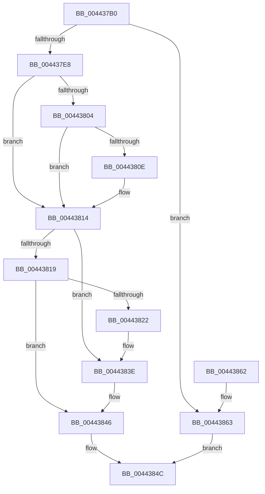

# PpmPerfFeedbackCounterRead

- RVA: `0x004437B0`–`0x0044386D` (길이 `189` bytes)
- VA: `0x00000001404437B0`
- 실행 섹션: `.text`
- PDB 이름 있음: `예`; PDB Function 태그: `아니요`
- unwind 정보 RVA: `0x000A559C`
- 디코드: `57`개 명령, `189/189` bytes 표시
- 미해석 바이트: `0` (있으면 어셈블리에 `.byte`로 보존)

> 이 문서는 커널 이미지의 기계어와 PDB 기호를 분석해 생성했습니다. 4번과 5번은 함수 원형과 자료형을 바이너리 사용 방식에서 추정한 C 해석이며 원본 소스 복구 결과는 아닙니다.

## 1. Dependencies

- 직접 호출 지점: **2**; 고유 호출 대상: **1**
- 직접 호출자로 확인된 함수: **1**
- RIP 상대 이미지 참조: **0**

### Outgoing calls
- `0x004437F0` → [guard_dispatch_icall](../6B/guard_dispatch_icall_function_006BAAD0.md) (function, `0x006BAAD0`)
- `0x00443866` → [guard_dispatch_icall](../6B/guard_dispatch_icall_function_006BAAD0.md) (function, `0x006BAAD0`)

### Direct callers
- [PpmInstallFeedbackCounters](../4D/PpmInstallFeedbackCounters_function_004D477C.md) at `0x004D4886`

### Static image references
- 디코드된 RIP-relative 메모리 참조가 없습니다.

## 2. Other-region calls and transfers

- 다른 실행 섹션으로 향하는 call: **0**
- 별도 외부 분기/꼬리 이동을 확인하지 못했습니다.

## 3. Assembly (complete function range)

```asm
004437B0  4C 8B DC                        mov r11, rsp
004437B3  49 89 5B 10                     mov qword ptr [r11 + 0x10], rbx
004437B7  49 89 73 18                     mov qword ptr [r11 + 0x18], rsi
004437BB  49 89 7B 20                     mov qword ptr [r11 + 0x20], rdi
004437BF  41 56                           push r14
004437C1  48 83 EC 40                     sub rsp, 0x40
004437C5  33 C0                           xor eax, eax
004437C7  48 8B D9                        mov rbx, rcx
004437CA  49 89 43 08                     mov qword ptr [r11 + 8], rax
004437CE  49 8B F9                        mov rdi, r9
004437D1  49 89 43 E8                     mov qword ptr [r11 - 0x18], rax
004437D5  4D 8B F0                        mov r14, r8
004437D8  48 8B 01                        mov rax, qword ptr [rcx]
004437DB  0F B6 F2                        movzx esi, dl
004437DE  80 7B 21 00                     cmp byte ptr [rbx + 0x21], 0
004437E2  48 8B 49 28                     mov rcx, qword ptr [rcx + 0x28]
004437E6  74 7B                           je 0x140443863
004437E8  4D 8D 4B 08                     lea r9, [r11 + 8]
004437EC  4D 8D 43 E8                     lea r8, [r11 - 0x18]
004437F0  E8 DB 72 27 00                  call 0x1406baad0
004437F5  4C 8B 4C 24 50                  mov r9, qword ptr [rsp + 0x50]
004437FA  4C 8B 44 24 30                  mov r8, qword ptr [rsp + 0x30]
004437FF  48 85 FF                        test rdi, rdi
00443802  74 10                           je 0x140443814
00443804  48 8B 44 24 70                  mov rax, qword ptr [rsp + 0x70]
00443809  48 85 C0                        test rax, rax
0044380C  74 06                           je 0x140443814
0044380E  4C 89 0F                        mov qword ptr [rdi], r9
00443811  4C 89 00                        mov qword ptr [rax], r8
00443814  40 84 F6                        test sil, sil
00443817  75 25                           jne 0x14044383e
00443819  48 8B 53 10                     mov rdx, qword ptr [rbx + 0x10]
0044381D  4C 3B C2                        cmp r8, rdx
00443820  74 24                           je 0x140443846
00443822  8B 43 24                        mov eax, dword ptr [rbx + 0x24]
00443825  49 8B C9                        mov rcx, r9
00443828  48 2B 4B 08                     sub rcx, qword ptr [rbx + 8]
0044382C  48 0F AF C1                     imul rax, rcx
00443830  49 8B C8                        mov rcx, r8
00443833  48 2B CA                        sub rcx, rdx
00443836  33 D2                           xor edx, edx
00443838  48 F7 F1                        div rcx
0044383B  89 43 18                        mov dword ptr [rbx + 0x18], eax
0044383E  4C 89 4B 08                     mov qword ptr [rbx + 8], r9
00443842  4C 89 43 10                     mov qword ptr [rbx + 0x10], r8
00443846  8B 43 18                        mov eax, dword ptr [rbx + 0x18]
00443849  41 89 06                        mov dword ptr [r14], eax
0044384C  48 8B 5C 24 58                  mov rbx, qword ptr [rsp + 0x58]
00443851  48 8B 74 24 60                  mov rsi, qword ptr [rsp + 0x60]
00443856  48 8B 7C 24 68                  mov rdi, qword ptr [rsp + 0x68]
0044385B  48 83 C4 40                     add rsp, 0x40
0044385F  41 5E                           pop r14
00443861  C3                              ret
00443862  CC                              int3
00443863  49 8B D6                        mov rdx, r14
00443866  E8 65 72 27 00                  call 0x1406baad0
0044386B  EB DF                           jmp 0x14044384c
```

## 4. C-style interpretation (structured pseudocode)

```c
__int64 __fastcall PpmPerfFeedbackCounterRead(__int64 a1, unsigned __int8 a2, __int64 a3, __int64 a4, __int64 a5)
{
    __int64 result;
    __int64 v_rsp;
    unsigned __int64 v_stack_m18;
    unsigned __int64 v_stack_p10;
    unsigned __int64 v_stack_p18;
    unsigned __int64 v_stack_p20;
    unsigned __int64 v_stack_p8;

    *(unsigned __int64 *)(v_rsp + 16) = v_rbx;
    *(unsigned __int64 *)(v_rsp + 24) = v_rsi;
    *(unsigned __int64 *)(v_rsp + 32) = v_rdi;
    v_rsp = (v_rsp) - (64);
    result = 0;
    *(unsigned __int64 *)(v_rsp + 8) = 0;
    *(unsigned __int64 *)(v_rsp - 24) = 0;
    if ((*(unsigned __int8 *)(a1 + 33)) == 0) goto loc_00443863;
    result = guard_dispatch_icall(*(unsigned __int64 *)(a1 + 40), a2, v_rsp - 24, v_rsp + 8);
    if (a4 == 0) goto loc_00443814;
    if (a5 != 0) {
        *(unsigned __int64 *)(a4) = v_stack_p8;
        *(unsigned __int64 *)(a5) = v_stack_m18;
    }
    if (a2 != 0) goto loc_0044383E;
    if (v_stack_m18 == (*(unsigned __int64 *)(a1 + 16))) goto loc_00443846;
    a1 = (v_stack_p8) - (*(unsigned __int64 *)(a1 + 8));
    result = ((unsigned int)(*(unsigned int *)(a1 + 36))) * (a1);
    a1 = (v_stack_m18) - (*(unsigned __int64 *)(a1 + 16));
    a2 = 0;
    *(unsigned int *)(a1 + 24) = (unsigned int)(result);
loc_0044383E:
    *(unsigned __int64 *)(a1 + 8) = v_stack_p8;
    *(unsigned __int64 *)(a1 + 16) = v_stack_m18;
loc_00443846:
    *(unsigned int *)(a3) = (unsigned int)((unsigned int)(*(unsigned int *)(a1 + 24)));
loc_0044384C:
    v_rsp = (v_rsp) + (64);
    return (unsigned int)(*(unsigned int *)(a1 + 24));
loc_00443863:
    result = guard_dispatch_icall(a1, a3, v_stack_m18, v_stack_p8);
    goto loc_0044384C;
}
```

## 5. (Beta) C Style

```c
int64_t PpmPerfFeedbackCounterRead(void *Arg1, uint8_t Arg2, void *Arg3, int64_t Arg4, int64_t Arg5)
{
    uint8_t *arg1 = (uint8_t *)Arg1;
    uint8_t *arg3 = (uint8_t *)Arg3;

    int64_t result;
    int64_t local_rsp;
    uint64_t v_stack_m18;
    uint64_t v_stack_p10;
    uint64_t v_stack_p18;
    uint64_t v_stack_p20;
    uint64_t v_stack_p8;

    *(uint64_t *)(local_rsp + 0x10) = local_rbx;
    *(uint64_t *)(local_rsp + 0x18) = local_rsi;
    *(uint64_t *)(local_rsp + 0x20) = local_rdi;
    local_rsp = (local_rsp) - (64);
    result = 0;
    *(uint64_t *)(local_rsp + 0x8) = 0;
    *(uint64_t *)(local_rsp - 0x18) = 0;
    if ((*(uint8_t *)(arg1 + 0x21)) == 0) goto loc_00443863;
    result = guard_dispatch_icall(*(uint64_t *)(arg1 + 0x28), Arg2, local_rsp - 24, local_rsp + 8);
    if (Arg4 == 0) goto loc_00443814;
    if (Arg5 != 0) {
        *(uint64_t *)(Arg4) = v_stack_p8;
        *(uint64_t *)(Arg5) = v_stack_m18;
    }
    if (Arg2 != 0) goto loc_0044383E;
    if (v_stack_m18 == (*(uint64_t *)(arg1 + 0x10))) goto loc_00443846;
    Arg1 = (v_stack_p8) - (*(uint64_t *)(arg1 + 0x8));
    result = ((uint32_t)(*(uint32_t *)(arg1 + 0x24))) * (Arg1);
    Arg1 = (v_stack_m18) - (*(uint64_t *)(arg1 + 0x10));
    Arg2 = 0;
    *(uint32_t *)(arg1 + 0x18) = (uint32_t)(result);
loc_0044383E:
    *(uint64_t *)(arg1 + 0x8) = v_stack_p8;
    *(uint64_t *)(arg1 + 0x10) = v_stack_m18;
loc_00443846:
    *(uint32_t *)(arg3) = (uint32_t)((uint32_t)(*(uint32_t *)(arg1 + 0x18)));
loc_0044384C:
    local_rsp = (local_rsp) + (64);
    return (uint32_t)(*(uint32_t *)(arg1 + 0x18));
loc_00443863:
    result = guard_dispatch_icall(Arg1, Arg3, v_stack_m18, v_stack_p8);
    goto loc_0044384C;
}
```

### 관측된 메모리 오프셋

구조체 형식이 확인되지 않은 접근은 인자 기준의 오프셋으로만 기록했습니다.

| 기준 인자 | 오프셋 표현 | 폭 (bit) | 접근 |
|---|---:|---:|---|
| `Arg1` | `+ 0x0` | `64` | `R` |
| `Arg1` | `+ 0x8` | `64` | `R` |
| `Arg1` | `+ 0x8` | `64` | `W` |
| `Arg1` | `+ 0x10` | `64` | `R` |
| `Arg1` | `+ 0x10` | `64` | `W` |
| `Arg1` | `+ 0x18` | `32` | `R` |
| `Arg1` | `+ 0x18` | `32` | `W` |
| `Arg1` | `+ 0x21` | `8` | `R` |
| `Arg1` | `+ 0x24` | `32` | `R` |
| `Arg1` | `+ 0x28` | `64` | `R` |
| `Arg3` | `+ 0x0` | `32` | `W` |

## 6. Execution-region graph

[열기: 2D/3D 그래프와 함수 탐색 컨트롤 패널](../../../control-panel.html?section=text&rva=0x004437B0&view=graph)

- 2D 그래프는 위에서 아래로 흐르고, 3D 그래프는 빈 공간을 드래그해 회전합니다. Shift+드래그는 이동, 휠은 확대·축소, 함수 노드 선택은 대상 보고서 이동입니다.

### Static fallback


