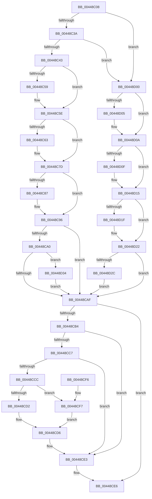

# PpmPerfGetCurrentState

- RVA: `0x00448C08`–`0x00448D3E` (길이 `310` bytes)
- VA: `0x0000000140448C08`
- 실행 섹션: `.text`
- PDB 이름 있음: `예`; PDB Function 태그: `아니요`
- unwind 정보 RVA: `0x000A62E0`
- 디코드: `85`개 명령, `310/310` bytes 표시
- 미해석 바이트: `0` (있으면 어셈블리에 `.byte`로 보존)

> 이 문서는 커널 이미지의 기계어와 PDB 기호를 분석해 생성했습니다. 4번과 5번은 함수 원형과 자료형을 바이너리 사용 방식에서 추정한 C 해석이며 원본 소스 복구 결과는 아닙니다.

## 1. Dependencies

- 직접 호출 지점: **0**; 고유 호출 대상: **0**
- 직접 호출자로 확인된 함수: **2**
- RIP 상대 이미지 참조: **0**

### Outgoing calls
- 직접 디코드된 call 명령이 없습니다.

### Direct callers
- [PpmWmiGetAllData](../../page/9E/PpmWmiGetAllData_function_009E1470.md) at `0x009E169E`
- [PopProcessorInformation](../../page/A1/PopProcessorInformation_function_00A11CA0.md) at `0x00A11D83`

### Static image references
- 디코드된 RIP-relative 메모리 참조가 없습니다.

## 2. Other-region calls and transfers

- 다른 실행 섹션으로 향하는 call: **0**
- 별도 외부 분기/꼬리 이동을 확인하지 못했습니다.

## 3. Assembly (complete function range)

```asm
00448C08  48 89 5C 24 08                  mov qword ptr [rsp + 8], rbx
00448C0D  48 89 74 24 10                  mov qword ptr [rsp + 0x10], rsi
00448C12  48 89 7C 24 18                  mov qword ptr [rsp + 0x18], rdi
00448C17  48 8B B9 B0 89 00 00            mov rdi, qword ptr [rcx + 0x89b0]
00448C1E  49 8B F1                        mov rsi, r9
00448C21  48 8B 99 B8 89 00 00            mov rbx, qword ptr [rcx + 0x89b8]
00448C28  4C 8B D9                        mov r11, rcx
00448C2B  41 BA 64 00 00 00               mov r10d, 0x64
00448C31  48 85 FF                        test rdi, rdi
00448C34  0F 84 C6 00 00 00               je 0x140448d00
00448C3A  48 85 DB                        test rbx, rbx
00448C3D  0F 84 BD 00 00 00               je 0x140448d00
00448C43  44 8B 4B 50                     mov r9d, dword ptr [rbx + 0x50]
00448C47  8B 87 10 02 00 00               mov eax, dword ptr [rdi + 0x210]
00448C4D  44 3B C8                        cmp r9d, eax
00448C50  44 0F 43 C8                     cmovae r9d, eax
00448C54  48 85 D2                        test rdx, rdx
00448C57  74 05                           je 0x140448c5e
00448C59  8B 43 54                        mov eax, dword ptr [rbx + 0x54]
00448C5C  89 02                           mov dword ptr [rdx], eax
00448C5E  4D 85 C0                        test r8, r8
00448C61  74 1A                           je 0x140448c7d
00448C63  8B 8F C0 01 00 00               mov ecx, dword ptr [rdi + 0x1c0]
00448C69  B8 1F 85 EB 51                  mov eax, 0x51eb851f
00448C6E  0F AF 8F 10 02 00 00            imul ecx, dword ptr [rdi + 0x210]
00448C75  F7 E1                           mul ecx
00448C77  C1 EA 05                        shr edx, 5
00448C7A  41 89 10                        mov dword ptr [r8], edx
00448C7D  48 8B 4C 24 28                  mov rcx, qword ptr [rsp + 0x28]
00448C82  48 85 C9                        test rcx, rcx
00448C85  74 0F                           je 0x140448c96
00448C87  44 3B 8F C8 01 00 00            cmp r9d, dword ptr [rdi + 0x1c8]
00448C8E  1B C0                           sbb eax, eax
00448C90  F7 D8                           neg eax
00448C92  FF C0                           inc eax
00448C94  89 01                           mov dword ptr [rcx], eax
00448C96  48 8B 4C 24 30                  mov rcx, qword ptr [rsp + 0x30]
00448C9B  48 85 C9                        test rcx, rcx
00448C9E  74 0F                           je 0x140448caf
00448CA0  8B 43 20                        mov eax, dword ptr [rbx + 0x20]
00448CA3  89 01                           mov dword ptr [rcx], eax
00448CA5  44 39 53 1C                     cmp dword ptr [rbx + 0x1c], r10d
00448CA9  0F 82 85 00 00 00               jb 0x140448d34
00448CAF  48 85 F6                        test rsi, rsi
00448CB2  74 32                           je 0x140448ce6
00448CB4  49 8B 8B B0 89 00 00            mov rcx, qword ptr [r11 + 0x89b0]
00448CBB  49 8B 83 B8 89 00 00            mov rax, qword ptr [r11 + 0x89b8]
00448CC2  48 85 C9                        test rcx, rcx
00448CC5  74 1C                           je 0x140448ce3
00448CC7  48 85 C0                        test rax, rax
00448CCA  74 17                           je 0x140448ce3
00448CCC  80 78 70 00                     cmp byte ptr [rax + 0x70], 0
00448CD0  75 25                           jne 0x140448cf7
00448CD2  44 8B 50 50                     mov r10d, dword ptr [rax + 0x50]
00448CD6  8B 81 10 02 00 00               mov eax, dword ptr [rcx + 0x210]
00448CDC  44 3B D0                        cmp r10d, eax
00448CDF  44 0F 43 D0                     cmovae r10d, eax
00448CE3  44 89 16                        mov dword ptr [rsi], r10d
00448CE6  48 8B 5C 24 08                  mov rbx, qword ptr [rsp + 8]
00448CEB  48 8B 74 24 10                  mov rsi, qword ptr [rsp + 0x10]
00448CF0  48 8B 7C 24 18                  mov rdi, qword ptr [rsp + 0x18]
00448CF5  C3                              ret
00448CF6  CC                              int3
00448CF7  44 8B 90 84 00 00 00            mov r10d, dword ptr [rax + 0x84]
00448CFE  EB D6                           jmp 0x140448cd6
00448D00  48 85 D2                        test rdx, rdx
00448D03  74 05                           je 0x140448d0a
00448D05  8B 41 44                        mov eax, dword ptr [rcx + 0x44]
00448D08  89 02                           mov dword ptr [rdx], eax
00448D0A  4D 85 C0                        test r8, r8
00448D0D  74 06                           je 0x140448d15
00448D0F  8B 41 44                        mov eax, dword ptr [rcx + 0x44]
00448D12  41 89 00                        mov dword ptr [r8], eax
00448D15  48 8B 44 24 28                  mov rax, qword ptr [rsp + 0x28]
00448D1A  48 85 C0                        test rax, rax
00448D1D  74 03                           je 0x140448d22
00448D1F  83 20 00                        and dword ptr [rax], 0
00448D22  48 8B 44 24 30                  mov rax, qword ptr [rsp + 0x30]
00448D27  48 85 C0                        test rax, rax
00448D2A  74 83                           je 0x140448caf
00448D2C  83 20 00                        and dword ptr [rax], 0
00448D2F  E9 7B FF FF FF                  jmp 0x140448caf
00448D34  83 C8 04                        or eax, 4
00448D37  89 01                           mov dword ptr [rcx], eax
00448D39  E9 71 FF FF FF                  jmp 0x140448caf
```

## 4. C-style interpretation (structured pseudocode)

```c
__int64 __fastcall PpmPerfGetCurrentState(__int64 a1, __int64 a2, __int64 a3, __int64 a4, __int64 a5, __int64 a6)
{
    __int64 result;
    __int64 v_r10;
    unsigned __int64 v_stack_p10;
    unsigned __int64 v_stack_p18;
    unsigned __int64 v_stack_p8;

    v_stack_p8 = v_rbx;
    v_stack_p10 = v_rsi;
    v_stack_p18 = v_rdi;
    if (*(unsigned __int64 *)(a1 + 35248) == 0) goto loc_00448D00;
    if (*(unsigned __int64 *)(a1 + 35256) == 0) goto loc_00448D00;
    a4 = (unsigned int)(*(unsigned int *)(*(unsigned __int64 *)(a1 + 35256) + 80));
    if (((unsigned int)((unsigned int)(*(unsigned int *)(*(unsigned __int64 *)(a1 + 35256) + 80)))) >= ((unsigned int)((unsigned int)(*(unsigned int *)(*(unsigned __int64 *)(a1 + 35248) + 528))))) { a4 = (unsigned int)((unsigned int)(*(unsigned int *)(*(unsigned __int64 *)(a1 + 35248) + 528))); }
    result = (unsigned int)(*(unsigned int *)(*(unsigned __int64 *)(a1 + 35248) + 528));
    if (a2 != 0) {
        result = *(unsigned int *)(*(unsigned __int64 *)(a1 + 35256) + 84);
        *(unsigned int *)(a2) = (unsigned int)(result);
    }
    if (a3 != 0) {
        a1 = *(unsigned int *)(*(unsigned __int64 *)(a1 + 35248) + 448);
        result = 0x51EB851FULL;
        a1 = (unsigned int)((a1) * (*(unsigned int *)(*(unsigned __int64 *)(a1 + 35248) + 528)));
        a2 = (unsigned int)((a2) >> (5));
        *(unsigned int *)(a3) = (unsigned int)(a2);
    }
    if (a5 != 0) {
        result = (unsigned int)(-(result));
        result = (unsigned int)((result) + 1);
        *(unsigned int *)(a5) = (unsigned int)(result);
    }
    if (a6 == 0) goto loc_00448CAF;
    *(unsigned int *)(a6) = (unsigned int)((unsigned int)(*(unsigned int *)(*(unsigned __int64 *)(a1 + 35256) + 32)));
    if ((*(unsigned int *)(*(unsigned __int64 *)(a1 + 35256) + 28)) < 100) goto loc_00448D34;
loc_00448CAF:
    if (a4 == 0) goto loc_00448CE6;
    if (*(unsigned __int64 *)(a1 + 35248) == 0) goto loc_00448CE3;
    if (*(unsigned __int64 *)(a1 + 35256) == 0) goto loc_00448CE3;
    if ((*(unsigned __int8 *)(*(unsigned __int64 *)(a1 + 35256) + 112)) != 0) goto loc_00448CF7;
loc_00448CD6:
    v_r10 = (unsigned int)(*(unsigned int *)(*(unsigned __int64 *)(a1 + 35256) + 80));
    if (((unsigned int)((unsigned int)(*(unsigned int *)(*(unsigned __int64 *)(a1 + 35256) + 80)))) >= ((unsigned int)((unsigned int)(*(unsigned int *)(*(unsigned __int64 *)(a1 + 35248) + 528))))) { v_r10 = (unsigned int)((unsigned int)(*(unsigned int *)(*(unsigned __int64 *)(a1 + 35248) + 528))); }
loc_00448CE3:
    *(unsigned int *)(a4) = (unsigned int)(v_r10);
loc_00448CE6:
    return (unsigned int)(*(unsigned int *)(*(unsigned __int64 *)(a1 + 35248) + 528));
loc_00448CF7:
    goto loc_00448CD6;
loc_00448D00:
    result = (unsigned int)(*(unsigned int *)(*(unsigned __int64 *)(a1 + 35248) + 528));
    if (a2 != 0) {
        result = *(unsigned int *)(*(unsigned __int64 *)(a1 + 35248) + 68);
        *(unsigned int *)(a2) = (unsigned int)(result);
    }
    if (a3 != 0) {
        result = *(unsigned int *)(*(unsigned __int64 *)(a1 + 35248) + 68);
        *(unsigned int *)(a3) = (unsigned int)(result);
    }
    if (a5 != 0) {
    }
    if (a6 == 0) goto loc_00448CAF;
    goto loc_00448CAF;
loc_00448D34:
    result = (unsigned int)((a6) | (4));
    *(unsigned int *)(*(unsigned __int64 *)(a1 + 35248)) = (unsigned int)(result);
    goto loc_00448CAF;
}
```

## 5. (Beta) C Style

```c
int64_t PpmPerfGetCurrentState(void *Arg1, int64_t Arg2, int64_t Arg3, int64_t Arg4, int64_t Arg5, int64_t Arg6)
{
    uint8_t *arg1 = (uint8_t *)Arg1;

    int64_t result;
    int64_t local_r10;
    uint64_t v_stack_p10;
    uint64_t v_stack_p18;
    uint64_t v_stack_p8;

    v_stack_p8 = local_rbx;
    v_stack_p10 = local_rsi;
    v_stack_p18 = local_rdi;
    if (*(uint64_t *)(arg1 + 0x89B0) == 0) goto loc_00448D00;
    if (*(uint64_t *)(arg1 + 0x89B8) == 0) goto loc_00448D00;
    Arg4 = (uint32_t)(*(uint32_t *)(*(uint64_t *)(arg1 + 0x89B8) + 0x50));
    if (((uint32_t)((uint32_t)(*(uint32_t *)(*(uint64_t *)(arg1 + 0x89B8) + 0x50)))) >= ((uint32_t)((uint32_t)(*(uint32_t *)(*(uint64_t *)(arg1 + 0x89B0) + 0x210))))) { Arg4 = (uint32_t)((uint32_t)(*(uint32_t *)(*(uint64_t *)(arg1 + 0x89B0) + 0x210))); }
    result = (uint32_t)(*(uint32_t *)(*(uint64_t *)(arg1 + 0x89B0) + 0x210));
    if (Arg2 != 0) {
        result = *(uint32_t *)(*(uint64_t *)(arg1 + 0x89B8) + 0x54);
        *(uint32_t *)(Arg2) = (uint32_t)(result);
    }
    if (Arg3 != 0) {
        Arg1 = *(uint32_t *)(*(uint64_t *)(arg1 + 0x89B0) + 0x1C0);
        result = 0x51EB851FULL;
        Arg1 = (uint32_t)((Arg1) * (*(uint32_t *)(*(uint64_t *)(arg1 + 0x89B0) + 0x210)));
        Arg2 = (uint32_t)((Arg2) >> (5));
        *(uint32_t *)(Arg3) = (uint32_t)(Arg2);
    }
    if (Arg5 != 0) {
        result = (uint32_t)(-(result));
        result = (uint32_t)((result) + 1);
        *(uint32_t *)(Arg5) = (uint32_t)(result);
    }
    if (Arg6 == 0) goto loc_00448CAF;
    *(uint32_t *)(Arg6) = (uint32_t)((uint32_t)(*(uint32_t *)(*(uint64_t *)(arg1 + 0x89B8) + 0x20)));
    if ((*(uint32_t *)(*(uint64_t *)(arg1 + 0x89B8) + 0x1C)) < 100) goto loc_00448D34;
loc_00448CAF:
    if (Arg4 == 0) goto loc_00448CE6;
    if (*(uint64_t *)(arg1 + 0x89B0) == 0) goto loc_00448CE3;
    if (*(uint64_t *)(arg1 + 0x89B8) == 0) goto loc_00448CE3;
    if ((*(uint8_t *)(*(uint64_t *)(arg1 + 0x89B8) + 0x70)) != 0) goto loc_00448CF7;
loc_00448CD6:
    local_r10 = (uint32_t)(*(uint32_t *)(*(uint64_t *)(arg1 + 0x89B8) + 0x50));
    if (((uint32_t)((uint32_t)(*(uint32_t *)(*(uint64_t *)(arg1 + 0x89B8) + 0x50)))) >= ((uint32_t)((uint32_t)(*(uint32_t *)(*(uint64_t *)(arg1 + 0x89B0) + 0x210))))) { local_r10 = (uint32_t)((uint32_t)(*(uint32_t *)(*(uint64_t *)(arg1 + 0x89B0) + 0x210))); }
loc_00448CE3:
    *(uint32_t *)(Arg4) = (uint32_t)(local_r10);
loc_00448CE6:
    return (uint32_t)(*(uint32_t *)(*(uint64_t *)(arg1 + 0x89B0) + 0x210));
loc_00448CF7:
    goto loc_00448CD6;
loc_00448D00:
    result = (uint32_t)(*(uint32_t *)(*(uint64_t *)(arg1 + 0x89B0) + 0x210));
    if (Arg2 != 0) {
        result = *(uint32_t *)(*(uint64_t *)(arg1 + 0x89B0) + 0x44);
        *(uint32_t *)(Arg2) = (uint32_t)(result);
    }
    if (Arg3 != 0) {
        result = *(uint32_t *)(*(uint64_t *)(arg1 + 0x89B0) + 0x44);
        *(uint32_t *)(Arg3) = (uint32_t)(result);
    }
    if (Arg5 != 0) {
    }
    if (Arg6 == 0) goto loc_00448CAF;
    goto loc_00448CAF;
loc_00448D34:
    result = (uint32_t)((Arg6) | (4));
    *(uint32_t *)(*(uint64_t *)(arg1 + 0x89B0)) = (uint32_t)(result);
    goto loc_00448CAF;
}
```

### 관측된 메모리 오프셋

구조체 형식이 확인되지 않은 접근은 인자 기준의 오프셋으로만 기록했습니다.

| 기준 인자 | 오프셋 표현 | 폭 (bit) | 접근 |
|---|---:|---:|---|
| `Arg1` | `+ 0x44` | `32` | `R` |
| `Arg1` | `+ 0x89B0` | `64` | `R` |
| `Arg1` | `+ 0x89B8` | `64` | `R` |

## 6. Execution-region graph

[열기: 2D/3D 그래프와 함수 탐색 컨트롤 패널](../../../control-panel.html?section=text&rva=0x00448C08&view=graph)

- 2D 그래프는 위에서 아래로 흐르고, 3D 그래프는 빈 공간을 드래그해 회전합니다. Shift+드래그는 이동, 휠은 확대·축소, 함수 노드 선택은 대상 보고서 이동입니다.

### Static fallback


