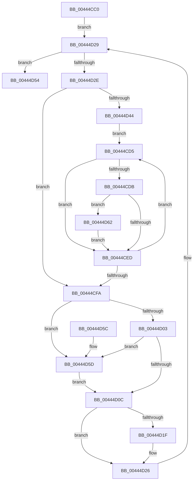

# PpmPerfSelectDomainStates

- RVA: `0x00444CC0`–`0x00444D67` (길이 `167` bytes)
- VA: `0x0000000140444CC0`
- 실행 섹션: `.text`
- PDB 이름 있음: `예`; PDB Function 태그: `아니요`
- unwind 정보 RVA: `0x0008CE74`
- 디코드: `45`개 명령, `167/167` bytes 표시
- 미해석 바이트: `0` (있으면 어셈블리에 `.byte`로 보존)

> 이 문서는 커널 이미지의 기계어와 PDB 기호를 분석해 생성했습니다. 4번과 5번은 함수 원형과 자료형을 바이너리 사용 방식에서 추정한 C 해석이며 원본 소스 복구 결과는 아닙니다.

## 1. Dependencies

- 직접 호출 지점: **0**; 고유 호출 대상: **0**
- 직접 호출자로 확인된 함수: **0**
- RIP 상대 이미지 참조: **1**

### Outgoing calls
- 직접 디코드된 call 명령이 없습니다.

### Direct callers
- 이 함수 시작 RVA로 연결되는 직접 call은 확인되지 않았습니다. 간접 호출은 완전히 역산할 수 없습니다.

### Static image references
- `0x00444CC5` → RVA `0x00FC6BA8` (`ALMOSTRO`; read)

## 2. Other-region calls and transfers

- 다른 실행 섹션으로 향하는 call: **0**
- 별도 외부 분기/꼬리 이동을 확인하지 못했습니다.

## 3. Assembly (complete function range)

```asm
00444CC0  48 89 5C 24 08                  mov qword ptr [rsp + 8], rbx
00444CC5  48 8B 0D DC 1E B8 00            mov rcx, qword ptr [rip + 0xb81edc]
00444CCC  48 8D 1D D5 1E B8 00            lea rbx, [rip + 0xb81ed5]
00444CD3  EB 54                           jmp 0x140444d29
00444CD5  83 7A D8 02                     cmp dword ptr [rdx - 0x28], 2
00444CD9  74 12                           je 0x140444ced
00444CDB  8B 02                           mov eax, dword ptr [rdx]
00444CDD  41 3B C0                        cmp eax, r8d
00444CE0  41 0F 46 C0                     cmovbe eax, r8d
00444CE4  44 8B C0                        mov r8d, eax
00444CE7  44 38 5A 04                     cmp byte ptr [rdx + 4], r11b
00444CEB  75 75                           jne 0x140444d62
00444CED  48 81 C2 A8 04 00 00            add rdx, 0x4a8
00444CF4  49 83 EA 01                     sub r10, 1
00444CF8  75 DB                           jne 0x140444cd5
00444CFA  44 39 81 0C 02 00 00            cmp dword ptr [rcx + 0x20c], r8d
00444D01  75 5A                           jne 0x140444d5d
00444D03  44 38 89 14 02 00 00            cmp byte ptr [rcx + 0x214], r9b
00444D0A  75 51                           jne 0x140444d5d
00444D0C  44 89 81 0C 02 00 00            mov dword ptr [rcx + 0x20c], r8d
00444D13  44 88 89 14 02 00 00            mov byte ptr [rcx + 0x214], r9b
00444D1A  45 84 DB                        test r11b, r11b
00444D1D  74 07                           je 0x140444d26
00444D1F  C6 81 BD 04 00 00 01            mov byte ptr [rcx + 0x4bd], 1
00444D26  48 8B 09                        mov rcx, qword ptr [rcx]
00444D29  48 3B CB                        cmp rcx, rbx
00444D2C  74 26                           je 0x140444d54
00444D2E  8B 81 28 01 00 00               mov eax, dword ptr [rcx + 0x128]
00444D34  45 32 DB                        xor r11b, r11b
00444D37  45 32 C9                        xor r9b, r9b
00444D3A  41 B8 01 00 00 00               mov r8d, 1
00444D40  85 C0                           test eax, eax
00444D42  74 B6                           je 0x140444cfa
00444D44  48 8B 91 38 01 00 00            mov rdx, qword ptr [rcx + 0x138]
00444D4B  44 8B D0                        mov r10d, eax
00444D4E  48 83 C2 38                     add rdx, 0x38
00444D52  EB 81                           jmp 0x140444cd5
00444D54  48 8B 5C 24 08                  mov rbx, qword ptr [rsp + 8]
00444D59  B0 01                           mov al, 1
00444D5B  C3                              ret
00444D5C  CC                              int3
00444D5D  41 B3 01                        mov r11b, 1
00444D60  EB AA                           jmp 0x140444d0c
00444D62  41 B1 01                        mov r9b, 1
00444D65  EB 86                           jmp 0x140444ced
```

## 4. C-style interpretation (structured pseudocode)

```c
__int64 __fastcall PpmPerfSelectDomainStates(__int64 a1, __int64 a2, int a3, unsigned __int8 a4)
{
    __int64 result;
    __int64 v_r10;
    __int64 v_r11;
    unsigned __int64 v_stack_p8;

    v_stack_p8 = v_rbx;
    goto loc_00444D29;
loc_00444CD5:
    if ((*(unsigned int *)(a2 - 40)) == 2) goto loc_00444CED;
    result = (unsigned int)(*(unsigned int *)(a2));
    if (((unsigned int)((unsigned int)(*(unsigned int *)(a2)))) <= a3) { result = a3; }
    if ((*(unsigned __int8 *)(a2 + 4)) != ((unsigned __int8)(v_r11))) goto loc_00444D62;
loc_00444CED:
    a2 = (a2) + (0x4A8ULL);
    v_r10 = (v_r10) - (1);
    if (condition_is_not_equal) goto loc_00444CD5;
loc_00444CFA:
    if ((*(unsigned int *)(*(unsigned __int64 *)(v_rip + 12066524) + 524)) != ((unsigned int)((unsigned int)((unsigned int)(result))))) goto loc_00444D5D;
    if ((*(unsigned __int8 *)(*(unsigned __int64 *)(v_rip + 12066524) + 532)) != a4) goto loc_00444D5D;
loc_00444D0C:
    *(unsigned int *)(*(unsigned __int64 *)(v_rip + 12066524) + 524) = (unsigned int)((unsigned int)((unsigned int)(result)));
    *(unsigned __int8 *)(*(unsigned __int64 *)(v_rip + 12066524) + 532) = a4;
    if ((unsigned __int8)(v_r11) != 0) {
        *(unsigned __int8 *)(*(unsigned __int64 *)(v_rip + 12066524) + 1213) = 1;
    }
loc_00444D29:
    if ((*(unsigned __int64 *)(*(unsigned __int64 *)(v_rip + 12066524))) == (v_rip + 12066517)) goto loc_00444D54;
    v_r11 = 0;
    a4 = 0;
    if ((unsigned int)((unsigned int)(*(unsigned int *)(*(unsigned __int64 *)(*(unsigned __int64 *)(v_rip + 12066524)) + 296))) == 0) goto loc_00444CFA;
    a2 = (*(unsigned __int64 *)(*(unsigned __int64 *)(*(unsigned __int64 *)(v_rip + 12066524)) + 312)) + (56);
    goto loc_00444CD5;
loc_00444D54:
    return 1;
loc_00444D5D:
    goto loc_00444D0C;
loc_00444D62:
    goto loc_00444CED;
}
```

## 5. (Beta) C Style

```c
int64_t PpmPerfSelectDomainStates(int64_t Arg1, int64_t Arg2, int32_t Arg3, uint8_t Arg4)
{
    int64_t result;
    int64_t local_r10;
    int64_t local_r11;
    uint64_t v_stack_p8;

    v_stack_p8 = local_rbx;
    goto loc_00444D29;
loc_00444CD5:
    if ((*(uint32_t *)(Arg2 - 0x28)) == 2) goto loc_00444CED;
    result = (uint32_t)(*(uint32_t *)(Arg2));
    if (((uint32_t)((uint32_t)(*(uint32_t *)(Arg2)))) <= Arg3) { result = Arg3; }
    if ((*(uint8_t *)(Arg2 + 0x4)) != ((uint8_t)(local_r11))) goto loc_00444D62;
loc_00444CED:
    Arg2 = (Arg2) + (0x4A8ULL);
    local_r10 = (local_r10) - (1);
    if (condition_is_not_equal) goto loc_00444CD5;
loc_00444CFA:
    if ((*(uint32_t *)(*(uint64_t *)(v_rip + 0xB81EDC) + 0x20C)) != ((uint32_t)((uint32_t)((uint32_t)(result))))) goto loc_00444D5D;
    if ((*(uint8_t *)(*(uint64_t *)(v_rip + 0xB81EDC) + 0x214)) != Arg4) goto loc_00444D5D;
loc_00444D0C:
    *(uint32_t *)(*(uint64_t *)(v_rip + 0xB81EDC) + 0x20C) = (uint32_t)((uint32_t)((uint32_t)(result)));
    *(uint8_t *)(*(uint64_t *)(v_rip + 0xB81EDC) + 0x214) = Arg4;
    if ((uint8_t)(local_r11) != 0) {
        *(uint8_t *)(*(uint64_t *)(v_rip + 0xB81EDC) + 0x4BD) = 1;
    }
loc_00444D29:
    if ((*(uint64_t *)(*(uint64_t *)(v_rip + 0xB81EDC))) == (v_rip + 12066517)) goto loc_00444D54;
    local_r11 = 0;
    Arg4 = 0;
    if ((uint32_t)((uint32_t)(*(uint32_t *)(*(uint64_t *)(*(uint64_t *)(v_rip + 0xB81EDC)) + 0x128))) == 0) goto loc_00444CFA;
    Arg2 = (*(uint64_t *)(*(uint64_t *)(*(uint64_t *)(v_rip + 0xB81EDC)) + 0x138)) + (56);
    goto loc_00444CD5;
loc_00444D54:
    return 1;
loc_00444D5D:
    goto loc_00444D0C;
loc_00444D62:
    goto loc_00444CED;
}
```

## 6. Execution-region graph

[열기: 2D/3D 그래프와 함수 탐색 컨트롤 패널](../../../control-panel.html?section=text&rva=0x00444CC0&view=graph)

- 2D 그래프는 위에서 아래로 흐르고, 3D 그래프는 빈 공간을 드래그해 회전합니다. Shift+드래그는 이동, 휠은 확대·축소, 함수 노드 선택은 대상 보고서 이동입니다.

### Static fallback


