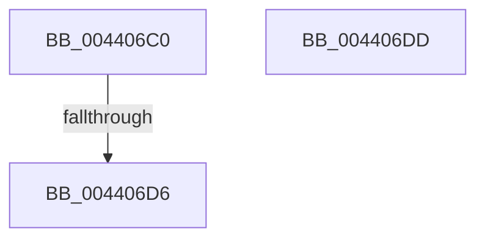

# PpmPerfSnapProcessorCyclesWorkloadClass

- RVA: `0x004406C0`–`0x004406DE` (길이 `30` bytes)
- VA: `0x00000001404406C0`
- 실행 섹션: `.text`
- PDB 이름 있음: `예`; PDB Function 태그: `아니요`
- unwind 정보 RVA: `0x000A4F88`
- 디코드: `12`개 명령, `30/30` bytes 표시
- 미해석 바이트: `0` (있으면 어셈블리에 `.byte`로 보존)

> 이 문서는 커널 이미지의 기계어와 PDB 기호를 분석해 생성했습니다. 4번과 5번은 함수 원형과 자료형을 바이너리 사용 방식에서 추정한 C 해석이며 원본 소스 복구 결과는 아닙니다.

## 1. Dependencies

- 직접 호출 지점: **0**; 고유 호출 대상: **0**
- 직접 호출자로 확인된 함수: **1**
- RIP 상대 이미지 참조: **1**

### Outgoing calls
- 직접 디코드된 call 명령이 없습니다.

### Direct callers
- [PpmPerfSnapDeliveredPerformance](../2D/PpmPerfSnapDeliveredPerformance_function_002D7F30.md) at `0x002D819D`

### Static image references
- `0x004406C7` → RVA `0x00FC6A86` (`ALMOSTRO`; read)

## 2. Other-region calls and transfers

- 다른 실행 섹션으로 향하는 call: **0**
- call이 아닌 외부 분기/꼬리 이동: **1**
  - `0x004406D4` → [sub_004406DE](Unknown_function_004406DE.md) (`tail-transfer`)

## 3. Assembly (complete function range)

```asm
004406C0  40 56                           push rsi
004406C2  57                              push rdi
004406C3  48 83 EC 18                     sub rsp, 0x18
004406C7  80 3D B8 63 B8 00 00            cmp byte ptr [rip + 0xb863b8], 0
004406CE  49 8B F0                        mov rsi, r8
004406D1  48 8B FA                        mov rdi, rdx
004406D4  75 08                           jne 0x1404406de
004406D6  48 83 C4 18                     add rsp, 0x18
004406DA  5F                              pop rdi
004406DB  5E                              pop rsi
004406DC  C3                              ret
004406DD  CC                              int3
```

## 4. C-style interpretation (structured pseudocode)

```c
void __fastcall PpmPerfSnapProcessorCyclesWorkloadClass(__int64 a1, __int64 a2, __int64 a3)
{
    __int64 v_rsp;

    v_rsp = (v_rsp) - (24);
    v_rsp = (v_rsp) + (24);
    return;
}
```

## 5. (Beta) C Style

```c
void PpmPerfSnapProcessorCyclesWorkloadClass(int64_t Arg1, int64_t Arg2, int64_t Arg3)
{
    int64_t local_rsp;

    local_rsp = (local_rsp) - (24);
    local_rsp = (local_rsp) + (24);
    return;
}
```

## 6. Execution-region graph

[열기: 2D/3D 그래프와 함수 탐색 컨트롤 패널](../../../control-panel.html?section=text&rva=0x004406C0&view=graph)

- 2D 그래프는 위에서 아래로 흐르고, 3D 그래프는 빈 공간을 드래그해 회전합니다. Shift+드래그는 이동, 휠은 확대·축소, 함수 노드 선택은 대상 보고서 이동입니다.

### Static fallback


