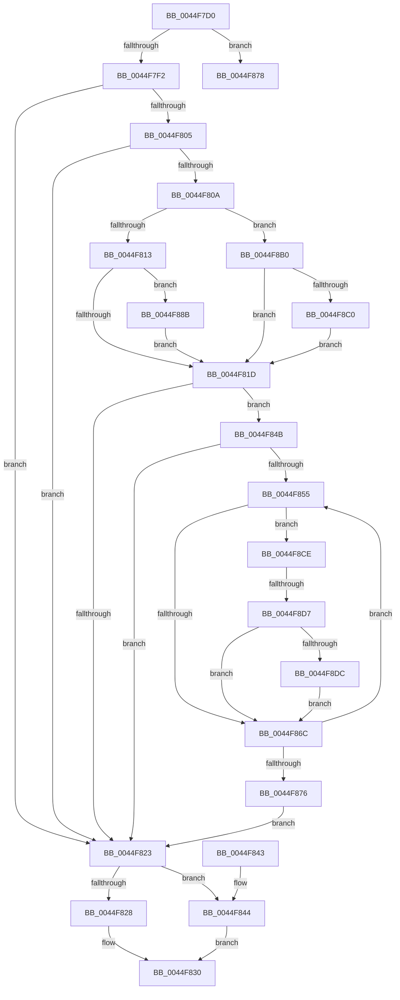

# PpmResetPerfEngineForProcessor

- RVA: `0x0044F7D0`–`0x0044F8E6` (길이 `278` bytes)
- VA: `0x000000014044F7D0`
- 실행 섹션: `.text`
- PDB 이름 있음: `예`; PDB Function 태그: `예`
- unwind 정보 RVA: `0x000A6D08`
- 디코드: `74`개 명령, `278/278` bytes 표시
- 미해석 바이트: `0` (있으면 어셈블리에 `.byte`로 보존)

> 이 문서는 커널 이미지의 기계어와 PDB 기호를 분석해 생성했습니다. 4번과 5번은 함수 원형과 자료형을 바이너리 사용 방식에서 추정한 C 해석이며 원본 소스 복구 결과는 아닙니다.

## 1. Dependencies

- 직접 호출 지점: **6**; 고유 호출 대상: **4**
- 직접 호출자로 확인된 함수: **1**
- RIP 상대 이미지 참조: **1**

### Outgoing calls
- `0x0044F82B` → [PpmResetPerfTimes](PpmResetPerfTimes_function_0044F8EC.md) (function, `0x0044F8EC`)
- `0x0044F844` → [PpmHeteroHgsProcessorThreadFeedbackInit](../4F/PpmHeteroHgsProcessorThreadFeedbackInit_function_004FC94C.md) (function, `0x004FC94C`)
- `0x0044F890` → [RtlGetInterruptTimePrecise](../20/RtlGetInterruptTimePrecise_function_0020A4C0.md) (function, `0x0020A4C0`)
- `0x0044F8A6` → [guard_dispatch_icall](../6B/guard_dispatch_icall_function_006BAAD0.md) (function, `0x006BAAD0`)
- `0x0044F8C4` → [guard_dispatch_icall](../6B/guard_dispatch_icall_function_006BAAD0.md) (function, `0x006BAAD0`)
- `0x0044F8DF` → [PpmResetPerfTimes](PpmResetPerfTimes_function_0044F8EC.md) (function, `0x0044F8EC`)

### Direct callers
- [PopHandleNextState](../../pagelk/B7/PopHandleNextState_function_00B77350.md) at `0x00B773AD`
- [PopHandleNextState](../../pagelk/B7/PopHandleNextState_function_00B77350.md) at `0x00B7766F`

### Static image references
- `0x0044F878` → RVA `0x00FC6BA8` (`ALMOSTRO`; read)

## 2. Other-region calls and transfers

- 다른 실행 섹션으로 향하는 call: **0**
- call이 아닌 외부 분기/꼬리 이동: **2**
  - `0x0044F886` → [sub_006F12A0 + 0x5A](../6F/Unknown_function_006F12A0.md) (`tail-transfer`)
  - `0x0044F8D1` → [sub_006F12A0 + 0x64](../6F/Unknown_function_006F12A0.md) (`tail-transfer`)

## 3. Assembly (complete function range)

```asm
0044F7D0  48 89 5C 24 10                  mov qword ptr [rsp + 0x10], rbx
0044F7D5  48 89 6C 24 18                  mov qword ptr [rsp + 0x18], rbp
0044F7DA  56                              push rsi
0044F7DB  57                              push rdi
0044F7DC  41 57                           push r15
0044F7DE  48 83 EC 20                     sub rsp, 0x20
0044F7E2  83 79 24 00                     cmp dword ptr [rcx + 0x24], 0
0044F7E6  40 8A EA                        mov bpl, dl
0044F7E9  48 8B F1                        mov rsi, rcx
0044F7EC  0F 84 86 00 00 00               je 0x14044f878
0044F7F2  48 8D BE B0 89 00 00            lea rdi, [rsi + 0x89b0]
0044F7F9  48 8B 1F                        mov rbx, qword ptr [rdi]
0044F7FC  48 8B 77 08                     mov rsi, qword ptr [rdi + 8]
0044F800  48 85 DB                        test rbx, rbx
0044F803  74 1E                           je 0x14044f823
0044F805  48 85 F6                        test rsi, rsi
0044F808  74 19                           je 0x14044f823
0044F80A  40 84 ED                        test bpl, bpl
0044F80D  0F 84 9D 00 00 00               je 0x14044f8b0
0044F813  48 83 BB A0 01 00 00 00         cmp qword ptr [rbx + 0x1a0], 0
0044F81B  75 6E                           jne 0x14044f88b
0044F81D  48 3B 7B 10                     cmp rdi, qword ptr [rbx + 0x10]
0044F821  74 28                           je 0x14044f84b
0044F823  40 84 ED                        test bpl, bpl
0044F826  74 1C                           je 0x14044f844
0044F828  48 8B CF                        mov rcx, rdi
0044F82B  E8 BC 00 00 00                  call 0x14044f8ec
0044F830  48 8B 5C 24 48                  mov rbx, qword ptr [rsp + 0x48]
0044F835  48 8B 6C 24 50                  mov rbp, qword ptr [rsp + 0x50]
0044F83A  48 83 C4 20                     add rsp, 0x20
0044F83E  41 5F                           pop r15
0044F840  5F                              pop rdi
0044F841  5E                              pop rsi
0044F842  C3                              ret
0044F843  CC                              int3
0044F844  E8 03 D1 0A 00                  call 0x1404fc94c
0044F849  EB E5                           jmp 0x14044f830
0044F84B  33 F6                           xor esi, esi
0044F84D  39 B3 28 01 00 00               cmp dword ptr [rbx + 0x128], esi
0044F853  76 CE                           jbe 0x14044f823
0044F855  8B C6                           mov eax, esi
0044F857  48 69 C8 A8 04 00 00            imul rcx, rax, 0x4a8
0044F85E  48 03 8B 38 01 00 00            add rcx, qword ptr [rbx + 0x138]
0044F865  8B 41 10                        mov eax, dword ptr [rcx + 0x10]
0044F868  85 C0                           test eax, eax
0044F86A  75 62                           jne 0x14044f8ce
0044F86C  FF C6                           inc esi
0044F86E  3B B3 28 01 00 00               cmp esi, dword ptr [rbx + 0x128]
0044F874  72 DF                           jb 0x14044f855
0044F876  EB AB                           jmp 0x14044f823
0044F878  48 8B 1D 29 73 B7 00            mov rbx, qword ptr [rip + 0xb77329]
0044F87F  4C 8D 3D 22 73 B7 00            lea r15, [rip + 0xb77322]
0044F886  E9 6F 1A 2A 00                  jmp 0x1406f12fa
0044F88B  48 8D 4C 24 40                  lea rcx, [rsp + 0x40]
0044F890  E8 2B AC DB FF                  call 0x14020a4c0
0044F895  48 8B 4E 08                     mov rcx, qword ptr [rsi + 8]
0044F899  48 8B D0                        mov rdx, rax
0044F89C  48 8B 83 A0 01 00 00            mov rax, qword ptr [rbx + 0x1a0]
0044F8A3  41 B0 01                        mov r8b, 1
0044F8A6  E8 25 B2 26 00                  call 0x1406baad0
0044F8AB  E9 6D FF FF FF                  jmp 0x14044f81d
0044F8B0  48 8B 83 70 01 00 00            mov rax, qword ptr [rbx + 0x170]
0044F8B7  48 85 C0                        test rax, rax
0044F8BA  0F 84 5D FF FF FF               je 0x14044f81d
0044F8C0  48 8B 4E 08                     mov rcx, qword ptr [rsi + 8]
0044F8C4  E8 07 B2 26 00                  call 0x1406baad0
0044F8C9  E9 4F FF FF FF                  jmp 0x14044f81d
0044F8CE  40 84 ED                        test bpl, bpl
0044F8D1  0F 84 2D 1A 2A 00               je 0x1406f1304
0044F8D7  83 F8 01                        cmp eax, 1
0044F8DA  75 90                           jne 0x14044f86c
0044F8DC  48 8B 09                        mov rcx, qword ptr [rcx]
0044F8DF  E8 08 00 00 00                  call 0x14044f8ec
0044F8E4  EB 86                           jmp 0x14044f86c
```

## 4. C-style interpretation (structured pseudocode)

```c
__int64 __fastcall PpmResetPerfEngineForProcessor(__int64 a1, unsigned __int8 a2)
{
    __int64 result;
    __int64 v_rsi;
    __int64 v_rsp;
    unsigned __int64 v_stack_p10;
    unsigned __int64 v_stack_p18;
    unsigned __int64 v_stack_p40;

    v_stack_p10 = v_rbx;
    v_stack_p18 = v_rbp;
    v_rsp = (v_rsp) - (32);
    if ((*(unsigned int *)(a1 + 36)) == 0) goto loc_0044F878;
    if (*(unsigned __int64 *)(a1 + 35248) == 0) goto loc_0044F823;
    if (*(unsigned __int64 *)(a1 + 35248 + 8) == 0) goto loc_0044F823;
    if (a2 == 0) goto loc_0044F8B0;
    if ((*(unsigned __int64 *)(*(unsigned __int64 *)(a1 + 35248) + 416)) != 0) goto loc_0044F88B;
loc_0044F81D:
    if ((a1 + 35248) == (*(unsigned __int64 *)(*(unsigned __int64 *)(a1 + 35248) + 16))) goto loc_0044F84B;
loc_0044F823:
    if (a2 == 0) goto loc_0044F844;
    result = PpmResetPerfTimes(a1 + 35248, a2, a3, a4);
loc_0044F830:
    v_rsp = (v_rsp) + (32);
    return result;
loc_0044F844:
    result = PpmHeteroHgsProcessorThreadFeedbackInit(a1 + 35248, a2, a3, a4);
    goto loc_0044F830;
loc_0044F84B:
    v_rsi = 0;
    if ((*(unsigned int *)(v_stack_p10 + 296)) <= 0) goto loc_0044F823;
loc_0044F855:
    a1 = (a1 + 35248) * (0);
    a1 = (a1) + (*(unsigned __int64 *)(v_stack_p10 + 312));
    if ((unsigned int)((unsigned int)(*(unsigned int *)(a1 + 16))) != 0) goto loc_0044F8CE;
loc_0044F86C:
    v_rsi = (unsigned int)((v_rsi) + 1);
    if (((unsigned int)(v_rsi)) < (*(unsigned int *)(v_stack_p10 + 296))) goto loc_0044F855;
    goto loc_0044F823;
loc_0044F878:
loc_0044F88B:
    result = RtlGetInterruptTimePrecise(v_stack_p40, a2, a3, a4);
    result = guard_dispatch_icall(*(unsigned __int64 *)(v_rsi + 8), result, 1, a4);
    goto loc_0044F81D;
loc_0044F8B0:
    if (*(unsigned __int64 *)(*(unsigned __int64 *)(v_rip + 12022569) + 368) == 0) goto loc_0044F81D;
    result = guard_dispatch_icall(*(unsigned __int64 *)(v_rsi + 8), result, 1, a4);
    goto loc_0044F81D;
loc_0044F8CE:
    if (((unsigned int)(result)) != 1) goto loc_0044F86C;
    result = PpmResetPerfTimes(*(unsigned __int64 *)(*(unsigned __int64 *)(v_rsi + 8)), result, 1, a4);
    goto loc_0044F86C;
}
```

## 5. (Beta) C Style

```c
int64_t PpmResetPerfEngineForProcessor(void *Arg1, uint8_t Arg2)
{
    uint8_t *arg1 = (uint8_t *)Arg1;

    int64_t result;
    int64_t local_rsi;
    int64_t local_rsp;
    uint64_t v_stack_p10;
    uint64_t v_stack_p18;
    uint64_t v_stack_p40;

    v_stack_p10 = local_rbx;
    v_stack_p18 = local_rbp;
    local_rsp = (local_rsp) - (32);
    if ((*(uint32_t *)(arg1 + 0x24)) == 0) goto loc_0044F878;
    if (*(uint64_t *)(arg1 + 0x89B0) == 0) goto loc_0044F823;
    if (*(uint64_t *)(arg1 + 0x89B0 + 0x8) == 0) goto loc_0044F823;
    if (Arg2 == 0) goto loc_0044F8B0;
    if ((*(uint64_t *)(*(uint64_t *)(arg1 + 0x89B0) + 0x1A0)) != 0) goto loc_0044F88B;
loc_0044F81D:
    if ((Arg1 + 35248) == (*(uint64_t *)(*(uint64_t *)(arg1 + 0x89B0) + 0x10))) goto loc_0044F84B;
loc_0044F823:
    if (Arg2 == 0) goto loc_0044F844;
    result = PpmResetPerfTimes(Arg1 + 35248, Arg2, a3, a4);
loc_0044F830:
    local_rsp = (local_rsp) + (32);
    return result;
loc_0044F844:
    result = PpmHeteroHgsProcessorThreadFeedbackInit(Arg1 + 35248, Arg2, a3, a4);
    goto loc_0044F830;
loc_0044F84B:
    local_rsi = 0;
    if ((*(uint32_t *)(v_stack_p10 + 0x128)) <= 0) goto loc_0044F823;
loc_0044F855:
    Arg1 = (Arg1 + 35248) * (0);
    Arg1 = (Arg1) + (*(uint64_t *)(v_stack_p10 + 0x138));
    if ((uint32_t)((uint32_t)(*(uint32_t *)(arg1 + 0x10))) != 0) goto loc_0044F8CE;
loc_0044F86C:
    local_rsi = (uint32_t)((local_rsi) + 1);
    if (((uint32_t)(local_rsi)) < (*(uint32_t *)(v_stack_p10 + 0x128))) goto loc_0044F855;
    goto loc_0044F823;
loc_0044F878:
loc_0044F88B:
    result = RtlGetInterruptTimePrecise(v_stack_p40, Arg2, a3, a4);
    result = guard_dispatch_icall(*(uint64_t *)(local_rsi + 0x8), result, 1, a4);
    goto loc_0044F81D;
loc_0044F8B0:
    if (*(uint64_t *)(*(uint64_t *)(v_rip + 0xB77329) + 0x170) == 0) goto loc_0044F81D;
    result = guard_dispatch_icall(*(uint64_t *)(local_rsi + 0x8), result, 1, a4);
    goto loc_0044F81D;
loc_0044F8CE:
    if (((uint32_t)(result)) != 1) goto loc_0044F86C;
    result = PpmResetPerfTimes(*(uint64_t *)(*(uint64_t *)(local_rsi + 0x8)), result, 1, a4);
    goto loc_0044F86C;
}
```

### 관측된 메모리 오프셋

구조체 형식이 확인되지 않은 접근은 인자 기준의 오프셋으로만 기록했습니다.

| 기준 인자 | 오프셋 표현 | 폭 (bit) | 접근 |
|---|---:|---:|---|
| `Arg1` | `+ 0x0` | `64` | `R` |
| `Arg1` | `+ 0x8` | `64` | `R` |
| `Arg1` | `+ 0x24` | `32` | `R` |
| `Arg1` | `+ 0x89B0` | `64` | `R` |

## 6. Execution-region graph

[열기: 2D/3D 그래프와 함수 탐색 컨트롤 패널](../../../control-panel.html?section=text&rva=0x0044F7D0&view=graph)

- 2D 그래프는 위에서 아래로 흐르고, 3D 그래프는 빈 공간을 드래그해 회전합니다. Shift+드래그는 이동, 휠은 확대·축소, 함수 노드 선택은 대상 보고서 이동입니다.

### Static fallback


