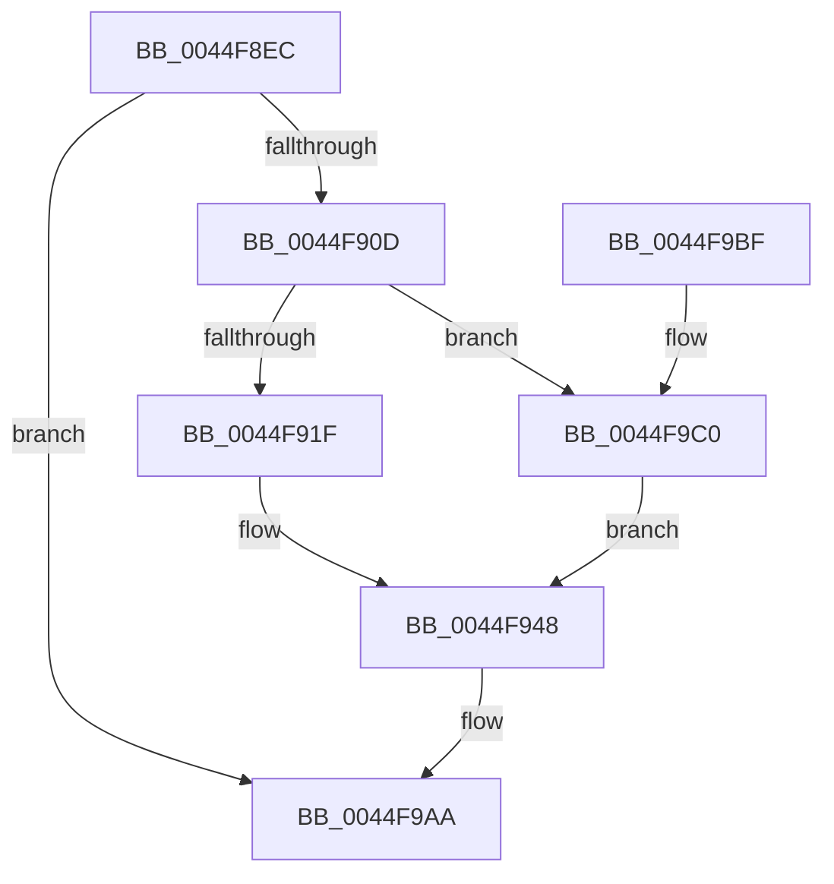

# PpmResetPerfTimes

- RVA: `0x0044F8EC`–`0x0044F9D7` (길이 `235` bytes)
- VA: `0x000000014044F8EC`
- 실행 섹션: `.text`
- PDB 이름 있음: `예`; PDB Function 태그: `아니요`
- unwind 정보 RVA: `0x000A6D30`
- 디코드: `57`개 명령, `235/235` bytes 표시
- 미해석 바이트: `0` (있으면 어셈블리에 `.byte`로 보존)

> 이 문서는 커널 이미지의 기계어와 PDB 기호를 분석해 생성했습니다. 4번과 5번은 함수 원형과 자료형을 바이너리 사용 방식에서 추정한 C 해석이며 원본 소스 복구 결과는 아닙니다.

## 1. Dependencies

- 직접 호출 지점: **4**; 고유 호출 대상: **4**
- 직접 호출자로 확인된 함수: **5**
- RIP 상대 이미지 참조: **0**

### Outgoing calls
- `0x0044F929` → [PpmResetPerformanceAccumulation](PpmResetPerformanceAccumulation_function_0044F9E0.md) (function, `0x0044F9E0`)
- `0x0044F943` → [PpmSnapPerformanceAccumulation](../2D/PpmSnapPerformanceAccumulation_function_002DE090.md) (function, `0x002DE090`)
- `0x0044F989` → [memcpy](../6C/memcpy_function_006C6840.md) (function, `0x006C6840`)
- `0x0044F9CD` → [PpmHvSnapPerformanceAccumulation](PpmHvSnapPerformanceAccumulation_function_0044FA34.md) (function, `0x0044FA34`)

### Direct callers
- [PpmCheckReset](PpmCheckReset_function_0044F7B0.md) at `0x0044F7BB`
- [PpmResetPerfEngineForProcessor](PpmResetPerfEngineForProcessor_function_0044F7D0.md) at `0x0044F82B`
- [PpmResetPerfEngineForProcessor](PpmResetPerfEngineForProcessor_function_0044F7D0.md) at `0x0044F8DF`
- [PpmCheckProcessorInit](../5D/PpmCheckProcessorInit_function_005D84A0.md) at `0x005D84B0`
- [PpmCheckResetProcessors](../5D/PpmCheckResetProcessors_function_005D84D0.md) at `0x005D8529`
- [PpmCheckResetProcessors](../5D/PpmCheckResetProcessors_function_005D84D0.md) at `0x005D8579`
- [sub_006F12A0](../6F/Unknown_function_006F12A0.md) at `0x006F12D1`

### Static image references
- 디코드된 RIP-relative 메모리 참조가 없습니다.

## 2. Other-region calls and transfers

- 다른 실행 섹션으로 향하는 call: **0**
- 별도 외부 분기/꼬리 이동을 확인하지 못했습니다.

## 3. Assembly (complete function range)

```asm
0044F8EC  48 89 5C 24 08                  mov qword ptr [rsp + 8], rbx
0044F8F1  48 89 6C 24 10                  mov qword ptr [rsp + 0x10], rbp
0044F8F6  48 89 74 24 18                  mov qword ptr [rsp + 0x18], rsi
0044F8FB  57                              push rdi
0044F8FC  48 83 EC 30                     sub rsp, 0x30
0044F900  48 8B 79 10                     mov rdi, qword ptr [rcx + 0x10]
0044F904  48 85 FF                        test rdi, rdi
0044F907  0F 84 9D 00 00 00               je 0x14044f9aa
0044F90D  80 79 44 00                     cmp byte ptr [rcx + 0x44], 0
0044F911  48 8D 77 20                     lea rsi, [rdi + 0x20]
0044F915  48 8B 6F 58                     mov rbp, qword ptr [rdi + 0x58]
0044F919  0F 84 A1 00 00 00               je 0x14044f9c0
0044F91F  48 8D 99 50 76 FF FF            lea rbx, [rcx - 0x89b0]
0044F926  48 8B CB                        mov rcx, rbx
0044F929  E8 B2 00 00 00                  call 0x14044f9e0
0044F92E  45 33 C9                        xor r9d, r9d
0044F931  48 89 6C 24 28                  mov qword ptr [rsp + 0x28], rbp
0044F936  45 33 C0                        xor r8d, r8d
0044F939  48 89 74 24 20                  mov qword ptr [rsp + 0x20], rsi
0044F93E  B2 01                           mov dl, 1
0044F940  48 8B CB                        mov rcx, rbx
0044F943  E8 48 E7 E8 FF                  call 0x1402de090
0044F948  0F 10 06                        movups xmm0, xmmword ptr [rsi]
0044F94B  48 8B 8F D8 00 00 00            mov rcx, qword ptr [rdi + 0xd8]
0044F952  48 8B D5                        mov rdx, rbp
0044F955  0F 11 87 A0 00 00 00            movups xmmword ptr [rdi + 0xa0], xmm0
0044F95C  0F 10 4E 10                     movups xmm1, xmmword ptr [rsi + 0x10]
0044F960  0F 11 8F B0 00 00 00            movups xmmword ptr [rdi + 0xb0], xmm1
0044F967  0F 10 46 20                     movups xmm0, xmmword ptr [rsi + 0x20]
0044F96B  0F 11 87 C0 00 00 00            movups xmmword ptr [rdi + 0xc0], xmm0
0044F972  F2 0F 10 4E 30                  movsd xmm1, qword ptr [rsi + 0x30]
0044F977  F2 0F 11 8F D0 00 00 00         movsd qword ptr [rdi + 0xd0], xmm1
0044F97F  6B 45 30 70                     imul eax, dword ptr [rbp + 0x30], 0x70
0044F983  83 C0 38                        add eax, 0x38
0044F986  4C 63 C0                        movsxd r8, eax
0044F989  E8 B2 6E 27 00                  call 0x1406c6840
0044F98E  48 8B 06                        mov rax, qword ptr [rsi]
0044F991  48 89 47 08                     mov qword ptr [rdi + 8], rax
0044F995  48 8B 46 08                     mov rax, qword ptr [rsi + 8]
0044F999  48 89 07                        mov qword ptr [rdi], rax
0044F99C  48 8B 46 10                     mov rax, qword ptr [rsi + 0x10]
0044F9A0  48 89 47 10                     mov qword ptr [rdi + 0x10], rax
0044F9A4  8B 46 30                        mov eax, dword ptr [rsi + 0x30]
0044F9A7  89 47 18                        mov dword ptr [rdi + 0x18], eax
0044F9AA  48 8B 5C 24 40                  mov rbx, qword ptr [rsp + 0x40]
0044F9AF  48 8B 6C 24 48                  mov rbp, qword ptr [rsp + 0x48]
0044F9B4  48 8B 74 24 50                  mov rsi, qword ptr [rsp + 0x50]
0044F9B9  48 83 C4 30                     add rsp, 0x30
0044F9BD  5F                              pop rdi
0044F9BE  C3                              ret
0044F9BF  CC                              int3
0044F9C0  4C 8B CE                        mov r9, rsi
0044F9C3  48 89 6C 24 20                  mov qword ptr [rsp + 0x20], rbp
0044F9C8  45 33 C0                        xor r8d, r8d
0044F9CB  B2 01                           mov dl, 1
0044F9CD  E8 62 00 00 00                  call 0x14044fa34
0044F9D2  E9 71 FF FF FF                  jmp 0x14044f948
```

## 4. C-style interpretation (structured pseudocode)

```c
__int64 __fastcall PpmResetPerfTimes(__int64 a1, __int64 a2, int a3, int a4)
{
    __int64 result;
    __int64 v_rsp;
    unsigned __int64 v_stack_m10;
    unsigned __int64 v_stack_m18;
    unsigned __int64 v_stack_p10;
    unsigned __int64 v_stack_p18;
    unsigned __int64 v_stack_p20;
    unsigned __int64 v_stack_p8;

    v_stack_p8 = v_rbx;
    v_stack_p10 = v_rbp;
    v_stack_p18 = v_rsi;
    v_rsp = (v_rsp) - (48);
    if (*(unsigned __int64 *)(a1 + 16) == 0) goto loc_0044F9AA;
    if ((*(unsigned __int8 *)(a1 + 68)) == 0) goto loc_0044F9C0;
    result = PpmResetPerformanceAccumulation(a1 - 35248, a2, a3, a4);
    a4 = 0;
    v_stack_m10 = *(unsigned __int64 *)(*(unsigned __int64 *)(a1 + 16) + 88);
    a3 = 0;
    v_stack_m18 = *(unsigned __int64 *)(a1 + 16) + 32;
    result = PpmSnapPerformanceAccumulation(a1 - 35248, 1, a3, a4);
loc_0044F948:
    *(unsigned __int64 *)(*(unsigned __int64 *)(a1 + 16) + 160) = v_xmm0;
    *(unsigned __int64 *)(*(unsigned __int64 *)(a1 + 16) + 176) = v_xmm1;
    *(unsigned __int64 *)(*(unsigned __int64 *)(a1 + 16) + 192) = v_xmm0;
    *(unsigned __int64 *)(*(unsigned __int64 *)(a1 + 16) + 208) = v_xmm1;
    result = (unsigned int)((result) * (*(unsigned int *)(*(unsigned __int64 *)(*(unsigned __int64 *)(a1 + 16) + 88) + 48)));
    result = (unsigned int)((result) + (56));
    result = memcpy(*(unsigned __int64 *)(*(unsigned __int64 *)(a1 + 16) + 216), *(unsigned __int64 *)(*(unsigned __int64 *)(a1 + 16) + 88), (int)((unsigned int)(result)), a4);
    *(unsigned __int64 *)(*(unsigned __int64 *)(a1 + 16) + 8) = *(unsigned __int64 *)(*(unsigned __int64 *)(a1 + 16) + 32);
    *(unsigned __int64 *)(*(unsigned __int64 *)(a1 + 16)) = *(unsigned __int64 *)(*(unsigned __int64 *)(a1 + 16) + 32 + 8);
    *(unsigned __int64 *)(*(unsigned __int64 *)(a1 + 16) + 16) = *(unsigned __int64 *)(*(unsigned __int64 *)(a1 + 16) + 32 + 16);
    *(unsigned int *)(*(unsigned __int64 *)(a1 + 16) + 24) = (unsigned int)((unsigned int)(*(unsigned int *)(*(unsigned __int64 *)(a1 + 16) + 32 + 48)));
loc_0044F9AA:
    v_rsp = (v_rsp) + (48);
    return (unsigned int)(*(unsigned int *)(*(unsigned __int64 *)(a1 + 16) + 32 + 48));
loc_0044F9C0:
    v_stack_p20 = v_stack_p10;
    a3 = 0;
    result = PpmHvSnapPerformanceAccumulation(*(unsigned __int64 *)(*(unsigned __int64 *)(a1 + 16) + 216), 1, a3, v_stack_p18);
    goto loc_0044F948;
}
```

## 5. (Beta) C Style

```c
int64_t PpmResetPerfTimes(void *Arg1, int64_t Arg2, int32_t Arg3, int32_t Arg4)
{
    uint8_t *arg1 = (uint8_t *)Arg1;

    int64_t result;
    int64_t local_rsp;
    uint64_t v_stack_m10;
    uint64_t v_stack_m18;
    uint64_t v_stack_p10;
    uint64_t v_stack_p18;
    uint64_t v_stack_p20;
    uint64_t v_stack_p8;

    v_stack_p8 = local_rbx;
    v_stack_p10 = local_rbp;
    v_stack_p18 = local_rsi;
    local_rsp = (local_rsp) - (48);
    if (*(uint64_t *)(arg1 + 0x10) == 0) goto loc_0044F9AA;
    if ((*(uint8_t *)(arg1 + 0x44)) == 0) goto loc_0044F9C0;
    result = PpmResetPerformanceAccumulation(Arg1 - 35248, Arg2, Arg3, Arg4);
    Arg4 = 0;
    v_stack_m10 = *(uint64_t *)(*(uint64_t *)(arg1 + 0x10) + 0x58);
    Arg3 = 0;
    v_stack_m18 = *(uint64_t *)(arg1 + 0x10) + 32;
    result = PpmSnapPerformanceAccumulation(Arg1 - 35248, 1, Arg3, Arg4);
loc_0044F948:
    *(uint64_t *)(*(uint64_t *)(arg1 + 0x10) + 0xA0) = v_xmm0;
    *(uint64_t *)(*(uint64_t *)(arg1 + 0x10) + 0xB0) = v_xmm1;
    *(uint64_t *)(*(uint64_t *)(arg1 + 0x10) + 0xC0) = v_xmm0;
    *(uint64_t *)(*(uint64_t *)(arg1 + 0x10) + 0xD0) = v_xmm1;
    result = (uint32_t)((result) * (*(uint32_t *)(*(uint64_t *)(*(uint64_t *)(arg1 + 0x10) + 0x58) + 0x30)));
    result = (uint32_t)((result) + (56));
    result = memcpy(*(uint64_t *)(*(uint64_t *)(arg1 + 0x10) + 0xD8), *(uint64_t *)(*(uint64_t *)(arg1 + 0x10) + 0x58), (int32_t)((uint32_t)(result)), Arg4);
    *(uint64_t *)(*(uint64_t *)(arg1 + 0x10) + 0x8) = *(uint64_t *)(*(uint64_t *)(arg1 + 0x10) + 0x20);
    *(uint64_t *)(*(uint64_t *)(arg1 + 0x10)) = *(uint64_t *)(*(uint64_t *)(arg1 + 0x10) + 0x20 + 0x8);
    *(uint64_t *)(*(uint64_t *)(arg1 + 0x10) + 0x10) = *(uint64_t *)(*(uint64_t *)(arg1 + 0x10) + 0x20 + 0x10);
    *(uint32_t *)(*(uint64_t *)(arg1 + 0x10) + 0x18) = (uint32_t)((uint32_t)(*(uint32_t *)(*(uint64_t *)(arg1 + 0x10) + 0x20 + 0x30)));
loc_0044F9AA:
    local_rsp = (local_rsp) + (48);
    return (uint32_t)(*(uint32_t *)(*(uint64_t *)(arg1 + 0x10) + 0x20 + 0x30));
loc_0044F9C0:
    v_stack_p20 = v_stack_p10;
    Arg3 = 0;
    result = PpmHvSnapPerformanceAccumulation(*(uint64_t *)(*(uint64_t *)(arg1 + 0x10) + 0xD8), 1, Arg3, v_stack_p18);
    goto loc_0044F948;
}
```

### 관측된 메모리 오프셋

구조체 형식이 확인되지 않은 접근은 인자 기준의 오프셋으로만 기록했습니다.

| 기준 인자 | 오프셋 표현 | 폭 (bit) | 접근 |
|---|---:|---:|---|
| `Arg1` | `- 0x89B0` | `64` | `R` |
| `Arg1` | `+ 0x10` | `64` | `R` |
| `Arg1` | `+ 0x44` | `8` | `R` |

## 6. Execution-region graph

[열기: 2D/3D 그래프와 함수 탐색 컨트롤 패널](../../../control-panel.html?section=text&rva=0x0044F8EC&view=graph)

- 2D 그래프는 위에서 아래로 흐르고, 3D 그래프는 빈 공간을 드래그해 회전합니다. Shift+드래그는 이동, 휠은 확대·축소, 함수 노드 선택은 대상 보고서 이동입니다.

### Static fallback


