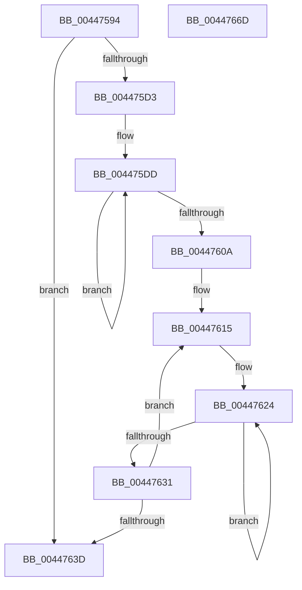

# PpmResetProcessorIdleAccounting

- RVA: `0x00447594`–`0x0044766E` (길이 `218` bytes)
- VA: `0x0000000140447594`
- 실행 섹션: `.text`
- PDB 이름 있음: `예`; PDB Function 태그: `아니요`
- unwind 정보 RVA: `0x0008A350`
- 디코드: `62`개 명령, `218/218` bytes 표시
- 미해석 바이트: `0` (있으면 어셈블리에 `.byte`로 보존)

> 이 문서는 커널 이미지의 기계어와 PDB 기호를 분석해 생성했습니다. 4번과 5번은 함수 원형과 자료형을 바이너리 사용 방식에서 추정한 C 해석이며 원본 소스 복구 결과는 아닙니다.

## 1. Dependencies

- 직접 호출 지점: **1**; 고유 호출 대상: **1**
- 직접 호출자로 확인된 함수: **2**
- RIP 상대 이미지 참조: **0**

### Outgoing calls
- `0x004475F8` → [memset](../6C/memset_function_006C6C40.md) (function, `0x006C6C40`)

### Direct callers
- [PoIdle](../2C/PoIdle_function_002CFB40.md) at `0x002CFD3C`
- [PpmResetIdlePolicy](PpmResetIdlePolicy_function_00447468.md) at `0x00447499`

### Static image references
- 디코드된 RIP-relative 메모리 참조가 없습니다.

## 2. Other-region calls and transfers

- 다른 실행 섹션으로 향하는 call: **0**
- 별도 외부 분기/꼬리 이동을 확인하지 못했습니다.

## 3. Assembly (complete function range)

```asm
00447594  48 8B C4                        mov rax, rsp
00447597  48 89 58 08                     mov qword ptr [rax + 8], rbx
0044759B  48 89 68 10                     mov qword ptr [rax + 0x10], rbp
0044759F  48 89 70 18                     mov qword ptr [rax + 0x18], rsi
004475A3  48 89 78 20                     mov qword ptr [rax + 0x20], rdi
004475A7  41 55                           push r13
004475A9  41 56                           push r14
004475AB  41 57                           push r15
004475AD  48 83 EC 20                     sub rsp, 0x20
004475B1  8B 31                           mov esi, dword ptr [rcx]
004475B3  0F 57 C0                        xorps xmm0, xmm0
004475B6  44 8B 69 08                     mov r13d, dword ptr [rcx + 8]
004475BA  33 C0                           xor eax, eax
004475BC  4C 8B FA                        mov r15, rdx
004475BF  48 8B D9                        mov rbx, rcx
004475C2  8B FE                           mov edi, esi
004475C4  0F 11 01                        movups xmmword ptr [rcx], xmm0
004475C7  0F 11 41 10                     movups xmmword ptr [rcx + 0x10], xmm0
004475CB  48 89 41 20                     mov qword ptr [rcx + 0x20], rax
004475CF  85 F6                           test esi, esi
004475D1  74 6A                           je 0x14044763d
004475D3  48 8D A9 E0 00 00 00            lea rbp, [rcx + 0xe0]
004475DA  44 8B F6                        mov r14d, esi
004475DD  0F 57 C0                        xorps xmm0, xmm0
004475E0  33 C0                           xor eax, eax
004475E2  0F 11 03                        movups xmmword ptr [rbx], xmm0
004475E5  33 D2                           xor edx, edx
004475E7  41 B8 40 03 00 00               mov r8d, 0x340
004475ED  0F 11 43 10                     movups xmmword ptr [rbx + 0x10], xmm0
004475F1  48 8B CD                        mov rcx, rbp
004475F4  48 89 43 20                     mov qword ptr [rbx + 0x20], rax
004475F8  E8 43 F6 27 00                  call 0x1406c6c40
004475FD  48 81 C5 F8 03 00 00            add rbp, 0x3f8
00447604  49 83 EE 01                     sub r14, 1
00447608  75 D3                           jne 0x1404475dd
0044760A  48 8D 83 E8 00 00 00            lea rax, [rbx + 0xe8]
00447611  49 83 C8 FF                     or r8, 0xffffffffffffffff
00447615  4C 89 80 58 FF FF FF            mov qword ptr [rax - 0xa8], r8
0044761C  48 8B C8                        mov rcx, rax
0044761F  BA 1A 00 00 00                  mov edx, 0x1a
00447624  4C 89 01                        mov qword ptr [rcx], r8
00447627  48 8D 49 20                     lea rcx, [rcx + 0x20]
0044762B  48 83 EA 01                     sub rdx, 1
0044762F  75 F3                           jne 0x140447624
00447631  48 05 F8 03 00 00               add rax, 0x3f8
00447637  48 83 EF 01                     sub rdi, 1
0044763B  75 D8                           jne 0x140447615
0044763D  83 63 20 00                     and dword ptr [rbx + 0x20], 0
00447641  41 8D 45 01                     lea eax, [r13 + 1]
00447645  48 8B 6C 24 48                  mov rbp, qword ptr [rsp + 0x48]
0044764A  48 8B 7C 24 58                  mov rdi, qword ptr [rsp + 0x58]
0044764F  89 33                           mov dword ptr [rbx], esi
00447651  48 8B 74 24 50                  mov rsi, qword ptr [rsp + 0x50]
00447656  89 43 08                        mov dword ptr [rbx + 8], eax
00447659  4C 89 7B 10                     mov qword ptr [rbx + 0x10], r15
0044765D  48 8B 5C 24 40                  mov rbx, qword ptr [rsp + 0x40]
00447662  48 83 C4 20                     add rsp, 0x20
00447666  41 5F                           pop r15
00447668  41 5E                           pop r14
0044766A  41 5D                           pop r13
0044766C  C3                              ret
0044766D  CC                              int3
```

## 4. C-style interpretation (structured pseudocode)

```c
__int64 __fastcall PpmResetProcessorIdleAccounting(__int64 a1, __int64 a2)
{
    __int64 result;
    __int64 v_r14;
    __int64 v_rbp;
    __int64 v_rdi;
    __int64 v_rsp;
    unsigned __int64 v_stack_p10;
    unsigned __int64 v_stack_p18;
    unsigned __int64 v_stack_p20;
    unsigned __int64 v_stack_p8;

    *(unsigned __int64 *)(v_rsp + 8) = v_rbx;
    *(unsigned __int64 *)(v_rsp + 16) = v_rbp;
    *(unsigned __int64 *)(v_rsp + 24) = v_rsi;
    *(unsigned __int64 *)(v_rsp + 32) = v_rdi;
    v_rsp = (v_rsp) - (32);
    result = 0;
    *(unsigned __int64 *)(a1) = v_xmm0;
    *(unsigned __int64 *)(a1 + 16) = v_xmm0;
    *(unsigned __int64 *)(a1 + 32) = 0;
    if ((unsigned int)((unsigned int)(*(unsigned int *)(a1))) == 0) goto loc_0044763D;
loc_004475DD:
    result = 0;
    *(unsigned __int64 *)(a1) = v_xmm0;
    a2 = 0;
    *(unsigned __int64 *)(a1 + 16) = v_xmm0;
    *(unsigned __int64 *)(a1 + 32) = 0;
    result = memset(a1 + 224, a2, 832, a4);
    v_rbp = (a1 + 224) + (0x3F8ULL);
    v_r14 = ((unsigned int)((unsigned int)((unsigned int)(*(unsigned int *)(a1))))) - (1);
    if (condition_is_not_equal) goto loc_004475DD;
    a3 = (832) | (-1);
loc_00447615:
    *(unsigned __int64 *)(a1 + 232 - 168) = a3;
loc_00447624:
    *(unsigned __int64 *)(a1 + 232) = a3;
    a2 = (26) - (1);
    if (condition_is_not_equal) goto loc_00447624;
    result = (a1 + 232) + (0x3F8ULL);
    v_rdi = ((unsigned int)((unsigned int)((unsigned int)(*(unsigned int *)(a1))))) - (1);
    if (condition_is_not_equal) goto loc_00447615;
loc_0044763D:
    *(unsigned int *)(a1) = (unsigned int)((unsigned int)(*(unsigned int *)(a1)));
    *(unsigned int *)(a1 + 8) = (unsigned int)((unsigned int)(*(unsigned int *)(a1 + 8)) + 1);
    *(unsigned __int64 *)(a1 + 16) = a2;
    v_rsp = (v_rsp) + (32);
    return (unsigned int)(*(unsigned int *)(a1 + 8)) + 1;
}
```

## 5. (Beta) C Style

```c
int64_t PpmResetProcessorIdleAccounting(void *Arg1, int64_t Arg2)
{
    uint8_t *arg1 = (uint8_t *)Arg1;

    int64_t result;
    int64_t local_r14;
    int64_t local_rbp;
    int64_t local_rdi;
    int64_t local_rsp;
    uint64_t v_stack_p10;
    uint64_t v_stack_p18;
    uint64_t v_stack_p20;
    uint64_t v_stack_p8;

    *(uint64_t *)(local_rsp + 0x8) = local_rbx;
    *(uint64_t *)(local_rsp + 0x10) = local_rbp;
    *(uint64_t *)(local_rsp + 0x18) = local_rsi;
    *(uint64_t *)(local_rsp + 0x20) = local_rdi;
    local_rsp = (local_rsp) - (32);
    result = 0;
    *(uint64_t *)(arg1) = v_xmm0;
    *(uint64_t *)(arg1 + 0x10) = v_xmm0;
    *(uint64_t *)(arg1 + 0x20) = 0;
    if ((uint32_t)((uint32_t)(*(uint32_t *)(arg1))) == 0) goto loc_0044763D;
loc_004475DD:
    result = 0;
    *(uint64_t *)(arg1) = v_xmm0;
    Arg2 = 0;
    *(uint64_t *)(arg1 + 0x10) = v_xmm0;
    *(uint64_t *)(arg1 + 0x20) = 0;
    result = memset(Arg1 + 224, Arg2, 832, a4);
    local_rbp = (Arg1 + 224) + (0x3F8ULL);
    local_r14 = ((uint32_t)((uint32_t)((uint32_t)(*(uint32_t *)(arg1))))) - (1);
    if (condition_is_not_equal) goto loc_004475DD;
    a3 = (832) | (-1);
loc_00447615:
    *(uint64_t *)(arg1 + 0xE8 - 0xA8) = a3;
loc_00447624:
    *(uint64_t *)(arg1 + 0xE8) = a3;
    Arg2 = (26) - (1);
    if (condition_is_not_equal) goto loc_00447624;
    result = (Arg1 + 232) + (0x3F8ULL);
    local_rdi = ((uint32_t)((uint32_t)((uint32_t)(*(uint32_t *)(arg1))))) - (1);
    if (condition_is_not_equal) goto loc_00447615;
loc_0044763D:
    *(uint32_t *)(arg1) = (uint32_t)((uint32_t)(*(uint32_t *)(arg1)));
    *(uint32_t *)(arg1 + 0x8) = (uint32_t)((uint32_t)(*(uint32_t *)(arg1 + 0x8)) + 1);
    *(uint64_t *)(arg1 + 0x10) = Arg2;
    local_rsp = (local_rsp) + (32);
    return (uint32_t)(*(uint32_t *)(arg1 + 0x8)) + 1;
}
```

### 관측된 메모리 오프셋

구조체 형식이 확인되지 않은 접근은 인자 기준의 오프셋으로만 기록했습니다.

| 기준 인자 | 오프셋 표현 | 폭 (bit) | 접근 |
|---|---:|---:|---|
| `Arg1` | `- 0xA8` | `64` | `W` |
| `Arg1` | `+ 0x0` | `32` | `R` |
| `Arg1` | `+ 0x0` | `32` | `W` |
| `Arg1` | `+ 0x0` | `64` | `W` |
| `Arg1` | `+ 0x0` | `128` | `R` |
| `Arg1` | `+ 0x8` | `32` | `R` |
| `Arg1` | `+ 0x8` | `32` | `W` |
| `Arg1` | `+ 0x10` | `64` | `W` |
| `Arg1` | `+ 0x10` | `128` | `R` |
| `Arg1` | `+ 0x20` | `32` | `R/W` |
| `Arg1` | `+ 0x20` | `64` | `R` |
| `Arg1` | `+ 0x20` | `64` | `W` |
| `Arg1` | `+ 0xE0` | `64` | `R` |
| `Arg1` | `+ 0xE8` | `64` | `R` |

## 6. Execution-region graph

[열기: 2D/3D 그래프와 함수 탐색 컨트롤 패널](../../../control-panel.html?section=text&rva=0x00447594&view=graph)

- 2D 그래프는 위에서 아래로 흐르고, 3D 그래프는 빈 공간을 드래그해 회전합니다. Shift+드래그는 이동, 휠은 확대·축소, 함수 노드 선택은 대상 보고서 이동입니다.

### Static fallback


