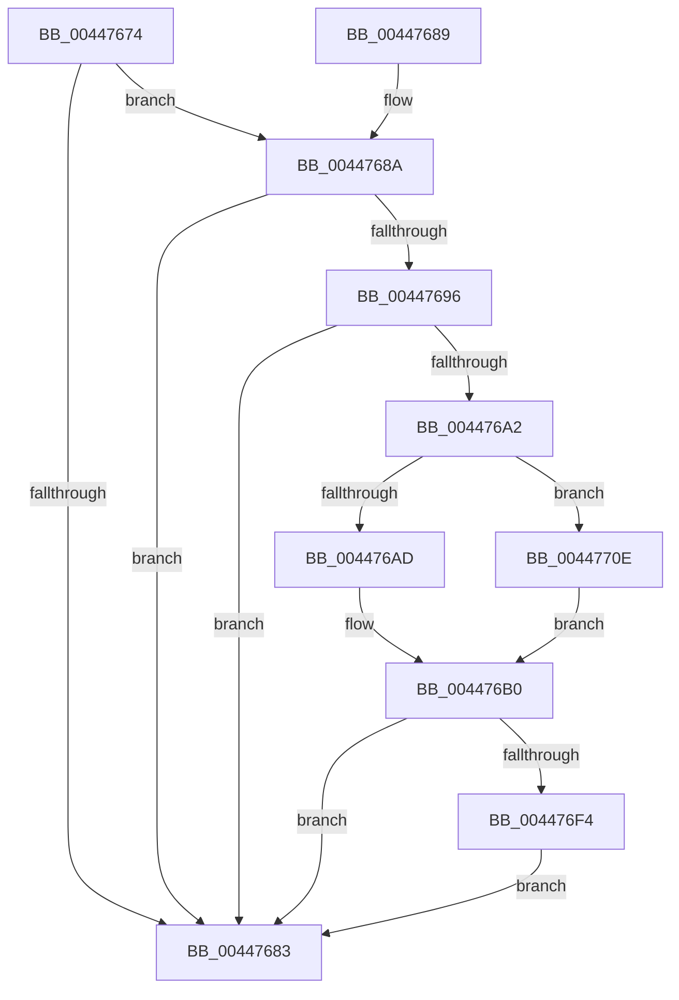

# PpmScaleIdleStateValues

- RVA: `0x00447674`–`0x00447716` (길이 `162` bytes)
- VA: `0x0000000140447674`
- 실행 섹션: `.text`
- PDB 이름 있음: `예`; PDB Function 태그: `아니요`
- unwind 정보 RVA: `0x000A5E90`
- 디코드: `45`개 명령, `162/162` bytes 표시
- 미해석 바이트: `0` (있으면 어셈블리에 `.byte`로 보존)

> 이 문서는 커널 이미지의 기계어와 PDB 기호를 분석해 생성했습니다. 4번과 5번은 함수 원형과 자료형을 바이너리 사용 방식에서 추정한 C 해석이며 원본 소스 복구 결과는 아닙니다.

## 1. Dependencies

- 직접 호출 지점: **2**; 고유 호출 대상: **2**
- 직접 호출자로 확인된 함수: **2**
- RIP 상대 이미지 참조: **0**

### Outgoing calls
- `0x004476FB` → [HvlGetLpIndexFromProcessorIndex](HvlGetLpIndexFromProcessorIndex_function_0044FFE0.md) (function, `0x0044FFE0`)
- `0x00447704` → [HvlRegisterLogicalProcessorFrequency](../4C/HvlRegisterLogicalProcessorFrequency_function_004C90C8.md) (function, `0x004C90C8`)

### Direct callers
- [PpmPerfApplyProcessorState](../2D/PpmPerfApplyProcessorState_function_002DA4BC.md) at `0x002DA5D0`
- [PpmResetIdlePolicy](PpmResetIdlePolicy_function_00447468.md) at `0x00447486`

### Static image references
- 디코드된 RIP-relative 메모리 참조가 없습니다.

## 2. Other-region calls and transfers

- 다른 실행 섹션으로 향하는 call: **0**
- 별도 외부 분기/꼬리 이동을 확인하지 못했습니다.

## 3. Assembly (complete function range)

```asm
00447674  40 53                           push rbx
00447676  48 83 EC 20                     sub rsp, 0x20
0044767A  80 79 48 00                     cmp byte ptr [rcx + 0x48], 0
0044767E  4C 8B C9                        mov r9, rcx
00447681  75 07                           jne 0x14044768a
00447683  48 83 C4 20                     add rsp, 0x20
00447687  5B                              pop rbx
00447688  C3                              ret
00447689  CC                              int3
0044768A  48 8B 89 78 01 00 00            mov rcx, qword ptr [rcx + 0x178]
00447691  48 85 C9                        test rcx, rcx
00447694  74 ED                           je 0x140447683
00447696  49 8B 91 70 01 00 00            mov rdx, qword ptr [r9 + 0x170]
0044769D  48 85 D2                        test rdx, rdx
004476A0  74 E1                           je 0x140447683
004476A2  8B 82 10 02 00 00               mov eax, dword ptr [rdx + 0x210]
004476A8  39 41 50                        cmp dword ptr [rcx + 0x50], eax
004476AB  73 61                           jae 0x14044770e
004476AD  8A 41 50                        mov al, byte ptr [rcx + 0x50]
004476B0  41 0F B6 49 46                  movzx ecx, byte ptr [r9 + 0x46]
004476B5  41 BA 59 17 B7 D1               mov r10d, 0xd1b71759
004476BB  0F B6 D8                        movzx ebx, al
004476BE  41 8B C2                        mov eax, r10d
004476C1  44 8B C3                        mov r8d, ebx
004476C4  44 0F AF C3                     imul r8d, ebx
004476C8  41 0F AF C8                     imul ecx, r8d
004476CC  F7 E1                           mul ecx
004476CE  41 0F B6 49 47                  movzx ecx, byte ptr [r9 + 0x47]
004476D3  41 8B C2                        mov eax, r10d
004476D6  C1 EA 0D                        shr edx, 0xd
004476D9  41 88 51 44                     mov byte ptr [r9 + 0x44], dl
004476DD  41 0F AF C8                     imul ecx, r8d
004476E1  F7 E1                           mul ecx
004476E3  C1 EA 0D                        shr edx, 0xd
004476E6  41 88 51 45                     mov byte ptr [r9 + 0x45], dl
004476EA  41 83 B9 E0 00 00 00 03         cmp dword ptr [r9 + 0xe0], 3
004476F2  75 8F                           jne 0x140447683
004476F4  41 8B 89 E4 77 FF FF            mov ecx, dword ptr [r9 - 0x881c]
004476FB  E8 E0 88 00 00                  call 0x14044ffe0
00447700  8B C8                           mov ecx, eax
00447702  8B D3                           mov edx, ebx
00447704  E8 BF 19 08 00                  call 0x1404c90c8
00447709  E9 75 FF FF FF                  jmp 0x140447683
0044770E  8A 82 10 02 00 00               mov al, byte ptr [rdx + 0x210]
00447714  EB 9A                           jmp 0x1404476b0
```

## 4. C-style interpretation (structured pseudocode)

```c
__int64 __fastcall PpmScaleIdleStateValues(__int64 a1)
{
    __int64 result;
    __int64 v_rsp;

    v_rsp = (v_rsp) - (32);
    if ((*(unsigned __int8 *)(a1 + 72)) != 0) goto loc_0044768A;
loc_00447683:
    v_rsp = (v_rsp) + (32);
    return result;
loc_0044768A:
    if (*(unsigned __int64 *)(a1 + 376) == 0) goto loc_00447683;
    if (*(unsigned __int64 *)(a1 + 368) == 0) goto loc_00447683;
    if ((*(unsigned int *)(*(unsigned __int64 *)(a1 + 376) + 80)) >= ((unsigned int)((unsigned int)(*(unsigned int *)(*(unsigned __int64 *)(a1 + 368) + 528))))) goto loc_0044770E;
loc_004476B0:
    a3 = (unsigned int)(((unsigned int)((unsigned int)((unsigned __int8)(*(unsigned __int8 *)(*(unsigned __int64 *)(a1 + 376) + 80))))) * ((unsigned int)((unsigned __int8)(*(unsigned __int8 *)(*(unsigned __int64 *)(a1 + 376) + 80)))));
    a1 = (unsigned int)((*(unsigned __int8 *)(a1 + 70)) * ((unsigned int)(a3)));
    a2 = (unsigned int)((*(unsigned __int64 *)(a1 + 368)) >> (13));
    *(unsigned __int8 *)(a1 + 68) = (unsigned __int8)(a2);
    a1 = (unsigned int)((*(unsigned __int8 *)(a1 + 71)) * ((unsigned int)(a3)));
    a2 = (unsigned int)((a2) >> (13));
    *(unsigned __int8 *)(a1 + 69) = (unsigned __int8)(a2);
    if ((*(unsigned int *)(a1 + 224)) != 3) goto loc_00447683;
    result = HvlGetLpIndexFromProcessorIndex((unsigned int)(*(unsigned int *)(a1 - 34844)), a2, a3, a1);
    result = HvlRegisterLogicalProcessorFrequency((unsigned int)((unsigned int)(result)), (unsigned int)((unsigned int)((unsigned __int8)(*(unsigned __int8 *)(*(unsigned __int64 *)(a1 + 376) + 80)))), a3, a1);
    goto loc_00447683;
loc_0044770E:
    goto loc_004476B0;
}
```

## 5. (Beta) C Style

```c
int64_t PpmScaleIdleStateValues(void *Arg1)
{
    uint8_t *arg1 = (uint8_t *)Arg1;

    int64_t result;
    int64_t local_rsp;

    local_rsp = (local_rsp) - (32);
    if ((*(uint8_t *)(arg1 + 0x48)) != 0) goto loc_0044768A;
loc_00447683:
    local_rsp = (local_rsp) + (32);
    return result;
loc_0044768A:
    if (*(uint64_t *)(arg1 + 0x178) == 0) goto loc_00447683;
    if (*(uint64_t *)(arg1 + 0x170) == 0) goto loc_00447683;
    if ((*(uint32_t *)(*(uint64_t *)(arg1 + 0x178) + 0x50)) >= ((uint32_t)((uint32_t)(*(uint32_t *)(*(uint64_t *)(arg1 + 0x170) + 0x210))))) goto loc_0044770E;
loc_004476B0:
    a3 = (uint32_t)(((uint32_t)((uint32_t)((uint8_t)(*(uint8_t *)(*(uint64_t *)(arg1 + 0x178) + 0x50))))) * ((uint32_t)((uint8_t)(*(uint8_t *)(*(uint64_t *)(arg1 + 0x178) + 0x50)))));
    Arg1 = (uint32_t)((*(uint8_t *)(arg1 + 0x46)) * ((uint32_t)(a3)));
    a2 = (uint32_t)((*(uint64_t *)(arg1 + 0x170)) >> (13));
    *(uint8_t *)(arg1 + 0x44) = (uint8_t)(a2);
    Arg1 = (uint32_t)((*(uint8_t *)(arg1 + 0x47)) * ((uint32_t)(a3)));
    a2 = (uint32_t)((a2) >> (13));
    *(uint8_t *)(arg1 + 0x45) = (uint8_t)(a2);
    if ((*(uint32_t *)(arg1 + 0xE0)) != 3) goto loc_00447683;
    result = HvlGetLpIndexFromProcessorIndex((uint32_t)(*(uint32_t *)(arg1 - 0x881C)), a2, a3, Arg1);
    result = HvlRegisterLogicalProcessorFrequency((uint32_t)((uint32_t)(result)), (uint32_t)((uint32_t)((uint8_t)(*(uint8_t *)(*(uint64_t *)(arg1 + 0x178) + 0x50)))), a3, Arg1);
    goto loc_00447683;
loc_0044770E:
    goto loc_004476B0;
}
```

### 관측된 메모리 오프셋

구조체 형식이 확인되지 않은 접근은 인자 기준의 오프셋으로만 기록했습니다.

| 기준 인자 | 오프셋 표현 | 폭 (bit) | 접근 |
|---|---:|---:|---|
| `Arg1` | `- 0x881C` | `32` | `R` |
| `Arg1` | `+ 0x44` | `8` | `W` |
| `Arg1` | `+ 0x45` | `8` | `W` |
| `Arg1` | `+ 0x46` | `8` | `R` |
| `Arg1` | `+ 0x47` | `8` | `R` |
| `Arg1` | `+ 0x48` | `8` | `R` |
| `Arg1` | `+ 0xE0` | `32` | `R` |
| `Arg1` | `+ 0x170` | `64` | `R` |
| `Arg1` | `+ 0x178` | `64` | `R` |

## 6. Execution-region graph

[열기: 2D/3D 그래프와 함수 탐색 컨트롤 패널](../../../control-panel.html?section=text&rva=0x00447674&view=graph)

- 2D 그래프는 위에서 아래로 흐르고, 3D 그래프는 빈 공간을 드래그해 회전합니다. Shift+드래그는 이동, 휠은 확대·축소, 함수 노드 선택은 대상 보고서 이동입니다.

### Static fallback


