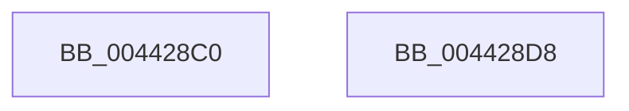

# PsAttachSiloToCurrentThread

- RVA: `0x004428C0`–`0x004428D9` (길이 `25` bytes)
- VA: `0x00000001404428C0`
- 실행 섹션: `.text`
- PDB 이름 있음: `예`; PDB Function 태그: `아니요`
- unwind 정보 RVA: `0x000DB714`
- 디코드: `5`개 명령, `25/25` bytes 표시
- 미해석 바이트: `0` (있으면 어셈블리에 `.byte`로 보존)

> 이 문서는 커널 이미지의 기계어와 PDB 기호를 분석해 생성했습니다. 4번과 5번은 함수 원형과 자료형을 바이너리 사용 방식에서 추정한 C 해석이며 원본 소스 복구 결과는 아닙니다.

## 1. Dependencies

- 직접 호출 지점: **0**; 고유 호출 대상: **0**
- 직접 호출자로 확인된 함수: **33**
- RIP 상대 이미지 참조: **0**

### Outgoing calls
- 직접 디코드된 call 명령이 없습니다.

### Direct callers
- [PspDeleteExternalServerSiloState](../../page/77/PspDeleteExternalServerSiloState_function_0077FB88.md) at `0x0077FBAC`
- [PspInitializeServerSiloDeferred](../../page/77/PspInitializeServerSiloDeferred_function_0077FEE0.md) at `0x0077FF6E`
- [PspInitializeServerSiloDeferred](../../page/77/PspInitializeServerSiloDeferred_function_0077FEE0.md) at `0x0077FFAF`
- [PspInitializeServerSiloDeferred](../../page/77/PspInitializeServerSiloDeferred_function_0077FEE0.md) at `0x0077FFE4`
- [PspInitializeServerSiloDeferred](../../page/77/PspInitializeServerSiloDeferred_function_0077FEE0.md) at `0x0078002A`
- [PspInitializeServerSiloDeferred](../../page/77/PspInitializeServerSiloDeferred_function_0077FEE0.md) at `0x007800AD`
- [PspShutdownCsrProcess](../../page/78/PspShutdownCsrProcess_function_00780214.md) at `0x00780273`
- [PspSiloInitializeSystemRootSymlink](../../page/78/PspSiloInitializeSystemRootSymlink_function_00780558.md) at `0x00780625`
- [PspSiloInitializeUserSharedData](../../page/78/PspSiloInitializeUserSharedData_function_00780684.md) at `0x00780731`
- [PspSiloLoadApiSets](../../page/78/PspSiloLoadApiSets_function_00780848.md) at `0x00780882`
- [SeInitServerSilo](../../page/79/SeInitServerSilo_function_0079C3EC.md) at `0x0079C42E`
- [SepDeleteUnreferencedLogonSessionsInSilo](../../page/7A/SepDeleteUnreferencedLogonSessionsInSilo_function_007A15D8.md) at `0x007A15F1`
- [EtwpInitializeSiloState](../../page/7B/EtwpInitializeSiloState_function_007B6A3C.md) at `0x007B6B81`
- [EtwpUpdateFileInfoDriverRegistration](../../page/7B/EtwpUpdateFileInfoDriverRegistration_function_007B8B1C.md) at `0x007B8B5C`
- [ExpTimeZoneInitSiloState](../../page/7C/ExpTimeZoneInitSiloState_function_007C6430.md) at `0x007C6449`
- [ExpTimeZoneWork](../../page/7C/ExpTimeZoneWork_function_007C64F0.md) at `0x007C6502`
- [ObCreateSiloRootDirectory](../../page/83/ObCreateSiloRootDirectory_function_0083CA34.md) at `0x0083CADF`
- [ObpDecrementHandleCount](../../page/86/ObpDecrementHandleCount_function_008632E0.md) at `0x0086339F`
- [ObCloseHandleTableEntry](../../page/86/ObCloseHandleTableEntry_function_00869E20.md) at `0x0086A10F`
- [ObpCreateHandle](../../page/86/ObpCreateHandle_function_0086B950.md) at `0x0086D550`
- [ObpIncrementHandleCountEx](../../page/86/ObpIncrementHandleCountEx_function_0086DA10.md) at `0x0086E1DC`
- [ExpWnfLookupPermanentName](../../page/8B/ExpWnfLookupPermanentName_function_008BD914.md) at `0x008BD985`
- [ExpWnfAllocateNextPersistentNameSequence](../../page/8B/ExpWnfAllocateNextPersistentNameSequence_function_008BDE84.md) at `0x008BDECE`
- [VrpHandleIoctlGetVirtualRootKey](../../page/93/VrpHandleIoctlGetVirtualRootKey_function_00935374.md) at `0x00935437`
- [MmLoadSystemImageEx](../../page/99/MmLoadSystemImageEx_function_00999B8C.md) at `0x00999C2D`
- [EtwpLogger](../../page/9B/EtwpLogger_function_009BE310.md) at `0x009BE352`
- [EtwpTrackGuidEntryRegistrations](../../page/A0/EtwpTrackGuidEntryRegistrations_function_00A03CC0.md) at `0x00A03E45`
- [EtwpEnableGuid](../../page/A5/EtwpEnableGuid_function_00A5CD28.md) at `0x00A5D72C`
- [SepRmCommandServerThread](../../page/A6/SepRmCommandServerThread_function_00A6A8D0.md) at `0x00A6AA71`
- [SepRmLsaConnectRequest](../../page/A6/SepRmLsaConnectRequest_function_00A6AB54.md) at `0x00A6AD5B`
- [ExpRefreshTimeZoneInformation](../../page/A6/ExpRefreshTimeZoneInformation_function_00A6B46C.md) at `0x00A6B51A`
- [SepCleanupLUIDDeviceMapDirectory](../../page/A9/SepCleanupLUIDDeviceMapDirectory_function_00A98F24.md) at `0x00A99033`
- [MmUnloadSystemImage](../../page/AA/MmUnloadSystemImage_function_00AA2F60.md) at `0x00AA2F99`
- [IopUnloadDriver](../../page/AB/IopUnloadDriver_function_00ABF868.md) at `0x00ABFB9D`
- [sub_00B1B2E4](../../page/B1/Unknown_function_00B1B2E4.md) at `0x00B1B5D7`
- [sub_00B1B2E4](../../page/B1/Unknown_function_00B1B2E4.md) at `0x00B1B6A3`
- [sub_00B20D7E](../../page/B2/Unknown_function_00B20D7E.md) at `0x00B20D7E`
- [IovpUnloadDriver](../../pagevrfy/B9/IovpUnloadDriver_function_00B92AE8.md) at `0x00B92B60`

### Static image references
- 디코드된 RIP-relative 메모리 참조가 없습니다.

## 2. Other-region calls and transfers

- 다른 실행 섹션으로 향하는 call: **0**
- 별도 외부 분기/꼬리 이동을 확인하지 못했습니다.

## 3. Assembly (complete function range)

```asm
004428C0  65 48 8B 14 25 88 01 00 00      mov rdx, qword ptr gs:[0x188]
004428C9  48 8B 82 98 06 00 00            mov rax, qword ptr [rdx + 0x698]
004428D0  48 89 8A 98 06 00 00            mov qword ptr [rdx + 0x698], rcx
004428D7  C3                              ret
004428D8  CC                              int3
```

## 4. C-style interpretation (structured pseudocode)

```c
__int64 __fastcall PsAttachSiloToCurrentThread(__int64 a1)
{
    *(unsigned __int64 *)(*(unsigned __int64 *)(gs_base + (0 + 392)) + 1688) = a1;
    return *(unsigned __int64 *)(*(unsigned __int64 *)(gs_base + (0 + 392)) + 1688);
}
```

## 5. (Beta) C Style

```c
int64_t PsAttachSiloToCurrentThread(int64_t Arg1)
{
    *(uint64_t *)(*(uint64_t *)(gs_base + (0 + 0x188)) + 0x698) = Arg1;
    return *(uint64_t *)(*(uint64_t *)(gs_base + (0 + 0x188)) + 0x698);
}
```

## 6. Execution-region graph

[열기: 2D/3D 그래프와 함수 탐색 컨트롤 패널](../../../control-panel.html?section=text&rva=0x004428C0&view=graph)

- 2D 그래프는 위에서 아래로 흐르고, 3D 그래프는 빈 공간을 드래그해 회전합니다. Shift+드래그는 이동, 휠은 확대·축소, 함수 노드 선택은 대상 보고서 이동입니다.

### Static fallback


