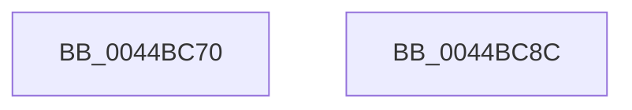

# PsEncodeThreadWorkOnBehalfTicket

- RVA: `0x0044BC70`–`0x0044BC8D` (길이 `29` bytes)
- VA: `0x000000014044BC70`
- 실행 섹션: `.text`
- PDB 이름 있음: `예`; PDB Function 태그: `아니요`
- unwind 정보 RVA: `0x000DB714`
- 디코드: `8`개 명령, `29/29` bytes 표시
- 미해석 바이트: `0` (있으면 어셈블리에 `.byte`로 보존)

> 이 문서는 커널 이미지의 기계어와 PDB 기호를 분석해 생성했습니다. 4번과 5번은 함수 원형과 자료형을 바이너리 사용 방식에서 추정한 C 해석이며 원본 소스 복구 결과는 아닙니다.

## 1. Dependencies

- 직접 호출 지점: **0**; 고유 호출 대상: **0**
- 직접 호출자로 확인된 함수: **3**
- RIP 상대 이미지 참조: **1**

### Outgoing calls
- 직접 디코드된 call 명령이 없습니다.

### Direct callers
- [NtAlpcImpersonateClientContainerOfPort](../../page/74/NtAlpcImpersonateClientContainerOfPort_function_0074C1B0.md) at `0x0074C38B`
- [AlpcpCaptureWorkOnBehalfAttribute](../../page/9D/AlpcpCaptureWorkOnBehalfAttribute_function_009D6D10.md) at `0x009D6D6D`
- [NtQueryInformationThread](../../page/AE/NtQueryInformationThread_function_00AE3760.md) at `0x00AE4DAC`
- [NtQueryInformationThread](../../page/AE/NtQueryInformationThread_function_00AE3760.md) at `0x00AE4DBB`

### Static image references
- `0x0044BC81` → RVA `0x00FD9DD0` (`PAGEDATA`; read)

## 2. Other-region calls and transfers

- 다른 실행 섹션으로 향하는 call: **0**
- 별도 외부 분기/꼬리 이동을 확인하지 못했습니다.

## 3. Assembly (complete function range)

```asm
0044BC70  8B 81 10 05 00 00               mov eax, dword ptr [rcx + 0x510]
0044BC76  89 02                           mov dword ptr [rdx], eax
0044BC78  8B 81 C0 04 00 00               mov eax, dword ptr [rcx + 0x4c0]
0044BC7E  89 42 04                        mov dword ptr [rdx + 4], eax
0044BC81  48 8B 05 48 E1 B8 00            mov rax, qword ptr [rip + 0xb8e148]
0044BC88  48 31 02                        xor qword ptr [rdx], rax
0044BC8B  C3                              ret
0044BC8C  CC                              int3
```

## 4. C-style interpretation (structured pseudocode)

```c
__int64 __fastcall PsEncodeThreadWorkOnBehalfTicket(__int64 a1, __int64 a2)
{
    *(unsigned int *)(a2) = (unsigned int)((unsigned int)(*(unsigned int *)(a1 + 1296)));
    *(unsigned int *)(a2 + 4) = (unsigned int)((unsigned int)(*(unsigned int *)(a1 + 1216)));
    return *(unsigned __int64 *)(v_rip + 12116296);
}
```

## 5. (Beta) C Style

```c
int64_t PsEncodeThreadWorkOnBehalfTicket(void *Arg1, void *Arg2)
{
    uint8_t *arg1 = (uint8_t *)Arg1;
    uint8_t *arg2 = (uint8_t *)Arg2;

    *(uint32_t *)(arg2) = (uint32_t)((uint32_t)(*(uint32_t *)(arg1 + 0x510)));
    *(uint32_t *)(arg2 + 0x4) = (uint32_t)((uint32_t)(*(uint32_t *)(arg1 + 0x4C0)));
    return *(uint64_t *)(v_rip + 0xB8E148);
}
```

### 관측된 메모리 오프셋

구조체 형식이 확인되지 않은 접근은 인자 기준의 오프셋으로만 기록했습니다.

| 기준 인자 | 오프셋 표현 | 폭 (bit) | 접근 |
|---|---:|---:|---|
| `Arg1` | `+ 0x4C0` | `32` | `R` |
| `Arg1` | `+ 0x510` | `32` | `R` |
| `Arg2` | `+ 0x0` | `32` | `W` |
| `Arg2` | `+ 0x0` | `64` | `R/W` |
| `Arg2` | `+ 0x4` | `32` | `W` |

## 6. Execution-region graph

[열기: 2D/3D 그래프와 함수 탐색 컨트롤 패널](../../../control-panel.html?section=text&rva=0x0044BC70&view=graph)

- 2D 그래프는 위에서 아래로 흐르고, 3D 그래프는 빈 공간을 드래그해 회전합니다. Shift+드래그는 이동, 휠은 확대·축소, 함수 노드 선택은 대상 보고서 이동입니다.

### Static fallback


