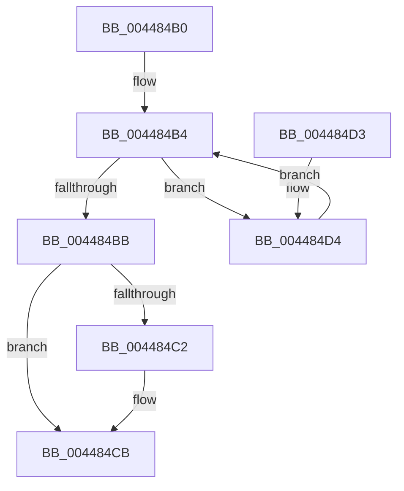

# PsGetBaseTrapFrame

- RVA: `0x004484B0`–`0x004484DA` (길이 `42` bytes)
- VA: `0x00000001404484B0`
- 실행 섹션: `.text`
- PDB 이름 있음: `예`; PDB Function 태그: `아니요`
- unwind 정보 RVA: `0x000DB714`
- 디코드: `14`개 명령, `42/42` bytes 표시
- 미해석 바이트: `0` (있으면 어셈블리에 `.byte`로 보존)

> 이 문서는 커널 이미지의 기계어와 PDB 기호를 분석해 생성했습니다. 4번과 5번은 함수 원형과 자료형을 바이너리 사용 방식에서 추정한 C 해석이며 원본 소스 복구 결과는 아닙니다.

## 1. Dependencies

- 직접 호출 지점: **0**; 고유 호출 대상: **0**
- 직접 호출자로 확인된 함수: **2**
- RIP 상대 이미지 참조: **0**

### Outgoing calls
- 직접 디코드된 call 명령이 없습니다.

### Direct callers
- [PsCallEnclave](../../page/A0/PsCallEnclave_function_00A0CF50.md) at `0x00A0D033`
- [PsPicoWalkUserStack](../../page/AB/PsPicoWalkUserStack_function_00ABF288.md) at `0x00ABF2C9`

### Static image references
- 디코드된 RIP-relative 메모리 참조가 없습니다.

## 2. Other-region calls and transfers

- 다른 실행 섹션으로 향하는 call: **0**
- 별도 외부 분기/꼬리 이동을 확인하지 못했습니다.

## 3. Assembly (complete function range)

```asm
004484B0  4C 8B 41 28                     mov r8, qword ptr [rcx + 0x28]
004484B4  41 F6 40 08 01                  test byte ptr [r8 + 8], 1
004484B9  75 19                           jne 0x1404484d4
004484BB  33 C0                           xor eax, eax
004484BD  48 85 D2                        test rdx, rdx
004484C0  74 09                           je 0x1404484cb
004484C2  49 39 40 20                     cmp qword ptr [r8 + 0x20], rax
004484C6  0F 95 C0                        setne al
004484C9  89 02                           mov dword ptr [rdx], eax
004484CB  49 8D 80 70 FE FF FF            lea rax, [r8 - 0x190]
004484D2  C3                              ret
004484D3  CC                              int3
004484D4  4D 8B 40 28                     mov r8, qword ptr [r8 + 0x28]
004484D8  EB DA                           jmp 0x1404484b4
```

## 4. C-style interpretation (structured pseudocode)

```c
__int64 __fastcall PsGetBaseTrapFrame(__int64 a1, __int64 a2)
{
    __int64 result;

loc_004484B4:
    if (((*(unsigned __int8 *)(*(unsigned __int64 *)(a1 + 40) + 8)) & (1)) != 0) goto loc_004484D4;
    result = 0;
    if (a2 != 0) {
        result = ((*(unsigned __int64 *)(*(unsigned __int64 *)(a1 + 40) + 32)) != 0) ? 1 : 0;
        *(unsigned int *)(a2) = (unsigned int)(result);
    }
    return *(unsigned __int64 *)(a1 + 40) - 400;
loc_004484D4:
    goto loc_004484B4;
}
```

## 5. (Beta) C Style

```c
int64_t PsGetBaseTrapFrame(void *Arg1, int64_t Arg2)
{
    uint8_t *arg1 = (uint8_t *)Arg1;

    int64_t result;

loc_004484B4:
    if (((*(uint8_t *)(*(uint64_t *)(arg1 + 0x28) + 0x8)) & (1)) != 0) goto loc_004484D4;
    result = 0;
    if (Arg2 != 0) {
        result = ((*(uint64_t *)(*(uint64_t *)(arg1 + 0x28) + 0x20)) != 0) ? 1 : 0;
        *(uint32_t *)(Arg2) = (uint32_t)(result);
    }
    return *(uint64_t *)(arg1 + 0x28) - 400;
loc_004484D4:
    goto loc_004484B4;
}
```

### 관측된 메모리 오프셋

구조체 형식이 확인되지 않은 접근은 인자 기준의 오프셋으로만 기록했습니다.

| 기준 인자 | 오프셋 표현 | 폭 (bit) | 접근 |
|---|---:|---:|---|
| `Arg1` | `+ 0x28` | `64` | `R` |

## 6. Execution-region graph

[열기: 2D/3D 그래프와 함수 탐색 컨트롤 패널](../../../control-panel.html?section=text&rva=0x004484B0&view=graph)

- 2D 그래프는 위에서 아래로 흐르고, 3D 그래프는 빈 공간을 드래그해 회전합니다. Shift+드래그는 이동, 휠은 확대·축소, 함수 노드 선택은 대상 보고서 이동입니다.

### Static fallback


