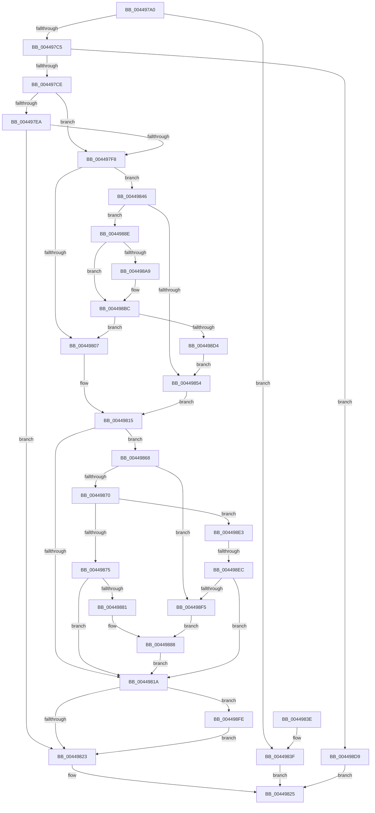

# PsGetEffectiveContainerId

- RVA: `0x004497A0`–`0x00449910` (길이 `368` bytes)
- VA: `0x00000001404497A0`
- 실행 섹션: `.text`
- PDB 이름 있음: `예`; PDB Function 태그: `예`
- unwind 정보 RVA: `0x000A6390`
- 디코드: `91`개 명령, `368/368` bytes 표시
- 미해석 바이트: `0` (있으면 어셈블리에 `.byte`로 보존)

> 이 문서는 커널 이미지의 기계어와 PDB 기호를 분석해 생성했습니다. 4번과 5번은 함수 원형과 자료형을 바이너리 사용 방식에서 추정한 C 해석이며 원본 소스 복구 결과는 아닙니다.

## 1. Dependencies

- 직접 호출 지점: **4**; 고유 호출 대상: **4**
- 직접 호출자로 확인된 함수: **1**
- RIP 상대 이미지 참조: **1**

### Outgoing calls
- `0x00449895` → [ExAcquireSpinLockShared](../24/ExAcquireSpinLockShared_function_0024DCE0.md) (function, `0x0024DCE0`)
- `0x004498B1` → [ObfReferenceObjectWithTag](../21/ObfReferenceObjectWithTag_function_00210710.md) (function, `0x00210710`)
- `0x004498C6` → [ExReleaseSpinLockShared](../2F/ExReleaseSpinLockShared_function_002F0EF0.md) (function, `0x002F0EF0`)
- `0x00449906` → [ObfDereferenceObjectWithTag](../2F/ObfDereferenceObjectWithTag_function_002F78E0.md) (function, `0x002F78E0`)

### Direct callers
- [NtQueryInformationThread](../../page/AE/NtQueryInformationThread_function_00AE3760.md) at `0x00AE487A`

### Static image references
- `0x0044988E` → RVA `0x00F06590` (`.data`; read)

## 2. Other-region calls and transfers

- 다른 실행 섹션으로 향하는 call: **0**
- call이 아닌 외부 분기/꼬리 이동: **1**
  - `0x004498E6` → [sub_006F0B44](../6F/Unknown_function_006F0B44.md) (`tail-transfer`)

## 3. Assembly (complete function range)

```asm
004497A0  48 89 5C 24 08                  mov qword ptr [rsp + 8], rbx
004497A5  48 89 6C 24 10                  mov qword ptr [rsp + 0x10], rbp
004497AA  48 89 74 24 18                  mov qword ptr [rsp + 0x18], rsi
004497AF  57                              push rdi
004497B0  41 56                           push r14
004497B2  41 57                           push r15
004497B4  48 83 EC 20                     sub rsp, 0x20
004497B8  49 8B F0                        mov rsi, r8
004497BB  48 8B FA                        mov rdi, rdx
004497BE  8B D9                           mov ebx, ecx
004497C0  83 F9 05                        cmp ecx, 5
004497C3  7D 7A                           jge 0x14044983f
004497C5  48 85 D2                        test rdx, rdx
004497C8  0F 84 0B 01 00 00               je 0x1404498d9
004497CE  33 C0                           xor eax, eax
004497D0  0F 57 C0                        xorps xmm0, xmm0
004497D3  41 0F 11 00                     movups xmmword ptr [r8], xmm0
004497D7  41 89 40 10                     mov dword ptr [r8 + 0x10], eax
004497DB  65 8B 04 25 3C 3A 00 00         mov eax, dword ptr gs:[0x3a3c]
004497E3  A9 01 00 01 00                  test eax, 0x10001
004497E8  74 0E                           je 0x1404497f8
004497EA  65 48 8B 04 25 88 01 00 00      mov rax, qword ptr gs:[0x188]
004497F3  48 3B D0                        cmp rdx, rax
004497F6  74 2B                           je 0x140449823
004497F8  48 8B AA 50 06 00 00            mov rbp, qword ptr [rdx + 0x650]
004497FF  45 33 F6                        xor r14d, r14d
00449802  48 85 ED                        test rbp, rbp
00449805  75 3F                           jne 0x140449846
00449807  48 8B 87 20 02 00 00            mov rax, qword ptr [rdi + 0x220]
0044980E  48 8B 88 A0 02 00 00            mov rcx, qword ptr [rax + 0x2a0]
00449815  48 85 C9                        test rcx, rcx
00449818  75 4E                           jne 0x140449868
0044981A  45 85 F6                        test r14d, r14d
0044981D  0F 85 DB 00 00 00               jne 0x1404498fe
00449823  33 C0                           xor eax, eax
00449825  48 8B 5C 24 40                  mov rbx, qword ptr [rsp + 0x40]
0044982A  48 8B 6C 24 48                  mov rbp, qword ptr [rsp + 0x48]
0044982F  48 8B 74 24 50                  mov rsi, qword ptr [rsp + 0x50]
00449834  48 83 C4 20                     add rsp, 0x20
00449838  41 5F                           pop r15
0044983A  41 5E                           pop r14
0044983C  5F                              pop rdi
0044983D  C3                              ret
0044983E  CC                              int3
0044983F  B8 EF 00 00 C0                  mov eax, 0xc00000ef
00449844  EB DF                           jmp 0x140449825
00449846  65 48 8B 04 25 88 01 00 00      mov rax, qword ptr gs:[0x188]
0044984F  48 3B F8                        cmp rdi, rax
00449852  75 3A                           jne 0x14044988e
00449854  48 8B 85 20 02 00 00            mov rax, qword ptr [rbp + 0x220]
0044985B  48 8B 88 A0 02 00 00            mov rcx, qword ptr [rax + 0x2a0]
00449862  83 4E 10 01                     or dword ptr [rsi + 0x10], 1
00449866  EB AD                           jmp 0x140449815
00449868  85 DB                           test ebx, ebx
0044986A  0F 84 85 00 00 00               je 0x1404498f5
00449870  83 EB 02                        sub ebx, 2
00449873  75 6E                           jne 0x1404498e3
00449875  48 8B 81 10 04 00 00            mov rax, qword ptr [rcx + 0x410]
0044987C  48 85 C0                        test rax, rax
0044987F  74 99                           je 0x14044981a
00449881  0F 10 80 C0 05 00 00            movups xmm0, xmmword ptr [rax + 0x5c0]
00449888  F3 0F 7F 06                     movdqu xmmword ptr [rsi], xmm0
0044988C  EB 8C                           jmp 0x14044981a
0044988E  48 8D 0D FB CC AB 00            lea rcx, [rip + 0xabccfb]
00449895  E8 46 44 E0 FF                  call 0x14024dce0
0044989A  48 8B AF 50 06 00 00            mov rbp, qword ptr [rdi + 0x650]
004498A1  44 8A F8                        mov r15b, al
004498A4  48 85 ED                        test rbp, rbp
004498A7  74 13                           je 0x1404498bc
004498A9  BA 44 66 6C 74                  mov edx, 0x746c6644
004498AE  48 8B CD                        mov rcx, rbp
004498B1  E8 5A 6E DC FF                  call 0x140210710
004498B6  41 BE 01 00 00 00               mov r14d, 1
004498BC  41 8A D7                        mov dl, r15b
004498BF  48 8D 0D CA CC AB 00            lea rcx, [rip + 0xabccca]
004498C6  E8 25 76 EA FF                  call 0x1402f0ef0
004498CB  48 85 ED                        test rbp, rbp
004498CE  0F 84 33 FF FF FF               je 0x140449807
004498D4  E9 7B FF FF FF                  jmp 0x140449854
004498D9  B8 F0 00 00 C0                  mov eax, 0xc00000f0
004498DE  E9 42 FF FF FF                  jmp 0x140449825
004498E3  83 EB 01                        sub ebx, 1
004498E6  0F 84 58 72 2A 00               je 0x1406f0b44
004498EC  83 FB 01                        cmp ebx, 1
004498EF  0F 85 25 FF FF FF               jne 0x14044981a
004498F5  0F 10 81 C0 05 00 00            movups xmm0, xmmword ptr [rcx + 0x5c0]
004498FC  EB 8A                           jmp 0x140449888
004498FE  BA 44 66 6C 74                  mov edx, 0x746c6644
00449903  48 8B CD                        mov rcx, rbp
00449906  E8 D5 DF EA FF                  call 0x1402f78e0
0044990B  E9 13 FF FF FF                  jmp 0x140449823
```

## 4. C-style interpretation (structured pseudocode)

```c
__int64 __fastcall PsGetEffectiveContainerId(int a1, __int64 a2, __int64 a3)
{
    __int64 result;
    __int64 v_r14;
    __int64 v_rbx;
    __int64 v_rsp;
    unsigned __int64 v_stack_p10;
    unsigned __int64 v_stack_p18;
    unsigned __int64 v_stack_p8;

    v_stack_p8 = v_rbx;
    v_stack_p10 = v_rbp;
    v_stack_p18 = v_rsi;
    v_rsp = (v_rsp) - (32);
    if (a1 >= 5) goto loc_0044983F;
    if (a2 == 0) goto loc_004498D9;
    result = 0;
    *(unsigned __int64 *)(a3) = v_xmm0;
    *(unsigned int *)(a3 + 16) = 0;
    if ((((unsigned int)((unsigned int)(*(unsigned int *)(gs_base + (0 + 14908))))) & (0x10001ULL)) == 0) goto loc_004497F8;
    if (a2 == (*(unsigned __int64 *)(gs_base + (0 + 392)))) goto loc_00449823;
loc_004497F8:
    v_r14 = 0;
    if (*(unsigned __int64 *)(a2 + 1616) != 0) goto loc_00449846;
loc_00449807:
loc_00449815:
    if (*(unsigned __int64 *)(*(unsigned __int64 *)(a2 + 544) + 672) != 0) goto loc_00449868;
loc_0044981A:
    if (0 != 0) goto loc_004498FE;
loc_00449823:
    result = 0;
loc_00449825:
    v_rsp = (v_rsp) + (32);
    return result;
loc_0044983F:
    goto loc_00449825;
loc_00449846:
    if (a2 != (*(unsigned __int64 *)(gs_base + (0 + 392)))) goto loc_0044988E;
loc_00449854:
    goto loc_00449815;
loc_00449868:
    if ((unsigned int)(v_stack_p8) == 0) goto loc_004498F5;
    v_rbx = (unsigned int)((v_stack_p8) - (2));
    if (condition_is_not_equal) goto loc_004498E3;
    if (*(unsigned __int64 *)(*(unsigned __int64 *)(*(unsigned __int64 *)(v_stack_p10 + 544) + 672) + 1040) == 0) goto loc_0044981A;
loc_00449888:
    *(unsigned __int64 *)(v_stack_p18) = v_xmm0;
    goto loc_0044981A;
loc_0044988E:
    result = ExAcquireSpinLockShared(v_rip + 11259131, a2, a3, a4);
    if (*(unsigned __int64 *)(a2 + 1616) != 0) {
        a2 = 0x746C6644ULL;
        a1 = *(unsigned __int64 *)(a2 + 1616);
        result = ObfReferenceObjectWithTag(a1, a2, a3, a4);
        v_r14 = 1;
    }
    result = ExReleaseSpinLockShared(v_rip + 11259082, (unsigned __int8)((unsigned __int8)(result)), a3, a4);
    if (*(unsigned __int64 *)(a2 + 1616) == 0) goto loc_00449807;
    goto loc_00449854;
loc_004498D9:
    goto loc_00449825;
loc_004498E3:
    v_rbx = (unsigned int)((v_rbx) - (1));
    if (((unsigned int)(v_rbx)) != 1) goto loc_0044981A;
loc_004498F5:
    goto loc_00449888;
loc_004498FE:
    result = ObfDereferenceObjectWithTag(*(unsigned __int64 *)(a2 + 1616), (unsigned int)(0x746C6644ULL), a3, a4);
    goto loc_00449823;
}
```

## 5. (Beta) C Style

```c
int64_t PsGetEffectiveContainerId(int32_t Arg1, int64_t Arg2, void *Arg3)
{
    uint8_t *arg3 = (uint8_t *)Arg3;

    int64_t result;
    int64_t local_r14;
    int64_t local_rbx;
    int64_t local_rsp;
    uint64_t v_stack_p10;
    uint64_t v_stack_p18;
    uint64_t v_stack_p8;

    v_stack_p8 = local_rbx;
    v_stack_p10 = local_rbp;
    v_stack_p18 = local_rsi;
    local_rsp = (local_rsp) - (32);
    if (Arg1 >= 5) goto loc_0044983F;
    if (Arg2 == 0) goto loc_004498D9;
    result = 0;
    *(uint64_t *)(arg3) = v_xmm0;
    *(uint32_t *)(arg3 + 0x10) = 0;
    if ((((uint32_t)((uint32_t)(*(uint32_t *)(gs_base + (0 + 0x3A3C))))) & (0x10001ULL)) == 0) goto loc_004497F8;
    if (Arg2 == (*(uint64_t *)(gs_base + (0 + 0x188)))) goto loc_00449823;
loc_004497F8:
    local_r14 = 0;
    if (*(uint64_t *)(Arg2 + 0x650) != 0) goto loc_00449846;
loc_00449807:
loc_00449815:
    if (*(uint64_t *)(*(uint64_t *)(Arg2 + 0x220) + 0x2A0) != 0) goto loc_00449868;
loc_0044981A:
    if (0 != 0) goto loc_004498FE;
loc_00449823:
    result = 0;
loc_00449825:
    local_rsp = (local_rsp) + (32);
    return result;
loc_0044983F:
    goto loc_00449825;
loc_00449846:
    if (Arg2 != (*(uint64_t *)(gs_base + (0 + 0x188)))) goto loc_0044988E;
loc_00449854:
    goto loc_00449815;
loc_00449868:
    if ((uint32_t)(v_stack_p8) == 0) goto loc_004498F5;
    local_rbx = (uint32_t)((v_stack_p8) - (2));
    if (condition_is_not_equal) goto loc_004498E3;
    if (*(uint64_t *)(*(uint64_t *)(*(uint64_t *)(v_stack_p10 + 0x220) + 0x2A0) + 0x410) == 0) goto loc_0044981A;
loc_00449888:
    *(uint64_t *)(v_stack_p18) = v_xmm0;
    goto loc_0044981A;
loc_0044988E:
    result = ExAcquireSpinLockShared(v_rip + 11259131, Arg2, Arg3, a4);
    if (*(uint64_t *)(Arg2 + 0x650) != 0) {
        Arg2 = 0x746C6644ULL;
        Arg1 = *(uint64_t *)(Arg2 + 0x650);
        result = ObfReferenceObjectWithTag(Arg1, Arg2, Arg3, a4);
        local_r14 = 1;
    }
    result = ExReleaseSpinLockShared(v_rip + 11259082, (uint8_t)((uint8_t)(result)), Arg3, a4);
    if (*(uint64_t *)(Arg2 + 0x650) == 0) goto loc_00449807;
    goto loc_00449854;
loc_004498D9:
    goto loc_00449825;
loc_004498E3:
    local_rbx = (uint32_t)((local_rbx) - (1));
    if (((uint32_t)(local_rbx)) != 1) goto loc_0044981A;
loc_004498F5:
    goto loc_00449888;
loc_004498FE:
    result = ObfDereferenceObjectWithTag(*(uint64_t *)(Arg2 + 0x650), (uint32_t)(0x746C6644ULL), Arg3, a4);
    goto loc_00449823;
}
```

### 관측된 메모리 오프셋

구조체 형식이 확인되지 않은 접근은 인자 기준의 오프셋으로만 기록했습니다.

| 기준 인자 | 오프셋 표현 | 폭 (bit) | 접근 |
|---|---:|---:|---|
| `Arg3` | `+ 0x0` | `128` | `R` |
| `Arg3` | `+ 0x0` | `128` | `W` |
| `Arg3` | `+ 0x10` | `32` | `R/W` |
| `Arg3` | `+ 0x10` | `32` | `W` |

## 6. Execution-region graph

[열기: 2D/3D 그래프와 함수 탐색 컨트롤 패널](../../../control-panel.html?section=text&rva=0x004497A0&view=graph)

- 2D 그래프는 위에서 아래로 흐르고, 3D 그래프는 빈 공간을 드래그해 회전합니다. Shift+드래그는 이동, 휠은 확대·축소, 함수 노드 선택은 대상 보고서 이동입니다.

### Static fallback


