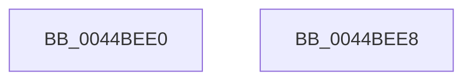

# PsGetProcessServerSilo

- RVA: `0x0044BEE0`–`0x0044BEE9` (길이 `9` bytes)
- VA: `0x000000014044BEE0`
- 실행 섹션: `.text`
- PDB 이름 있음: `예`; PDB Function 태그: `아니요`
- unwind 정보 RVA: `0x000DB714`
- 디코드: `3`개 명령, `9/9` bytes 표시
- 미해석 바이트: `0` (있으면 어셈블리에 `.byte`로 보존)

> 이 문서는 커널 이미지의 기계어와 PDB 기호를 분석해 생성했습니다. 4번과 5번은 함수 원형과 자료형을 바이너리 사용 방식에서 추정한 C 해석이며 원본 소스 복구 결과는 아닙니다.

## 1. Dependencies

- 직접 호출 지점: **0**; 고유 호출 대상: **0**
- 직접 호출자로 확인된 함수: **35**
- RIP 상대 이미지 참조: **0**

### Outgoing calls
- 직접 디코드된 call 명령이 없습니다.

### Direct callers
- [EtwpLogProcessPerfCtrs](../../page/7B/EtwpLogProcessPerfCtrs_function_007B85C0.md) at `0x007B8655`
- [ObpDecrementHandleCount](../../page/86/ObpDecrementHandleCount_function_008632E0.md) at `0x00863397`
- [ObCloseHandleTableEntry](../../page/86/ObCloseHandleTableEntry_function_00869E20.md) at `0x0086A107`
- [ObpCreateHandle](../../page/86/ObpCreateHandle_function_0086B950.md) at `0x0086D548`
- [ObpIncrementHandleCountEx](../../page/86/ObpIncrementHandleCountEx_function_0086DA10.md) at `0x0086E1D4`
- [CmpCheckOpenAccessOnKeyBody](../../page/87/CmpCheckOpenAccessOnKeyBody_function_00870000.md) at `0x0087077B`
- [PerfInfoLogVirtualFree](../../page/88/PerfInfoLogVirtualFree_function_00880B98.md) at `0x00880BDE`
- [ObpLookupObjectName](../../page/89/ObpLookupObjectName_function_0089BE90.md) at `0x0089C186`
- [EtwpWriteProcessEvent](../../page/8A/EtwpWriteProcessEvent_function_008A420C.md) at `0x008A4335`
- [EtwpWriteAppStateChangeSummary](../../page/8A/EtwpWriteAppStateChangeSummary_function_008A4990.md) at `0x008A4A0E`
- [EtwpProcessEnumCallback](../../page/8A/EtwpProcessEnumCallback_function_008A5F40.md) at `0x008A5F8C`
- [PspTerminateAllThreads](../../page/8C/PspTerminateAllThreads_function_008C97D0.md) at `0x008C9A2C`
- [DbgkFlushErrorPort](../../page/90/DbgkFlushErrorPort_function_00903FA4.md) at `0x00903FBD`
- [PspExitLastThread](../../page/90/PspExitLastThread_function_00904184.md) at `0x00904334`
- [EtwTraceThread](../../page/90/EtwTraceThread_function_00905700.md) at `0x0090592F`
- [PspTerminateThreadByPointer](../../page/90/PspTerminateThreadByPointer_function_00905E80.md) at `0x00905F2B`
- [ObClearProcessDeviceMap](../../page/90/ObClearProcessDeviceMap_function_00907688.md) at `0x009076AD`
- [DbgkpSendErrorMessage](../../page/92/DbgkpSendErrorMessage_function_009210A8.md) at `0x0092111B`
- [ObQueryDeviceMapInformation](../../page/96/ObQueryDeviceMapInformation_function_0096C5C0.md) at `0x0096C646`
- [ObpReferenceCurrentDeviceMap](../../page/96/ObpReferenceCurrentDeviceMap_function_0096CBD0.md) at `0x0096CC05`
- [MmMapApiSetView](../../page/98/MmMapApiSetView_function_00980E98.md) at `0x00980EB6`
- [EtwpTrackGuidEntryRegistrations](../../page/A0/EtwpTrackGuidEntryRegistrations_function_00A03CC0.md) at `0x00A03E3D`
- [PerfInfoLogVirtualAlloc](../../page/A4/PerfInfoLogVirtualAlloc_function_00A45754.md) at `0x00A457B2`
- [PerfInfoLogVirtualAlloc](../../page/A4/PerfInfoLogVirtualAlloc_function_00A45754.md) at `0x00A4582B`
- [EtwpEnableGuid](../../page/A5/EtwpEnableGuid_function_00A5CD28.md) at `0x00A5D724`
- [PspEstimateNewProcessServerSilo](../../page/A5/PspEstimateNewProcessServerSilo_function_00A5F7E4.md) at `0x00A5F804`
- [SepRmLsaConnectRequest](../../page/A6/SepRmLsaConnectRequest_function_00A6AB54.md) at `0x00A6AC77`
- [PspMapSiloSharedDataView](../../page/A6/PspMapSiloSharedDataView_function_00A6F850.md) at `0x00A6F85B`
- [PspValidateJobAssignmentSiloPolicy](../../page/A7/PspValidateJobAssignmentSiloPolicy_function_00A71CAC.md) at `0x00A71D10`
- [DbgkRegisterErrorPort](../../page/A9/DbgkRegisterErrorPort_function_00A9C39C.md) at `0x00A9C5C8`
- [NtSetInformationProcess](../../page/AE/NtSetInformationProcess_function_00AE5370.md) at `0x00AE67A6`
- [NtCreateUserProcess](../../page/AE/NtCreateUserProcess_function_00AEA680.md) at `0x00AEB676`
- [PspSetupUserProcessAddressSpace](../../page/AE/PspSetupUserProcessAddressSpace_function_00AEBDC8.md) at `0x00AEBE98`
- [sub_00B16F66](../../page/B1/Unknown_function_00B16F66.md) at `0x00B1711B`
- [sub_00B16F66](../../page/B1/Unknown_function_00B16F66.md) at `0x00B17201`
- [sub_00B1B2E4](../../page/B1/Unknown_function_00B1B2E4.md) at `0x00B1B696`
- [sub_00B20D7E](../../page/B2/Unknown_function_00B20D7E.md) at `0x00B20E31`

### Static image references
- 디코드된 RIP-relative 메모리 참조가 없습니다.

## 2. Other-region calls and transfers

- 다른 실행 섹션으로 향하는 call: **0**
- 별도 외부 분기/꼬리 이동을 확인하지 못했습니다.

## 3. Assembly (complete function range)

```asm
0044BEE0  48 8B 81 F0 05 00 00            mov rax, qword ptr [rcx + 0x5f0]
0044BEE7  C3                              ret
0044BEE8  CC                              int3
```

## 4. C-style interpretation (structured pseudocode)

```c
__int64 __fastcall PsGetProcessServerSilo(__int64 a1)
{
    return *(unsigned __int64 *)(a1 + 1520);
}
```

## 5. (Beta) C Style

```c
int64_t PsGetProcessServerSilo(void *Arg1)
{
    uint8_t *arg1 = (uint8_t *)Arg1;

    return *(uint64_t *)(arg1 + 0x5F0);
}
```

### 관측된 메모리 오프셋

구조체 형식이 확인되지 않은 접근은 인자 기준의 오프셋으로만 기록했습니다.

| 기준 인자 | 오프셋 표현 | 폭 (bit) | 접근 |
|---|---:|---:|---|
| `Arg1` | `+ 0x5F0` | `64` | `R` |

## 6. Execution-region graph

[열기: 2D/3D 그래프와 함수 탐색 컨트롤 패널](../../../control-panel.html?section=text&rva=0x0044BEE0&view=graph)

- 2D 그래프는 위에서 아래로 흐르고, 3D 그래프는 빈 공간을 드래그해 회전합니다. Shift+드래그는 이동, 휠은 확대·축소, 함수 노드 선택은 대상 보고서 이동입니다.

### Static fallback


