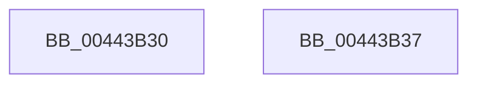

# PsIsHostSilo

- RVA: `0x00443B30`–`0x00443B38` (길이 `8` bytes)
- VA: `0x0000000140443B30`
- 실행 섹션: `.text`
- PDB 이름 있음: `예`; PDB Function 태그: `아니요`
- unwind 정보 RVA: `0x000DB714`
- 디코드: `4`개 명령, `8/8` bytes 표시
- 미해석 바이트: `0` (있으면 어셈블리에 `.byte`로 보존)

> 이 문서는 커널 이미지의 기계어와 PDB 기호를 분석해 생성했습니다. 4번과 5번은 함수 원형과 자료형을 바이너리 사용 방식에서 추정한 C 해석이며 원본 소스 복구 결과는 아닙니다.

## 1. Dependencies

- 직접 호출 지점: **0**; 고유 호출 대상: **0**
- 직접 호출자로 확인된 함수: **28**
- RIP 상대 이미지 참조: **0**

### Outgoing calls
- 직접 디코드된 call 명령이 없습니다.

### Direct callers
- [ObInitServerSilo](../../page/74/ObInitServerSilo_function_0074D8FC.md) at `0x0074D961`
- [ObpCreateDosDevicesDirectory](../../page/74/ObpCreateDosDevicesDirectory_function_0074E03C.md) at `0x0074E08F`
- [ObpInitializeRootNamespace](../../page/74/ObpInitializeRootNamespace_function_0074E588.md) at `0x0074E5D6`
- [PspCatchCriticalBreak](../../page/78/PspCatchCriticalBreak_function_00786408.md) at `0x007864E5`
- [PsRegisterSiloMonitor](../../page/78/PsRegisterSiloMonitor_function_007866A0.md) at `0x007866FA`
- [SeInitServerSilo](../../page/79/SeInitServerSilo_function_0079C3EC.md) at `0x0079C403`
- [EtwpInitializeSiloState](../../page/7B/EtwpInitializeSiloState_function_007B6A3C.md) at `0x007B6A66`
- [ExpTimeZoneWork](../../page/7C/ExpTimeZoneWork_function_007C64F0.md) at `0x007C653D`
- [SLUpdateLicenseDataInternal](../../page/7C/SLUpdateLicenseDataInternal_function_007C9C04.md) at `0x007CA6F3`
- [AlpcpExposeTokenAttribute](../../page/89/AlpcpExposeTokenAttribute_function_00891390.md) at `0x00891713`
- [sub_00891948](../../page/89/Unknown_function_00891948.md) at `0x00891953`
- [sub_00891C4F](../../page/89/Unknown_function_00891C4F.md) at `0x00891C5A`
- [IopAllocRealFileObject](../../page/89/IopAllocRealFileObject_function_00899720.md) at `0x0089996B`
- [IopAllocRealFileObject](../../page/89/IopAllocRealFileObject_function_00899720.md) at `0x00899C2B`
- [IopAllocRealFileObject](../../page/89/IopAllocRealFileObject_function_00899720.md) at `0x00899D40`
- [IopAllocRealFileObject](../../page/89/IopAllocRealFileObject_function_00899720.md) at `0x00899D62`
- [IopAllocRealFileObject](../../page/89/IopAllocRealFileObject_function_00899720.md) at `0x00899D96`
- [IopParseDevice](../../page/89/IopParseDevice_function_0089E510.md) at `0x0089F6F7`
- [IopParseDevice](../../page/89/IopParseDevice_function_0089E510.md) at `0x0089F715`
- [IopParseDevice](../../page/89/IopParseDevice_function_0089E510.md) at `0x0089F751`
- [EtwpWriteAppStateChangeSummary](../../page/8A/EtwpWriteAppStateChangeSummary_function_008A4990.md) at `0x008A4A19`
- [PopGetSettingNotificationName](../../page/91/PopGetSettingNotificationName_function_0091346C.md) at `0x00913590`
- [sub_009669C4](../../page/96/Unknown_function_009669C4.md) at `0x00966A13`
- [sub_009669C4](../../page/96/Unknown_function_009669C4.md) at `0x00966D15`
- [MmMapApiSetView](../../page/98/MmMapApiSetView_function_00980E98.md) at `0x00980EC1`
- [PspEstimateNewProcessServerSilo](../../page/A5/PspEstimateNewProcessServerSilo_function_00A5F7E4.md) at `0x00A5F80F`
- [PspEstimateNewProcessServerSilo](../../page/A5/PspEstimateNewProcessServerSilo_function_00A5F7E4.md) at `0x00A5F851`
- [SepRmCommandServerThread](../../page/A6/SepRmCommandServerThread_function_00A6A8D0.md) at `0x00A6AAC7`
- [SepRmLsaConnectRequest](../../page/A6/SepRmLsaConnectRequest_function_00A6AB54.md) at `0x00A6ACAF`
- [PspMapSiloSharedDataView](../../page/A6/PspMapSiloSharedDataView_function_00A6F850.md) at `0x00A6F866`
- [PopTransitionCheckpoint](../../page/A8/PopTransitionCheckpoint_function_00A8F3E8.md) at `0x00A8F403`
- [DbgkRegisterErrorPort](../../page/A9/DbgkRegisterErrorPort_function_00A9C39C.md) at `0x00A9C628`
- [SepUpdateSiloInClientSecurity](../../page/AD/SepUpdateSiloInClientSecurity_function_00AD4E10.md) at `0x00AD4E52`
- [sub_00B1943A](../../page/B1/Unknown_function_00B1943A.md) at `0x00B19452`
- [sub_00B316B4](../../page/B3/Unknown_function_00B316B4.md) at `0x00B31F04`
- [sub_00B316B4](../../page/B3/Unknown_function_00B316B4.md) at `0x00B3211F`
- [sub_00B316B4](../../page/B3/Unknown_function_00B316B4.md) at `0x00B323F2`
- [NtSetSystemPowerState](../../pagelk/B7/NtSetSystemPowerState_function_00B70890.md) at `0x00B70956`

### Static image references
- 디코드된 RIP-relative 메모리 참조가 없습니다.

## 2. Other-region calls and transfers

- 다른 실행 섹션으로 향하는 call: **0**
- 별도 외부 분기/꼬리 이동을 확인하지 못했습니다.

## 3. Assembly (complete function range)

```asm
00443B30  48 85 C9                        test rcx, rcx
00443B33  0F 94 C0                        sete al
00443B36  C3                              ret
00443B37  CC                              int3
```

## 4. C-style interpretation (structured pseudocode)

```c
__int64 __fastcall PsIsHostSilo(__int64 a1)
{
    __int64 result;

    result = (a1 == 0) ? 1 : 0;
    return result;
}
```

## 5. (Beta) C Style

```c
int64_t PsIsHostSilo(int64_t Arg1)
{
    int64_t result;

    result = (Arg1 == 0) ? 1 : 0;
    return result;
}
```

## 6. Execution-region graph

[열기: 2D/3D 그래프와 함수 탐색 컨트롤 패널](../../../control-panel.html?section=text&rva=0x00443B30&view=graph)

- 2D 그래프는 위에서 아래로 흐르고, 3D 그래프는 빈 공간을 드래그해 회전합니다. Shift+드래그는 이동, 휠은 확대·축소, 함수 노드 선택은 대상 보고서 이동입니다.

### Static fallback


