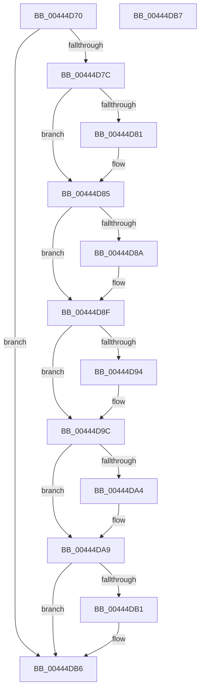

# PsUpdateDiskCounters

- RVA: `0x00444D70`–`0x00444DB8` (길이 `72` bytes)
- VA: `0x0000000140444D70`
- 실행 섹션: `.text`
- PDB 이름 있음: `예`; PDB Function 태그: `아니요`
- unwind 정보 RVA: `0x000DB714`
- 디코드: `23`개 명령, `72/72` bytes 표시
- 미해석 바이트: `0` (있으면 어셈블리에 `.byte`로 보존)

> 이 문서는 커널 이미지의 기계어와 PDB 기호를 분석해 생성했습니다. 4번과 5번은 함수 원형과 자료형을 바이너리 사용 방식에서 추정한 C 해석이며 원본 소스 복구 결과는 아닙니다.

## 1. Dependencies

- 직접 호출 지점: **0**; 고유 호출 대상: **0**
- 직접 호출자로 확인된 함수: **0**
- RIP 상대 이미지 참조: **0**

### Outgoing calls
- 직접 디코드된 call 명령이 없습니다.

### Direct callers
- 이 함수 시작 RVA로 연결되는 직접 call은 확인되지 않았습니다. 간접 호출은 완전히 역산할 수 없습니다.

### Static image references
- 디코드된 RIP-relative 메모리 참조가 없습니다.

## 2. Other-region calls and transfers

- 다른 실행 섹션으로 향하는 call: **0**
- 별도 외부 분기/꼬리 이동을 확인하지 못했습니다.

## 3. Assembly (complete function range)

```asm
00444D70  48 8B 81 38 06 00 00            mov rax, qword ptr [rcx + 0x638]
00444D77  48 85 C0                        test rax, rax
00444D7A  74 3A                           je 0x140444db6
00444D7C  48 85 D2                        test rdx, rdx
00444D7F  74 04                           je 0x140444d85
00444D81  F0 48 01 10                     lock add qword ptr [rax], rdx
00444D85  4D 85 C0                        test r8, r8
00444D88  74 05                           je 0x140444d8f
00444D8A  F0 4C 01 40 08                  lock add qword ptr [rax + 8], r8
00444D8F  45 85 C9                        test r9d, r9d
00444D92  74 08                           je 0x140444d9c
00444D94  41 8B C9                        mov ecx, r9d
00444D97  F0 48 01 48 10                  lock add qword ptr [rax + 0x10], rcx
00444D9C  8B 4C 24 28                     mov ecx, dword ptr [rsp + 0x28]
00444DA0  85 C9                           test ecx, ecx
00444DA2  74 05                           je 0x140444da9
00444DA4  F0 48 01 48 18                  lock add qword ptr [rax + 0x18], rcx
00444DA9  8B 4C 24 30                     mov ecx, dword ptr [rsp + 0x30]
00444DAD  85 C9                           test ecx, ecx
00444DAF  74 05                           je 0x140444db6
00444DB1  F0 48 01 48 20                  lock add qword ptr [rax + 0x20], rcx
00444DB6  C3                              ret
00444DB7  CC                              int3
```

## 4. C-style interpretation (structured pseudocode)

```c
__int64 __fastcall PsUpdateDiskCounters(__int64 a1, __int64 a2, __int64 a3, int a4, unsigned int a5, unsigned int a6)
{
    if (*(unsigned __int64 *)(a1 + 1592) == 0) goto loc_00444DB6;
    if (a2 != 0) {
    }
    if (a3 != 0) {
    }
    if (a4 != 0) {
        a1 = a4;
    }
    if ((unsigned int)((unsigned int)(a5)) != 0) {
    }
    if ((unsigned int)((unsigned int)(a6)) != 0) {
    }
    return *(unsigned __int64 *)(a1 + 1592);
}
```

## 5. (Beta) C Style

```c
int64_t PsUpdateDiskCounters(void *Arg1, int64_t Arg2, int64_t Arg3, int32_t Arg4, uint32_t Arg5, uint32_t Arg6)
{
    uint8_t *arg1 = (uint8_t *)Arg1;

    if (*(uint64_t *)(arg1 + 0x638) == 0) goto loc_00444DB6;
    if (Arg2 != 0) {
    }
    if (Arg3 != 0) {
    }
    if (Arg4 != 0) {
        Arg1 = Arg4;
    }
    if ((uint32_t)((uint32_t)(Arg5)) != 0) {
    }
    if ((uint32_t)((uint32_t)(Arg6)) != 0) {
    }
    return *(uint64_t *)(arg1 + 0x638);
}
```

### 관측된 메모리 오프셋

구조체 형식이 확인되지 않은 접근은 인자 기준의 오프셋으로만 기록했습니다.

| 기준 인자 | 오프셋 표현 | 폭 (bit) | 접근 |
|---|---:|---:|---|
| `Arg1` | `+ 0x638` | `64` | `R` |

## 6. Execution-region graph

[열기: 2D/3D 그래프와 함수 탐색 컨트롤 패널](../../../control-panel.html?section=text&rva=0x00444D70&view=graph)

- 2D 그래프는 위에서 아래로 흐르고, 3D 그래프는 빈 공간을 드래그해 회전합니다. Shift+드래그는 이동, 휠은 확대·축소, 함수 노드 선택은 대상 보고서 이동입니다.

### Static fallback


