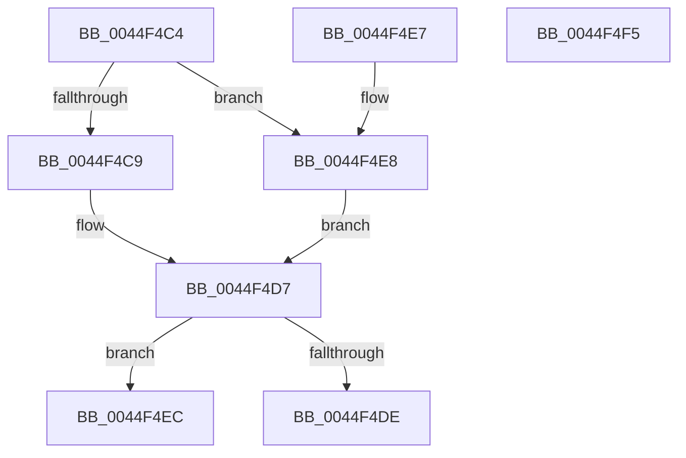

# ReferenceVacbLevel

- RVA: `0x0044F4C4`–`0x0044F4F6` (길이 `50` bytes)
- VA: `0x000000014044F4C4`
- 실행 섹션: `.text`
- PDB 이름 있음: `예`; PDB Function 태그: `아니요`
- unwind 정보 RVA: `0x000DB714`
- 디코드: `15`개 명령, `50/50` bytes 표시
- 미해석 바이트: `0` (있으면 어셈블리에 `.byte`로 보존)

> 이 문서는 커널 이미지의 기계어와 PDB 기호를 분석해 생성했습니다. 4번과 5번은 함수 원형과 자료형을 바이너리 사용 방식에서 추정한 C 해석이며 원본 소스 복구 결과는 아닙니다.

## 1. Dependencies

- 직접 호출 지점: **0**; 고유 호출 대상: **0**
- 직접 호출자로 확인된 함수: **1**
- RIP 상대 이미지 참조: **0**

### Outgoing calls
- 직접 디코드된 call 명령이 없습니다.

### Direct callers
- [CcAdjustVacbLevelLockCount](../41/CcAdjustVacbLevelLockCount_function_0041F8A4.md) at `0x0041F974`

### Static image references
- 디코드된 RIP-relative 메모리 참조가 없습니다.

## 2. Other-region calls and transfers

- 다른 실행 섹션으로 향하는 call: **0**
- 별도 외부 분기/꼬리 이동을 확인하지 못했습니다.

## 3. Assembly (complete function range)

```asm
0044F4C4  45 85 C0                        test r8d, r8d
0044F4C7  75 1F                           jne 0x14044f4e8
0044F4C9  8B 81 98 00 00 00               mov eax, dword ptr [rcx + 0x98]
0044F4CF  25 00 02 00 00                  and eax, 0x200
0044F4D4  48 03 C0                        add rax, rax
0044F4D7  83 7C 24 28 00                  cmp dword ptr [rsp + 0x28], 0
0044F4DC  75 0E                           jne 0x14044f4ec
0044F4DE  44 01 8C 10 00 04 00 00         add dword ptr [rax + rdx + 0x400], r9d
0044F4E6  C3                              ret
0044F4E7  CC                              int3
0044F4E8  33 C0                           xor eax, eax
0044F4EA  EB EB                           jmp 0x14044f4d7
0044F4EC  44 01 8C 10 04 04 00 00         add dword ptr [rax + rdx + 0x404], r9d
0044F4F4  C3                              ret
0044F4F5  CC                              int3
```

## 4. C-style interpretation (structured pseudocode)

```c
__int64 __fastcall ReferenceVacbLevel(__int64 a1, __int64 a2, int a3, int a4, unsigned int a5)
{
    __int64 result;

    if (a3 != 0) goto loc_0044F4E8;
    result = (unsigned int)(((unsigned int)(*(unsigned int *)(a1 + 152))) & (512));
    result = (result) + (result);
loc_0044F4D7:
    if (a5 != 0) goto loc_0044F4EC;
    return result;
loc_0044F4E8:
    result = 0;
    goto loc_0044F4D7;
loc_0044F4EC:
    return result;
}
```

## 5. (Beta) C Style

```c
int64_t ReferenceVacbLevel(void *Arg1, int64_t Arg2, int32_t Arg3, int32_t Arg4, uint32_t Arg5)
{
    uint8_t *arg1 = (uint8_t *)Arg1;

    int64_t result;

    if (Arg3 != 0) goto loc_0044F4E8;
    result = (uint32_t)(((uint32_t)(*(uint32_t *)(arg1 + 0x98))) & (512));
    result = (result) + (result);
loc_0044F4D7:
    if (Arg5 != 0) goto loc_0044F4EC;
    return result;
loc_0044F4E8:
    result = 0;
    goto loc_0044F4D7;
loc_0044F4EC:
    return result;
}
```

### 관측된 메모리 오프셋

구조체 형식이 확인되지 않은 접근은 인자 기준의 오프셋으로만 기록했습니다.

| 기준 인자 | 오프셋 표현 | 폭 (bit) | 접근 |
|---|---:|---:|---|
| `Arg1` | `+ 0x98` | `32` | `R` |

## 6. Execution-region graph

[열기: 2D/3D 그래프와 함수 탐색 컨트롤 패널](../../../control-panel.html?section=text&rva=0x0044F4C4&view=graph)

- 2D 그래프는 위에서 아래로 흐르고, 3D 그래프는 빈 공간을 드래그해 회전합니다. Shift+드래그는 이동, 휠은 확대·축소, 함수 노드 선택은 대상 보고서 이동입니다.

### Static fallback


