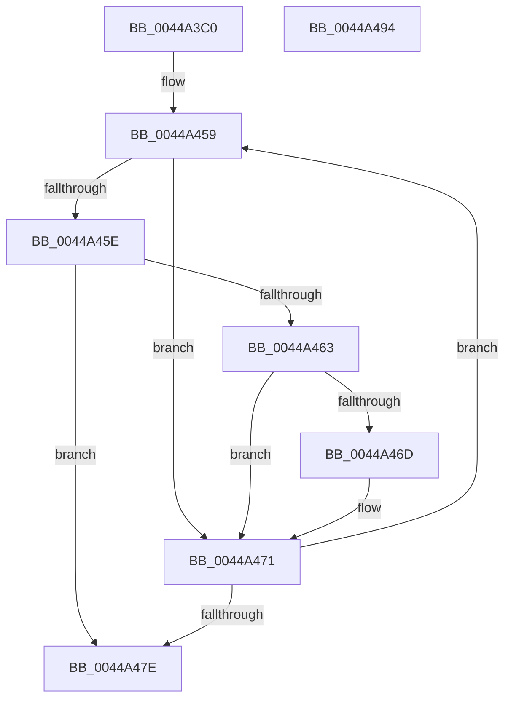

# RtlApplyImportRelocationToPage

- RVA: `0x0044A3C0`–`0x0044A495` (길이 `213` bytes)
- VA: `0x000000014044A3C0`
- 실행 섹션: `.text`
- PDB 이름 있음: `예`; PDB Function 태그: `아니요`
- unwind 정보 RVA: `0x000A6434`
- 디코드: `63`개 명령, `213/213` bytes 표시
- 미해석 바이트: `0` (있으면 어셈블리에 `.byte`로 보존)

> 이 문서는 커널 이미지의 기계어와 PDB 기호를 분석해 생성했습니다. 4번과 5번은 함수 원형과 자료형을 바이너리 사용 방식에서 추정한 C 해석이며 원본 소스 복구 결과는 아닙니다.

## 1. Dependencies

- 직접 호출 지점: **2**; 고유 호출 대상: **2**
- 직접 호출자로 확인된 함수: **2**
- RIP 상대 이미지 참조: **1**

### Outgoing calls
- `0x0044A440` → [RtlpConstructImportRelocationFixup](RtlpConstructImportRelocationFixup_function_0044A49C.md) (function, `0x0044A49C`)
- `0x0044A486` → [_security_check_cookie](../6A/_security_check_cookie_function_006AC640.md) (function, `0x006AC640`)

### Direct callers
- [MiUpdateRetpolineImportFixups](MiUpdateRetpolineImportFixups_function_0044A0D0.md) at `0x0044A162`
- [MiUpdateRetpolineImportFixups](MiUpdateRetpolineImportFixups_function_0044A0D0.md) at `0x0044A1B9`
- [MiApplyDynamicRelocationFixups](MiApplyDynamicRelocationFixups_function_0044A1CC.md) at `0x0044A287`
- [MiApplyDynamicRelocationFixups](MiApplyDynamicRelocationFixups_function_0044A1CC.md) at `0x0044A325`

### Static image references
- `0x0044A3C9` → RVA `0x00E0A740` (`.data`; read)

## 2. Other-region calls and transfers

- 다른 실행 섹션으로 향하는 call: **0**
- 별도 외부 분기/꼬리 이동을 확인하지 못했습니다.

## 3. Assembly (complete function range)

```asm
0044A3C0  40 53                           push rbx
0044A3C2  55                              push rbp
0044A3C3  56                              push rsi
0044A3C4  57                              push rdi
0044A3C5  48 83 EC 68                     sub rsp, 0x68
0044A3C9  48 8B 05 70 03 9C 00            mov rax, qword ptr [rip + 0x9c0370]
0044A3D0  48 33 C4                        xor rax, rsp
0044A3D3  48 89 44 24 50                  mov qword ptr [rsp + 0x50], rax
0044A3D8  33 C0                           xor eax, eax
0044A3DA  48 8B E9                        mov rbp, rcx
0044A3DD  48 89 44 24 40                  mov qword ptr [rsp + 0x40], rax
0044A3E2  4D 8B D9                        mov r11, r9
0044A3E5  4C 8B 8C 24 B0 00 00 00         mov r9, qword ptr [rsp + 0xb0]
0044A3ED  4D 8B D0                        mov r10, r8
0044A3F0  89 44 24 48                     mov dword ptr [rsp + 0x48], eax
0044A3F4  8B FA                           mov edi, edx
0044A3F6  66 89 44 24 4C                  mov word ptr [rsp + 0x4c], ax
0044A3FB  33 F6                           xor esi, esi
0044A3FD  48 8D 44 24 40                  lea rax, [rsp + 0x40]
0044A402  4D 8B C3                        mov r8, r11
0044A405  41 8B 09                        mov ecx, dword ptr [r9]
0044A408  48 89 44 24 30                  mov qword ptr [rsp + 0x30], rax
0044A40D  81 E1 FF 0F 00 00               and ecx, 0xfff
0044A413  8B 84 24 C8 00 00 00            mov eax, dword ptr [rsp + 0xc8]
0044A41A  03 CA                           add ecx, edx
0044A41C  39 B4 24 C0 00 00 00            cmp dword ptr [rsp + 0xc0], esi
0044A423  49 8B D2                        mov rdx, r10
0044A426  89 44 24 28                     mov dword ptr [rsp + 0x28], eax
0044A42A  8B 84 24 B8 00 00 00            mov eax, dword ptr [rsp + 0xb8]
0044A431  8D 99 00 F0 FF FF               lea ebx, [rcx - 0x1000]
0044A437  89 44 24 20                     mov dword ptr [rsp + 0x20], eax
0044A43B  0F 44 D9                        cmove ebx, ecx
0044A43E  8B CB                           mov ecx, ebx
0044A440  E8 57 00 00 00                  call 0x14044a49c
0044A445  2B DF                           sub ebx, edi
0044A447  4C 8D 85 00 10 00 00            lea r8, [rbp + 0x1000]
0044A44E  48 63 CB                        movsxd rcx, ebx
0044A451  48 8D 54 24 42                  lea rdx, [rsp + 0x42]
0044A456  48 03 CD                        add rcx, rbp
0044A459  48 3B CD                        cmp rcx, rbp
0044A45C  72 13                           jb 0x14044a471
0044A45E  49 3B C8                        cmp rcx, r8
0044A461  73 1B                           jae 0x14044a47e
0044A463  0F B7 44 24 40                  movzx eax, word ptr [rsp + 0x40]
0044A468  0F A3 F0                        bt eax, esi
0044A46B  73 04                           jae 0x14044a471
0044A46D  8A 02                           mov al, byte ptr [rdx]
0044A46F  88 01                           mov byte ptr [rcx], al
0044A471  FF C6                           inc esi
0044A473  48 FF C1                        inc rcx
0044A476  48 FF C2                        inc rdx
0044A479  83 FE 0C                        cmp esi, 0xc
0044A47C  72 DB                           jb 0x14044a459
0044A47E  48 8B 4C 24 50                  mov rcx, qword ptr [rsp + 0x50]
0044A483  48 33 CC                        xor rcx, rsp
0044A486  E8 B5 21 26 00                  call 0x1406ac640
0044A48B  48 83 C4 68                     add rsp, 0x68
0044A48F  5F                              pop rdi
0044A490  5E                              pop rsi
0044A491  5D                              pop rbp
0044A492  5B                              pop rbx
0044A493  C3                              ret
0044A494  CC                              int3
```

## 4. C-style interpretation (structured pseudocode)

```c
__int64 __fastcall RtlApplyImportRelocationToPage(__int64 a1, int a2, __int64 a3, __int64 a4, __int64 a5, unsigned int a6, unsigned int a7, unsigned int a8)
{
    __int64 result;
    __int64 v_rbx;
    __int64 v_rsi;
    __int64 v_rsp;
    unsigned __int64 v_stack_m38;
    unsigned __int16 v_stack_m3C;
    unsigned int v_stack_m40;
    unsigned __int64 v_stack_m46;
    unsigned __int64 v_stack_m48;
    unsigned __int64 v_stack_m58;
    unsigned int v_stack_m60;
    unsigned int v_stack_m68;

    v_rsp = (v_rsp) - (104);
    result = (*(unsigned __int64 *)(v_rip + 10224496)) ^ (v_rsp);
    v_stack_m38 = result;
    result = 0;
    v_stack_m48 = 0;
    v_stack_m40 = 0;
    v_stack_m3C = 0;
    v_rsi = 0;
    v_stack_m58 = v_stack_m48;
    a1 = (unsigned int)(((unsigned int)(*(unsigned int *)(a5))) & (0xFFFULL));
    a1 = (unsigned int)((a1) + (a2));
    v_stack_m60 = (unsigned int)((unsigned int)(a8));
    v_stack_m68 = (unsigned int)((unsigned int)(a6));
    v_rbx = a1 - 4096;
    if (a7 == 0) { v_rbx = (unsigned int)(a1); }
    result = RtlpConstructImportRelocationFixup((unsigned int)((unsigned int)(v_rbx)), a3, a4, a5);
    v_rbx = (unsigned int)((v_rbx) - ((unsigned int)((unsigned int)(a2))));
    a1 = ((int)((unsigned int)(v_rbx))) + (a1);
loc_0044A459:
    if (a1 < a1) goto loc_0044A471;
    if (a1 >= (a1 + 4096)) goto loc_0044A47E;
    result = v_stack_m48;
    if (a1 < (a1 + 4096)) {
        result = *(unsigned __int8 *)(v_stack_m46);
        *(unsigned __int8 *)(a1) = (unsigned __int8)(result);
    }
    v_rsi = (unsigned int)((v_rsi) + 1);
    a1 = (a1) + 1;
    a2 = (v_stack_m46) + 1;
    if (((unsigned int)(v_rsi)) < 12) goto loc_0044A459;
loc_0044A47E:
    a1 = (v_stack_m38) ^ (v_rsp);
    result = _security_check_cookie(a1, a2, a1 + 4096, a5);
    v_rsp = (v_rsp) + (104);
    return result;
}
```

## 5. (Beta) C Style

```c
int64_t RtlApplyImportRelocationToPage(void *Arg1, int32_t Arg2, int64_t Arg3, int64_t Arg4, void *Arg5, uint32_t Arg6, uint32_t Arg7, uint32_t Arg8)
{
    uint8_t *arg1 = (uint8_t *)Arg1;
    uint8_t *arg5 = (uint8_t *)Arg5;

    int64_t result;
    int64_t local_rbx;
    int64_t local_rsi;
    int64_t local_rsp;
    uint64_t v_stack_m38;
    uint16_t v_stack_m3C;
    uint32_t v_stack_m40;
    uint64_t v_stack_m46;
    uint64_t v_stack_m48;
    uint64_t v_stack_m58;
    uint32_t v_stack_m60;
    uint32_t v_stack_m68;

    local_rsp = (local_rsp) - (104);
    result = (*(uint64_t *)(v_rip + 0x9C0370)) ^ (local_rsp);
    v_stack_m38 = result;
    result = 0;
    v_stack_m48 = 0;
    v_stack_m40 = 0;
    v_stack_m3C = 0;
    local_rsi = 0;
    v_stack_m58 = v_stack_m48;
    Arg1 = (uint32_t)(((uint32_t)(*(uint32_t *)(arg5))) & (0xFFFULL));
    Arg1 = (uint32_t)((Arg1) + (Arg2));
    v_stack_m60 = (uint32_t)((uint32_t)(Arg8));
    v_stack_m68 = (uint32_t)((uint32_t)(Arg6));
    local_rbx = Arg1 - 4096;
    if (Arg7 == 0) { local_rbx = (uint32_t)(Arg1); }
    result = RtlpConstructImportRelocationFixup((uint32_t)((uint32_t)(local_rbx)), Arg3, Arg4, Arg5);
    local_rbx = (uint32_t)((local_rbx) - ((uint32_t)((uint32_t)(Arg2))));
    Arg1 = ((int32_t)((uint32_t)(local_rbx))) + (Arg1);
loc_0044A459:
    if (Arg1 < Arg1) goto loc_0044A471;
    if (Arg1 >= (Arg1 + 4096)) goto loc_0044A47E;
    result = v_stack_m48;
    if (Arg1 < (Arg1 + 4096)) {
        result = *(uint8_t *)(v_stack_m46);
        *(uint8_t *)(arg1) = (uint8_t)(result);
    }
    local_rsi = (uint32_t)((local_rsi) + 1);
    Arg1 = (Arg1) + 1;
    Arg2 = (v_stack_m46) + 1;
    if (((uint32_t)(local_rsi)) < 12) goto loc_0044A459;
loc_0044A47E:
    Arg1 = (v_stack_m38) ^ (local_rsp);
    result = _security_check_cookie(Arg1, Arg2, Arg1 + 4096, Arg5);
    local_rsp = (local_rsp) + (104);
    return result;
}
```

### 관측된 메모리 오프셋

구조체 형식이 확인되지 않은 접근은 인자 기준의 오프셋으로만 기록했습니다.

| 기준 인자 | 오프셋 표현 | 폭 (bit) | 접근 |
|---|---:|---:|---|
| `Arg1` | `+ 0x1000` | `64` | `R` |
| `Arg5` | `+ 0x0` | `32` | `R` |

## 6. Execution-region graph

[열기: 2D/3D 그래프와 함수 탐색 컨트롤 패널](../../../control-panel.html?section=text&rva=0x0044A3C0&view=graph)

- 2D 그래프는 위에서 아래로 흐르고, 3D 그래프는 빈 공간을 드래그해 회전합니다. Shift+드래그는 이동, 휠은 확대·축소, 함수 노드 선택은 대상 보고서 이동입니다.

### Static fallback


