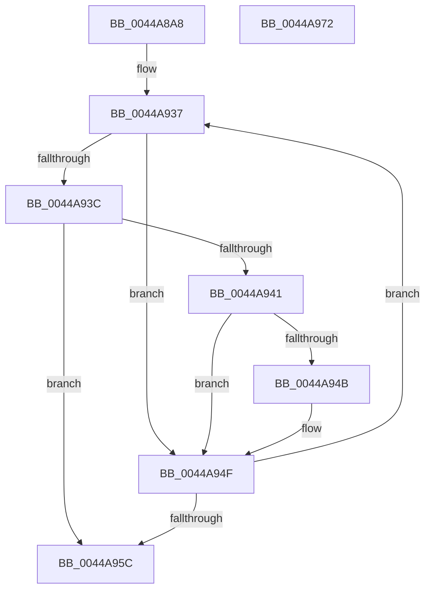

# RtlApplyIndirectRelocationToPage

- RVA: `0x0044A8A8`–`0x0044A973` (길이 `203` bytes)
- VA: `0x000000014044A8A8`
- 실행 섹션: `.text`
- PDB 이름 있음: `예`; PDB Function 태그: `아니요`
- unwind 정보 RVA: `0x000A6470`
- 디코드: `61`개 명령, `203/203` bytes 표시
- 미해석 바이트: `0` (있으면 어셈블리에 `.byte`로 보존)

> 이 문서는 커널 이미지의 기계어와 PDB 기호를 분석해 생성했습니다. 4번과 5번은 함수 원형과 자료형을 바이너리 사용 방식에서 추정한 C 해석이며 원본 소스 복구 결과는 아닙니다.

## 1. Dependencies

- 직접 호출 지점: **2**; 고유 호출 대상: **2**
- 직접 호출자로 확인된 함수: **1**
- RIP 상대 이미지 참조: **1**

### Outgoing calls
- `0x0044A91E` → [RtlpConstructIndirectRelocationFixup](RtlpConstructIndirectRelocationFixup_function_0044A97C.md) (function, `0x0044A97C`)
- `0x0044A964` → [_security_check_cookie](../6A/_security_check_cookie_function_006AC640.md) (function, `0x006AC640`)

### Direct callers
- [MiApplyDynamicRelocationFixups](MiApplyDynamicRelocationFixups_function_0044A1CC.md) at `0x0044A2F3`
- [MiApplyDynamicRelocationFixups](MiApplyDynamicRelocationFixups_function_0044A1CC.md) at `0x0044A37F`

### Static image references
- `0x0044A8B1` → RVA `0x00E0A740` (`.data`; read)

## 2. Other-region calls and transfers

- 다른 실행 섹션으로 향하는 call: **0**
- 별도 외부 분기/꼬리 이동을 확인하지 못했습니다.

## 3. Assembly (complete function range)

```asm
0044A8A8  40 53                           push rbx
0044A8AA  55                              push rbp
0044A8AB  56                              push rsi
0044A8AC  57                              push rdi
0044A8AD  48 83 EC 58                     sub rsp, 0x58
0044A8B1  48 8B 05 88 FE 9B 00            mov rax, qword ptr [rip + 0x9bfe88]
0044A8B8  48 33 C4                        xor rax, rsp
0044A8BB  48 89 44 24 40                  mov qword ptr [rsp + 0x40], rax
0044A8C0  33 C0                           xor eax, eax
0044A8C2  48 8B E9                        mov rbp, rcx
0044A8C5  4D 8B D9                        mov r11, r9
0044A8C8  48 89 44 24 30                  mov qword ptr [rsp + 0x30], rax
0044A8CD  4C 8B 8C 24 A0 00 00 00         mov r9, qword ptr [rsp + 0xa0]
0044A8D5  4D 8B D0                        mov r10, r8
0044A8D8  89 44 24 38                     mov dword ptr [rsp + 0x38], eax
0044A8DC  8B FA                           mov edi, edx
0044A8DE  66 89 44 24 3C                  mov word ptr [rsp + 0x3c], ax
0044A8E3  33 F6                           xor esi, esi
0044A8E5  48 8D 44 24 30                  lea rax, [rsp + 0x30]
0044A8EA  4D 8B C3                        mov r8, r11
0044A8ED  41 0F B7 09                     movzx ecx, word ptr [r9]
0044A8F1  81 E1 FF 0F 00 00               and ecx, 0xfff
0044A8F7  48 89 44 24 28                  mov qword ptr [rsp + 0x28], rax
0044A8FC  8B 84 24 A8 00 00 00            mov eax, dword ptr [rsp + 0xa8]
0044A903  03 CA                           add ecx, edx
0044A905  39 B4 24 B0 00 00 00            cmp dword ptr [rsp + 0xb0], esi
0044A90C  49 8B D2                        mov rdx, r10
0044A90F  89 44 24 20                     mov dword ptr [rsp + 0x20], eax
0044A913  8D 99 00 F0 FF FF               lea ebx, [rcx - 0x1000]
0044A919  0F 44 D9                        cmove ebx, ecx
0044A91C  8B CB                           mov ecx, ebx
0044A91E  E8 59 00 00 00                  call 0x14044a97c
0044A923  2B DF                           sub ebx, edi
0044A925  4C 8D 85 00 10 00 00            lea r8, [rbp + 0x1000]
0044A92C  48 63 CB                        movsxd rcx, ebx
0044A92F  48 8D 54 24 32                  lea rdx, [rsp + 0x32]
0044A934  48 03 CD                        add rcx, rbp
0044A937  48 3B CD                        cmp rcx, rbp
0044A93A  72 13                           jb 0x14044a94f
0044A93C  49 3B C8                        cmp rcx, r8
0044A93F  73 1B                           jae 0x14044a95c
0044A941  0F B7 44 24 30                  movzx eax, word ptr [rsp + 0x30]
0044A946  0F A3 F0                        bt eax, esi
0044A949  73 04                           jae 0x14044a94f
0044A94B  8A 02                           mov al, byte ptr [rdx]
0044A94D  88 01                           mov byte ptr [rcx], al
0044A94F  FF C6                           inc esi
0044A951  48 FF C1                        inc rcx
0044A954  48 FF C2                        inc rdx
0044A957  83 FE 0C                        cmp esi, 0xc
0044A95A  72 DB                           jb 0x14044a937
0044A95C  48 8B 4C 24 40                  mov rcx, qword ptr [rsp + 0x40]
0044A961  48 33 CC                        xor rcx, rsp
0044A964  E8 D7 1C 26 00                  call 0x1406ac640
0044A969  48 83 C4 58                     add rsp, 0x58
0044A96D  5F                              pop rdi
0044A96E  5E                              pop rsi
0044A96F  5D                              pop rbp
0044A970  5B                              pop rbx
0044A971  C3                              ret
0044A972  CC                              int3
```

## 4. C-style interpretation (structured pseudocode)

```c
__int64 __fastcall RtlApplyIndirectRelocationToPage(__int64 a1, int a2, __int64 a3, __int64 a4, __int64 a5, unsigned int a6, unsigned int a7)
{
    __int64 result;
    __int64 v_rbx;
    __int64 v_rsi;
    __int64 v_rsp;
    unsigned __int64 v_stack_m38;
    unsigned __int16 v_stack_m3C;
    unsigned int v_stack_m40;
    unsigned __int64 v_stack_m46;
    unsigned __int64 v_stack_m48;
    unsigned __int64 v_stack_m50;
    unsigned int v_stack_m58;

    v_rsp = (v_rsp) - (88);
    result = (*(unsigned __int64 *)(v_rip + 10223240)) ^ (v_rsp);
    v_stack_m38 = result;
    result = 0;
    v_stack_m48 = 0;
    v_stack_m40 = 0;
    v_stack_m3C = 0;
    v_rsi = 0;
    a1 = (unsigned int)((*(unsigned __int16 *)(a5)) & (0xFFFULL));
    v_stack_m50 = v_stack_m48;
    a1 = (unsigned int)((a1) + (a2));
    v_stack_m58 = (unsigned int)((unsigned int)(a6));
    v_rbx = a1 - 4096;
    if (a7 == 0) { v_rbx = (unsigned int)(a1); }
    result = RtlpConstructIndirectRelocationFixup((unsigned int)((unsigned int)(v_rbx)), a3, a4, a5);
    v_rbx = (unsigned int)((v_rbx) - ((unsigned int)((unsigned int)(a2))));
    a1 = ((int)((unsigned int)(v_rbx))) + (a1);
loc_0044A937:
    if (a1 < a1) goto loc_0044A94F;
    if (a1 >= (a1 + 4096)) goto loc_0044A95C;
    result = v_stack_m48;
    if (a1 < (a1 + 4096)) {
        result = *(unsigned __int8 *)(v_stack_m46);
        *(unsigned __int8 *)(a1) = (unsigned __int8)(result);
    }
    v_rsi = (unsigned int)((v_rsi) + 1);
    a1 = (a1) + 1;
    a2 = (v_stack_m46) + 1;
    if (((unsigned int)(v_rsi)) < 12) goto loc_0044A937;
loc_0044A95C:
    a1 = (v_stack_m38) ^ (v_rsp);
    result = _security_check_cookie(a1, a2, a1 + 4096, a5);
    v_rsp = (v_rsp) + (88);
    return result;
}
```

## 5. (Beta) C Style

```c
int64_t RtlApplyIndirectRelocationToPage(void *Arg1, int32_t Arg2, int64_t Arg3, int64_t Arg4, void *Arg5, uint32_t Arg6, uint32_t Arg7)
{
    uint8_t *arg1 = (uint8_t *)Arg1;
    uint8_t *arg5 = (uint8_t *)Arg5;

    int64_t result;
    int64_t local_rbx;
    int64_t local_rsi;
    int64_t local_rsp;
    uint64_t v_stack_m38;
    uint16_t v_stack_m3C;
    uint32_t v_stack_m40;
    uint64_t v_stack_m46;
    uint64_t v_stack_m48;
    uint64_t v_stack_m50;
    uint32_t v_stack_m58;

    local_rsp = (local_rsp) - (88);
    result = (*(uint64_t *)(v_rip + 0x9BFE88)) ^ (local_rsp);
    v_stack_m38 = result;
    result = 0;
    v_stack_m48 = 0;
    v_stack_m40 = 0;
    v_stack_m3C = 0;
    local_rsi = 0;
    Arg1 = (uint32_t)((*(uint16_t *)(arg5)) & (0xFFFULL));
    v_stack_m50 = v_stack_m48;
    Arg1 = (uint32_t)((Arg1) + (Arg2));
    v_stack_m58 = (uint32_t)((uint32_t)(Arg6));
    local_rbx = Arg1 - 4096;
    if (Arg7 == 0) { local_rbx = (uint32_t)(Arg1); }
    result = RtlpConstructIndirectRelocationFixup((uint32_t)((uint32_t)(local_rbx)), Arg3, Arg4, Arg5);
    local_rbx = (uint32_t)((local_rbx) - ((uint32_t)((uint32_t)(Arg2))));
    Arg1 = ((int32_t)((uint32_t)(local_rbx))) + (Arg1);
loc_0044A937:
    if (Arg1 < Arg1) goto loc_0044A94F;
    if (Arg1 >= (Arg1 + 4096)) goto loc_0044A95C;
    result = v_stack_m48;
    if (Arg1 < (Arg1 + 4096)) {
        result = *(uint8_t *)(v_stack_m46);
        *(uint8_t *)(arg1) = (uint8_t)(result);
    }
    local_rsi = (uint32_t)((local_rsi) + 1);
    Arg1 = (Arg1) + 1;
    Arg2 = (v_stack_m46) + 1;
    if (((uint32_t)(local_rsi)) < 12) goto loc_0044A937;
loc_0044A95C:
    Arg1 = (v_stack_m38) ^ (local_rsp);
    result = _security_check_cookie(Arg1, Arg2, Arg1 + 4096, Arg5);
    local_rsp = (local_rsp) + (88);
    return result;
}
```

### 관측된 메모리 오프셋

구조체 형식이 확인되지 않은 접근은 인자 기준의 오프셋으로만 기록했습니다.

| 기준 인자 | 오프셋 표현 | 폭 (bit) | 접근 |
|---|---:|---:|---|
| `Arg1` | `+ 0x1000` | `64` | `R` |
| `Arg5` | `+ 0x0` | `16` | `R` |

## 6. Execution-region graph

[열기: 2D/3D 그래프와 함수 탐색 컨트롤 패널](../../../control-panel.html?section=text&rva=0x0044A8A8&view=graph)

- 2D 그래프는 위에서 아래로 흐르고, 3D 그래프는 빈 공간을 드래그해 회전합니다. Shift+드래그는 이동, 휠은 확대·축소, 함수 노드 선택은 대상 보고서 이동입니다.

### Static fallback


