# RtlCreateRetpolineRelocationInformation

- RVA: `0x0044AC14`–`0x0044AFA7` (길이 `915` bytes)
- VA: `0x000000014044AC14`
- 실행 섹션: `.text`
- PDB 이름 있음: `예`; PDB Function 태그: `아니요`
- unwind 정보 RVA: `0x000A64C4`
- 디코드: `247`개 명령, `915/915` bytes 표시
- 미해석 바이트: `0` (있으면 어셈블리에 `.byte`로 보존)

> 이 문서는 커널 이미지의 기계어와 PDB 기호를 분석해 생성했습니다. 4번과 5번은 함수 원형과 자료형을 바이너리 사용 방식에서 추정한 C 해석이며 원본 소스 복구 결과는 아닙니다.

## 1. Dependencies

- 직접 호출 지점: **8**; 고유 호출 대상: **5**
- 직접 호출자로 확인된 함수: **1**
- RIP 상대 이미지 참조: **0**

### Outgoing calls
- `0x0044AC7D` → [memset](../6C/memset_function_006C6C40.md) (function, `0x006C6C40`)
- `0x0044AC8B` → [memset](../6C/memset_function_006C6C40.md) (function, `0x006C6C40`)
- `0x0044AD43` → [RtlSizeOfRetpolineRelocationEntry](RtlSizeOfRetpolineRelocationEntry_function_0044AFB0.md) (function, `0x0044AFB0`)
- `0x0044AD52` → [memcpy](../6C/memcpy_function_006C6840.md) (function, `0x006C6840`)
- `0x0044AD7F` → [RtlpCopyRetpolineRelocationBlockEntryArray](RtlpCopyRetpolineRelocationBlockEntryArray_function_0044AB44.md) (function, `0x0044AB44`)
- `0x0044ADAB` → [RtlpCopyRetpolineRelocationBlockEntryArray](RtlpCopyRetpolineRelocationBlockEntryArray_function_0044AB44.md) (function, `0x0044AB44`)
- `0x0044AEB6` → [RtlSizeOfRetpolineIndirectFixup](RtlSizeOfRetpolineIndirectFixup_function_0044AFE4.md) (function, `0x0044AFE4`)
- `0x0044AF83` → [RtlpCopyRetpolineRelocationBlockEntryArray](RtlpCopyRetpolineRelocationBlockEntryArray_function_0044AB44.md) (function, `0x0044AB44`)

### Direct callers
- [MiCreateRetpolineRelocationInformation](../../page/93/MiCreateRetpolineRelocationInformation_function_0093FE10.md) at `0x0093FEBF`

### Static image references
- 디코드된 RIP-relative 메모리 참조가 없습니다.

## 2. Other-region calls and transfers

- 다른 실행 섹션으로 향하는 call: **0**
- 별도 외부 분기/꼬리 이동을 확인하지 못했습니다.

## 3. Assembly (complete function range)

```asm
0044AC14  48 89 5C 24 18                  mov qword ptr [rsp + 0x18], rbx
0044AC19  89 4C 24 08                     mov dword ptr [rsp + 8], ecx
0044AC1D  55                              push rbp
0044AC1E  56                              push rsi
0044AC1F  57                              push rdi
0044AC20  41 54                           push r12
0044AC22  41 55                           push r13
0044AC24  41 56                           push r14
0044AC26  41 57                           push r15
0044AC28  48 8B EC                        mov rbp, rsp
0044AC2B  48 81 EC 80 00 00 00            sub rsp, 0x80
0044AC32  48 83 65 D0 00                  and qword ptr [rbp - 0x30], 0
0044AC37  49 8B F8                        mov rdi, r8
0044AC3A  8B C2                           mov eax, edx
0044AC3C  49 8B D9                        mov rbx, r9
0044AC3F  44 8B D1                        mov r10d, ecx
0044AC42  49 C1 EA 0C                     shr r10, 0xc
0044AC46  44 8B F9                        mov r15d, ecx
0044AC49  4F 8D 04 52                     lea r8, [r10 + r10*2]
0044AC4D  4C 03 C0                        add r8, rax
0044AC50  8B 45 70                        mov eax, dword ptr [rbp + 0x70]
0044AC53  49 C1 E0 02                     shl r8, 2
0044AC57  49 3B C0                        cmp rax, r8
0044AC5A  0F 82 FD 02 00 00               jb 0x14044af5d
0044AC60  8B 85 80 00 00 00               mov eax, dword ptr [rbp + 0x80]
0044AC66  4A 8D 34 D5 00 00 00 00         lea rsi, [r10*8]
0044AC6E  48 3B C6                        cmp rax, rsi
0044AC71  0F 82 E6 02 00 00               jb 0x14044af5d
0044AC77  48 8B 4D 68                     mov rcx, qword ptr [rbp + 0x68]
0044AC7B  33 D2                           xor edx, edx
0044AC7D  E8 BE BF 27 00                  call 0x1406c6c40
0044AC82  48 8B 4D 78                     mov rcx, qword ptr [rbp + 0x78]
0044AC86  4C 8B C6                        mov r8, rsi
0044AC89  33 D2                           xor edx, edx
0044AC8B  E8 B0 BF 27 00                  call 0x1406c6c40
0044AC90  45 33 C0                        xor r8d, r8d
0044AC93  32 C9                           xor cl, cl
0044AC95  45 33 F6                        xor r14d, r14d
0044AC98  44 89 45 B4                     mov dword ptr [rbp - 0x4c], r8d
0044AC9C  48 85 FF                        test rdi, rdi
0044AC9F  0F 84 AD 02 00 00               je 0x14044af52
0044ACA5  44 8B 4F 08                     mov r9d, dword ptr [rdi + 8]
0044ACA9  4C 8D 67 0C                     lea r12, [rdi + 0xc]
0044ACAD  4D 03 CC                        add r9, r12
0044ACB0  4C 89 4D D8                     mov qword ptr [rbp - 0x28], r9
0044ACB4  48 85 DB                        test rbx, rbx
0044ACB7  0F 85 75 02 00 00               jne 0x14044af32
0044ACBD  45 33 ED                        xor r13d, r13d
0044ACC0  45 33 D2                        xor r10d, r10d
0044ACC3  48 8B 45 60                     mov rax, qword ptr [rbp + 0x60]
0044ACC7  4C 89 55 E0                     mov qword ptr [rbp - 0x20], r10
0044ACCB  48 85 C0                        test rax, rax
0044ACCE  0F 85 6E 02 00 00               jne 0x14044af42
0044ACD4  33 D2                           xor edx, edx
0044ACD6  45 33 DB                        xor r11d, r11d
0044ACD9  4C 89 5D E8                     mov qword ptr [rbp - 0x18], r11
0044ACDD  48 89 55 B8                     mov qword ptr [rbp - 0x48], rdx
0044ACE1  45 85 FF                        test r15d, r15d
0044ACE4  0F 84 71 01 00 00               je 0x14044ae5b
0044ACEA  BF 00 10 00 00                  mov edi, 0x1000
0044ACEF  4D 3B E1                        cmp r12, r9
0044ACF2  0F 82 9C 01 00 00               jb 0x14044ae94
0044ACF8  48 83 65 C0 00                  and qword ptr [rbp - 0x40], 0
0044ACFD  45 33 FF                        xor r15d, r15d
0044AD00  44 89 7D 70                     mov dword ptr [rbp + 0x70], r15d
0044AD04  4D 3B EA                        cmp r13, r10
0044AD07  0F 82 E9 01 00 00               jb 0x14044aef6
0044AD0D  48 83 65 C8 00                  and qword ptr [rbp - 0x38], 0
0044AD12  33 F6                           xor esi, esi
0044AD14  89 75 48                        mov dword ptr [rbp + 0x48], esi
0044AD17  49 3B D3                        cmp rdx, r11
0044AD1A  0F 82 F3 01 00 00               jb 0x14044af13
0044AD20  33 DB                           xor ebx, ebx
0044AD22  89 5D B0                        mov dword ptr [rbp - 0x50], ebx
0044AD25  84 C9                           test cl, cl
0044AD27  0F 84 4C 01 00 00               je 0x14044ae79
0044AD2D  48 8B 7D 68                     mov rdi, qword ptr [rbp + 0x68]
0044AD31  0F B6 C1                        movzx eax, cl
0044AD34  48 89 7D F0                     mov qword ptr [rbp - 0x10], rdi
0044AD38  66 89 47 06                     mov word ptr [rdi + 6], ax
0044AD3C  84 C9                           test cl, cl
0044AD3E  74 17                           je 0x14044ad57
0044AD40  0F B6 C9                        movzx ecx, cl
0044AD43  E8 68 02 00 00                  call 0x14044afb0
0044AD48  44 8B C0                        mov r8d, eax
0044AD4B  48 8D 4F 08                     lea rcx, [rdi + 8]
0044AD4F  49 8B D6                        mov rdx, r14
0044AD52  E8 E9 BA 27 00                  call 0x1406c6840
0044AD57  4C 8D 77 0C                     lea r14, [rdi + 0xc]
0044AD5B  49 8B FE                        mov rdi, r14
0044AD5E  45 85 FF                        test r15d, r15d
0044AD61  74 28                           je 0x14044ad8b
0044AD63  4C 8B 45 C0                     mov r8, qword ptr [rbp - 0x40]
0044AD67  48 8D 45 70                     lea rax, [rbp + 0x70]
0044AD6B  49 83 C0 08                     add r8, 8
0044AD6F  48 89 44 24 20                  mov qword ptr [rsp + 0x20], rax
0044AD74  45 8B CF                        mov r9d, r15d
0044AD77  BA 03 00 00 00                  mov edx, 3
0044AD7C  49 8B CE                        mov rcx, r14
0044AD7F  E8 C0 FD FF FF                  call 0x14044ab44
0044AD84  44 8B 7D 70                     mov r15d, dword ptr [rbp + 0x70]
0044AD88  49 03 FF                        add rdi, r15
0044AD8B  85 F6                           test esi, esi
0044AD8D  74 27                           je 0x14044adb6
0044AD8F  4C 8B 45 C8                     mov r8, qword ptr [rbp - 0x38]
0044AD93  48 8D 45 48                     lea rax, [rbp + 0x48]
0044AD97  49 83 C0 08                     add r8, 8
0044AD9B  48 89 44 24 20                  mov qword ptr [rsp + 0x20], rax
0044ADA0  44 8B CE                        mov r9d, esi
0044ADA3  BA 04 00 00 00                  mov edx, 4
0044ADA8  48 8B CF                        mov rcx, rdi
0044ADAB  E8 94 FD FF FF                  call 0x14044ab44
0044ADB0  8B 75 48                        mov esi, dword ptr [rbp + 0x48]
0044ADB3  48 03 FE                        add rdi, rsi
0044ADB6  85 DB                           test ebx, ebx
0044ADB8  0F 85 A9 01 00 00               jne 0x14044af67
0044ADBE  48 8B 45 68                     mov rax, qword ptr [rbp + 0x68]
0044ADC2  48 89 7D 68                     mov qword ptr [rbp + 0x68], rdi
0044ADC6  BF 00 10 00 00                  mov edi, 0x1000
0044ADCB  41 0F B7 D7                     movzx edx, r15w
0044ADCF  49 03 D6                        add rdx, r14
0044ADD2  44 0F B7 C6                     movzx r8d, si
0044ADD6  4C 03 C2                        add r8, rdx
0044ADD9  44 0F B7 CB                     movzx r9d, bx
0044ADDD  44 8D 57 FF                     lea r10d, [rdi - 1]
0044ADE1  66 89 70 02                     mov word ptr [rax + 2], si
0044ADE5  66 89 58 04                     mov word ptr [rax + 4], bx
0044ADE9  4D 03 C8                        add r9, r8
0044ADEC  66 44 89 38                     mov word ptr [rax], r15w
0044ADF0  4C 3B F2                        cmp r14, rdx
0044ADF3  73 17                           jae 0x14044ae0c
0044ADF5  41 8B 06                        mov eax, dword ptr [r14]
0044ADF8  41 23 C2                        and eax, r10d
0044ADFB  83 C0 0C                        add eax, 0xc
0044ADFE  3B C7                           cmp eax, edi
0044AE00  0F 87 E9 00 00 00               ja 0x14044aeef
0044AE06  49 83 C6 04                     add r14, 4
0044AE0A  EB E4                           jmp 0x14044adf0
0044AE0C  49 3B D0                        cmp rdx, r8
0044AE0F  0F 82 9E 00 00 00               jb 0x14044aeb3
0044AE15  4D 3B C1                        cmp r8, r9
0044AE18  0F 82 B6 00 00 00               jb 0x14044aed4
0044AE1E  32 C9                           xor cl, cl
0044AE20  45 33 F6                        xor r14d, r14d
0044AE23  4C 8B 4D 78                     mov r9, qword ptr [rbp + 0x78]
0044AE27  48 8B 55 F0                     mov rdx, qword ptr [rbp - 0x10]
0044AE2B  44 8B 45 B4                     mov r8d, dword ptr [rbp - 0x4c]
0044AE2F  4C 8B 55 E0                     mov r10, qword ptr [rbp - 0x20]
0044AE33  41 8B C0                        mov eax, r8d
0044AE36  4C 8B 5D E8                     mov r11, qword ptr [rbp - 0x18]
0044AE3A  48 C1 E8 0C                     shr rax, 0xc
0044AE3E  49 89 14 C1                     mov qword ptr [r9 + rax*8], rdx
0044AE42  48 8B 55 B8                     mov rdx, qword ptr [rbp - 0x48]
0044AE46  4C 8B 4D D8                     mov r9, qword ptr [rbp - 0x28]
0044AE4A  44 03 C7                        add r8d, edi
0044AE4D  44 89 45 B4                     mov dword ptr [rbp - 0x4c], r8d
0044AE51  44 3B 45 40                     cmp r8d, dword ptr [rbp + 0x40]
0044AE55  0F 82 94 FE FF FF               jb 0x14044acef
0044AE5B  33 C0                           xor eax, eax
0044AE5D  48 8B 9C 24 D0 00 00 00         mov rbx, qword ptr [rsp + 0xd0]
0044AE65  48 81 C4 80 00 00 00            add rsp, 0x80
0044AE6C  41 5F                           pop r15
0044AE6E  41 5E                           pop r14
0044AE70  41 5D                           pop r13
0044AE72  41 5C                           pop r12
0044AE74  5F                              pop rdi
0044AE75  5E                              pop rsi
0044AE76  5D                              pop rbp
0044AE77  C3                              ret
0044AE78  CC                              int3
0044AE79  45 85 FF                        test r15d, r15d
0044AE7C  0F 85 AB FE FF FF               jne 0x14044ad2d
0044AE82  85 F6                           test esi, esi
0044AE84  0F 85 A3 FE FF FF               jne 0x14044ad2d
0044AE8A  85 DB                           test ebx, ebx
0044AE8C  0F 85 9B FE FF FF               jne 0x14044ad2d
0044AE92  EB B6                           jmp 0x14044ae4a
0044AE94  45 39 04 24                     cmp dword ptr [r12], r8d
0044AE98  0F 85 5A FE FF FF               jne 0x14044acf8
0044AE9E  41 8B 44 24 04                  mov eax, dword ptr [r12 + 4]
0044AEA3  4C 89 65 C0                     mov qword ptr [rbp - 0x40], r12
0044AEA7  4C 03 E0                        add r12, rax
0044AEAA  44 8D 78 F8                     lea r15d, [rax - 8]
0044AEAE  E9 4D FE FF FF                  jmp 0x14044ad00
0044AEB3  48 8B CA                        mov rcx, rdx
0044AEB6  E8 29 01 00 00                  call 0x14044afe4
0044AEBB  0F B7 0A                        movzx ecx, word ptr [rdx]
0044AEBE  41 23 CA                        and ecx, r10d
0044AEC1  03 C1                           add eax, ecx
0044AEC3  3B C7                           cmp eax, edi
0044AEC5  0F 87 C8 00 00 00               ja 0x14044af93
0044AECB  48 83 C2 02                     add rdx, 2
0044AECF  E9 38 FF FF FF                  jmp 0x14044ae0c
0044AED4  41 0F B7 00                     movzx eax, word ptr [r8]
0044AED8  41 23 C2                        and eax, r10d
0044AEDB  83 C0 06                        add eax, 6
0044AEDE  3B C7                           cmp eax, edi
0044AEE0  0F 87 B7 00 00 00               ja 0x14044af9d
0044AEE6  49 83 C0 02                     add r8, 2
0044AEEA  E9 26 FF FF FF                  jmp 0x14044ae15
0044AEEF  B1 03                           mov cl, 3
0044AEF1  E9 2D FF FF FF                  jmp 0x14044ae23
0044AEF6  45 39 45 00                     cmp dword ptr [r13], r8d
0044AEFA  0F 85 0D FE FF FF               jne 0x14044ad0d
0044AF00  41 8B 45 04                     mov eax, dword ptr [r13 + 4]
0044AF04  4C 89 6D C8                     mov qword ptr [rbp - 0x38], r13
0044AF08  4C 03 E8                        add r13, rax
0044AF0B  8D 70 F8                        lea esi, [rax - 8]
0044AF0E  E9 01 FE FF FF                  jmp 0x14044ad14
0044AF13  44 39 02                        cmp dword ptr [rdx], r8d
0044AF16  0F 85 04 FE FF FF               jne 0x14044ad20
0044AF1C  8B 42 04                        mov eax, dword ptr [rdx + 4]
0044AF1F  48 89 55 D0                     mov qword ptr [rbp - 0x30], rdx
0044AF23  48 03 D0                        add rdx, rax
0044AF26  48 89 55 B8                     mov qword ptr [rbp - 0x48], rdx
0044AF2A  8D 58 F8                        lea ebx, [rax - 8]
0044AF2D  E9 F0 FD FF FF                  jmp 0x14044ad22
0044AF32  44 8B 53 08                     mov r10d, dword ptr [rbx + 8]
0044AF36  4C 8D 6B 0C                     lea r13, [rbx + 0xc]
0044AF3A  4D 03 D5                        add r10, r13
0044AF3D  E9 81 FD FF FF                  jmp 0x14044acc3
0044AF42  44 8B 58 08                     mov r11d, dword ptr [rax + 8]
0044AF46  48 8D 50 0C                     lea rdx, [rax + 0xc]
0044AF4A  4C 03 DA                        add r11, rdx
0044AF4D  E9 87 FD FF FF                  jmp 0x14044acd9
0044AF52  45 33 E4                        xor r12d, r12d
0044AF55  45 33 C9                        xor r9d, r9d
0044AF58  E9 53 FD FF FF                  jmp 0x14044acb0
0044AF5D  B8 23 00 00 C0                  mov eax, 0xc0000023
0044AF62  E9 F6 FE FF FF                  jmp 0x14044ae5d
0044AF67  4C 8B 45 D0                     mov r8, qword ptr [rbp - 0x30]
0044AF6B  48 8D 45 B0                     lea rax, [rbp - 0x50]
0044AF6F  49 83 C0 08                     add r8, 8
0044AF73  48 89 44 24 20                  mov qword ptr [rsp + 0x20], rax
0044AF78  44 8B CB                        mov r9d, ebx
0044AF7B  BA 05 00 00 00                  mov edx, 5
0044AF80  48 8B CF                        mov rcx, rdi
0044AF83  E8 BC FB FF FF                  call 0x14044ab44
0044AF88  8B 5D B0                        mov ebx, dword ptr [rbp - 0x50]
0044AF8B  48 03 FB                        add rdi, rbx
0044AF8E  E9 2B FE FF FF                  jmp 0x14044adbe
0044AF93  B1 04                           mov cl, 4
0044AF95  4C 8B F2                        mov r14, rdx
0044AF98  E9 86 FE FF FF                  jmp 0x14044ae23
0044AF9D  B1 05                           mov cl, 5
0044AF9F  4D 8B F0                        mov r14, r8
0044AFA2  E9 7C FE FF FF                  jmp 0x14044ae23
```

## 4. C-style interpretation (structured pseudocode)

```c
__int64 __fastcall RtlCreateRetpolineRelocationInformation(int a1, int a2, __int64 a3, __int64 a4, __int64 a5, __int64 a6, unsigned int a7, __int64 a8, unsigned int a9)
{
    __int64 result;
    __int64 v_r10;
    __int64 v_r11;
    __int64 v_r12;
    __int64 v_r13;
    __int64 v_r14;
    __int64 v_r15;
    __int64 v_rbx;
    __int64 v_rdi;
    __int64 v_rsi;
    __int64 v_rsp;
    unsigned __int64 v_stack_m48;
    unsigned __int64 v_stack_m50;
    unsigned __int64 v_stack_m58;
    unsigned __int64 v_stack_m60;
    unsigned __int64 v_stack_m68;
    unsigned __int64 v_stack_m70;
    unsigned __int64 v_stack_m78;
    unsigned __int64 v_stack_m80;
    unsigned int v_stack_m84;
    unsigned int v_stack_m88;
    unsigned __int64 v_stack_m98;
    unsigned int v_stack_p10;
    unsigned __int64 v_stack_p18;
    unsigned __int64 v_stack_p20;
    unsigned __int64 v_stack_p30;
    unsigned int v_stack_p38;
    unsigned int v_stack_p8;

    v_stack_p18 = v_rbx;
    v_stack_p8 = a1;
    v_rsp = (v_rsp) - (128);
    v_r10 = ((unsigned int)(a1)) >> (12);
    a3 = (v_r10 + v_r10 * 2) + ((unsigned int)(a2));
    a3 = (a3) << (2);
    if (((unsigned int)(a7)) < a3) goto loc_0044AF5D;
    if (((unsigned int)(a9)) < (v_r10 * 8)) goto loc_0044AF5D;
    a2 = 0;
    result = memset(a6, a2, a3, a4);
    a2 = 0;
    result = memset(a8, a2, v_r10 * 8, a4);
    a3 = 0;
    a1 = 0;
    v_r14 = 0;
    v_stack_m84 = 0;
    if (0 == 0) goto loc_0044AF52;
    a4 = ((unsigned int)(*(unsigned int *)(a3 + 8))) + (a3 + 12);
loc_0044ACB0:
    v_stack_m60 = a4;
    if (a4 != 0) goto loc_0044AF32;
    v_r13 = 0;
    v_r10 = 0;
loc_0044ACC3:
    v_stack_m58 = 0;
    if (a5 != 0) goto loc_0044AF42;
    a2 = 0;
    v_r11 = 0;
loc_0044ACD9:
    v_stack_m50 = 0;
    v_stack_m80 = 0;
    if ((unsigned int)((unsigned int)(a1)) == 0) goto loc_0044AE5B;
loc_0044ACEF:
    if ((a3 + 12) < a4) goto loc_0044AE94;
loc_0044ACF8:
    v_r15 = 0;
loc_0044AD00:
    v_stack_p38 = 0;
    if (0 < 0) goto loc_0044AEF6;
loc_0044AD0D:
    v_rsi = 0;
loc_0044AD14:
    v_stack_p10 = 0;
    if (0 < 0) goto loc_0044AF13;
loc_0044AD20:
    v_rbx = 0;
loc_0044AD22:
    v_stack_m88 = 0;
    if (0 == 0) goto loc_0044AE79;
loc_0044AD2D:
    v_stack_m48 = a6;
    *(unsigned __int16 *)(a6 + 6) = 0;
    result = 0;
    if (0 != 0) {
        a1 = 0;
        result = RtlSizeOfRetpolineRelocationEntry(a1, a2, a3, a4);
        a3 = (unsigned int)(result);
        a1 = a6 + 8;
        a2 = 0;
        result = memcpy(a1, a2, a3, a4);
    }
    v_rdi = a6 + 12;
    if (0 != 0) {
        a3 = v_stack_m78;
        result = a7;
        a3 = (a3) + (8);
        v_stack_m98 = result;
        a4 = 0;
        a2 = 3;
        a1 = a6 + 12;
        result = RtlpCopyRetpolineRelocationBlockEntryArray(a1, a2, a3, a4);
        v_r15 = a7;
        v_rdi = (a6 + 12) + (v_r15);
    }
    if (0 != 0) {
        a3 = v_stack_m70;
        result = v_stack_p10;
        a3 = (a3) + (8);
        v_stack_m98 = result;
        a4 = 0;
        a2 = 4;
        a1 = v_rdi;
        result = RtlpCopyRetpolineRelocationBlockEntryArray(a1, a2, a3, a4);
        v_rsi = v_stack_p10;
        v_rdi = (v_rdi) + (v_rsi);
    }
    if (0 != 0) goto loc_0044AF67;
loc_0044ADBE:
    v_stack_p30 = v_rdi;
    a2 = ((unsigned __int16)(v_r15)) + (a6 + 12);
    a3 = ((unsigned __int16)(v_rsi)) + (a2);
    *(unsigned __int16 *)(a6 + 2) = (unsigned __int16)(v_rsi);
    *(unsigned __int16 *)(a6 + 4) = 0;
    a4 = (0) + (a3);
    *(unsigned __int16 *)(a6) = (unsigned __int16)(v_r15);
loc_0044ADF0:
    if ((a6 + 12) >= a2) goto loc_0044AE0C;
    result = (unsigned int)(((unsigned int)(*(unsigned int *)(a6 + 12))) & ((unsigned int)((unsigned int)(0x1000ULL) - 1)));
    result = (unsigned int)((result) + (12));
    if (((unsigned int)(result)) > ((unsigned int)((unsigned int)(0x1000ULL)))) goto loc_0044AEEF;
    v_r14 = (a6 + 12) + (4);
    goto loc_0044ADF0;
loc_0044AE0C:
    if (a2 < a3) goto loc_0044AEB3;
loc_0044AE15:
    if (a3 < a4) goto loc_0044AED4;
    a1 = 0;
    v_r14 = 0;
loc_0044AE23:
    result = ((unsigned int)((unsigned int)((unsigned int)(v_stack_m84)))) >> (12);
    *(unsigned __int64 *)(a8 + result * 8) = v_stack_m48;
loc_0044AE4A:
    a3 = (unsigned int)(((unsigned int)(v_stack_m84)) + ((unsigned int)((unsigned int)(0x1000ULL))));
    v_stack_m84 = (unsigned int)(a3);
    if (((unsigned int)(a3)) < v_stack_p8) goto loc_0044ACEF;
loc_0044AE5B:
    result = 0;
loc_0044AE5D:
    v_rsp = (v_rsp) + (128);
    return result;
loc_0044AE79:
    if ((unsigned int)(v_r15) != 0) goto loc_0044AD2D;
    if ((unsigned int)(v_rsi) != 0) goto loc_0044AD2D;
    if ((unsigned int)(v_stack_p18) != 0) goto loc_0044AD2D;
    goto loc_0044AE4A;
loc_0044AE94:
    if ((*(unsigned int *)(a3 + 12)) != ((unsigned int)(a3))) goto loc_0044ACF8;
    v_stack_m78 = a3 + 12;
    v_r12 = (a3 + 12) + ((unsigned int)(*(unsigned int *)(a3 + 12 + 4)));
    goto loc_0044AD00;
loc_0044AEB3:
    result = RtlSizeOfRetpolineIndirectFixup(v_stack_m80, v_stack_m80, a3, v_stack_m60);
    a1 = (unsigned int)((*(unsigned __int16 *)(v_stack_m80)) & ((unsigned int)(v_stack_m58)));
    result = (unsigned int)((result) + (a1));
    if (((unsigned int)(result)) > ((unsigned int)((unsigned int)(0x1000ULL)))) goto loc_0044AF93;
    a2 = (v_stack_m80) + (2);
    goto loc_0044AE0C;
loc_0044AED4:
    result = (unsigned int)((*(unsigned __int16 *)(a3)) & ((unsigned int)(v_stack_m58)));
    result = (unsigned int)((result) + (6));
    if (((unsigned int)(result)) > ((unsigned int)((unsigned int)(0x1000ULL)))) goto loc_0044AF9D;
    a3 = (a3) + (2);
    goto loc_0044AE15;
loc_0044AEEF:
    goto loc_0044AE23;
loc_0044AEF6:
    if ((*(unsigned int *)(v_r13)) != ((unsigned int)(a3))) goto loc_0044AD0D;
    v_stack_m70 = 0;
    v_r13 = (v_r13) + ((unsigned int)(*(unsigned int *)(v_r13 + 4)));
    goto loc_0044AD14;
loc_0044AF13:
    if ((*(unsigned int *)(a2)) != ((unsigned int)(a3))) goto loc_0044AD20;
    v_stack_m68 = a2;
    a2 = (a2) + ((unsigned int)(*(unsigned int *)(a2 + 4)));
    v_stack_m80 = a2;
    goto loc_0044AD22;
loc_0044AF32:
    v_r10 = ((unsigned int)(*(unsigned int *)((unsigned int)(*(unsigned int *)(a2 + 4)) - 8 + 8))) + ((unsigned int)(*(unsigned int *)(a2 + 4)) - 8 + 12);
    goto loc_0044ACC3;
loc_0044AF42:
    v_r11 = ((unsigned int)(*(unsigned int *)((unsigned int)(*(unsigned int *)(a2 + 4)) + 8))) + ((unsigned int)(*(unsigned int *)(a2 + 4)) + 12);
    goto loc_0044ACD9;
loc_0044AF52:
    v_r12 = 0;
    a4 = 0;
    goto loc_0044ACB0;
loc_0044AF5D:
    goto loc_0044AE5D;
loc_0044AF67:
    a3 = (v_stack_m68) + (8);
    v_stack_p20 = v_stack_m88;
    result = RtlpCopyRetpolineRelocationBlockEntryArray((unsigned int)(0x1000ULL), 5, a3, (unsigned int)((unsigned int)((unsigned int)(*(unsigned int *)(a2 + 4)) - 8)));
    v_rdi = ((unsigned int)(0x1000ULL)) + ((unsigned int)(v_stack_m88));
    goto loc_0044ADBE;
loc_0044AF93:
    goto loc_0044AE23;
loc_0044AF9D:
    goto loc_0044AE23;
}
```

## 5. (Beta) C Style

```c
int64_t RtlCreateRetpolineRelocationInformation(int32_t Arg1, int32_t Arg2, int64_t Arg3, int64_t Arg4, int64_t Arg5, void *Arg6, uint32_t Arg7, void *Arg8, uint32_t Arg9)
{
    uint8_t *arg6 = (uint8_t *)Arg6;
    uint8_t *arg8 = (uint8_t *)Arg8;

    int64_t result;
    int64_t local_r10;
    int64_t local_r11;
    int64_t local_r12;
    int64_t local_r13;
    int64_t local_r14;
    int64_t local_r15;
    int64_t local_rbx;
    int64_t local_rdi;
    int64_t local_rsi;
    int64_t local_rsp;
    uint64_t v_stack_m48;
    uint64_t v_stack_m50;
    uint64_t v_stack_m58;
    uint64_t v_stack_m60;
    uint64_t v_stack_m68;
    uint64_t v_stack_m70;
    uint64_t v_stack_m78;
    uint64_t v_stack_m80;
    uint32_t v_stack_m84;
    uint32_t v_stack_m88;
    uint64_t v_stack_m98;
    uint32_t v_stack_p10;
    uint64_t v_stack_p18;
    uint64_t v_stack_p20;
    uint64_t v_stack_p30;
    uint32_t v_stack_p38;
    uint32_t v_stack_p8;

    v_stack_p18 = local_rbx;
    v_stack_p8 = Arg1;
    local_rsp = (local_rsp) - (128);
    local_r10 = ((uint32_t)(Arg1)) >> (12);
    Arg3 = (local_r10 + local_r10 * 2) + ((uint32_t)(Arg2));
    Arg3 = (Arg3) << (2);
    if (((uint32_t)(Arg7)) < Arg3) goto loc_0044AF5D;
    if (((uint32_t)(Arg9)) < (local_r10 * 8)) goto loc_0044AF5D;
    Arg2 = 0;
    result = memset(Arg6, Arg2, Arg3, Arg4);
    Arg2 = 0;
    result = memset(Arg8, Arg2, local_r10 * 8, Arg4);
    Arg3 = 0;
    Arg1 = 0;
    local_r14 = 0;
    v_stack_m84 = 0;
    if (0 == 0) goto loc_0044AF52;
    Arg4 = ((uint32_t)(*(uint32_t *)(Arg3 + 0x8))) + (Arg3 + 12);
loc_0044ACB0:
    v_stack_m60 = Arg4;
    if (Arg4 != 0) goto loc_0044AF32;
    local_r13 = 0;
    local_r10 = 0;
loc_0044ACC3:
    v_stack_m58 = 0;
    if (Arg5 != 0) goto loc_0044AF42;
    Arg2 = 0;
    local_r11 = 0;
loc_0044ACD9:
    v_stack_m50 = 0;
    v_stack_m80 = 0;
    if ((uint32_t)((uint32_t)(Arg1)) == 0) goto loc_0044AE5B;
loc_0044ACEF:
    if ((Arg3 + 12) < Arg4) goto loc_0044AE94;
loc_0044ACF8:
    local_r15 = 0;
loc_0044AD00:
    v_stack_p38 = 0;
    if (0 < 0) goto loc_0044AEF6;
loc_0044AD0D:
    local_rsi = 0;
loc_0044AD14:
    v_stack_p10 = 0;
    if (0 < 0) goto loc_0044AF13;
loc_0044AD20:
    local_rbx = 0;
loc_0044AD22:
    v_stack_m88 = 0;
    if (0 == 0) goto loc_0044AE79;
loc_0044AD2D:
    v_stack_m48 = Arg6;
    *(uint16_t *)(arg6 + 0x6) = 0;
    result = 0;
    if (0 != 0) {
        Arg1 = 0;
        result = RtlSizeOfRetpolineRelocationEntry(Arg1, Arg2, Arg3, Arg4);
        Arg3 = (uint32_t)(result);
        Arg1 = Arg6 + 8;
        Arg2 = 0;
        result = memcpy(Arg1, Arg2, Arg3, Arg4);
    }
    local_rdi = Arg6 + 12;
    if (0 != 0) {
        Arg3 = v_stack_m78;
        result = Arg7;
        Arg3 = (Arg3) + (8);
        v_stack_m98 = result;
        Arg4 = 0;
        Arg2 = 3;
        Arg1 = Arg6 + 12;
        result = RtlpCopyRetpolineRelocationBlockEntryArray(Arg1, Arg2, Arg3, Arg4);
        local_r15 = Arg7;
        local_rdi = (Arg6 + 12) + (local_r15);
    }
    if (0 != 0) {
        Arg3 = v_stack_m70;
        result = v_stack_p10;
        Arg3 = (Arg3) + (8);
        v_stack_m98 = result;
        Arg4 = 0;
        Arg2 = 4;
        Arg1 = local_rdi;
        result = RtlpCopyRetpolineRelocationBlockEntryArray(Arg1, Arg2, Arg3, Arg4);
        local_rsi = v_stack_p10;
        local_rdi = (local_rdi) + (local_rsi);
    }
    if (0 != 0) goto loc_0044AF67;
loc_0044ADBE:
    v_stack_p30 = local_rdi;
    Arg2 = ((uint16_t)(local_r15)) + (Arg6 + 12);
    Arg3 = ((uint16_t)(local_rsi)) + (Arg2);
    *(uint16_t *)(arg6 + 0x2) = (uint16_t)(local_rsi);
    *(uint16_t *)(arg6 + 0x4) = 0;
    Arg4 = (0) + (Arg3);
    *(uint16_t *)(arg6) = (uint16_t)(local_r15);
loc_0044ADF0:
    if ((Arg6 + 12) >= Arg2) goto loc_0044AE0C;
    result = (uint32_t)(((uint32_t)(*(uint32_t *)(arg6 + 0xC))) & ((uint32_t)((uint32_t)(0x1000ULL) - 1)));
    result = (uint32_t)((result) + (12));
    if (((uint32_t)(result)) > ((uint32_t)((uint32_t)(0x1000ULL)))) goto loc_0044AEEF;
    local_r14 = (Arg6 + 12) + (4);
    goto loc_0044ADF0;
loc_0044AE0C:
    if (Arg2 < Arg3) goto loc_0044AEB3;
loc_0044AE15:
    if (Arg3 < Arg4) goto loc_0044AED4;
    Arg1 = 0;
    local_r14 = 0;
loc_0044AE23:
    result = ((uint32_t)((uint32_t)((uint32_t)(v_stack_m84)))) >> (12);
    *(uint64_t *)(arg8 + result * 8) = v_stack_m48;
loc_0044AE4A:
    Arg3 = (uint32_t)(((uint32_t)(v_stack_m84)) + ((uint32_t)((uint32_t)(0x1000ULL))));
    v_stack_m84 = (uint32_t)(Arg3);
    if (((uint32_t)(Arg3)) < v_stack_p8) goto loc_0044ACEF;
loc_0044AE5B:
    result = 0;
loc_0044AE5D:
    local_rsp = (local_rsp) + (128);
    return result;
loc_0044AE79:
    if ((uint32_t)(local_r15) != 0) goto loc_0044AD2D;
    if ((uint32_t)(local_rsi) != 0) goto loc_0044AD2D;
    if ((uint32_t)(v_stack_p18) != 0) goto loc_0044AD2D;
    goto loc_0044AE4A;
loc_0044AE94:
    if ((*(uint32_t *)(Arg3 + 0xC)) != ((uint32_t)(Arg3))) goto loc_0044ACF8;
    v_stack_m78 = Arg3 + 12;
    local_r12 = (Arg3 + 12) + ((uint32_t)(*(uint32_t *)(Arg3 + 0xC + 0x4)));
    goto loc_0044AD00;
loc_0044AEB3:
    result = RtlSizeOfRetpolineIndirectFixup(v_stack_m80, v_stack_m80, Arg3, v_stack_m60);
    Arg1 = (uint32_t)((*(uint16_t *)(v_stack_m80)) & ((uint32_t)(v_stack_m58)));
    result = (uint32_t)((result) + (Arg1));
    if (((uint32_t)(result)) > ((uint32_t)((uint32_t)(0x1000ULL)))) goto loc_0044AF93;
    Arg2 = (v_stack_m80) + (2);
    goto loc_0044AE0C;
loc_0044AED4:
    result = (uint32_t)((*(uint16_t *)(Arg3)) & ((uint32_t)(v_stack_m58)));
    result = (uint32_t)((result) + (6));
    if (((uint32_t)(result)) > ((uint32_t)((uint32_t)(0x1000ULL)))) goto loc_0044AF9D;
    Arg3 = (Arg3) + (2);
    goto loc_0044AE15;
loc_0044AEEF:
    goto loc_0044AE23;
loc_0044AEF6:
    if ((*(uint32_t *)(local_r13)) != ((uint32_t)(Arg3))) goto loc_0044AD0D;
    v_stack_m70 = 0;
    local_r13 = (local_r13) + ((uint32_t)(*(uint32_t *)(local_r13 + 0x4)));
    goto loc_0044AD14;
loc_0044AF13:
    if ((*(uint32_t *)(Arg2)) != ((uint32_t)(Arg3))) goto loc_0044AD20;
    v_stack_m68 = Arg2;
    Arg2 = (Arg2) + ((uint32_t)(*(uint32_t *)(Arg2 + 0x4)));
    v_stack_m80 = Arg2;
    goto loc_0044AD22;
loc_0044AF32:
    local_r10 = ((uint32_t)(*(uint32_t *)((uint32_t)(*(uint32_t *)(Arg2 + 0x4)) - 0x8 + 0x8))) + ((uint32_t)(*(uint32_t *)(Arg2 + 0x4)) - 8 + 12);
    goto loc_0044ACC3;
loc_0044AF42:
    local_r11 = ((uint32_t)(*(uint32_t *)((uint32_t)(*(uint32_t *)(Arg2 + 0x4)) + 0x8))) + ((uint32_t)(*(uint32_t *)(Arg2 + 0x4)) + 12);
    goto loc_0044ACD9;
loc_0044AF52:
    local_r12 = 0;
    Arg4 = 0;
    goto loc_0044ACB0;
loc_0044AF5D:
    goto loc_0044AE5D;
loc_0044AF67:
    Arg3 = (v_stack_m68) + (8);
    v_stack_p20 = v_stack_m88;
    result = RtlpCopyRetpolineRelocationBlockEntryArray((uint32_t)(0x1000ULL), 5, Arg3, (uint32_t)((uint32_t)((uint32_t)(*(uint32_t *)(Arg2 + 0x4)) - 8)));
    local_rdi = ((uint32_t)(0x1000ULL)) + ((uint32_t)(v_stack_m88));
    goto loc_0044ADBE;
loc_0044AF93:
    goto loc_0044AE23;
loc_0044AF9D:
    goto loc_0044AE23;
}
```

### 관측된 메모리 오프셋

구조체 형식이 확인되지 않은 접근은 인자 기준의 오프셋으로만 기록했습니다.

| 기준 인자 | 오프셋 표현 | 폭 (bit) | 접근 |
|---|---:|---:|---|
| `Arg6` | `+ 0x0` | `16` | `W` |
| `Arg6` | `+ 0x2` | `16` | `W` |
| `Arg6` | `+ 0x4` | `16` | `W` |
| `Arg6` | `+ 0x6` | `16` | `W` |
| `Arg6` | `+ 0x8` | `64` | `R` |
| `Arg6` | `+ 0xC` | `64` | `R` |
| `Arg8` | `+ 0x0 + rax*8` | `64` | `W` |

## 6. Execution-region graph

[열기: 2D/3D 그래프와 함수 탐색 컨트롤 패널](../../../control-panel.html?section=text&rva=0x0044AC14&view=graph)

- 2D 그래프는 위에서 아래로 흐르고, 3D 그래프는 빈 공간을 드래그해 회전합니다. Shift+드래그는 이동, 휠은 확대·축소, 함수 노드 선택은 대상 보고서 이동입니다.

### Static fallback

```mermaid
flowchart TD
  bb_0044AC14[BB_0044AC14]
  bb_0044AC60[BB_0044AC60]
  bb_0044AC77[BB_0044AC77]
  bb_0044ACA5[BB_0044ACA5]
  bb_0044ACB0[BB_0044ACB0]
  bb_0044ACBD[BB_0044ACBD]
  bb_0044ACC3[BB_0044ACC3]
  bb_0044ACD4[BB_0044ACD4]
  bb_0044ACD9[BB_0044ACD9]
  bb_0044ACEA[BB_0044ACEA]
  bb_0044ACEF[BB_0044ACEF]
  bb_0044ACF8[BB_0044ACF8]
  bb_0044AD00[BB_0044AD00]
  bb_0044AD0D[BB_0044AD0D]
  bb_0044AD14[BB_0044AD14]
  bb_0044AD20[BB_0044AD20]
  bb_0044AD22[BB_0044AD22]
  bb_0044AD2D[BB_0044AD2D]
  bb_0044AD40[BB_0044AD40]
  bb_0044AD57[BB_0044AD57]
  bb_0044AD63[BB_0044AD63]
  bb_0044AD8B[BB_0044AD8B]
  bb_0044AD8F[BB_0044AD8F]
  bb_0044ADB6[BB_0044ADB6]
  bb_0044ADBE[BB_0044ADBE]
  bb_0044ADF0[BB_0044ADF0]
  bb_0044ADF5[BB_0044ADF5]
  bb_0044AE06[BB_0044AE06]
  bb_0044AE0C[BB_0044AE0C]
  bb_0044AE15[BB_0044AE15]
  bb_0044AE1E[BB_0044AE1E]
  bb_0044AE23[BB_0044AE23]
  bb_0044AE4A[BB_0044AE4A]
  bb_0044AE5B[BB_0044AE5B]
  bb_0044AE5D[BB_0044AE5D]
  bb_0044AE78[BB_0044AE78]
  bb_0044AE79[BB_0044AE79]
  bb_0044AE82[BB_0044AE82]
  bb_0044AE8A[BB_0044AE8A]
  bb_0044AE92[BB_0044AE92]
  bb_0044AE94[BB_0044AE94]
  bb_0044AE9E[BB_0044AE9E]
  bb_0044AEB3[BB_0044AEB3]
  bb_0044AECB[BB_0044AECB]
  bb_0044AED4[BB_0044AED4]
  bb_0044AEE6[BB_0044AEE6]
  bb_0044AEEF[BB_0044AEEF]
  bb_0044AEF6[BB_0044AEF6]
  bb_0044AF00[BB_0044AF00]
  bb_0044AF13[BB_0044AF13]
  bb_0044AF1C[BB_0044AF1C]
  bb_0044AF32[BB_0044AF32]
  bb_0044AF42[BB_0044AF42]
  bb_0044AF52[BB_0044AF52]
  bb_0044AF5D[BB_0044AF5D]
  bb_0044AF67[BB_0044AF67]
  bb_0044AF93[BB_0044AF93]
  bb_0044AF9D[BB_0044AF9D]
  bb_0044AC14 -->|branch| bb_0044AF5D
  bb_0044AC14 -->|fallthrough| bb_0044AC60
  bb_0044AC60 -->|branch| bb_0044AF5D
  bb_0044AC60 -->|fallthrough| bb_0044AC77
  bb_0044AC77 -->|branch| bb_0044AF52
  bb_0044AC77 -->|fallthrough| bb_0044ACA5
  bb_0044ACA5 -->|flow| bb_0044ACB0
  bb_0044ACB0 -->|branch| bb_0044AF32
  bb_0044ACB0 -->|fallthrough| bb_0044ACBD
  bb_0044ACBD -->|flow| bb_0044ACC3
  bb_0044ACC3 -->|branch| bb_0044AF42
  bb_0044ACC3 -->|fallthrough| bb_0044ACD4
  bb_0044ACD4 -->|flow| bb_0044ACD9
  bb_0044ACD9 -->|branch| bb_0044AE5B
  bb_0044ACD9 -->|fallthrough| bb_0044ACEA
  bb_0044ACEA -->|flow| bb_0044ACEF
  bb_0044ACEF -->|branch| bb_0044AE94
  bb_0044ACEF -->|fallthrough| bb_0044ACF8
  bb_0044ACF8 -->|flow| bb_0044AD00
  bb_0044AD00 -->|branch| bb_0044AEF6
  bb_0044AD00 -->|fallthrough| bb_0044AD0D
  bb_0044AD0D -->|flow| bb_0044AD14
  bb_0044AD14 -->|branch| bb_0044AF13
  bb_0044AD14 -->|fallthrough| bb_0044AD20
  bb_0044AD20 -->|flow| bb_0044AD22
  bb_0044AD22 -->|branch| bb_0044AE79
  bb_0044AD22 -->|fallthrough| bb_0044AD2D
  bb_0044AD2D -->|branch| bb_0044AD57
  bb_0044AD2D -->|fallthrough| bb_0044AD40
  bb_0044AD40 -->|flow| bb_0044AD57
  bb_0044AD57 -->|branch| bb_0044AD8B
  bb_0044AD57 -->|fallthrough| bb_0044AD63
  bb_0044AD63 -->|flow| bb_0044AD8B
  bb_0044AD8B -->|branch| bb_0044ADB6
  bb_0044AD8B -->|fallthrough| bb_0044AD8F
  bb_0044AD8F -->|flow| bb_0044ADB6
  bb_0044ADB6 -->|branch| bb_0044AF67
  bb_0044ADB6 -->|fallthrough| bb_0044ADBE
  bb_0044ADBE -->|flow| bb_0044ADF0
  bb_0044ADF0 -->|branch| bb_0044AE0C
  bb_0044ADF0 -->|fallthrough| bb_0044ADF5
  bb_0044ADF5 -->|branch| bb_0044AEEF
  bb_0044ADF5 -->|fallthrough| bb_0044AE06
  bb_0044AE06 -->|branch| bb_0044ADF0
  bb_0044AE0C -->|branch| bb_0044AEB3
  bb_0044AE0C -->|fallthrough| bb_0044AE15
  bb_0044AE15 -->|branch| bb_0044AED4
  bb_0044AE15 -->|fallthrough| bb_0044AE1E
  bb_0044AE1E -->|flow| bb_0044AE23
  bb_0044AE23 -->|flow| bb_0044AE4A
  bb_0044AE4A -->|branch| bb_0044ACEF
  bb_0044AE4A -->|fallthrough| bb_0044AE5B
  bb_0044AE5B -->|flow| bb_0044AE5D
  bb_0044AE78 -->|flow| bb_0044AE79
  bb_0044AE79 -->|branch| bb_0044AD2D
  bb_0044AE79 -->|fallthrough| bb_0044AE82
  bb_0044AE82 -->|branch| bb_0044AD2D
  bb_0044AE82 -->|fallthrough| bb_0044AE8A
  bb_0044AE8A -->|branch| bb_0044AD2D
  bb_0044AE8A -->|fallthrough| bb_0044AE92
  bb_0044AE92 -->|branch| bb_0044AE4A
  bb_0044AE94 -->|branch| bb_0044ACF8
  bb_0044AE94 -->|fallthrough| bb_0044AE9E
  bb_0044AE9E -->|branch| bb_0044AD00
  bb_0044AEB3 -->|branch| bb_0044AF93
  bb_0044AEB3 -->|fallthrough| bb_0044AECB
  bb_0044AECB -->|branch| bb_0044AE0C
  bb_0044AED4 -->|branch| bb_0044AF9D
  bb_0044AED4 -->|fallthrough| bb_0044AEE6
  bb_0044AEE6 -->|branch| bb_0044AE15
  bb_0044AEEF -->|branch| bb_0044AE23
  bb_0044AEF6 -->|branch| bb_0044AD0D
  bb_0044AEF6 -->|fallthrough| bb_0044AF00
  bb_0044AF00 -->|branch| bb_0044AD14
  bb_0044AF13 -->|branch| bb_0044AD20
  bb_0044AF13 -->|fallthrough| bb_0044AF1C
  bb_0044AF1C -->|branch| bb_0044AD22
  bb_0044AF32 -->|branch| bb_0044ACC3
  bb_0044AF42 -->|branch| bb_0044ACD9
  bb_0044AF52 -->|branch| bb_0044ACB0
  bb_0044AF5D -->|branch| bb_0044AE5D
  bb_0044AF67 -->|branch| bb_0044ADBE
  bb_0044AF93 -->|branch| bb_0044AE23
  bb_0044AF9D -->|branch| bb_0044AE23
```


