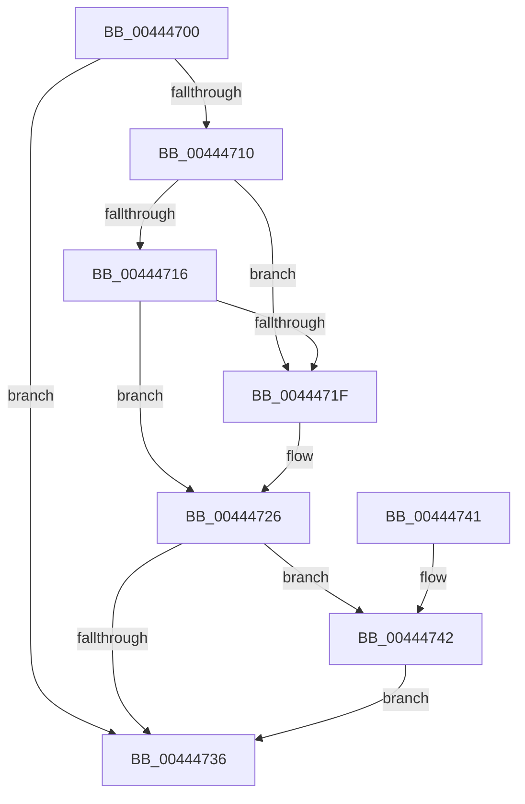

# RtlEndEnumerationHashTable

- RVA: `0x00444700`–`0x00444748` (길이 `72` bytes)
- VA: `0x0000000140444700`
- 실행 섹션: `.text`
- PDB 이름 있음: `예`; PDB Function 태그: `아니요`
- unwind 정보 RVA: `0x000DB714`
- 디코드: `23`개 명령, `72/72` bytes 표시
- 미해석 바이트: `0` (있으면 어셈블리에 `.byte`로 보존)

> 이 문서는 커널 이미지의 기계어와 PDB 기호를 분석해 생성했습니다. 4번과 5번은 함수 원형과 자료형을 바이너리 사용 방식에서 추정한 C 해석이며 원본 소스 복구 결과는 아닙니다.

## 1. Dependencies

- 직접 호출 지점: **0**; 고유 호출 대상: **0**
- 직접 호출자로 확인된 함수: **3**
- RIP 상대 이미지 참조: **0**

### Outgoing calls
- 직접 디코드된 call 명령이 없습니다.

### Direct callers
- [SepFindMatchingLowBoxNumberEntries](../../page/7A/SepFindMatchingLowBoxNumberEntries_function_007A3058.md) at `0x007A3105`
- [SepRmDestroyCapTable](../../page/7A/SepRmDestroyCapTable_function_007A4894.md) at `0x007A48FB`
- [SepDeleteCachedHandlesTable](../../page/AC/SepDeleteCachedHandlesTable_function_00ACCE28.md) at `0x00ACCEFA`

### Static image references
- 디코드된 RIP-relative 메모리 참조가 없습니다.

## 2. Other-region calls and transfers

- 다른 실행 섹션으로 향하는 call: **0**
- 별도 외부 분기/꼬리 이동을 확인하지 못했습니다.

## 3. Assembly (complete function range)

```asm
00444700  41 83 C9 FF                     or r9d, 0xffffffff
00444704  44 01 49 1C                     add dword ptr [rcx + 0x1c], r9d
00444708  48 8B 02                        mov rax, qword ptr [rdx]
0044470B  48 3B C2                        cmp rax, rdx
0044470E  74 26                           je 0x140444736
00444710  48 39 50 08                     cmp qword ptr [rax + 8], rdx
00444714  75 09                           jne 0x14044471f
00444716  4C 8B 42 08                     mov r8, qword ptr [rdx + 8]
0044471A  49 39 10                        cmp qword ptr [r8], rdx
0044471D  74 07                           je 0x140444726
0044471F  B9 03 00 00 00                  mov ecx, 3
00444724  CD 29                           int 0x29
00444726  49 89 00                        mov qword ptr [r8], rax
00444729  4C 89 40 08                     mov qword ptr [rax + 8], r8
0044472D  48 8B 42 18                     mov rax, qword ptr [rdx + 0x18]
00444731  48 39 00                        cmp qword ptr [rax], rax
00444734  74 0C                           je 0x140444742
00444736  B8 18 00 00 00                  mov eax, 0x18
0044473B  48 83 24 02 00                  and qword ptr [rdx + rax], 0
00444740  C3                              ret
00444741  CC                              int3
00444742  44 01 49 18                     add dword ptr [rcx + 0x18], r9d
00444746  EB EE                           jmp 0x140444736
```

## 4. C-style interpretation (structured pseudocode)

```c
__int64 __fastcall RtlEndEnumerationHashTable(__int64 a1, __int64 a2, __int64 a3, int a4)
{
    a4 = (unsigned int)((a4) | (0xFFFFFFFFULL));
    if ((*(unsigned __int64 *)(a2)) == a2) goto loc_00444736;
    if ((*(unsigned __int64 *)(*(unsigned __int64 *)(a2) + 8)) != a2) goto loc_0044471F;
    if ((*(unsigned __int64 *)(*(unsigned __int64 *)(a2 + 8))) != a2) {
        a1 = 3;
    }
    *(unsigned __int64 *)(*(unsigned __int64 *)(a2 + 8)) = *(unsigned __int64 *)(a2);
    *(unsigned __int64 *)(*(unsigned __int64 *)(a2) + 8) = *(unsigned __int64 *)(a2 + 8);
    if ((*(unsigned __int64 *)(*(unsigned __int64 *)(a2 + 24))) == (*(unsigned __int64 *)(a2 + 24))) goto loc_00444742;
loc_00444736:
    return 24;
loc_00444742:
    goto loc_00444736;
}
```

## 5. (Beta) C Style

```c
int64_t RtlEndEnumerationHashTable(void *Arg1, void *Arg2, int64_t Arg3, int32_t Arg4)
{
    uint8_t *arg1 = (uint8_t *)Arg1;
    uint8_t *arg2 = (uint8_t *)Arg2;

    Arg4 = (uint32_t)((Arg4) | (0xFFFFFFFFULL));
    if ((*(uint64_t *)(arg2)) == Arg2) goto loc_00444736;
    if ((*(uint64_t *)(*(uint64_t *)(arg2) + 0x8)) != Arg2) goto loc_0044471F;
    if ((*(uint64_t *)(*(uint64_t *)(arg2 + 0x8))) != Arg2) {
        Arg1 = 3;
    }
    *(uint64_t *)(*(uint64_t *)(arg2 + 0x8)) = *(uint64_t *)(arg2);
    *(uint64_t *)(*(uint64_t *)(arg2) + 0x8) = *(uint64_t *)(arg2 + 0x8);
    if ((*(uint64_t *)(*(uint64_t *)(arg2 + 0x18))) == (*(uint64_t *)(arg2 + 0x18))) goto loc_00444742;
loc_00444736:
    return 24;
loc_00444742:
    goto loc_00444736;
}
```

### 관측된 메모리 오프셋

구조체 형식이 확인되지 않은 접근은 인자 기준의 오프셋으로만 기록했습니다.

| 기준 인자 | 오프셋 표현 | 폭 (bit) | 접근 |
|---|---:|---:|---|
| `Arg1` | `+ 0x1C` | `32` | `R/W` |
| `Arg2` | `+ 0x0` | `64` | `R` |
| `Arg2` | `+ 0x0 + rax*1` | `64` | `R/W` |
| `Arg2` | `+ 0x8` | `64` | `R` |
| `Arg2` | `+ 0x18` | `64` | `R` |

## 6. Execution-region graph

[열기: 2D/3D 그래프와 함수 탐색 컨트롤 패널](../../../control-panel.html?section=text&rva=0x00444700&view=graph)

- 2D 그래프는 위에서 아래로 흐르고, 3D 그래프는 빈 공간을 드래그해 회전합니다. Shift+드래그는 이동, 휠은 확대·축소, 함수 노드 선택은 대상 보고서 이동입니다.

### Static fallback


