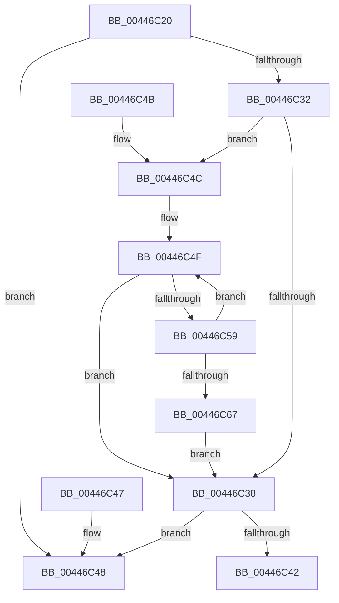

# RtlGetNextEntryHashTable

- RVA: `0x00446C20`–`0x00446C69` (길이 `73` bytes)
- VA: `0x0000000140446C20`
- 실행 섹션: `.text`
- PDB 이름 있음: `예`; PDB Function 태그: `아니요`
- unwind 정보 RVA: `0x000DB714`
- 디코드: `27`개 명령, `73/73` bytes 표시
- 미해석 바이트: `0` (있으면 어셈블리에 `.byte`로 보존)

> 이 문서는 커널 이미지의 기계어와 PDB 기호를 분석해 생성했습니다. 4번과 5번은 함수 원형과 자료형을 바이너리 사용 방식에서 추정한 C 해석이며 원본 소스 복구 결과는 아닙니다.

## 1. Dependencies

- 직접 호출 지점: **0**; 고유 호출 대상: **0**
- 직접 호출자로 확인된 함수: **6**
- RIP 상대 이미지 참조: **0**

### Outgoing calls
- 직접 디코드된 call 명령이 없습니다.

### Direct callers
- [SepRmReferenceFindCap](../3A/SepRmReferenceFindCap_function_003A58EC.md) at `0x003A596A`
- [SepFindMatchingAntiTamperEntry](../60/SepFindMatchingAntiTamperEntry_function_0060ADE4.md) at `0x0060AE4D`
- [SepFindMatchingLuidEntry](../../page/7A/SepFindMatchingLuidEntry_function_007A2814.md) at `0x007A2877`
- [SepFindSharedSidEntry](../../page/7A/SepFindSharedSidEntry_function_007A3148.md) at `0x007A31BA`
- [SepFindMatchingCachedHandlesEntry](../../page/9A/SepFindMatchingCachedHandlesEntry_function_009A9698.md) at `0x009A9730`
- [SepFindMatchingLowBoxNumberEntry](../../page/A7/SepFindMatchingLowBoxNumberEntry_function_00A74544.md) at `0x00A745E2`

### Static image references
- 디코드된 RIP-relative 메모리 참조가 없습니다.

## 2. Other-region calls and transfers

- 다른 실행 섹션으로 향하는 call: **0**
- 별도 외부 분기/꼬리 이동을 확인하지 못했습니다.

## 3. Assembly (complete function range)

```asm
00446C20  48 8B 42 08                     mov rax, qword ptr [rdx + 8]
00446C24  4C 8B 0A                        mov r9, qword ptr [rdx]
00446C27  4C 8B 00                        mov r8, qword ptr [rax]
00446C2A  49 8B 00                        mov rax, qword ptr [r8]
00446C2D  49 3B C1                        cmp rax, r9
00446C30  74 16                           je 0x140446c48
00446C32  83 79 1C 00                     cmp dword ptr [rcx + 0x1c], 0
00446C36  75 14                           jne 0x140446c4c
00446C38  48 8B 4A 10                     mov rcx, qword ptr [rdx + 0x10]
00446C3C  48 39 48 10                     cmp qword ptr [rax + 0x10], rcx
00446C40  75 06                           jne 0x140446c48
00446C42  4C 89 42 08                     mov qword ptr [rdx + 8], r8
00446C46  C3                              ret
00446C47  CC                              int3
00446C48  33 C0                           xor eax, eax
00446C4A  C3                              ret
00446C4B  CC                              int3
00446C4C  4C 8B D0                        mov r10, rax
00446C4F  49 83 7A 10 00                  cmp qword ptr [r10 + 0x10], 0
00446C54  49 8B C2                        mov rax, r10
00446C57  75 DF                           jne 0x140446c38
00446C59  49 8B 0A                        mov rcx, qword ptr [r10]
00446C5C  4D 8B C2                        mov r8, r10
00446C5F  4C 8B D1                        mov r10, rcx
00446C62  49 3B C9                        cmp rcx, r9
00446C65  75 E8                           jne 0x140446c4f
00446C67  EB CF                           jmp 0x140446c38
```

## 4. C-style interpretation (structured pseudocode)

```c
__int64 __fastcall RtlGetNextEntryHashTable(__int64 a1, __int64 a2)
{
    __int64 result;

    if ((*(unsigned __int64 *)(*(unsigned __int64 *)(*(unsigned __int64 *)(a2 + 8)))) == (*(unsigned __int64 *)(a2))) goto loc_00446C48;
    if ((*(unsigned int *)(a1 + 28)) != 0) goto loc_00446C4C;
loc_00446C38:
    if ((*(unsigned __int64 *)(*(unsigned __int64 *)(*(unsigned __int64 *)(*(unsigned __int64 *)(a2 + 8))) + 16)) != (*(unsigned __int64 *)(a2 + 16))) goto loc_00446C48;
    *(unsigned __int64 *)(a2 + 8) = *(unsigned __int64 *)(*(unsigned __int64 *)(a2 + 8));
    return *(unsigned __int64 *)(*(unsigned __int64 *)(*(unsigned __int64 *)(a2 + 8)));
loc_00446C48:
    result = 0;
    return result;
loc_00446C4C:
loc_00446C4F:
    if ((*(unsigned __int64 *)(0 + 16)) != 0) goto loc_00446C38;
    if ((*(unsigned __int64 *)(0)) != (*(unsigned __int64 *)(a2))) goto loc_00446C4F;
    goto loc_00446C38;
}
```

## 5. (Beta) C Style

```c
int64_t RtlGetNextEntryHashTable(void *Arg1, void *Arg2)
{
    uint8_t *arg1 = (uint8_t *)Arg1;
    uint8_t *arg2 = (uint8_t *)Arg2;

    int64_t result;

    if ((*(uint64_t *)(*(uint64_t *)(*(uint64_t *)(arg2 + 0x8)))) == (*(uint64_t *)(arg2))) goto loc_00446C48;
    if ((*(uint32_t *)(arg1 + 0x1C)) != 0) goto loc_00446C4C;
loc_00446C38:
    if ((*(uint64_t *)(*(uint64_t *)(*(uint64_t *)(*(uint64_t *)(arg2 + 0x8))) + 0x10)) != (*(uint64_t *)(arg2 + 0x10))) goto loc_00446C48;
    *(uint64_t *)(arg2 + 0x8) = *(uint64_t *)(*(uint64_t *)(arg2 + 0x8));
    return *(uint64_t *)(*(uint64_t *)(*(uint64_t *)(arg2 + 0x8)));
loc_00446C48:
    result = 0;
    return result;
loc_00446C4C:
loc_00446C4F:
    if ((*(uint64_t *)(0 + 0x10)) != 0) goto loc_00446C38;
    if ((*(uint64_t *)(0)) != (*(uint64_t *)(arg2))) goto loc_00446C4F;
    goto loc_00446C38;
}
```

### 관측된 메모리 오프셋

구조체 형식이 확인되지 않은 접근은 인자 기준의 오프셋으로만 기록했습니다.

| 기준 인자 | 오프셋 표현 | 폭 (bit) | 접근 |
|---|---:|---:|---|
| `Arg1` | `+ 0x1C` | `32` | `R` |
| `Arg2` | `+ 0x0` | `64` | `R` |
| `Arg2` | `+ 0x8` | `64` | `R` |
| `Arg2` | `+ 0x8` | `64` | `W` |
| `Arg2` | `+ 0x10` | `64` | `R` |

## 6. Execution-region graph

[열기: 2D/3D 그래프와 함수 탐색 컨트롤 패널](../../../control-panel.html?section=text&rva=0x00446C20&view=graph)

- 2D 그래프는 위에서 아래로 흐르고, 3D 그래프는 빈 공간을 드래그해 회전합니다. Shift+드래그는 이동, 휠은 확대·축소, 함수 노드 선택은 대상 보고서 이동입니다.

### Static fallback


