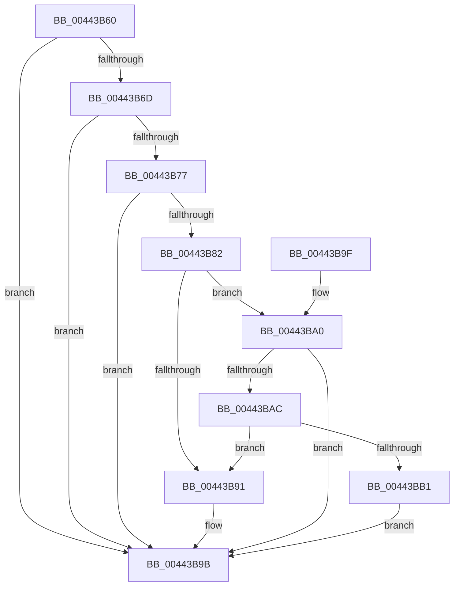

# RtlImageNtHeader

- RVA: `0x00443B60`–`0x00443BB3` (길이 `83` bytes)
- VA: `0x0000000140443B60`
- 실행 섹션: `.text`
- PDB 이름 있음: `예`; PDB Function 태그: `아니요`
- unwind 정보 RVA: `0x000DB714`
- 디코드: `25`개 명령, `83/83` bytes 표시
- 미해석 바이트: `0` (있으면 어셈블리에 `.byte`로 보존)

> 이 문서는 커널 이미지의 기계어와 PDB 기호를 분석해 생성했습니다. 4번과 5번은 함수 원형과 자료형을 바이너리 사용 방식에서 추정한 C 해석이며 원본 소스 복구 결과는 아닙니다.

## 1. Dependencies

- 직접 호출 지점: **0**; 고유 호출 대상: **0**
- 직접 호출자로 확인된 함수: **44**
- RIP 상대 이미지 참조: **0**

### Outgoing calls
- 직접 디코드된 call 명령이 없습니다.

### Direct callers
- [KiLockExtendedServiceTable](../50/KiLockExtendedServiceTable_function_00509F48.md) at `0x00509F8B`
- [KiLockExtendedServiceTable](../50/KiLockExtendedServiceTable_function_00509F48.md) at `0x00509FDF`
- [IopIsNotNativeDriverImage](../../page/71/IopIsNotNativeDriverImage_function_0071B914.md) at `0x0071BA99`
- [KiTpIsSupportedKernelTracepointLocation](../../page/74/KiTpIsSupportedKernelTracepointLocation_function_007488C8.md) at `0x007488D8`
- [ApiSetLoadSchemaEx](../../page/7D/ApiSetLoadSchemaEx_function_007D96F4.md) at `0x007D973C`
- [MiActOnLargeKernelHalPages](../../page/7F/MiActOnLargeKernelHalPages_function_007F852C.md) at `0x007F855A`
- [MmGetSectionRange](../../page/7F/MmGetSectionRange_function_007F9408.md) at `0x007F9443`
- [DbgkMapViewOfSection](../../page/89/DbgkMapViewOfSection_function_00897460.md) at `0x00897562`
- [EtwpQueryProcessOtherInfo](../../page/8A/EtwpQueryProcessOtherInfo_function_008A5BB0.md) at `0x008A5BCB`
- [EtwpEnumerateAddressSpace](../../page/8A/EtwpEnumerateAddressSpace_function_008A7590.md) at `0x008A7865`
- [RtlCreateUserStack](../../page/8C/RtlCreateUserStack_function_008CD908.md) at `0x008CDB0A`
- [DbgkCreateThread](../../page/8D/DbgkCreateThread_function_008D5E34.md) at `0x008D5F73`
- [DbgkCreateThread](../../page/8D/DbgkCreateThread_function_008D5E34.md) at `0x008D604E`
- [PspMapSystemDll](../../page/8D/PspMapSystemDll_function_008D6908.md) at `0x008D6AB6`
- [PerfLogImageLoad](../../page/8D/PerfLogImageLoad_function_008D6DE0.md) at `0x008D6E9F`
- [EtwpCovSampContextGetModule](../../page/8D/EtwpCovSampContextGetModule_function_008D7FEC.md) at `0x008D8059`
- [EtwpFindDebugId](../../page/8D/EtwpFindDebugId_function_008D9D58.md) at `0x008D9D82`
- [MmCreatePeb](../../page/98/MmCreatePeb_function_00980FB4.md) at `0x0098127D`
- [PopEtGetProcessImageInfo](../../page/98/PopEtGetProcessImageInfo_function_0098FB20.md) at `0x0098FB4B`
- [PnpPrepareDriverLoading](../../page/99/PnpPrepareDriverLoading_function_00996CC8.md) at `0x00996D17`
- [IopLoadDriver](../../page/99/IopLoadDriver_function_00997B54.md) at `0x00997FEA`
- [IopLoadDriver](../../page/99/IopLoadDriver_function_00997B54.md) at `0x009980C7`
- [MmLoadSystemImageEx](../../page/99/MmLoadSystemImageEx_function_00999B8C.md) at `0x00999E48`
- [PiLookupInDDBCache](../../page/99/PiLookupInDDBCache_function_0099AB78.md) at `0x0099ABD6`
- [LdrpAccessResourceDataNoMultipleLanguage](../../page/99/LdrpAccessResourceDataNoMultipleLanguage_function_0099BF00.md) at `0x0099BFB5`
- [RtlpWow64CreateUserStack](../../page/9F/RtlpWow64CreateUserStack_function_009F1300.md) at `0x009F137E`
- [DbgkSendSystemDllMessages](../../page/A1/DbgkSendSystemDllMessages_function_00A10C04.md) at `0x00A10D08`
- [PerfLogImageUnload](../../page/A2/PerfLogImageUnload_function_00A2216C.md) at `0x00A221E3`
- [MmResetDriverPaging](../../page/A4/MmResetDriverPaging_function_00A4ADB0.md) at `0x00A4AE22`
- [MiSnapDriverRange](../../page/A4/MiSnapDriverRange_function_00A4B328.md) at `0x00A4B3A5`
- [DbgkpPostModuleMessages](../../page/A5/DbgkpPostModuleMessages_function_00A5F86C.md) at `0x00A5F93D`
- [DbgkpPostModuleMessages](../../page/A5/DbgkpPostModuleMessages_function_00A5F86C.md) at `0x00A5FAA2`
- [MmLockPagableDataSection](../../page/A7/MmLockPagableDataSection_function_00A73E80.md) at `0x00A73EC2`
- [PiUpdateDriverDBCache](../../page/A8/PiUpdateDriverDBCache_function_00A895CC.md) at `0x00A89613`
- [MiProtectSystemImage](../../page/AA/MiProtectSystemImage_function_00AA7D74.md) at `0x00AA7E0D`
- [MiConstructLoaderEntry](../../page/AA/MiConstructLoaderEntry_function_00AAA264.md) at `0x00AAA300`
- [MiLockdownSections](../../page/AA/MiLockdownSections_function_00AAA788.md) at `0x00AAA7DD`
- [MiCaptureImageExceptionValues](../../page/AA/MiCaptureImageExceptionValues_function_00AAA890.md) at `0x00AAA8B3`
- [MiInitializeImageSectionLocks](../../page/AB/MiInitializeImageSectionLocks_function_00AB8EDC.md) at `0x00AB8F03`
- [IopUnloadDriver](../../page/AB/IopUnloadDriver_function_00ABF868.md) at `0x00ABFAFD`
- [NtSetSystemInformation](../../page/AF/NtSetSystemInformation_function_00AF4A60.md) at `0x00AF4FE2`
- [NtSetSystemInformation](../../page/AF/NtSetSystemInformation_function_00AF4A60.md) at `0x00AF53F8`
- [sub_00B1BA80](../../page/B1/Unknown_function_00B1BA80.md) at `0x00B1BAD6`
- [sub_00B36B22](../../page/B3/Unknown_function_00B36B22.md) at `0x00B36B56`
- [sub_00B40C48](../../page/B4/Unknown_function_00B40C48.md) at `0x00B40C54`
- [CcInitializeBcbProfiler](../../init/BE/CcInitializeBcbProfiler_function_00BEF294.md) at `0x00BEF38A`
- [sub_00BF16D0](../../init/BF/Unknown_function_00BF16D0.md) at `0x00BF18E1`
- [sub_00BF16D0](../../init/BF/Unknown_function_00BF16D0.md) at `0x00BF22FB`
- [sub_00BF16D0](../../init/BF/Unknown_function_00BF16D0.md) at `0x00BF607B`
- [sub_00BF16D0](../../init/BF/Unknown_function_00BF16D0.md) at `0x00BF60E0`
- [sub_00BF16D0](../../init/BF/Unknown_function_00BF16D0.md) at `0x00BF80D1`
- [sub_00C19464](../../init/C1/Unknown_function_00C19464.md) at `0x00C194C3`
- [sub_00C7EB3D](../../init/C7/Unknown_function_00C7EB3D.md) at `0x00C7EC81`
- [sub_00C7EB3D](../../init/C7/Unknown_function_00C7EB3D.md) at `0x00C7F17C`

### Static image references
- 디코드된 RIP-relative 메모리 참조가 없습니다.

## 2. Other-region calls and transfers

- 다른 실행 섹션으로 향하는 call: **0**
- 별도 외부 분기/꼬리 이동을 확인하지 못했습니다.

## 3. Assembly (complete function range)

```asm
00443B60  45 33 C0                        xor r8d, r8d
00443B63  48 8D 41 FF                     lea rax, [rcx - 1]
00443B67  48 83 F8 FD                     cmp rax, -3
00443B6B  77 2E                           ja 0x140443b9b
00443B6D  B8 4D 5A 00 00                  mov eax, 0x5a4d
00443B72  66 39 01                        cmp word ptr [rcx], ax
00443B75  75 24                           jne 0x140443b9b
00443B77  8B 41 3C                        mov eax, dword ptr [rcx + 0x3c]
00443B7A  48 03 C1                        add rax, rcx
00443B7D  48 3B C1                        cmp rax, rcx
00443B80  72 19                           jb 0x140443b9b
00443B82  48 BA FF FF FE FF FF 7F 00 00   movabs rdx, 0x7ffffffeffff
00443B8C  48 3B CA                        cmp rcx, rdx
00443B8F  76 0F                           jbe 0x140443ba0
00443B91  81 38 50 45 00 00               cmp dword ptr [rax], 0x4550
00443B97  4C 0F 44 C0                     cmove r8, rax
00443B9B  49 8B C0                        mov rax, r8
00443B9E  C3                              ret
00443B9F  CC                              int3
00443BA0  48 8D 88 07 01 00 00            lea rcx, [rax + 0x107]
00443BA7  48 3B C8                        cmp rcx, rax
00443BAA  72 EF                           jb 0x140443b9b
00443BAC  48 3B CA                        cmp rcx, rdx
00443BAF  76 E0                           jbe 0x140443b91
00443BB1  EB E8                           jmp 0x140443b9b
```

## 4. C-style interpretation (structured pseudocode)

```c
__int64 __fastcall RtlImageNtHeader(__int64 a1, __int64 a2, int a3)
{
    __int64 result;

    a3 = 0;
    if ((a1 - 1) > -3) goto loc_00443B9B;
    if ((*(unsigned __int16 *)(a1)) != ((unsigned __int16)((unsigned int)(0x5A4DULL)))) goto loc_00443B9B;
    result = ((unsigned int)(*(unsigned int *)(a1 + 60))) + (a1);
    if (result < a1) goto loc_00443B9B;
    if (a1 <= a2) goto loc_00443BA0;
loc_00443B91:
    if ((*(unsigned int *)(result)) == 0x4550ULL) { a3 = result; }
loc_00443B9B:
    return a3;
loc_00443BA0:
    if ((a3 + 263) < a3) goto loc_00443B9B;
    if ((a3 + 263) <= a2) goto loc_00443B91;
    goto loc_00443B9B;
}
```

## 5. (Beta) C Style

```c
int64_t RtlImageNtHeader(void *Arg1, int64_t Arg2, int32_t Arg3)
{
    uint8_t *arg1 = (uint8_t *)Arg1;

    int64_t result;

    Arg3 = 0;
    if ((Arg1 - 1) > -3) goto loc_00443B9B;
    if ((*(uint16_t *)(arg1)) != ((uint16_t)((uint32_t)(0x5A4DULL)))) goto loc_00443B9B;
    result = ((uint32_t)(*(uint32_t *)(arg1 + 0x3C))) + (Arg1);
    if (result < Arg1) goto loc_00443B9B;
    if (Arg1 <= Arg2) goto loc_00443BA0;
loc_00443B91:
    if ((*(uint32_t *)(result)) == 0x4550ULL) { Arg3 = result; }
loc_00443B9B:
    return Arg3;
loc_00443BA0:
    if ((Arg3 + 263) < Arg3) goto loc_00443B9B;
    if ((Arg3 + 263) <= Arg2) goto loc_00443B91;
    goto loc_00443B9B;
}
```

### 관측된 메모리 오프셋

구조체 형식이 확인되지 않은 접근은 인자 기준의 오프셋으로만 기록했습니다.

| 기준 인자 | 오프셋 표현 | 폭 (bit) | 접근 |
|---|---:|---:|---|
| `Arg1` | `- 0x1` | `64` | `R` |
| `Arg1` | `+ 0x0` | `16` | `R` |
| `Arg1` | `+ 0x3C` | `32` | `R` |

## 6. Execution-region graph

[열기: 2D/3D 그래프와 함수 탐색 컨트롤 패널](../../../control-panel.html?section=text&rva=0x00443B60&view=graph)

- 2D 그래프는 위에서 아래로 흐르고, 3D 그래프는 빈 공간을 드래그해 회전합니다. Shift+드래그는 이동, 휠은 확대·축소, 함수 노드 선택은 대상 보고서 이동입니다.

### Static fallback


