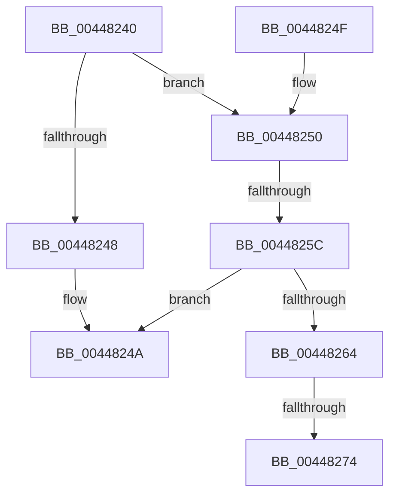

# RtlNtStatusToDosErrorNoTeb

- RVA: `0x00448240`–`0x00448276` (길이 `54` bytes)
- VA: `0x0000000140448240`
- 실행 섹션: `.text`
- PDB 이름 있음: `예`; PDB Function 태그: `아니요`
- unwind 정보 RVA: `0x000A6068`
- 디코드: `16`개 명령, `54/54` bytes 표시
- 미해석 바이트: `0` (있으면 어셈블리에 `.byte`로 보존)

> 이 문서는 커널 이미지의 기계어와 PDB 기호를 분석해 생성했습니다. 4번과 5번은 함수 원형과 자료형을 바이너리 사용 방식에서 추정한 C 해석이며 원본 소스 복구 결과는 아닙니다.

## 1. Dependencies

- 직접 호출 지점: **0**; 고유 호출 대상: **0**
- 직접 호출자로 확인된 함수: **1**
- RIP 상대 이미지 참조: **0**

### Outgoing calls
- 직접 디코드된 call 명령이 없습니다.

### Direct callers
- [RtlNtStatusToDosError](../../page/92/RtlNtStatusToDosError_function_00926C40.md) at `0x00926C7B`

### Static image references
- 디코드된 RIP-relative 메모리 참조가 없습니다.

## 2. Other-region calls and transfers

- 다른 실행 섹션으로 향하는 call: **0**
- call이 아닌 외부 분기/꼬리 이동: **2**
  - `0x00448256` → [sub_00448348](Unknown_function_00448348.md) (`tail-transfer`)
  - `0x0044826E` → [sub_00448348 + 0xA](Unknown_function_00448348.md) (`tail-transfer`)

## 3. Assembly (complete function range)

```asm
00448240  48 83 EC 08                     sub rsp, 8
00448244  85 C9                           test ecx, ecx
00448246  75 08                           jne 0x140448250
00448248  33 C0                           xor eax, eax
0044824A  48 83 C4 08                     add rsp, 8
0044824E  C3                              ret
0044824F  CC                              int3
00448250  81 F9 03 01 00 00               cmp ecx, 0x103
00448256  0F 84 EC 00 00 00               je 0x140448348
0044825C  8B C1                           mov eax, ecx
0044825E  0F BA E1 1D                     bt ecx, 0x1d
00448262  72 E6                           jb 0x14044824a
00448264  25 00 00 FF 00                  and eax, 0xff0000
00448269  3D 00 00 07 00                  cmp eax, 0x70000
0044826E  0F 84 DE 00 00 00               je 0x140448352
00448274  8B C1                           mov eax, ecx
```

## 4. C-style interpretation (structured pseudocode)

```c
__int64 __fastcall RtlNtStatusToDosErrorNoTeb(int a1)
{
    __int64 result;
    __int64 v_rsp;

    v_rsp = (v_rsp) - (8);
    if (a1 != 0) goto loc_00448250;
    result = 0;
loc_0044824A:
    v_rsp = (v_rsp) + (8);
    return result;
loc_00448250:
    if (a1 < 259) goto loc_0044824A;
    result = (unsigned int)(((unsigned int)(a1)) & (0xFF0000ULL));
    return (unsigned int)(a1);
}
```

## 5. (Beta) C Style

```c
int64_t RtlNtStatusToDosErrorNoTeb(int32_t Arg1)
{
    int64_t result;
    int64_t local_rsp;

    local_rsp = (local_rsp) - (8);
    if (Arg1 != 0) goto loc_00448250;
    result = 0;
loc_0044824A:
    local_rsp = (local_rsp) + (8);
    return result;
loc_00448250:
    if (Arg1 < 259) goto loc_0044824A;
    result = (uint32_t)(((uint32_t)(Arg1)) & (0xFF0000ULL));
    return (uint32_t)(Arg1);
}
```

## 6. Execution-region graph

[열기: 2D/3D 그래프와 함수 탐색 컨트롤 패널](../../../control-panel.html?section=text&rva=0x00448240&view=graph)

- 2D 그래프는 위에서 아래로 흐르고, 3D 그래프는 빈 공간을 드래그해 회전합니다. Shift+드래그는 이동, 휠은 확대·축소, 함수 노드 선택은 대상 보고서 이동입니다.

### Static fallback


