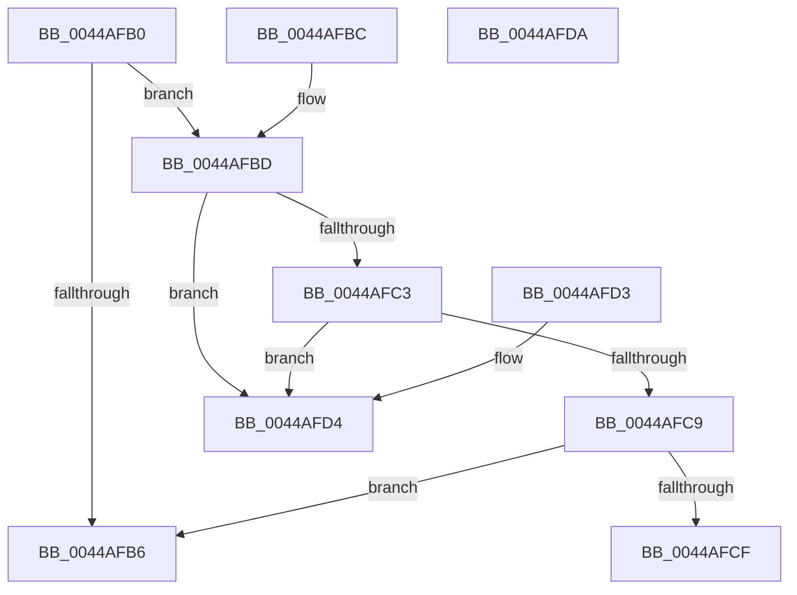

# RtlSizeOfRetpolineRelocationEntry

- RVA: `0x0044AFB0`–`0x0044AFDB` (길이 `43` bytes)
- VA: `0x000000014044AFB0`
- 실행 섹션: `.text`
- PDB 이름 있음: `예`; PDB Function 태그: `아니요`
- unwind 정보 RVA: `0x000DB714`
- 디코드: `17`개 명령, `43/43` bytes 표시
- 미해석 바이트: `0` (있으면 어셈블리에 `.byte`로 보존)

> 이 문서는 커널 이미지의 기계어와 PDB 기호를 분석해 생성했습니다. 4번과 5번은 함수 원형과 자료형을 바이너리 사용 방식에서 추정한 C 해석이며 원본 소스 복구 결과는 아닙니다.

## 1. Dependencies

- 직접 호출 지점: **0**; 고유 호출 대상: **0**
- 직접 호출자로 확인된 함수: **3**
- RIP 상대 이미지 참조: **0**

### Outgoing calls
- 직접 디코드된 call 명령이 없습니다.

### Direct callers
- [RtlValidateDynamicFixupRelocation](RtlValidateDynamicFixupRelocation_function_00449AD8.md) at `0x00449B13`
- [RtlpCopyRetpolineRelocationBlockEntryArray](RtlpCopyRetpolineRelocationBlockEntryArray_function_0044AB44.md) at `0x0044AB7D`
- [RtlCreateRetpolineRelocationInformation](RtlCreateRetpolineRelocationInformation_function_0044AC14.md) at `0x0044AD43`

### Static image references
- 디코드된 RIP-relative 메모리 참조가 없습니다.

## 2. Other-region calls and transfers

- 다른 실행 섹션으로 향하는 call: **0**
- 별도 외부 분기/꼬리 이동을 확인하지 못했습니다.

## 3. Assembly (complete function range)

```asm
0044AFB0  48 83 E9 03                     sub rcx, 3
0044AFB4  75 07                           jne 0x14044afbd
0044AFB6  B8 04 00 00 00                  mov eax, 4
0044AFBB  C3                              ret
0044AFBC  CC                              int3
0044AFBD  48 83 E9 01                     sub rcx, 1
0044AFC1  74 11                           je 0x14044afd4
0044AFC3  48 83 E9 01                     sub rcx, 1
0044AFC7  74 0B                           je 0x14044afd4
0044AFC9  48 83 F9 03                     cmp rcx, 3
0044AFCD  74 E7                           je 0x14044afb6
0044AFCF  83 C8 FF                        or eax, 0xffffffff
0044AFD2  C3                              ret
0044AFD3  CC                              int3
0044AFD4  B8 02 00 00 00                  mov eax, 2
0044AFD9  C3                              ret
0044AFDA  CC                              int3
```

## 4. C-style interpretation (structured pseudocode)

```c
__int64 __fastcall RtlSizeOfRetpolineRelocationEntry(__int64 a1)
{
    __int64 result;

    a1 = (a1) - (3);
    if (condition_is_not_equal) goto loc_0044AFBD;
loc_0044AFB6:
    return 4;
loc_0044AFBD:
    a1 = (a1) - (1);
    if (condition_is_equal) goto loc_0044AFD4;
    a1 = (a1) - (1);
    if (condition_is_equal) goto loc_0044AFD4;
    if (a1 == 3) goto loc_0044AFB6;
    result = (unsigned int)((4) | (0xFFFFFFFFULL));
    return result;
loc_0044AFD4:
    return 2;
}
```

## 5. (Beta) C Style

```c
int64_t RtlSizeOfRetpolineRelocationEntry(int64_t Arg1)
{
    int64_t result;

    Arg1 = (Arg1) - (3);
    if (condition_is_not_equal) goto loc_0044AFBD;
loc_0044AFB6:
    return 4;
loc_0044AFBD:
    Arg1 = (Arg1) - (1);
    if (condition_is_equal) goto loc_0044AFD4;
    Arg1 = (Arg1) - (1);
    if (condition_is_equal) goto loc_0044AFD4;
    if (Arg1 == 3) goto loc_0044AFB6;
    result = (uint32_t)((4) | (0xFFFFFFFFULL));
    return result;
loc_0044AFD4:
    return 2;
}
```

## 6. Execution-region graph

[열기: 2D/3D 그래프와 함수 탐색 컨트롤 패널](../../../control-panel.html?section=text&rva=0x0044AFB0&view=graph)

- 2D 그래프는 위에서 아래로 흐르고, 3D 그래프는 빈 공간을 드래그해 회전합니다. Shift+드래그는 이동, 휠은 확대·축소, 함수 노드 선택은 대상 보고서 이동입니다.

### Static fallback


