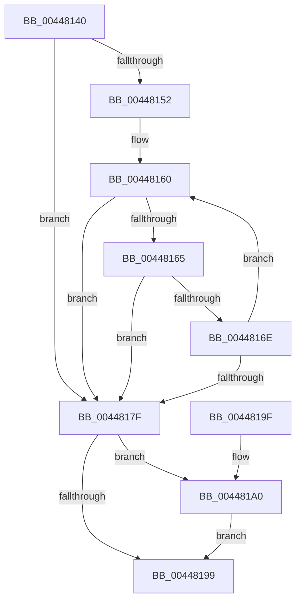

# RtlStringCopyWorkerA

- RVA: `0x00448140`–`0x004481B0` (길이 `112` bytes)
- VA: `0x0000000140448140`
- 실행 섹션: `.text`
- PDB 이름 있음: `예`; PDB Function 태그: `예`
- unwind 정보 RVA: `0x00071394`
- 디코드: `36`개 명령, `112/112` bytes 표시
- 미해석 바이트: `0` (있으면 어셈블리에 `.byte`로 보존)

> 이 문서는 커널 이미지의 기계어와 PDB 기호를 분석해 생성했습니다. 4번과 5번은 함수 원형과 자료형을 바이너리 사용 방식에서 추정한 C 해석이며 원본 소스 복구 결과는 아닙니다.

## 1. Dependencies

- 직접 호출 지점: **0**; 고유 호출 대상: **0**
- 직접 호출자로 확인된 함수: **2**
- RIP 상대 이미지 참조: **0**

### Outgoing calls
- 직접 디코드된 call 명령이 없습니다.

### Direct callers
- [RtlStringCbCatExA](../53/RtlStringCbCatExA_function_0053BB58.md) at `0x0053BBC6`
- [InitBootProcessor](../../init/C1/InitBootProcessor_function_00C1B1C8.md) at `0x00C1BB8F`

### Static image references
- 디코드된 RIP-relative 메모리 참조가 없습니다.

## 2. Other-region calls and transfers

- 다른 실행 섹션으로 향하는 call: **0**
- 별도 외부 분기/꼬리 이동을 확인하지 못했습니다.

## 3. Assembly (complete function range)

```asm
00448140  48 89 5C 24 08                  mov qword ptr [rsp + 8], rbx
00448145  33 DB                           xor ebx, ebx
00448147  4C 8B D2                        mov r10, rdx
0044814A  44 8B DB                        mov r11d, ebx
0044814D  48 85 D2                        test rdx, rdx
00448150  74 2D                           je 0x14044817f
00448152  B8 FE FF FF 7F                  mov eax, 0x7ffffffe
00448157  4C 2B C9                        sub r9, rcx
0044815A  66 0F 1F 44 00 00               nop word ptr [rax + rax]
00448160  48 85 C0                        test rax, rax
00448163  74 1A                           je 0x14044817f
00448165  41 0F B6 14 09                  movzx edx, byte ptr [r9 + rcx]
0044816A  84 D2                           test dl, dl
0044816C  74 11                           je 0x14044817f
0044816E  88 11                           mov byte ptr [rcx], dl
00448170  48 FF C8                        dec rax
00448173  48 FF C1                        inc rcx
00448176  49 FF C3                        inc r11
00448179  49 83 EA 01                     sub r10, 1
0044817D  75 E1                           jne 0x140448160
0044817F  4D 85 D2                        test r10, r10
00448182  48 8D 51 FF                     lea rdx, [rcx - 1]
00448186  B8 05 00 00 80                  mov eax, 0x80000005
0044818B  48 0F 45 D1                     cmovne rdx, rcx
0044818F  0F 45 C3                        cmovne eax, ebx
00448192  88 1A                           mov byte ptr [rdx], bl
00448194  4D 85 C0                        test r8, r8
00448197  75 07                           jne 0x1404481a0
00448199  48 8B 5C 24 08                  mov rbx, qword ptr [rsp + 8]
0044819E  C3                              ret
0044819F  CC                              int3
004481A0  4D 85 D2                        test r10, r10
004481A3  49 8D 4B FF                     lea rcx, [r11 - 1]
004481A7  49 0F 45 CB                     cmovne rcx, r11
004481AB  49 89 08                        mov qword ptr [r8], rcx
004481AE  EB E9                           jmp 0x140448199
```

## 4. C-style interpretation (structured pseudocode)

```c
__int64 __fastcall RtlStringCopyWorkerA(__int64 a1, __int64 a2, __int64 a3, __int64 a4)
{
    __int64 result;
    __int64 v_r10;
    __int64 v_r11;
    __int64 v_rbx;
    unsigned __int64 v_stack_p8;

    v_stack_p8 = v_rbx;
    v_rbx = 0;
    if (a2 == 0) goto loc_0044817F;
    a4 = (a4) - (a1);
loc_00448160:
    if ((unsigned int)(0x7FFFFFFEULL) == 0) goto loc_0044817F;
    if ((unsigned __int8)(*(unsigned __int8 *)(a4 + a1 * 1)) == 0) goto loc_0044817F;
    *(unsigned __int8 *)(a1) = (unsigned __int8)(*(unsigned __int8 *)(a4 + a1 * 1));
    result = ((unsigned int)(0x7FFFFFFEULL)) - 1;
    a1 = (a1) + 1;
    v_r11 = (0) + 1;
    v_r10 = (a2) - (1);
    if (condition_is_not_equal) goto loc_00448160;
loc_0044817F:
    a2 = a1 - 1;
    if (v_r10 != 0) { a2 = a1; }
    result = (unsigned int)(0x80000005ULL);
    if (v_r10 != 0) { result = 0; }
    *(unsigned __int8 *)(a2) = 0;
    if (a3 != 0) goto loc_004481A0;
loc_00448199:
    return result;
loc_004481A0:
    a1 = v_r11 - 1;
    if (v_r10 != 0) { a1 = v_r11; }
    *(unsigned __int64 *)(a3) = a1;
    goto loc_00448199;
}
```

## 5. (Beta) C Style

```c
int64_t RtlStringCopyWorkerA(int64_t Arg1, int64_t Arg2, int64_t Arg3, void *Arg4)
{
    uint8_t *arg4 = (uint8_t *)Arg4;

    int64_t result;
    int64_t local_r10;
    int64_t local_r11;
    int64_t local_rbx;
    uint64_t v_stack_p8;

    v_stack_p8 = local_rbx;
    local_rbx = 0;
    if (Arg2 == 0) goto loc_0044817F;
    Arg4 = (Arg4) - (Arg1);
loc_00448160:
    if ((uint32_t)(0x7FFFFFFEULL) == 0) goto loc_0044817F;
    if ((uint8_t)(*(uint8_t *)(arg4 + Arg1 * 1)) == 0) goto loc_0044817F;
    *(uint8_t *)(Arg1) = (uint8_t)(*(uint8_t *)(arg4 + Arg1 * 1));
    result = ((uint32_t)(0x7FFFFFFEULL)) - 1;
    Arg1 = (Arg1) + 1;
    local_r11 = (0) + 1;
    local_r10 = (Arg2) - (1);
    if (condition_is_not_equal) goto loc_00448160;
loc_0044817F:
    Arg2 = Arg1 - 1;
    if (local_r10 != 0) { Arg2 = Arg1; }
    result = (uint32_t)(0x80000005ULL);
    if (local_r10 != 0) { result = 0; }
    *(uint8_t *)(Arg2) = 0;
    if (Arg3 != 0) goto loc_004481A0;
loc_00448199:
    return result;
loc_004481A0:
    Arg1 = local_r11 - 1;
    if (local_r10 != 0) { Arg1 = local_r11; }
    *(uint64_t *)(Arg3) = Arg1;
    goto loc_00448199;
}
```

### 관측된 메모리 오프셋

구조체 형식이 확인되지 않은 접근은 인자 기준의 오프셋으로만 기록했습니다.

| 기준 인자 | 오프셋 표현 | 폭 (bit) | 접근 |
|---|---:|---:|---|
| `Arg4` | `+ 0x0 + rcx*1` | `8` | `R` |

## 6. Execution-region graph

[열기: 2D/3D 그래프와 함수 탐색 컨트롤 패널](../../../control-panel.html?section=text&rva=0x00448140&view=graph)

- 2D 그래프는 위에서 아래로 흐르고, 3D 그래프는 빈 공간을 드래그해 회전합니다. Shift+드래그는 이동, 휠은 확대·축소, 함수 노드 선택은 대상 보고서 이동입니다.

### Static fallback


