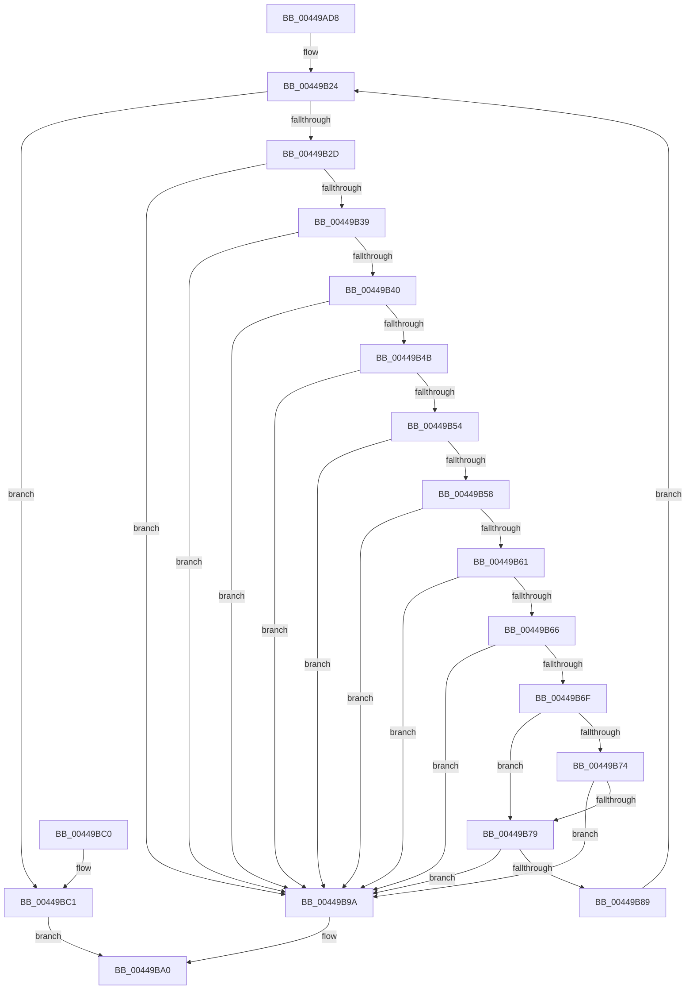

# RtlValidateDynamicFixupRelocation

- RVA: `0x00449AD8`–`0x00449BC6` (길이 `238` bytes)
- VA: `0x0000000140449AD8`
- 실행 섹션: `.text`
- PDB 이름 있음: `예`; PDB Function 태그: `아니요`
- unwind 정보 RVA: `0x0006F790`
- 디코드: `79`개 명령, `238/238` bytes 표시
- 미해석 바이트: `0` (있으면 어셈블리에 `.byte`로 보존)

> 이 문서는 커널 이미지의 기계어와 PDB 기호를 분석해 생성했습니다. 4번과 5번은 함수 원형과 자료형을 바이너리 사용 방식에서 추정한 C 해석이며 원본 소스 복구 결과는 아닙니다.

## 1. Dependencies

- 직접 호출 지점: **1**; 고유 호출 대상: **1**
- 직접 호출자로 확인된 함수: **1**
- RIP 상대 이미지 참조: **0**

### Outgoing calls
- `0x00449B13` → [RtlSizeOfRetpolineRelocationEntry](RtlSizeOfRetpolineRelocationEntry_function_0044AFB0.md) (function, `0x0044AFB0`)

### Direct callers
- [MiCaptureRetpolineRelocationTables](../../page/94/MiCaptureRetpolineRelocationTables_function_00942E14.md) at `0x00942FCA`

### Static image references
- 디코드된 RIP-relative 메모리 참조가 없습니다.

## 2. Other-region calls and transfers

- 다른 실행 섹션으로 향하는 call: **0**
- 별도 외부 분기/꼬리 이동을 확인하지 못했습니다.

## 3. Assembly (complete function range)

```asm
00449AD8  48 89 5C 24 10                  mov qword ptr [rsp + 0x10], rbx
00449ADD  48 89 6C 24 18                  mov qword ptr [rsp + 0x18], rbp
00449AE2  48 89 74 24 20                  mov qword ptr [rsp + 0x20], rsi
00449AE7  57                              push rdi
00449AE8  41 54                           push r12
00449AEA  41 55                           push r13
00449AEC  41 56                           push r14
00449AEE  41 57                           push r15
00449AF0  48 83 EC 20                     sub rsp, 0x20
00449AF4  8B 59 08                        mov ebx, dword ptr [rcx + 8]
00449AF7  45 33 D2                        xor r10d, r10d
00449AFA  48 8B F1                        mov rsi, rcx
00449AFD  4D 8B F9                        mov r15, r9
00449B00  48 8B 09                        mov rcx, qword ptr [rcx]
00449B03  45 8B E0                        mov r12d, r8d
00449B06  44 8B EA                        mov r13d, edx
00449B09  41 8A EA                        mov bpl, r10b
00449B0C  45 8D 5A 0C                     lea r11d, [r10 + 0xc]
00449B10  41 03 DB                        add ebx, r11d
00449B13  E8 98 14 00 00                  call 0x14044afb0
00449B18  8B D0                           mov edx, eax
00449B1A  89 44 24 50                     mov dword ptr [rsp + 0x50], eax
00449B1E  45 8B F2                        mov r14d, r10d
00449B21  41 8B FA                        mov edi, r10d
00449B24  44 3B DB                        cmp r11d, ebx
00449B27  0F 83 94 00 00 00               jae 0x140449bc1
00449B2D  45 8B C3                        mov r8d, r11d
00449B30  49 8D 48 08                     lea rcx, [r8 + 8]
00449B34  49 3B C8                        cmp rcx, r8
00449B37  72 61                           jb 0x140449b9a
00449B39  8B C3                           mov eax, ebx
00449B3B  48 3B C8                        cmp rcx, rax
00449B3E  77 5A                           ja 0x140449b9a
00449B40  45 8B 4C 30 04                  mov r9d, dword ptr [r8 + rsi + 4]
00449B45  41 83 F9 08                     cmp r9d, 8
00449B49  72 4F                           jb 0x140449b9a
00449B4B  43 8D 04 19                     lea eax, [r9 + r11]
00449B4F  41 3B C3                        cmp eax, r11d
00449B52  72 46                           jb 0x140449b9a
00449B54  3B C3                           cmp eax, ebx
00449B56  77 42                           ja 0x140449b9a
00449B58  45 8B 04 30                     mov r8d, dword ptr [r8 + rsi]
00449B5C  45 3B C5                        cmp r8d, r13d
00449B5F  73 39                           jae 0x140449b9a
00449B61  45 3B C4                        cmp r8d, r12d
00449B64  72 34                           jb 0x140449b9a
00449B66  41 F7 C0 FF 0F 00 00            test r8d, 0xfff
00449B6D  75 2B                           jne 0x140449b9a
00449B6F  40 84 ED                        test bpl, bpl
00449B72  74 05                           je 0x140449b79
00449B74  4D 3B C6                        cmp r8, r14
00449B77  76 21                           jbe 0x140449b9a
00449B79  8B CA                           mov ecx, edx
00449B7B  49 8D 41 F8                     lea rax, [r9 - 8]
00449B7F  33 D2                           xor edx, edx
00449B81  48 F7 F1                        div rcx
00449B84  48 85 D2                        test rdx, rdx
00449B87  75 11                           jne 0x140449b9a
00449B89  8B 54 24 50                     mov edx, dword ptr [rsp + 0x50]
00449B8D  03 F8                           add edi, eax
00449B8F  45 03 D9                        add r11d, r9d
00449B92  4D 8B F0                        mov r14, r8
00449B95  40 B5 01                        mov bpl, 1
00449B98  EB 8A                           jmp 0x140449b24
00449B9A  41 BA 7B 00 00 C0               mov r10d, 0xc000007b
00449BA0  48 8B 5C 24 58                  mov rbx, qword ptr [rsp + 0x58]
00449BA5  41 8B C2                        mov eax, r10d
00449BA8  48 8B 6C 24 60                  mov rbp, qword ptr [rsp + 0x60]
00449BAD  48 8B 74 24 68                  mov rsi, qword ptr [rsp + 0x68]
00449BB2  48 83 C4 20                     add rsp, 0x20
00449BB6  41 5F                           pop r15
00449BB8  41 5E                           pop r14
00449BBA  41 5D                           pop r13
00449BBC  41 5C                           pop r12
00449BBE  5F                              pop rdi
00449BBF  C3                              ret
00449BC0  CC                              int3
00449BC1  41 89 3F                        mov dword ptr [r15], edi
00449BC4  EB DA                           jmp 0x140449ba0
```

## 4. C-style interpretation (structured pseudocode)

```c
__int64 __fastcall RtlValidateDynamicFixupRelocation(__int64 a1, int a2, int a3, __int64 a4)
{
    __int64 result;
    __int64 v_r10;
    __int64 v_r11;
    __int64 v_rbx;
    __int64 v_rdi;
    __int64 v_rsp;
    unsigned __int64 v_stack_p10;
    unsigned __int64 v_stack_p18;
    unsigned __int64 v_stack_p20;
    unsigned int v_stack_p8;

    v_stack_p10 = v_rbx;
    v_stack_p18 = v_rbp;
    v_stack_p20 = v_rsi;
    v_rsp = (v_rsp) - (32);
    v_r10 = 0;
    v_rbx = (unsigned int)(((unsigned int)(*(unsigned int *)(a1 + 8))) + ((unsigned int)(v_r10 + 12)));
    result = RtlSizeOfRetpolineRelocationEntry(*(unsigned __int64 *)(a1), a2, a3, a4);
    v_stack_p8 = (unsigned int)(result);
loc_00449B24:
    if (((unsigned int)(v_r10 + 12)) >= ((unsigned int)(v_rbx))) goto loc_00449BC1;
    if (((unsigned int)((unsigned int)(v_r10 + 12)) + 8) < ((unsigned int)((unsigned int)(v_r10 + 12)))) goto loc_00449B9A;
    if (((unsigned int)((unsigned int)(v_r10 + 12)) + 8) > ((unsigned int)((unsigned int)(v_rbx)))) goto loc_00449B9A;
    if (((unsigned int)((unsigned int)(*(unsigned int *)((unsigned int)((unsigned int)(v_r10 + 12)) + a1 * 1 + 4)))) < 8) goto loc_00449B9A;
    if (((unsigned int)((unsigned int)(*(unsigned int *)((unsigned int)((unsigned int)(v_r10 + 12)) + a1 * 1 + 4)) + v_r10 + 12 * 1)) < ((unsigned int)(v_r10 + 12))) goto loc_00449B9A;
    if (((unsigned int)((unsigned int)(*(unsigned int *)((unsigned int)((unsigned int)(v_r10 + 12)) + a1 * 1 + 4)) + v_r10 + 12 * 1)) > ((unsigned int)(v_rbx))) goto loc_00449B9A;
    if (((unsigned int)((unsigned int)(*(unsigned int *)((unsigned int)((unsigned int)(v_r10 + 12)) + a1 * 1)))) >= ((unsigned int)((unsigned int)(a2)))) goto loc_00449B9A;
    if (((unsigned int)((unsigned int)(*(unsigned int *)((unsigned int)((unsigned int)(v_r10 + 12)) + a1 * 1)))) < ((unsigned int)((unsigned int)(a3)))) goto loc_00449B9A;
    if ((((unsigned int)((unsigned int)(*(unsigned int *)((unsigned int)((unsigned int)(v_r10 + 12)) + a1 * 1)))) & (0xFFFULL)) != 0) goto loc_00449B9A;
    if (0 == 0) goto loc_00449B79;
    if (((unsigned int)(*(unsigned int *)((unsigned int)((unsigned int)(v_r10 + 12)) + a1 * 1))) <= 0) goto loc_00449B9A;
loc_00449B79:
    a2 = 0;
    if (0 != 0) goto loc_00449B9A;
    v_rdi = (unsigned int)((0) + ((unsigned int)((unsigned int)(*(unsigned int *)((unsigned int)((unsigned int)(v_r10 + 12)) + a1 * 1 + 4)) - 8)));
    v_r11 = (unsigned int)((v_r10 + 12) + ((unsigned int)((unsigned int)(*(unsigned int *)((unsigned int)((unsigned int)(v_r10 + 12)) + a1 * 1 + 4)))));
    goto loc_00449B24;
loc_00449B9A:
loc_00449BA0:
    v_rsp = (v_rsp) + (32);
    return (unsigned int)((unsigned int)((unsigned int)(0xC000007BULL)));
loc_00449BC1:
    *(unsigned int *)(a4) = (unsigned int)(v_rdi);
    goto loc_00449BA0;
}
```

## 5. (Beta) C Style

```c
int64_t RtlValidateDynamicFixupRelocation(void *Arg1, int32_t Arg2, int32_t Arg3, void *Arg4)
{
    uint8_t *arg1 = (uint8_t *)Arg1;
    uint8_t *arg4 = (uint8_t *)Arg4;

    int64_t result;
    int64_t local_r10;
    int64_t local_r11;
    int64_t local_rbx;
    int64_t local_rdi;
    int64_t local_rsp;
    uint64_t v_stack_p10;
    uint64_t v_stack_p18;
    uint64_t v_stack_p20;
    uint32_t v_stack_p8;

    v_stack_p10 = local_rbx;
    v_stack_p18 = local_rbp;
    v_stack_p20 = local_rsi;
    local_rsp = (local_rsp) - (32);
    local_r10 = 0;
    local_rbx = (uint32_t)(((uint32_t)(*(uint32_t *)(arg1 + 0x8))) + ((uint32_t)(local_r10 + 12)));
    result = RtlSizeOfRetpolineRelocationEntry(*(uint64_t *)(arg1), Arg2, Arg3, Arg4);
    v_stack_p8 = (uint32_t)(result);
loc_00449B24:
    if (((uint32_t)(local_r10 + 12)) >= ((uint32_t)(local_rbx))) goto loc_00449BC1;
    if (((uint32_t)((uint32_t)(local_r10 + 12)) + 8) < ((uint32_t)((uint32_t)(local_r10 + 12)))) goto loc_00449B9A;
    if (((uint32_t)((uint32_t)(local_r10 + 12)) + 8) > ((uint32_t)((uint32_t)(local_rbx)))) goto loc_00449B9A;
    if (((uint32_t)((uint32_t)(*(uint32_t *)((uint32_t)((uint32_t)(local_r10 + 0xC)) + arg1 * 1 + 0x4)))) < 8) goto loc_00449B9A;
    if (((uint32_t)((uint32_t)(*(uint32_t *)((uint32_t)((uint32_t)(local_r10 + 0xC)) + arg1 * 1 + 0x4)) + local_r10 + 12 * 1)) < ((uint32_t)(local_r10 + 12))) goto loc_00449B9A;
    if (((uint32_t)((uint32_t)(*(uint32_t *)((uint32_t)((uint32_t)(local_r10 + 0xC)) + arg1 * 1 + 0x4)) + local_r10 + 12 * 1)) > ((uint32_t)(local_rbx))) goto loc_00449B9A;
    if (((uint32_t)((uint32_t)(*(uint32_t *)((uint32_t)((uint32_t)(local_r10 + 0xC)) + arg1 * 1)))) >= ((uint32_t)((uint32_t)(Arg2)))) goto loc_00449B9A;
    if (((uint32_t)((uint32_t)(*(uint32_t *)((uint32_t)((uint32_t)(local_r10 + 0xC)) + arg1 * 1)))) < ((uint32_t)((uint32_t)(Arg3)))) goto loc_00449B9A;
    if ((((uint32_t)((uint32_t)(*(uint32_t *)((uint32_t)((uint32_t)(local_r10 + 0xC)) + arg1 * 1)))) & (0xFFFULL)) != 0) goto loc_00449B9A;
    if (0 == 0) goto loc_00449B79;
    if (((uint32_t)(*(uint32_t *)((uint32_t)((uint32_t)(local_r10 + 0xC)) + arg1 * 1))) <= 0) goto loc_00449B9A;
loc_00449B79:
    Arg2 = 0;
    if (0 != 0) goto loc_00449B9A;
    local_rdi = (uint32_t)((0) + ((uint32_t)((uint32_t)(*(uint32_t *)((uint32_t)((uint32_t)(local_r10 + 0xC)) + arg1 * 1 + 0x4)) - 8)));
    local_r11 = (uint32_t)((local_r10 + 12) + ((uint32_t)((uint32_t)(*(uint32_t *)((uint32_t)((uint32_t)(local_r10 + 0xC)) + arg1 * 1 + 0x4)))));
    goto loc_00449B24;
loc_00449B9A:
loc_00449BA0:
    local_rsp = (local_rsp) + (32);
    return (uint32_t)((uint32_t)((uint32_t)(0xC000007BULL)));
loc_00449BC1:
    *(uint32_t *)(arg4) = (uint32_t)(local_rdi);
    goto loc_00449BA0;
}
```

### 관측된 메모리 오프셋

구조체 형식이 확인되지 않은 접근은 인자 기준의 오프셋으로만 기록했습니다.

| 기준 인자 | 오프셋 표현 | 폭 (bit) | 접근 |
|---|---:|---:|---|
| `Arg1` | `+ 0x0` | `64` | `R` |
| `Arg1` | `+ 0x8` | `32` | `R` |
| `Arg4` | `+ 0x0` | `32` | `W` |

## 6. Execution-region graph

[열기: 2D/3D 그래프와 함수 탐색 컨트롤 패널](../../../control-panel.html?section=text&rva=0x00449AD8&view=graph)

- 2D 그래프는 위에서 아래로 흐르고, 3D 그래프는 빈 공간을 드래그해 회전합니다. Shift+드래그는 이동, 휠은 확대·축소, 함수 노드 선택은 대상 보고서 이동입니다.

### Static fallback


