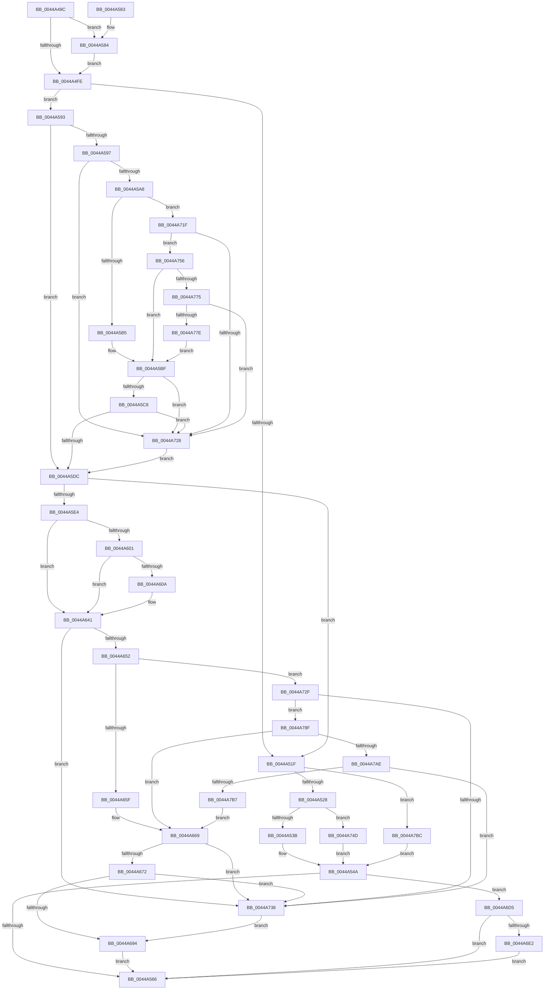

# RtlpConstructImportRelocationFixup

- RVA: `0x0044A49C`–`0x0044A7E6` (길이 `842` bytes)
- VA: `0x000000014044A49C`
- 실행 섹션: `.text`
- PDB 이름 있음: `예`; PDB Function 태그: `아니요`
- unwind 정보 RVA: `0x000A6450`
- 디코드: `224`개 명령, `842/842` bytes 표시
- 미해석 바이트: `0` (있으면 어셈블리에 `.byte`로 보존)

> 이 문서는 커널 이미지의 기계어와 PDB 기호를 분석해 생성했습니다. 4번과 5번은 함수 원형과 자료형을 바이너리 사용 방식에서 추정한 C 해석이며 원본 소스 복구 결과는 아닙니다.

## 1. Dependencies

- 직접 호출 지점: **2**; 고유 호출 대상: **1**
- 직접 호출자로 확인된 함수: **2**
- RIP 상대 이미지 참조: **0**

### Outgoing calls
- `0x0044A775` → [guard_dispatch_icall](../6B/guard_dispatch_icall_function_006BAAD0.md) (function, `0x006BAAD0`)
- `0x0044A7AE` → [guard_dispatch_icall](../6B/guard_dispatch_icall_function_006BAAD0.md) (function, `0x006BAAD0`)

### Direct callers
- [RtlApplyImportRelocationToPage](RtlApplyImportRelocationToPage_function_0044A3C0.md) at `0x0044A440`
- [RtlApplyImportRelocationToImage](../6A/RtlApplyImportRelocationToImage_function_006A98F8.md) at `0x006A9968`

### Static image references
- 디코드된 RIP-relative 메모리 참조가 없습니다.

## 2. Other-region calls and transfers

- 다른 실행 섹션으로 향하는 call: **0**
- 별도 외부 분기/꼬리 이동을 확인하지 못했습니다.

## 3. Assembly (complete function range)

```asm
0044A49C  48 89 5C 24 08                  mov qword ptr [rsp + 8], rbx
0044A4A1  48 89 6C 24 10                  mov qword ptr [rsp + 0x10], rbp
0044A4A6  48 89 74 24 18                  mov qword ptr [rsp + 0x18], rsi
0044A4AB  57                              push rdi
0044A4AC  41 54                           push r12
0044A4AE  41 55                           push r13
0044A4B0  41 56                           push r14
0044A4B2  41 57                           push r15
0044A4B4  48 83 EC 20                     sub rsp, 0x20
0044A4B8  48 8B 9C 24 80 00 00 00         mov rbx, qword ptr [rsp + 0x80]
0044A4C0  33 C0                           xor eax, eax
0044A4C2  44 8B 7C 24 78                  mov r15d, dword ptr [rsp + 0x78]
0044A4C7  48 8B F2                        mov rsi, rdx
0044A4CA  41 8B D7                        mov edx, r15d
0044A4CD  4D 8B F1                        mov r14, r9
0044A4D0  83 E2 01                        and edx, 1
0044A4D3  41 83 E7 02                     and r15d, 2
0044A4D7  48 89 03                        mov qword ptr [rbx], rax
0044A4DA  4D 8B E0                        mov r12, r8
0044A4DD  89 43 08                        mov dword ptr [rbx + 8], eax
0044A4E0  44 8B E9                        mov r13d, ecx
0044A4E3  66 89 43 0C                     mov word ptr [rbx + 0xc], ax
0044A4E7  48 B8 CC CC CC CC CC CC CC CC   movabs rax, 0xcccccccccccccccc
0044A4F1  41 F7 01 00 10 00 00            test dword ptr [r9], 0x1000
0044A4F8  0F 85 86 00 00 00               jne 0x14044a584
0044A4FE  8B 6C 24 70                     mov ebp, dword ptr [rsp + 0x70]
0044A502  41 B8 00 E0 FF FF               mov r8d, 0xffffe000
0044A508  48 89 43 02                     mov qword ptr [rbx + 2], rax
0044A50C  41 B9 00 00 00 80               mov r9d, 0x80000000
0044A512  89 43 0A                        mov dword ptr [rbx + 0xa], eax
0044A515  41 BA FF FF FF FF               mov r10d, 0xffffffff
0044A51B  85 ED                           test ebp, ebp
0044A51D  75 74                           jne 0x14044a593
0044A51F  45 85 FF                        test r15d, r15d
0044A522  0F 85 94 02 00 00               jne 0x14044a7bc
0044A528  66 C7 43 02 48 FF               mov word ptr [rbx + 2], 0xff48
0044A52E  41 F7 06 00 10 00 00            test dword ptr [r14], 0x1000
0044A535  0F 84 12 02 00 00               je 0x14044a74d
0044A53B  C6 43 04 15                     mov byte ptr [rbx + 4], 0x15
0044A53F  C7 43 09 0F 1F 44 00            mov dword ptr [rbx + 9], 0x441f0f
0044A546  44 88 7B 0D                     mov byte ptr [rbx + 0xd], r15b
0044A54A  41 B9 00 E0 FF FF               mov r9d, 0xffffe000
0044A550  66 C7 03 87 0F                  mov word ptr [rbx], 0xf87
0044A555  41 8B 0E                        mov ecx, dword ptr [r14]
0044A558  8B C1                           mov eax, ecx
0044A55A  41 23 C1                        and eax, r9d
0044A55D  41 3B C1                        cmp eax, r9d
0044A560  0F 85 6F 01 00 00               jne 0x14044a6d5
0044A566  48 8B 5C 24 50                  mov rbx, qword ptr [rsp + 0x50]
0044A56B  48 8B 6C 24 58                  mov rbp, qword ptr [rsp + 0x58]
0044A570  48 8B 74 24 60                  mov rsi, qword ptr [rsp + 0x60]
0044A575  48 83 C4 20                     add rsp, 0x20
0044A579  41 5F                           pop r15
0044A57B  41 5E                           pop r14
0044A57D  41 5D                           pop r13
0044A57F  41 5C                           pop r12
0044A581  5F                              pop rdi
0044A582  C3                              ret
0044A583  CC                              int3
0044A584  48 B8 90 90 90 90 90 90 90 90   movabs rax, 0x9090909090909090
0044A58E  E9 6B FF FF FF                  jmp 0x14044a4fe
0044A593  85 D2                           test edx, edx
0044A595  74 45                           je 0x14044a5dc
0044A597  41 8B 0E                        mov ecx, dword ptr [r14]
0044A59A  8B C1                           mov eax, ecx
0044A59C  41 23 C0                        and eax, r8d
0044A59F  41 3B C0                        cmp eax, r8d
0044A5A2  0F 84 80 01 00 00               je 0x14044a728
0044A5A8  48 8B 56 10                     mov rdx, qword ptr [rsi + 0x10]
0044A5AC  48 85 D2                        test rdx, rdx
0044A5AF  0F 84 6A 01 00 00               je 0x14044a71f
0044A5B5  8B C1                           mov eax, ecx
0044A5B7  48 C1 E8 0D                     shr rax, 0xd
0044A5BB  48 63 3C 82                     movsxd rdi, dword ptr [rdx + rax*4]
0044A5BF  48 85 FF                        test rdi, rdi
0044A5C2  0F 84 60 01 00 00               je 0x14044a728
0044A5C8  41 8D 4D 0C                     lea ecx, [r13 + 0xc]
0044A5CC  48 2B F9                        sub rdi, rcx
0044A5CF  4A 8D 04 0F                     lea rax, [rdi + r9]
0044A5D3  49 3B C2                        cmp rax, r10
0044A5D6  0F 87 4C 01 00 00               ja 0x14044a728
0044A5DC  85 ED                           test ebp, ebp
0044A5DE  0F 84 3B FF FF FF               je 0x14044a51f
0044A5E4  41 B9 00 E0 FF FF               mov r9d, 0xffffe000
0044A5EA  C7 03 07 00 4C 8B               mov dword ptr [rbx], 0x8b4c0007
0044A5F0  C6 43 04 15                     mov byte ptr [rbx + 4], 0x15
0044A5F4  41 8B 0E                        mov ecx, dword ptr [r14]
0044A5F7  8B C1                           mov eax, ecx
0044A5F9  41 23 C1                        and eax, r9d
0044A5FC  41 3B C1                        cmp eax, r9d
0044A5FF  74 40                           je 0x14044a641
0044A601  44 8B 46 04                     mov r8d, dword ptr [rsi + 4]
0044A605  45 85 C0                        test r8d, r8d
0044A608  74 37                           je 0x14044a641
0044A60A  8B D1                           mov edx, ecx
0044A60C  66 C7 03 7F 00                  mov word ptr [rbx], 0x7f
0044A611  48 C1 EA 0D                     shr rdx, 0xd
0044A615  41 8D 4D 07                     lea ecx, [r13 + 7]
0044A619  48 C1 E2 03                     shl rdx, 3
0044A61D  48 2B D1                        sub rdx, rcx
0044A620  49 03 D0                        add rdx, r8
0044A623  48 8B C2                        mov rax, rdx
0044A626  88 53 05                        mov byte ptr [rbx + 5], dl
0044A629  48 C1 F8 08                     sar rax, 8
0044A62D  88 43 06                        mov byte ptr [rbx + 6], al
0044A630  48 8B C2                        mov rax, rdx
0044A633  48 C1 F8 10                     sar rax, 0x10
0044A637  48 C1 FA 18                     sar rdx, 0x18
0044A63B  88 53 08                        mov byte ptr [rbx + 8], dl
0044A63E  88 43 07                        mov byte ptr [rbx + 7], al
0044A641  41 8B 0E                        mov ecx, dword ptr [r14]
0044A644  8B C1                           mov eax, ecx
0044A646  41 23 C1                        and eax, r9d
0044A649  41 3B C1                        cmp eax, r9d
0044A64C  0F 84 E6 00 00 00               je 0x14044a738
0044A652  48 8B 56 10                     mov rdx, qword ptr [rsi + 0x10]
0044A656  48 85 D2                        test rdx, rdx
0044A659  0F 84 D0 00 00 00               je 0x14044a72f
0044A65F  8B C1                           mov eax, ecx
0044A661  48 C1 E8 0D                     shr rax, 0xd
0044A665  48 63 3C 82                     movsxd rdi, dword ptr [rdx + rax*4]
0044A669  48 85 FF                        test rdi, rdi
0044A66C  0F 84 C6 00 00 00               je 0x14044a738
0044A672  41 8D 55 0C                     lea edx, [r13 + 0xc]
0044A676  48 8B CF                        mov rcx, rdi
0044A679  8B C2                           mov eax, edx
0044A67B  48 2B C8                        sub rcx, rax
0044A67E  B8 00 00 00 80                  mov eax, 0x80000000
0044A683  48 03 C1                        add rax, rcx
0044A686  B9 FF FF FF FF                  mov ecx, 0xffffffff
0044A68B  48 3B C1                        cmp rax, rcx
0044A68E  0F 87 A4 00 00 00               ja 0x14044a738
0044A694  8B C2                           mov eax, edx
0044A696  48 2B F8                        sub rdi, rax
0044A699  41 8B 06                        mov eax, dword ptr [r14]
0044A69C  C1 E8 0C                        shr eax, 0xc
0044A69F  F6 D0                           not al
0044A6A1  24 01                           and al, 1
0044A6A3  0C E8                           or al, 0xe8
0044A6A5  88 43 09                        mov byte ptr [rbx + 9], al
0044A6A8  48 8B C7                        mov rax, rdi
0044A6AB  48 C1 F8 08                     sar rax, 8
0044A6AF  88 43 0B                        mov byte ptr [rbx + 0xb], al
0044A6B2  48 8B C7                        mov rax, rdi
0044A6B5  48 C1 F8 10                     sar rax, 0x10
0044A6B9  88 43 0C                        mov byte ptr [rbx + 0xc], al
0044A6BC  B8 80 0F 00 00                  mov eax, 0xf80
0044A6C1  40 88 7B 0A                     mov byte ptr [rbx + 0xa], dil
0044A6C5  48 C1 FF 18                     sar rdi, 0x18
0044A6C9  66 09 03                        or word ptr [rbx], ax
0044A6CC  40 88 7B 0D                     mov byte ptr [rbx + 0xd], dil
0044A6D0  E9 91 FE FF FF                  jmp 0x14044a566
0044A6D5  44 8B 46 04                     mov r8d, dword ptr [rsi + 4]
0044A6D9  45 85 C0                        test r8d, r8d
0044A6DC  0F 84 84 FE FF FF               je 0x14044a566
0044A6E2  48 8B D1                        mov rdx, rcx
0044A6E5  66 C7 03 FF 0F                  mov word ptr [rbx], 0xfff
0044A6EA  48 C1 EA 0D                     shr rdx, 0xd
0044A6EE  41 8D 4D 07                     lea ecx, [r13 + 7]
0044A6F2  48 C1 E2 03                     shl rdx, 3
0044A6F6  48 2B D1                        sub rdx, rcx
0044A6F9  49 03 D0                        add rdx, r8
0044A6FC  48 8B C2                        mov rax, rdx
0044A6FF  88 53 05                        mov byte ptr [rbx + 5], dl
0044A702  48 C1 F8 08                     sar rax, 8
0044A706  88 43 06                        mov byte ptr [rbx + 6], al
0044A709  48 8B C2                        mov rax, rdx
0044A70C  48 C1 F8 10                     sar rax, 0x10
0044A710  48 C1 FA 18                     sar rdx, 0x18
0044A714  88 53 08                        mov byte ptr [rbx + 8], dl
0044A717  88 43 07                        mov byte ptr [rbx + 7], al
0044A71A  E9 47 FE FF FF                  jmp 0x14044a566
0044A71F  48 8B 56 18                     mov rdx, qword ptr [rsi + 0x18]
0044A723  48 85 D2                        test rdx, rdx
0044A726  75 2E                           jne 0x14044a756
0044A728  33 ED                           xor ebp, ebp
0044A72A  E9 AD FE FF FF                  jmp 0x14044a5dc
0044A72F  48 8B 56 18                     mov rdx, qword ptr [rsi + 0x18]
0044A733  48 85 D2                        test rdx, rdx
0044A736  75 57                           jne 0x14044a78f
0044A738  41 8B 7C 24 48                  mov edi, dword ptr [r12 + 0x48]
0044A73D  41 8D 55 0C                     lea edx, [r13 + 0xc]
0044A741  48 63 46 30                     movsxd rax, dword ptr [rsi + 0x30]
0044A745  48 03 F8                        add rdi, rax
0044A748  E9 47 FF FF FF                  jmp 0x14044a694
0044A74D  C6 43 04 25                     mov byte ptr [rbx + 4], 0x25
0044A751  E9 F4 FD FF FF                  jmp 0x14044a54a
0044A756  48 8B C1                        mov rax, rcx
0044A759  48 C1 E8 0D                     shr rax, 0xd
0044A75D  48 8B 0C C2                     mov rcx, qword ptr [rdx + rax*8]
0044A761  48 8B 46 28                     mov rax, qword ptr [rsi + 0x28]
0044A765  48 8B F9                        mov rdi, rcx
0044A768  48 2B 7E 20                     sub rdi, qword ptr [rsi + 0x20]
0044A76C  48 85 C0                        test rax, rax
0044A76F  0F 84 4A FE FF FF               je 0x14044a5bf
0044A775  E8 56 03 27 00                  call 0x1406baad0
0044A77A  85 C0                           test eax, eax
0044A77C  74 AA                           je 0x14044a728
0044A77E  41 B9 00 00 00 80               mov r9d, 0x80000000
0044A784  41 BA FF FF FF FF               mov r10d, 0xffffffff
0044A78A  E9 30 FE FF FF                  jmp 0x14044a5bf
0044A78F  48 8B C1                        mov rax, rcx
0044A792  48 C1 E8 0D                     shr rax, 0xd
0044A796  48 8B 0C C2                     mov rcx, qword ptr [rdx + rax*8]
0044A79A  48 8B 46 28                     mov rax, qword ptr [rsi + 0x28]
0044A79E  48 8B F9                        mov rdi, rcx
0044A7A1  48 2B 7E 20                     sub rdi, qword ptr [rsi + 0x20]
0044A7A5  48 85 C0                        test rax, rax
0044A7A8  0F 84 BB FE FF FF               je 0x14044a669
0044A7AE  E8 1D 03 27 00                  call 0x1406baad0
0044A7B3  85 C0                           test eax, eax
0044A7B5  74 81                           je 0x14044a738
0044A7B7  E9 AD FE FF FF                  jmp 0x14044a669
0044A7BC  66 C7 43 02 4C 8B               mov word ptr [rbx + 2], 0x8b4c
0044A7C2  C6 43 04 15                     mov byte ptr [rbx + 4], 0x15
0044A7C6  66 C7 43 09 4D FF               mov word ptr [rbx + 9], 0xff4d
0044A7CC  41 8B 06                        mov eax, dword ptr [r14]
0044A7CF  25 00 10 00 00                  and eax, 0x1000
0044A7D4  F7 D8                           neg eax
0044A7D6  1A C9                           sbb cl, cl
0044A7D8  80 E1 F0                        and cl, 0xf0
0044A7DB  80 C1 E2                        add cl, 0xe2
0044A7DE  88 4B 0B                        mov byte ptr [rbx + 0xb], cl
0044A7E1  E9 64 FD FF FF                  jmp 0x14044a54a
```

## 4. C-style interpretation (structured pseudocode)

```c
__int64 __fastcall RtlpConstructImportRelocationFixup(int a1, __int64 a2, __int64 a3, __int64 a4, unsigned int a5, unsigned int a6, __int64 a7)
{
    __int64 result;
    __int64 v_r15;
    __int64 v_rbp;
    __int64 v_rdi;
    __int64 v_rsp;
    unsigned __int64 v_stack_p10;
    unsigned __int64 v_stack_p18;
    unsigned __int64 v_stack_p8;

    v_stack_p8 = v_rbx;
    v_stack_p10 = v_rbp;
    v_stack_p18 = v_rsi;
    v_rsp = (v_rsp) - (32);
    result = 0;
    a2 = (unsigned int)(((unsigned int)((unsigned int)((unsigned int)(a6)))) & (1));
    v_r15 = (unsigned int)(((unsigned int)(a6)) & (2));
    *(unsigned __int64 *)(a7) = 0;
    *(unsigned int *)(a7 + 8) = 0;
    *(unsigned __int16 *)(a7 + 12) = 0;
    if (((*(unsigned int *)(a4)) & (0x1000ULL)) != 0) goto loc_0044A584;
loc_0044A4FE:
    *(unsigned __int64 *)(a7 + 2) = 0;
    *(unsigned int *)(a7 + 10) = 0;
    if ((unsigned int)((unsigned int)(a5)) != 0) goto loc_0044A593;
loc_0044A51F:
    if ((unsigned int)(v_r15) != 0) goto loc_0044A7BC;
    *(unsigned __int16 *)(a7 + 2) = 0xFF48ULL;
    if (((*(unsigned int *)(a4)) & (0x1000ULL)) == 0) goto loc_0044A74D;
    *(unsigned __int8 *)(a7 + 4) = 21;
    *(unsigned int *)(a7 + 9) = 0x441F0FULL;
    *(unsigned __int8 *)(a7 + 13) = (unsigned __int8)(v_r15);
loc_0044A54A:
    *(unsigned __int16 *)(a7) = 0xF87ULL;
    result = (unsigned int)(((unsigned int)((unsigned int)((unsigned int)(*(unsigned int *)(a4))))) & ((unsigned int)((unsigned int)(0xFFFFE000ULL))));
    if (((unsigned int)(result)) != ((unsigned int)((unsigned int)(0xFFFFE000ULL)))) goto loc_0044A6D5;
loc_0044A566:
    v_rsp = (v_rsp) + (32);
    return result;
loc_0044A584:
    goto loc_0044A4FE;
loc_0044A593:
    if ((unsigned int)(a2) == 0) goto loc_0044A5DC;
    result = (unsigned int)(((unsigned int)((unsigned int)((unsigned int)(*(unsigned int *)(a4))))) & ((unsigned int)((unsigned int)(0xFFFFE000ULL))));
    if (((unsigned int)(result)) == ((unsigned int)((unsigned int)(0xFFFFE000ULL)))) goto loc_0044A728;
    if (*(unsigned __int64 *)(v_stack_p18 + 16) == 0) goto loc_0044A71F;
    result = ((unsigned int)((unsigned int)((unsigned int)(*(unsigned int *)(a4))))) >> (13);
loc_0044A5BF:
    if ((int)(*(unsigned int *)(*(unsigned __int64 *)(v_stack_p18 + 16) + result * 4)) == 0) goto loc_0044A728;
    v_rdi = ((int)(*(unsigned int *)(*(unsigned __int64 *)(v_stack_p18 + 16) + result * 4))) - ((unsigned int)(a1) + 12);
    if ((v_rdi + (unsigned int)(0xFFFFE000ULL) * 1) > ((unsigned int)(0xFFFFFFFFULL))) goto loc_0044A728;
loc_0044A5DC:
    if ((unsigned int)(v_stack_p10) == 0) goto loc_0044A51F;
    *(unsigned int *)(v_stack_p8) = 0x8B4C0007ULL;
    *(unsigned __int8 *)(v_stack_p8 + 4) = 21;
    result = (unsigned int)(((unsigned int)((unsigned int)((unsigned int)(*(unsigned int *)(a4))))) & ((unsigned int)((unsigned int)(0xFFFFE000ULL))));
    if (((unsigned int)(result)) == ((unsigned int)((unsigned int)(0xFFFFE000ULL)))) goto loc_0044A641;
    if ((unsigned int)((unsigned int)(*(unsigned int *)(v_stack_p18 + 4))) != 0) {
        a2 = (unsigned int)((unsigned int)(*(unsigned int *)(a4)));
        *(unsigned __int16 *)(v_stack_p8) = 127;
        a2 = (a2) >> (13);
        a1 = (unsigned int)(a1) + 7;
        a2 = (a2) << (3);
        a2 = (a2) - (a1);
        a2 = (a2) + ((unsigned int)(*(unsigned int *)(v_stack_p18 + 4)));
        result = a2;
        *(unsigned __int8 *)(v_stack_p8 + 5) = (unsigned __int8)(a2);
        result = (result) >> (8);
        *(unsigned __int8 *)(v_stack_p8 + 6) = (unsigned __int8)(result);
        result = a2;
        result = (result) >> (16);
        a2 = (a2) >> (24);
        *(unsigned __int8 *)(v_stack_p8 + 8) = (unsigned __int8)(a2);
        *(unsigned __int8 *)(v_stack_p8 + 7) = (unsigned __int8)(result);
    }
    result = (unsigned int)(((unsigned int)((unsigned int)((unsigned int)(*(unsigned int *)(a4))))) & ((unsigned int)((unsigned int)(0xFFFFE000ULL))));
    if (((unsigned int)(result)) == ((unsigned int)((unsigned int)(0xFFFFE000ULL)))) goto loc_0044A738;
    if (*(unsigned __int64 *)(v_stack_p18 + 16) == 0) goto loc_0044A72F;
    result = ((unsigned int)((unsigned int)((unsigned int)(*(unsigned int *)(a4))))) >> (13);
loc_0044A669:
    if ((int)(*(unsigned int *)(*(unsigned __int64 *)(v_stack_p18 + 16) + result * 4)) == 0) goto loc_0044A738;
    a1 = ((int)(*(unsigned int *)(*(unsigned __int64 *)(v_stack_p18 + 16) + result * 4))) - ((unsigned int)((unsigned int)((unsigned int)(a1) + 12)));
    result = ((unsigned int)(0x80000000ULL)) + (a1);
    if (result > ((unsigned int)(0xFFFFFFFFULL))) goto loc_0044A738;
loc_0044A694:
    v_rdi = ((int)(*(unsigned int *)(*(unsigned __int64 *)(v_stack_p18 + 16) + result * 4))) - ((unsigned int)((unsigned int)((unsigned int)(a1) + 12)));
    result = (unsigned int)(((unsigned int)(*(unsigned int *)(a4))) >> (12));
    result = (unsigned __int8)(~(result));
    result = (unsigned __int8)((result) & (1));
    result = (unsigned __int8)((result) | (232));
    *(unsigned __int8 *)(v_stack_p8 + 9) = (unsigned __int8)(result);
    result = (v_rdi) >> (8);
    *(unsigned __int8 *)(v_stack_p8 + 11) = (unsigned __int8)(result);
    result = (v_rdi) >> (16);
    *(unsigned __int8 *)(v_stack_p8 + 12) = (unsigned __int8)(result);
    *(unsigned __int8 *)(v_stack_p8 + 10) = (unsigned __int8)(v_rdi);
    v_rdi = (v_rdi) >> (24);
    *(unsigned __int8 *)(v_stack_p8 + 13) = (unsigned __int8)(v_rdi);
    goto loc_0044A566;
loc_0044A6D5:
    if ((unsigned int)((unsigned int)(*(unsigned int *)(v_stack_p18 + 4))) == 0) goto loc_0044A566;
    *(unsigned __int16 *)(v_stack_p8) = 0xFFFULL;
    a2 = ((unsigned int)(0xFFFFFFFFULL)) >> (13);
    a2 = (a2) << (3);
    a2 = (a2) - ((unsigned int)(a1) + 7);
    a2 = (a2) + ((unsigned int)(*(unsigned int *)(v_stack_p18 + 4)));
    *(unsigned __int8 *)(v_stack_p8 + 5) = (unsigned __int8)(a2);
    result = (a2) >> (8);
    *(unsigned __int8 *)(v_stack_p8 + 6) = (unsigned __int8)(result);
    result = (a2) >> (16);
    a2 = (a2) >> (24);
    *(unsigned __int8 *)(v_stack_p8 + 8) = (unsigned __int8)(a2);
    *(unsigned __int8 *)(v_stack_p8 + 7) = (unsigned __int8)(result);
    goto loc_0044A566;
loc_0044A71F:
    if (*(unsigned __int64 *)(v_stack_p18 + 24) != 0) goto loc_0044A756;
loc_0044A728:
    v_rbp = 0;
    goto loc_0044A5DC;
loc_0044A72F:
    if (*(unsigned __int64 *)(v_stack_p18 + 24) != 0) goto loc_0044A78F;
loc_0044A738:
    v_rdi = ((unsigned int)(*(unsigned int *)(a3 + 72))) + ((int)(*(unsigned int *)(v_stack_p18 + 48)));
    goto loc_0044A694;
loc_0044A74D:
    *(unsigned __int8 *)(v_stack_p8 + 4) = 37;
    goto loc_0044A54A;
loc_0044A756:
    result = ((unsigned int)(a1) + 7) >> (13);
    v_rdi = (*(unsigned __int64 *)((unsigned int)(a1) + 12 + result * 8)) - (*(unsigned __int64 *)(v_stack_p18 + 32));
    if (*(unsigned __int64 *)(v_stack_p18 + 40) == 0) goto loc_0044A5BF;
    result = guard_dispatch_icall(*(unsigned __int64 *)((unsigned int)(a1) + 12 + result * 8), (unsigned int)(a1) + 12, (unsigned int)(*(unsigned int *)(v_stack_p18 + 4)), (unsigned int)(0xFFFFE000ULL));
    if ((unsigned int)(result) == 0) goto loc_0044A728;
    goto loc_0044A5BF;
loc_0044A78F:
    result = (*(unsigned __int64 *)((unsigned int)(a1) + 12 + result * 8)) >> (13);
    v_rdi = (*(unsigned __int64 *)((unsigned int)(a1) + 12 + result * 8)) - (*(unsigned __int64 *)(v_stack_p18 + 32));
    if (*(unsigned __int64 *)(v_stack_p18 + 40) == 0) goto loc_0044A669;
    result = guard_dispatch_icall(*(unsigned __int64 *)((unsigned int)(a1) + 12 + result * 8), (unsigned int)(a1) + 12, (unsigned int)(*(unsigned int *)(v_stack_p18 + 4)), (unsigned int)(0x80000000ULL));
    if ((unsigned int)(result) == 0) goto loc_0044A738;
    goto loc_0044A669;
loc_0044A7BC:
    *(unsigned __int16 *)(v_stack_p8 + 2) = 0x8B4CULL;
    *(unsigned __int8 *)(v_stack_p8 + 4) = 21;
    *(unsigned __int16 *)(v_stack_p8 + 9) = 0xFF4DULL;
    result = (unsigned int)(((unsigned int)(*(unsigned int *)(a4))) & (0x1000ULL));
    result = (unsigned int)(-(result));
    a1 = (unsigned __int8)((*(unsigned __int64 *)((unsigned int)(a1) + 12 + result * 8)) & (240));
    a1 = (unsigned __int8)((a1) + (226));
    *(unsigned __int8 *)(v_stack_p8 + 11) = (unsigned __int8)(a1);
    goto loc_0044A54A;
}
```

## 5. (Beta) C Style

```c
int64_t RtlpConstructImportRelocationFixup(void *Arg1, void *Arg2, void *Arg3, void *Arg4, uint32_t Arg5, uint32_t Arg6, void *Arg7)
{
    uint8_t *arg1 = (uint8_t *)Arg1;
    uint8_t *arg2 = (uint8_t *)Arg2;
    uint8_t *arg3 = (uint8_t *)Arg3;
    uint8_t *arg4 = (uint8_t *)Arg4;
    uint8_t *arg7 = (uint8_t *)Arg7;

    int64_t result;
    int64_t local_r15;
    int64_t local_rbp;
    int64_t local_rdi;
    int64_t local_rsp;
    uint64_t v_stack_p10;
    uint64_t v_stack_p18;
    uint64_t v_stack_p8;

    v_stack_p8 = local_rbx;
    v_stack_p10 = local_rbp;
    v_stack_p18 = local_rsi;
    local_rsp = (local_rsp) - (32);
    result = 0;
    Arg2 = (uint32_t)(((uint32_t)((uint32_t)((uint32_t)(Arg6)))) & (1));
    local_r15 = (uint32_t)(((uint32_t)(Arg6)) & (2));
    *(uint64_t *)(arg7) = 0;
    *(uint32_t *)(arg7 + 0x8) = 0;
    *(uint16_t *)(arg7 + 0xC) = 0;
    if (((*(uint32_t *)(arg4)) & (0x1000ULL)) != 0) goto loc_0044A584;
loc_0044A4FE:
    *(uint64_t *)(arg7 + 0x2) = 0;
    *(uint32_t *)(arg7 + 0xA) = 0;
    if ((uint32_t)((uint32_t)(Arg5)) != 0) goto loc_0044A593;
loc_0044A51F:
    if ((uint32_t)(local_r15) != 0) goto loc_0044A7BC;
    *(uint16_t *)(arg7 + 0x2) = 0xFF48ULL;
    if (((*(uint32_t *)(arg4)) & (0x1000ULL)) == 0) goto loc_0044A74D;
    *(uint8_t *)(arg7 + 0x4) = 21;
    *(uint32_t *)(arg7 + 0x9) = 0x441F0FULL;
    *(uint8_t *)(arg7 + 0xD) = (uint8_t)(local_r15);
loc_0044A54A:
    *(uint16_t *)(arg7) = 0xF87ULL;
    result = (uint32_t)(((uint32_t)((uint32_t)((uint32_t)(*(uint32_t *)(arg4))))) & ((uint32_t)((uint32_t)(0xFFFFE000ULL))));
    if (((uint32_t)(result)) != ((uint32_t)((uint32_t)(0xFFFFE000ULL)))) goto loc_0044A6D5;
loc_0044A566:
    local_rsp = (local_rsp) + (32);
    return result;
loc_0044A584:
    goto loc_0044A4FE;
loc_0044A593:
    if ((uint32_t)(Arg2) == 0) goto loc_0044A5DC;
    result = (uint32_t)(((uint32_t)((uint32_t)((uint32_t)(*(uint32_t *)(arg4))))) & ((uint32_t)((uint32_t)(0xFFFFE000ULL))));
    if (((uint32_t)(result)) == ((uint32_t)((uint32_t)(0xFFFFE000ULL)))) goto loc_0044A728;
    if (*(uint64_t *)(v_stack_p18 + 0x10) == 0) goto loc_0044A71F;
    result = ((uint32_t)((uint32_t)((uint32_t)(*(uint32_t *)(arg4))))) >> (13);
loc_0044A5BF:
    if ((int32_t)(*(uint32_t *)(*(uint64_t *)(v_stack_p18 + 0x10) + result * 4)) == 0) goto loc_0044A728;
    local_rdi = ((int32_t)(*(uint32_t *)(*(uint64_t *)(v_stack_p18 + 0x10) + result * 4))) - ((uint32_t)(Arg1) + 12);
    if ((local_rdi + (uint32_t)(0xFFFFE000ULL) * 1) > ((uint32_t)(0xFFFFFFFFULL))) goto loc_0044A728;
loc_0044A5DC:
    if ((uint32_t)(v_stack_p10) == 0) goto loc_0044A51F;
    *(uint32_t *)(v_stack_p8) = 0x8B4C0007ULL;
    *(uint8_t *)(v_stack_p8 + 0x4) = 21;
    result = (uint32_t)(((uint32_t)((uint32_t)((uint32_t)(*(uint32_t *)(arg4))))) & ((uint32_t)((uint32_t)(0xFFFFE000ULL))));
    if (((uint32_t)(result)) == ((uint32_t)((uint32_t)(0xFFFFE000ULL)))) goto loc_0044A641;
    if ((uint32_t)((uint32_t)(*(uint32_t *)(v_stack_p18 + 0x4))) != 0) {
        Arg2 = (uint32_t)((uint32_t)(*(uint32_t *)(arg4)));
        *(uint16_t *)(v_stack_p8) = 127;
        Arg2 = (Arg2) >> (13);
        Arg1 = (uint32_t)(Arg1) + 7;
        Arg2 = (Arg2) << (3);
        Arg2 = (Arg2) - (Arg1);
        Arg2 = (Arg2) + ((uint32_t)(*(uint32_t *)(v_stack_p18 + 0x4)));
        result = Arg2;
        *(uint8_t *)(v_stack_p8 + 0x5) = (uint8_t)(Arg2);
        result = (result) >> (8);
        *(uint8_t *)(v_stack_p8 + 0x6) = (uint8_t)(result);
        result = Arg2;
        result = (result) >> (16);
        Arg2 = (Arg2) >> (24);
        *(uint8_t *)(v_stack_p8 + 0x8) = (uint8_t)(Arg2);
        *(uint8_t *)(v_stack_p8 + 0x7) = (uint8_t)(result);
    }
    result = (uint32_t)(((uint32_t)((uint32_t)((uint32_t)(*(uint32_t *)(arg4))))) & ((uint32_t)((uint32_t)(0xFFFFE000ULL))));
    if (((uint32_t)(result)) == ((uint32_t)((uint32_t)(0xFFFFE000ULL)))) goto loc_0044A738;
    if (*(uint64_t *)(v_stack_p18 + 0x10) == 0) goto loc_0044A72F;
    result = ((uint32_t)((uint32_t)((uint32_t)(*(uint32_t *)(arg4))))) >> (13);
loc_0044A669:
    if ((int32_t)(*(uint32_t *)(*(uint64_t *)(v_stack_p18 + 0x10) + result * 4)) == 0) goto loc_0044A738;
    Arg1 = ((int32_t)(*(uint32_t *)(*(uint64_t *)(v_stack_p18 + 0x10) + result * 4))) - ((uint32_t)((uint32_t)((uint32_t)(Arg1) + 12)));
    result = ((uint32_t)(0x80000000ULL)) + (Arg1);
    if (result > ((uint32_t)(0xFFFFFFFFULL))) goto loc_0044A738;
loc_0044A694:
    local_rdi = ((int32_t)(*(uint32_t *)(*(uint64_t *)(v_stack_p18 + 0x10) + result * 4))) - ((uint32_t)((uint32_t)((uint32_t)(Arg1) + 12)));
    result = (uint32_t)(((uint32_t)(*(uint32_t *)(arg4))) >> (12));
    result = (uint8_t)(~(result));
    result = (uint8_t)((result) & (1));
    result = (uint8_t)((result) | (232));
    *(uint8_t *)(v_stack_p8 + 0x9) = (uint8_t)(result);
    result = (local_rdi) >> (8);
    *(uint8_t *)(v_stack_p8 + 0xB) = (uint8_t)(result);
    result = (local_rdi) >> (16);
    *(uint8_t *)(v_stack_p8 + 0xC) = (uint8_t)(result);
    *(uint8_t *)(v_stack_p8 + 0xA) = (uint8_t)(local_rdi);
    local_rdi = (local_rdi) >> (24);
    *(uint8_t *)(v_stack_p8 + 0xD) = (uint8_t)(local_rdi);
    goto loc_0044A566;
loc_0044A6D5:
    if ((uint32_t)((uint32_t)(*(uint32_t *)(v_stack_p18 + 0x4))) == 0) goto loc_0044A566;
    *(uint16_t *)(v_stack_p8) = 0xFFFULL;
    Arg2 = ((uint32_t)(0xFFFFFFFFULL)) >> (13);
    Arg2 = (Arg2) << (3);
    Arg2 = (Arg2) - ((uint32_t)(Arg1) + 7);
    Arg2 = (Arg2) + ((uint32_t)(*(uint32_t *)(v_stack_p18 + 0x4)));
    *(uint8_t *)(v_stack_p8 + 0x5) = (uint8_t)(Arg2);
    result = (Arg2) >> (8);
    *(uint8_t *)(v_stack_p8 + 0x6) = (uint8_t)(result);
    result = (Arg2) >> (16);
    Arg2 = (Arg2) >> (24);
    *(uint8_t *)(v_stack_p8 + 0x8) = (uint8_t)(Arg2);
    *(uint8_t *)(v_stack_p8 + 0x7) = (uint8_t)(result);
    goto loc_0044A566;
loc_0044A71F:
    if (*(uint64_t *)(v_stack_p18 + 0x18) != 0) goto loc_0044A756;
loc_0044A728:
    local_rbp = 0;
    goto loc_0044A5DC;
loc_0044A72F:
    if (*(uint64_t *)(v_stack_p18 + 0x18) != 0) goto loc_0044A78F;
loc_0044A738:
    local_rdi = ((uint32_t)(*(uint32_t *)(arg3 + 0x48))) + ((int32_t)(*(uint32_t *)(v_stack_p18 + 0x30)));
    goto loc_0044A694;
loc_0044A74D:
    *(uint8_t *)(v_stack_p8 + 0x4) = 37;
    goto loc_0044A54A;
loc_0044A756:
    result = ((uint32_t)(Arg1) + 7) >> (13);
    local_rdi = (*(uint64_t *)((uint32_t)(arg1) + 0xC + result * 8)) - (*(uint64_t *)(v_stack_p18 + 0x20));
    if (*(uint64_t *)(v_stack_p18 + 0x28) == 0) goto loc_0044A5BF;
    result = guard_dispatch_icall(*(uint64_t *)((uint32_t)(arg1) + 0xC + result * 8), (uint32_t)(Arg1) + 12, (uint32_t)(*(uint32_t *)(v_stack_p18 + 0x4)), (uint32_t)(0xFFFFE000ULL));
    if ((uint32_t)(result) == 0) goto loc_0044A728;
    goto loc_0044A5BF;
loc_0044A78F:
    result = (*(uint64_t *)((uint32_t)(arg1) + 0xC + result * 8)) >> (13);
    local_rdi = (*(uint64_t *)((uint32_t)(arg1) + 0xC + result * 8)) - (*(uint64_t *)(v_stack_p18 + 0x20));
    if (*(uint64_t *)(v_stack_p18 + 0x28) == 0) goto loc_0044A669;
    result = guard_dispatch_icall(*(uint64_t *)((uint32_t)(arg1) + 0xC + result * 8), (uint32_t)(Arg1) + 12, (uint32_t)(*(uint32_t *)(v_stack_p18 + 0x4)), (uint32_t)(0x80000000ULL));
    if ((uint32_t)(result) == 0) goto loc_0044A738;
    goto loc_0044A669;
loc_0044A7BC:
    *(uint16_t *)(v_stack_p8 + 0x2) = 0x8B4CULL;
    *(uint8_t *)(v_stack_p8 + 0x4) = 21;
    *(uint16_t *)(v_stack_p8 + 0x9) = 0xFF4DULL;
    result = (uint32_t)(((uint32_t)(*(uint32_t *)(arg4))) & (0x1000ULL));
    result = (uint32_t)(-(result));
    Arg1 = (uint8_t)((*(uint64_t *)((uint32_t)(arg1) + 0xC + result * 8)) & (240));
    Arg1 = (uint8_t)((Arg1) + (226));
    *(uint8_t *)(v_stack_p8 + 0xB) = (uint8_t)(Arg1);
    goto loc_0044A54A;
}
```

### 관측된 메모리 오프셋

구조체 형식이 확인되지 않은 접근은 인자 기준의 오프셋으로만 기록했습니다.

| 기준 인자 | 오프셋 표현 | 폭 (bit) | 접근 |
|---|---:|---:|---|
| `Arg1` | `+ 0x7` | `32` | `R` |
| `Arg1` | `+ 0xC` | `32` | `R` |
| `Arg2` | `+ 0x4` | `32` | `R` |
| `Arg2` | `+ 0x10` | `64` | `R` |
| `Arg2` | `+ 0x18` | `64` | `R` |
| `Arg2` | `+ 0x20` | `64` | `R` |
| `Arg2` | `+ 0x28` | `64` | `R` |
| `Arg2` | `+ 0x30` | `32` | `R` |
| `Arg3` | `+ 0x48` | `32` | `R` |
| `Arg4` | `+ 0x0` | `32` | `R` |
| `Arg7` | `+ 0x0` | `16` | `R/W` |
| `Arg7` | `+ 0x0` | `16` | `W` |
| `Arg7` | `+ 0x0` | `32` | `W` |
| `Arg7` | `+ 0x0` | `64` | `W` |
| `Arg7` | `+ 0x2` | `16` | `W` |
| `Arg7` | `+ 0x2` | `64` | `W` |
| `Arg7` | `+ 0x4` | `8` | `W` |
| `Arg7` | `+ 0x5` | `8` | `W` |
| `Arg7` | `+ 0x6` | `8` | `W` |
| `Arg7` | `+ 0x7` | `8` | `W` |
| `Arg7` | `+ 0x8` | `8` | `W` |
| `Arg7` | `+ 0x8` | `32` | `W` |
| `Arg7` | `+ 0x9` | `8` | `W` |
| `Arg7` | `+ 0x9` | `16` | `W` |
| `Arg7` | `+ 0x9` | `32` | `W` |
| `Arg7` | `+ 0xA` | `8` | `W` |
| `Arg7` | `+ 0xA` | `32` | `W` |
| `Arg7` | `+ 0xB` | `8` | `W` |
| `Arg7` | `+ 0xC` | `8` | `W` |
| `Arg7` | `+ 0xC` | `16` | `W` |
| `Arg7` | `+ 0xD` | `8` | `W` |

## 6. Execution-region graph

[열기: 2D/3D 그래프와 함수 탐색 컨트롤 패널](../../../control-panel.html?section=text&rva=0x0044A49C&view=graph)

- 2D 그래프는 위에서 아래로 흐르고, 3D 그래프는 빈 공간을 드래그해 회전합니다. Shift+드래그는 이동, 휠은 확대·축소, 함수 노드 선택은 대상 보고서 이동입니다.

### Static fallback


