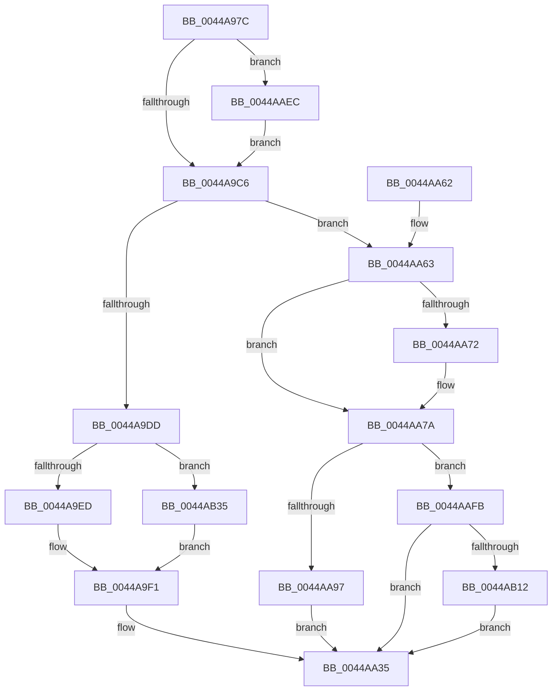

# RtlpConstructIndirectRelocationFixup

- RVA: `0x0044A97C`–`0x0044AB3E` (길이 `450` bytes)
- VA: `0x000000014044A97C`
- 실행 섹션: `.text`
- PDB 이름 있음: `예`; PDB Function 태그: `아니요`
- unwind 정보 RVA: `0x000A648C`
- 디코드: `114`개 명령, `450/450` bytes 표시
- 미해석 바이트: `0` (있으면 어셈블리에 `.byte`로 보존)

> 이 문서는 커널 이미지의 기계어와 PDB 기호를 분석해 생성했습니다. 4번과 5번은 함수 원형과 자료형을 바이너리 사용 방식에서 추정한 C 해석이며 원본 소스 복구 결과는 아닙니다.

## 1. Dependencies

- 직접 호출 지점: **1**; 고유 호출 대상: **1**
- 직접 호출자로 확인된 함수: **2**
- RIP 상대 이미지 참조: **0**

### Outgoing calls
- `0x0044AA38` → [RtlSizeOfRetpolineIndirectFixup](RtlSizeOfRetpolineIndirectFixup_function_0044AFE4.md) (function, `0x0044AFE4`)

### Direct callers
- [RtlApplyIndirectRelocationToPage](RtlApplyIndirectRelocationToPage_function_0044A8A8.md) at `0x0044A91E`
- [RtlApplyIndirectRelocationToImage](../6A/RtlApplyIndirectRelocationToImage_function_006A999C.md) at `0x006A9A02`

### Static image references
- 디코드된 RIP-relative 메모리 참조가 없습니다.

## 2. Other-region calls and transfers

- 다른 실행 섹션으로 향하는 call: **0**
- 별도 외부 분기/꼬리 이동을 확인하지 못했습니다.

## 3. Assembly (complete function range)

```asm
0044A97C  48 89 5C 24 08                  mov qword ptr [rsp + 8], rbx
0044A981  48 89 6C 24 10                  mov qword ptr [rsp + 0x10], rbp
0044A986  48 89 74 24 18                  mov qword ptr [rsp + 0x18], rsi
0044A98B  57                              push rdi
0044A98C  48 83 EC 20                     sub rsp, 0x20
0044A990  4C 8B 54 24 58                  mov r10, qword ptr [rsp + 0x58]
0044A995  33 C0                           xor eax, eax
0044A997  49 8B D9                        mov rbx, r9
0044A99A  BD 00 10 00 00                  mov ebp, 0x1000
0044A99F  4D 8B C8                        mov r9, r8
0044A9A2  48 8B FA                        mov rdi, rdx
0044A9A5  8B F1                           mov esi, ecx
0044A9A7  49 89 02                        mov qword ptr [r10], rax
0044A9AA  41 89 42 08                     mov dword ptr [r10 + 8], eax
0044A9AE  66 41 89 42 0C                  mov word ptr [r10 + 0xc], ax
0044A9B3  48 B8 CC CC CC CC CC CC CC CC   movabs rax, 0xcccccccccccccccc
0044A9BD  66 85 2B                        test word ptr [rbx], bp
0044A9C0  0F 85 26 01 00 00               jne 0x14044aaec
0044A9C6  83 7C 24 50 00                  cmp dword ptr [rsp + 0x50], 0
0044A9CB  49 89 42 02                     mov qword ptr [r10 + 2], rax
0044A9CF  41 89 42 0A                     mov dword ptr [r10 + 0xa], eax
0044A9D3  44 0F B7 03                     movzx r8d, word ptr [rbx]
0044A9D7  0F 84 86 00 00 00               je 0x14044aa63
0044A9DD  66 41 0F BA E0 0E               bt r8w, 0xe
0044A9E3  48 63 47 30                     movsxd rax, dword ptr [rdi + 0x30]
0044A9E7  0F 83 48 01 00 00               jae 0x14044ab35
0044A9ED  41 8B 51 40                     mov edx, dword ptr [r9 + 0x40]
0044A9F1  48 03 D0                        add rdx, rax
0044A9F4  66 41 C1 E8 0C                  shr r8w, 0xc
0044A9F9  83 C1 05                        add ecx, 5
0044A9FC  41 F6 D0                        not r8b
0044A9FF  48 2B D1                        sub rdx, rcx
0044AA02  41 BB 01 00 00 00               mov r11d, 1
0044AA08  45 22 C3                        and r8b, r11b
0044AA0B  48 8B C2                        mov rax, rdx
0044AA0E  48 C1 F8 08                     sar rax, 8
0044AA12  41 80 C8 E8                     or r8b, 0xe8
0044AA16  45 88 42 02                     mov byte ptr [r10 + 2], r8b
0044AA1A  41 88 42 04                     mov byte ptr [r10 + 4], al
0044AA1E  48 8B C2                        mov rax, rdx
0044AA21  48 C1 F8 10                     sar rax, 0x10
0044AA25  41 88 52 03                     mov byte ptr [r10 + 3], dl
0044AA29  48 C1 FA 18                     sar rdx, 0x18
0044AA2D  41 88 52 06                     mov byte ptr [r10 + 6], dl
0044AA31  41 88 42 05                     mov byte ptr [r10 + 5], al
0044AA35  48 8B CB                        mov rcx, rbx
0044AA38  E8 A7 05 00 00                  call 0x14044afe4
0044AA3D  48 8B 5C 24 30                  mov rbx, qword ptr [rsp + 0x30]
0044AA42  8B C8                           mov ecx, eax
0044AA44  48 8B 6C 24 38                  mov rbp, qword ptr [rsp + 0x38]
0044AA49  41 8B C3                        mov eax, r11d
0044AA4C  48 8B 74 24 40                  mov rsi, qword ptr [rsp + 0x40]
0044AA51  66 D3 E0                        shl ax, cl
0044AA54  66 41 2B C3                     sub ax, r11w
0044AA58  66 41 89 02                     mov word ptr [r10], ax
0044AA5C  48 83 C4 20                     add rsp, 0x20
0044AA60  5F                              pop rdi
0044AA61  C3                              ret
0044AA62  CC                              int3
0044AA63  45 33 C9                        xor r9d, r9d
0044AA66  66 41 0F BA E0 0D               bt r8w, 0xd
0044AA6C  45 8D 59 01                     lea r11d, [r9 + 1]
0044AA70  73 08                           jae 0x14044aa7a
0044AA72  41 C6 42 02 48                  mov byte ptr [r10 + 2], 0x48
0044AA77  45 8B CB                        mov r9d, r11d
0044AA7A  0F B7 0B                        movzx ecx, word ptr [rbx]
0044AA7D  45 8D 41 01                     lea r8d, [r9 + 1]
0044AA81  41 8B C1                        mov eax, r9d
0044AA84  42 C6 44 10 02 FF               mov byte ptr [rax + r10 + 2], 0xff
0044AA8A  0F B7 03                        movzx eax, word ptr [rbx]
0044AA8D  66 23 C5                        and ax, bp
0044AA90  66 0F BA E1 0E                  bt cx, 0xe
0044AA95  73 64                           jae 0x14044aafb
0044AA97  66 F7 D8                        neg ax
0044AA9A  8D 4E 06                        lea ecx, [rsi + 6]
0044AA9D  1A C0                           sbb al, al
0044AA9F  41 03 C9                        add ecx, r9d
0044AAA2  24 F0                           and al, 0xf0
0044AAA4  04 25                           add al, 0x25
0044AAA6  43 88 44 10 02                  mov byte ptr [r8 + r10 + 2], al
0044AAAB  41 8D 41 02                     lea eax, [r9 + 2]
0044AAAF  44 8B 02                        mov r8d, dword ptr [rdx]
0044AAB2  4C 2B C1                        sub r8, rcx
0044AAB5  46 88 44 10 02                  mov byte ptr [rax + r10 + 2], r8b
0044AABA  49 8B D0                        mov rdx, r8
0044AABD  48 C1 FA 08                     sar rdx, 8
0044AAC1  41 8D 41 03                     lea eax, [r9 + 3]
0044AAC5  42 88 54 10 02                  mov byte ptr [rax + r10 + 2], dl
0044AACA  41 8D 41 04                     lea eax, [r9 + 4]
0044AACE  49 8B D0                        mov rdx, r8
0044AAD1  48 C1 FA 10                     sar rdx, 0x10
0044AAD5  42 88 54 10 02                  mov byte ptr [rax + r10 + 2], dl
0044AADA  41 8D 41 05                     lea eax, [r9 + 5]
0044AADE  49 C1 F8 18                     sar r8, 0x18
0044AAE2  46 88 44 10 02                  mov byte ptr [rax + r10 + 2], r8b
0044AAE7  E9 49 FF FF FF                  jmp 0x14044aa35
0044AAEC  48 B8 90 90 90 90 90 90 90 90   movabs rax, 0x9090909090909090
0044AAF6  E9 CB FE FF FF                  jmp 0x14044a9c6
0044AAFB  66 F7 D8                        neg ax
0044AAFE  1A C0                           sbb al, al
0044AB00  24 F0                           and al, 0xf0
0044AB02  04 E0                           add al, 0xe0
0044AB04  43 88 44 10 02                  mov byte ptr [r8 + r10 + 2], al
0044AB09  66 85 2B                        test word ptr [rbx], bp
0044AB0C  0F 84 23 FF FF FF               je 0x14044aa35
0044AB12  41 8D 41 02                     lea eax, [r9 + 2]
0044AB16  42 C6 44 10 02 0F               mov byte ptr [rax + r10 + 2], 0xf
0044AB1C  41 8D 41 03                     lea eax, [r9 + 3]
0044AB20  42 C6 44 10 02 1F               mov byte ptr [rax + r10 + 2], 0x1f
0044AB26  41 8D 41 04                     lea eax, [r9 + 4]
0044AB2A  42 C6 44 10 02 00               mov byte ptr [rax + r10 + 2], 0
0044AB30  E9 00 FF FF FF                  jmp 0x14044aa35
0044AB35  41 8B 51 44                     mov edx, dword ptr [r9 + 0x44]
0044AB39  E9 B3 FE FF FF                  jmp 0x14044a9f1
```

## 4. C-style interpretation (structured pseudocode)

```c
__int64 __fastcall RtlpConstructIndirectRelocationFixup(int a1, __int64 a2, __int64 a3, __int64 a4, unsigned int a5, __int64 a6)
{
    __int64 result;
    __int64 v_rsp;
    unsigned __int64 v_stack_p10;
    unsigned __int64 v_stack_p18;
    unsigned __int64 v_stack_p8;

    v_stack_p8 = v_rbx;
    v_stack_p10 = v_rbp;
    v_stack_p18 = v_rsi;
    v_rsp = (v_rsp) - (32);
    result = 0;
    *(unsigned __int64 *)(a6) = 0;
    *(unsigned int *)(a6 + 8) = 0;
    *(unsigned __int16 *)(a6 + 12) = 0;
    if (((*(unsigned __int16 *)(a4)) & ((unsigned __int16)((unsigned int)(0x1000ULL)))) != 0) goto loc_0044AAEC;
loc_0044A9C6:
    *(unsigned __int64 *)(a6 + 2) = 0;
    *(unsigned int *)(a6 + 10) = 0;
    if (a5 == 0) goto loc_0044AA63;
    if (a5 >= 0) goto loc_0044AB35;
loc_0044A9F1:
    a2 = ((unsigned int)(*(unsigned int *)(a3 + 64))) + ((int)(*(unsigned int *)(a2 + 48)));
    a3 = (unsigned __int16)((*(unsigned __int16 *)(a4)) >> (12));
    a1 = (unsigned int)((a1) + (5));
    a3 = (unsigned __int8)(~(a3));
    a2 = (a2) - (a1);
    a3 = (unsigned __int8)((a3) & (1));
    result = (a2) >> (8);
    a3 = (unsigned __int8)((a3) | (232));
    *(unsigned __int8 *)(a6 + 2) = (unsigned __int8)(a3);
    *(unsigned __int8 *)(a6 + 4) = (unsigned __int8)(result);
    result = (a2) >> (16);
    *(unsigned __int8 *)(a6 + 3) = (unsigned __int8)(a2);
    a2 = (a2) >> (24);
    *(unsigned __int8 *)(a6 + 6) = (unsigned __int8)(a2);
    *(unsigned __int8 *)(a6 + 5) = (unsigned __int8)(result);
loc_0044AA35:
    result = RtlSizeOfRetpolineIndirectFixup(a4, a2, a3, a3);
    result = (unsigned __int16)((1) << ((unsigned __int8)((unsigned int)((unsigned int)(result)))));
    result = (unsigned __int16)((result) - (1));
    *(unsigned __int16 *)(a6) = (unsigned __int16)(result);
    v_rsp = (v_rsp) + (32);
    return result;
loc_0044AA63:
    a4 = 0;
    if (!(condition_is_above_or_equal)) {
        *(unsigned __int8 *)(a6 + 2) = 72;
        a4 = (unsigned int)(a4 + 1);
    }
    *(unsigned __int8 *)((unsigned int)((unsigned int)(a4)) + a6 * 1 + 2) = 255;
    result = (unsigned __int16)((*(unsigned __int16 *)(v_stack_p8)) & ((unsigned __int16)(v_stack_p10)));
    if (condition_is_above_or_equal) goto loc_0044AAFB;
    result = (unsigned __int16)(-(result));
    a1 = (unsigned int)((v_stack_p18 + 6) + ((unsigned int)(a4)));
    result = (unsigned __int8)((result) & (240));
    result = (unsigned __int8)((result) + (37));
    *(unsigned __int8 *)(a4 + 1 + a6 * 1 + 2) = (unsigned __int8)(result);
    a3 = ((unsigned int)(*(unsigned int *)(a2))) - (a1);
    *(unsigned __int8 *)(a4 + 2 + a6 * 1 + 2) = (unsigned __int8)(a3);
    a2 = (a3) >> (8);
    *(unsigned __int8 *)(a4 + 3 + a6 * 1 + 2) = (unsigned __int8)(a2);
    a2 = (a3) >> (16);
    *(unsigned __int8 *)(a4 + 4 + a6 * 1 + 2) = (unsigned __int8)(a2);
    a3 = (a3) >> (24);
    *(unsigned __int8 *)(a4 + 5 + a6 * 1 + 2) = (unsigned __int8)(a3);
    goto loc_0044AA35;
loc_0044AAEC:
    goto loc_0044A9C6;
loc_0044AAFB:
    result = (unsigned __int16)(-(a4 + 5));
    result = (unsigned __int8)((result) & (240));
    result = (unsigned __int8)((result) + (224));
    *(unsigned __int8 *)(a3 + a6 * 1 + 2) = (unsigned __int8)(result);
    if (((*(unsigned __int16 *)(v_stack_p8)) & ((unsigned __int16)(v_stack_p10))) == 0) goto loc_0044AA35;
    *(unsigned __int8 *)(a4 + 2 + a6 * 1 + 2) = 15;
    *(unsigned __int8 *)(a4 + 3 + a6 * 1 + 2) = 31;
    *(unsigned __int8 *)(a4 + 4 + a6 * 1 + 2) = 0;
    goto loc_0044AA35;
loc_0044AB35:
    goto loc_0044A9F1;
}
```

## 5. (Beta) C Style

```c
int64_t RtlpConstructIndirectRelocationFixup(void *Arg1, void *Arg2, void *Arg3, void *Arg4, uint32_t Arg5, void *Arg6)
{
    uint8_t *arg1 = (uint8_t *)Arg1;
    uint8_t *arg2 = (uint8_t *)Arg2;
    uint8_t *arg3 = (uint8_t *)Arg3;
    uint8_t *arg4 = (uint8_t *)Arg4;
    uint8_t *arg6 = (uint8_t *)Arg6;

    int64_t result;
    int64_t local_rsp;
    uint64_t v_stack_p10;
    uint64_t v_stack_p18;
    uint64_t v_stack_p8;

    v_stack_p8 = local_rbx;
    v_stack_p10 = local_rbp;
    v_stack_p18 = local_rsi;
    local_rsp = (local_rsp) - (32);
    result = 0;
    *(uint64_t *)(arg6) = 0;
    *(uint32_t *)(arg6 + 0x8) = 0;
    *(uint16_t *)(arg6 + 0xC) = 0;
    if (((*(uint16_t *)(arg4)) & ((uint16_t)((uint32_t)(0x1000ULL)))) != 0) goto loc_0044AAEC;
loc_0044A9C6:
    *(uint64_t *)(arg6 + 0x2) = 0;
    *(uint32_t *)(arg6 + 0xA) = 0;
    if (Arg5 == 0) goto loc_0044AA63;
    if (Arg5 >= 0) goto loc_0044AB35;
loc_0044A9F1:
    Arg2 = ((uint32_t)(*(uint32_t *)(arg3 + 0x40))) + ((int32_t)(*(uint32_t *)(arg2 + 0x30)));
    Arg3 = (uint16_t)((*(uint16_t *)(arg4)) >> (12));
    Arg1 = (uint32_t)((Arg1) + (5));
    Arg3 = (uint8_t)(~(Arg3));
    Arg2 = (Arg2) - (Arg1);
    Arg3 = (uint8_t)((Arg3) & (1));
    result = (Arg2) >> (8);
    Arg3 = (uint8_t)((Arg3) | (232));
    *(uint8_t *)(arg6 + 0x2) = (uint8_t)(Arg3);
    *(uint8_t *)(arg6 + 0x4) = (uint8_t)(result);
    result = (Arg2) >> (16);
    *(uint8_t *)(arg6 + 0x3) = (uint8_t)(Arg2);
    Arg2 = (Arg2) >> (24);
    *(uint8_t *)(arg6 + 0x6) = (uint8_t)(Arg2);
    *(uint8_t *)(arg6 + 0x5) = (uint8_t)(result);
loc_0044AA35:
    result = RtlSizeOfRetpolineIndirectFixup(Arg4, Arg2, Arg3, Arg3);
    result = (uint16_t)((1) << ((uint8_t)((uint32_t)((uint32_t)(result)))));
    result = (uint16_t)((result) - (1));
    *(uint16_t *)(arg6) = (uint16_t)(result);
    local_rsp = (local_rsp) + (32);
    return result;
loc_0044AA63:
    Arg4 = 0;
    if (!(condition_is_above_or_equal)) {
        *(uint8_t *)(arg6 + 0x2) = 72;
        Arg4 = (uint32_t)(Arg4 + 1);
    }
    *(uint8_t *)((uint32_t)((uint32_t)(arg4)) + arg6 * 1 + 0x2) = 255;
    result = (uint16_t)((*(uint16_t *)(v_stack_p8)) & ((uint16_t)(v_stack_p10)));
    if (condition_is_above_or_equal) goto loc_0044AAFB;
    result = (uint16_t)(-(result));
    Arg1 = (uint32_t)((v_stack_p18 + 6) + ((uint32_t)(Arg4)));
    result = (uint8_t)((result) & (240));
    result = (uint8_t)((result) + (37));
    *(uint8_t *)(arg4 + 0x1 + arg6 * 1 + 0x2) = (uint8_t)(result);
    Arg3 = ((uint32_t)(*(uint32_t *)(arg2))) - (Arg1);
    *(uint8_t *)(arg4 + 0x2 + arg6 * 1 + 0x2) = (uint8_t)(Arg3);
    Arg2 = (Arg3) >> (8);
    *(uint8_t *)(arg4 + 0x3 + arg6 * 1 + 0x2) = (uint8_t)(Arg2);
    Arg2 = (Arg3) >> (16);
    *(uint8_t *)(arg4 + 0x4 + arg6 * 1 + 0x2) = (uint8_t)(Arg2);
    Arg3 = (Arg3) >> (24);
    *(uint8_t *)(arg4 + 0x5 + arg6 * 1 + 0x2) = (uint8_t)(Arg3);
    goto loc_0044AA35;
loc_0044AAEC:
    goto loc_0044A9C6;
loc_0044AAFB:
    result = (uint16_t)(-(Arg4 + 5));
    result = (uint8_t)((result) & (240));
    result = (uint8_t)((result) + (224));
    *(uint8_t *)(arg3 + arg6 * 1 + 0x2) = (uint8_t)(result);
    if (((*(uint16_t *)(v_stack_p8)) & ((uint16_t)(v_stack_p10))) == 0) goto loc_0044AA35;
    *(uint8_t *)(arg4 + 0x2 + arg6 * 1 + 0x2) = 15;
    *(uint8_t *)(arg4 + 0x3 + arg6 * 1 + 0x2) = 31;
    *(uint8_t *)(arg4 + 0x4 + arg6 * 1 + 0x2) = 0;
    goto loc_0044AA35;
loc_0044AB35:
    goto loc_0044A9F1;
}
```

### 관측된 메모리 오프셋

구조체 형식이 확인되지 않은 접근은 인자 기준의 오프셋으로만 기록했습니다.

| 기준 인자 | 오프셋 표현 | 폭 (bit) | 접근 |
|---|---:|---:|---|
| `Arg1` | `+ 0x6` | `32` | `R` |
| `Arg2` | `+ 0x0` | `32` | `R` |
| `Arg2` | `+ 0x30` | `32` | `R` |
| `Arg3` | `+ 0x40` | `32` | `R` |
| `Arg3` | `+ 0x44` | `32` | `R` |
| `Arg4` | `+ 0x0` | `16` | `R` |
| `Arg6` | `+ 0x0` | `64` | `W` |
| `Arg6` | `+ 0x2` | `8` | `W` |
| `Arg6` | `+ 0x2` | `64` | `W` |
| `Arg6` | `+ 0x3` | `8` | `W` |
| `Arg6` | `+ 0x4` | `8` | `W` |
| `Arg6` | `+ 0x5` | `8` | `W` |
| `Arg6` | `+ 0x6` | `8` | `W` |
| `Arg6` | `+ 0x8` | `32` | `W` |
| `Arg6` | `+ 0xA` | `32` | `W` |
| `Arg6` | `+ 0xC` | `16` | `W` |

## 6. Execution-region graph

[열기: 2D/3D 그래프와 함수 탐색 컨트롤 패널](../../../control-panel.html?section=text&rva=0x0044A97C&view=graph)

- 2D 그래프는 위에서 아래로 흐르고, 3D 그래프는 빈 공간을 드래그해 회전합니다. Shift+드래그는 이동, 휠은 확대·축소, 함수 노드 선택은 대상 보고서 이동입니다.

### Static fallback


