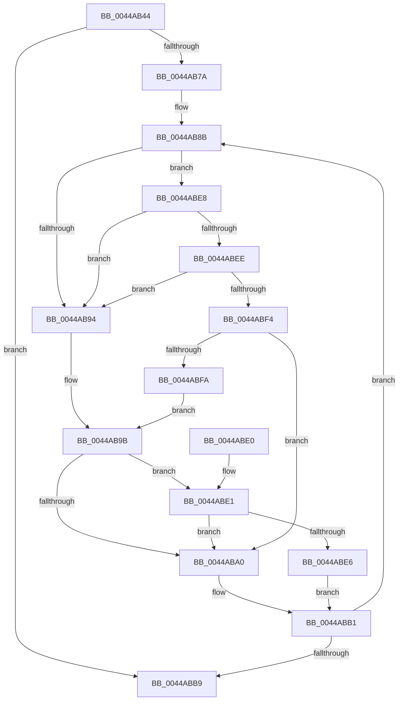

# RtlpCopyRetpolineRelocationBlockEntryArray

- RVA: `0x0044AB44`–`0x0044AC0B` (길이 `199` bytes)
- VA: `0x000000014044AB44`
- 실행 섹션: `.text`
- PDB 이름 있음: `예`; PDB Function 태그: `아니요`
- unwind 정보 RVA: `0x000A64A4`
- 디코드: `65`개 명령, `199/199` bytes 표시
- 미해석 바이트: `0` (있으면 어셈블리에 `.byte`로 보존)

> 이 문서는 커널 이미지의 기계어와 PDB 기호를 분석해 생성했습니다. 4번과 5번은 함수 원형과 자료형을 바이너리 사용 방식에서 추정한 C 해석이며 원본 소스 복구 결과는 아닙니다.

## 1. Dependencies

- 직접 호출 지점: **2**; 고유 호출 대상: **2**
- 직접 호출자로 확인된 함수: **1**
- RIP 상대 이미지 참조: **0**

### Outgoing calls
- `0x0044AB7D` → [RtlSizeOfRetpolineRelocationEntry](RtlSizeOfRetpolineRelocationEntry_function_0044AFB0.md) (function, `0x0044AFB0`)
- `0x0044ABA9` → [memcpy](../6C/memcpy_function_006C6840.md) (function, `0x006C6840`)

### Direct callers
- [RtlCreateRetpolineRelocationInformation](RtlCreateRetpolineRelocationInformation_function_0044AC14.md) at `0x0044AD7F`
- [RtlCreateRetpolineRelocationInformation](RtlCreateRetpolineRelocationInformation_function_0044AC14.md) at `0x0044ADAB`
- [RtlCreateRetpolineRelocationInformation](RtlCreateRetpolineRelocationInformation_function_0044AC14.md) at `0x0044AF83`

### Static image references
- 디코드된 RIP-relative 메모리 참조가 없습니다.

## 2. Other-region calls and transfers

- 다른 실행 섹션으로 향하는 call: **0**
- 별도 외부 분기/꼬리 이동을 확인하지 못했습니다.

## 3. Assembly (complete function range)

```asm
0044AB44  48 89 5C 24 08                  mov qword ptr [rsp + 8], rbx
0044AB49  48 89 6C 24 10                  mov qword ptr [rsp + 0x10], rbp
0044AB4E  48 89 74 24 18                  mov qword ptr [rsp + 0x18], rsi
0044AB53  57                              push rdi
0044AB54  41 54                           push r12
0044AB56  41 55                           push r13
0044AB58  41 56                           push r14
0044AB5A  41 57                           push r15
0044AB5C  48 83 EC 20                     sub rsp, 0x20
0044AB60  41 8B E9                        mov ebp, r9d
0044AB63  49 8B F0                        mov rsi, r8
0044AB66  49 03 E8                        add rbp, r8
0044AB69  44 8B E2                        mov r12d, edx
0044AB6C  4C 8B F9                        mov r15, rcx
0044AB6F  49 8B D8                        mov rbx, r8
0044AB72  48 8B F9                        mov rdi, rcx
0044AB75  4C 3B C5                        cmp r8, rbp
0044AB78  73 3F                           jae 0x14044abb9
0044AB7A  41 8B CC                        mov ecx, r12d
0044AB7D  E8 2E 04 00 00                  call 0x14044afb0
0044AB82  44 8B F0                        mov r14d, eax
0044AB85  41 BD FF 0F 00 00               mov r13d, 0xfff
0044AB8B  49 8B C4                        mov rax, r12
0044AB8E  48 83 E8 03                     sub rax, 3
0044AB92  75 54                           jne 0x14044abe8
0044AB94  0F B7 03                        movzx eax, word ptr [rbx]
0044AB97  66 41 23 C5                     and ax, r13w
0044AB9B  66 85 C0                        test ax, ax
0044AB9E  74 41                           je 0x14044abe1
0044ABA0  4D 8B C6                        mov r8, r14
0044ABA3  48 8B D3                        mov rdx, rbx
0044ABA6  48 8B CF                        mov rcx, rdi
0044ABA9  E8 92 BC 27 00                  call 0x1406c6840
0044ABAE  49 03 FE                        add rdi, r14
0044ABB1  49 03 DE                        add rbx, r14
0044ABB4  48 3B DD                        cmp rbx, rbp
0044ABB7  72 D2                           jb 0x14044ab8b
0044ABB9  48 8B 44 24 70                  mov rax, qword ptr [rsp + 0x70]
0044ABBE  41 2B FF                        sub edi, r15d
0044ABC1  48 8B 5C 24 50                  mov rbx, qword ptr [rsp + 0x50]
0044ABC6  48 8B 6C 24 58                  mov rbp, qword ptr [rsp + 0x58]
0044ABCB  48 8B 74 24 60                  mov rsi, qword ptr [rsp + 0x60]
0044ABD0  89 38                           mov dword ptr [rax], edi
0044ABD2  48 83 C4 20                     add rsp, 0x20
0044ABD6  41 5F                           pop r15
0044ABD8  41 5E                           pop r14
0044ABDA  41 5D                           pop r13
0044ABDC  41 5C                           pop r12
0044ABDE  5F                              pop rdi
0044ABDF  C3                              ret
0044ABE0  CC                              int3
0044ABE1  48 3B DE                        cmp rbx, rsi
0044ABE4  74 BA                           je 0x14044aba0
0044ABE6  EB C9                           jmp 0x14044abb1
0044ABE8  48 83 E8 01                     sub rax, 1
0044ABEC  74 A6                           je 0x14044ab94
0044ABEE  48 83 E8 01                     sub rax, 1
0044ABF2  74 A0                           je 0x14044ab94
0044ABF4  48 83 F8 03                     cmp rax, 3
0044ABF8  75 A6                           jne 0x14044aba0
0044ABFA  0F B7 03                        movzx eax, word ptr [rbx]
0044ABFD  B9 FF 03 00 00                  mov ecx, 0x3ff
0044AC02  66 23 C1                        and ax, cx
0044AC05  66 C1 E0 02                     shl ax, 2
0044AC09  EB 90                           jmp 0x14044ab9b
```

## 4. C-style interpretation (structured pseudocode)

```c
__int64 __fastcall RtlpCopyRetpolineRelocationBlockEntryArray(__int64 a1, int a2, __int64 a3, int a4, __int64 a5)
{
    __int64 result;
    __int64 v_rbp;
    __int64 v_rbx;
    __int64 v_rdi;
    __int64 v_rsp;
    unsigned __int64 v_stack_p10;
    unsigned __int64 v_stack_p18;
    unsigned __int64 v_stack_p8;

    v_stack_p8 = v_rbx;
    v_stack_p10 = v_rbp;
    v_stack_p18 = v_rsi;
    v_rsp = (v_rsp) - (32);
    v_rbp = ((unsigned int)(a4)) + (a3);
    if (a3 >= v_rbp) goto loc_0044ABB9;
    result = RtlSizeOfRetpolineRelocationEntry((unsigned int)((unsigned int)((unsigned int)(a2))), a2, a3, a4);
loc_0044AB8B:
    result = ((unsigned int)(a2)) - (3);
    if (condition_is_not_equal) goto loc_0044ABE8;
loc_0044AB94:
    result = (unsigned __int16)((*(unsigned __int16 *)(a3)) & ((unsigned __int16)((unsigned int)(0xFFFULL))));
loc_0044AB9B:
    if ((unsigned __int16)(result) == 0) goto loc_0044ABE1;
loc_0044ABA0:
    result = memcpy(a1, a3, (unsigned int)((unsigned int)(result)), a4);
    v_rdi = (a1) + ((unsigned int)((unsigned int)(result)));
loc_0044ABB1:
    v_rbx = (a3) + ((unsigned int)((unsigned int)(result)));
    if (v_rbx < v_rbp) goto loc_0044AB8B;
loc_0044ABB9:
    v_rdi = (unsigned int)((v_rdi) - ((unsigned int)(a1)));
    *(unsigned int *)(a5) = (unsigned int)(v_rdi);
    v_rsp = (v_rsp) + (32);
    return a5;
loc_0044ABE1:
    if (v_stack_p8 == v_stack_p18) goto loc_0044ABA0;
    goto loc_0044ABB1;
loc_0044ABE8:
    result = (a5) - (1);
    if (condition_is_equal) goto loc_0044AB94;
    result = (result) - (1);
    if (condition_is_equal) goto loc_0044AB94;
    if (result != 3) goto loc_0044ABA0;
    result = (unsigned __int16)((*(unsigned __int16 *)(v_stack_p8)) & ((unsigned __int16)((unsigned int)(0x3FFULL))));
    result = (unsigned __int16)((result) << (2));
    goto loc_0044AB9B;
}
```

## 5. (Beta) C Style

```c
void *RtlpCopyRetpolineRelocationBlockEntryArray(int64_t Arg1, int32_t Arg2, int64_t Arg3, int32_t Arg4, void *Arg5)
{
    uint8_t *arg5 = (uint8_t *)Arg5;

    int64_t result;
    int64_t local_rbp;
    int64_t local_rbx;
    int64_t local_rdi;
    int64_t local_rsp;
    uint64_t v_stack_p10;
    uint64_t v_stack_p18;
    uint64_t v_stack_p8;

    v_stack_p8 = local_rbx;
    v_stack_p10 = local_rbp;
    v_stack_p18 = local_rsi;
    local_rsp = (local_rsp) - (32);
    local_rbp = ((uint32_t)(Arg4)) + (Arg3);
    if (Arg3 >= local_rbp) goto loc_0044ABB9;
    result = RtlSizeOfRetpolineRelocationEntry((uint32_t)((uint32_t)((uint32_t)(Arg2))), Arg2, Arg3, Arg4);
loc_0044AB8B:
    result = ((uint32_t)(Arg2)) - (3);
    if (condition_is_not_equal) goto loc_0044ABE8;
loc_0044AB94:
    result = (uint16_t)((*(uint16_t *)(Arg3)) & ((uint16_t)((uint32_t)(0xFFFULL))));
loc_0044AB9B:
    if ((uint16_t)(result) == 0) goto loc_0044ABE1;
loc_0044ABA0:
    result = memcpy(Arg1, Arg3, (uint32_t)((uint32_t)(result)), Arg4);
    local_rdi = (Arg1) + ((uint32_t)((uint32_t)(result)));
loc_0044ABB1:
    local_rbx = (Arg3) + ((uint32_t)((uint32_t)(result)));
    if (local_rbx < local_rbp) goto loc_0044AB8B;
loc_0044ABB9:
    local_rdi = (uint32_t)((local_rdi) - ((uint32_t)(Arg1)));
    *(uint32_t *)(arg5) = (uint32_t)(local_rdi);
    local_rsp = (local_rsp) + (32);
    return Arg5;
loc_0044ABE1:
    if (v_stack_p8 == v_stack_p18) goto loc_0044ABA0;
    goto loc_0044ABB1;
loc_0044ABE8:
    result = (Arg5) - (1);
    if (condition_is_equal) goto loc_0044AB94;
    result = (result) - (1);
    if (condition_is_equal) goto loc_0044AB94;
    if (result != 3) goto loc_0044ABA0;
    result = (uint16_t)((*(uint16_t *)(v_stack_p8)) & ((uint16_t)((uint32_t)(0x3FFULL))));
    result = (uint16_t)((result) << (2));
    goto loc_0044AB9B;
}
```

### 관측된 메모리 오프셋

구조체 형식이 확인되지 않은 접근은 인자 기준의 오프셋으로만 기록했습니다.

| 기준 인자 | 오프셋 표현 | 폭 (bit) | 접근 |
|---|---:|---:|---|
| `Arg5` | `+ 0x0` | `32` | `W` |

## 6. Execution-region graph

[열기: 2D/3D 그래프와 함수 탐색 컨트롤 패널](../../../control-panel.html?section=text&rva=0x0044AB44&view=graph)

- 2D 그래프는 위에서 아래로 흐르고, 3D 그래프는 빈 공간을 드래그해 회전합니다. Shift+드래그는 이동, 휠은 확대·축소, 함수 노드 선택은 대상 보고서 이동입니다.

### Static fallback


