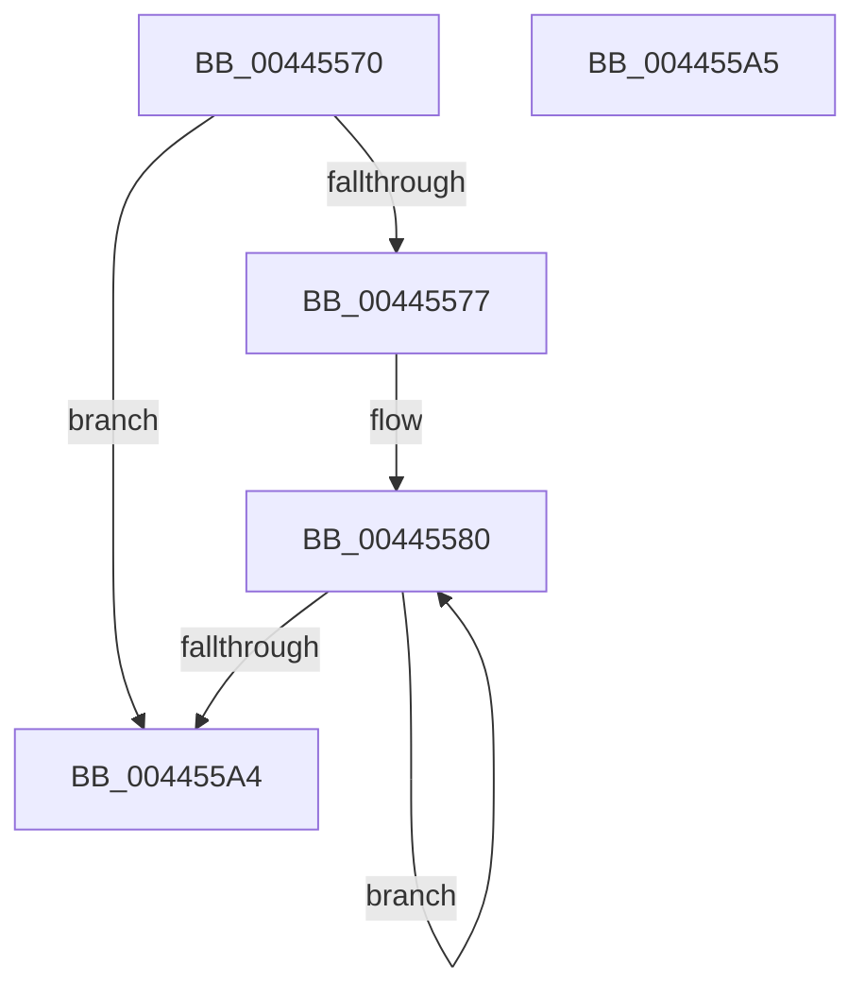

# RunningHash

- RVA: `0x00445570`–`0x004455A6` (길이 `54` bytes)
- VA: `0x0000000140445570`
- 실행 섹션: `.text`
- PDB 이름 있음: `예`; PDB Function 태그: `예`
- unwind 정보 RVA: `0x000DB714`
- 디코드: `16`개 명령, `54/54` bytes 표시
- 미해석 바이트: `0` (있으면 어셈블리에 `.byte`로 보존)

> 이 문서는 커널 이미지의 기계어와 PDB 기호를 분석해 생성했습니다. 4번과 5번은 함수 원형과 자료형을 바이너리 사용 방식에서 추정한 C 해석이며 원본 소스 복구 결과는 아닙니다.

## 1. Dependencies

- 직접 호출 지점: **0**; 고유 호출 대상: **0**
- 직접 호출자로 확인된 함수: **1**
- RIP 상대 이미지 참조: **0**

### Outgoing calls
- 직접 디코드된 call 명령이 없습니다.

### Direct callers
- [ComputeFlushPeriod](../../page/83/ComputeFlushPeriod_function_00835F58.md) at `0x00835F9E`
- [ComputeFlushPeriod](../../page/83/ComputeFlushPeriod_function_00835F58.md) at `0x00835FB3`

### Static image references
- 디코드된 RIP-relative 메모리 참조가 없습니다.

## 2. Other-region calls and transfers

- 다른 실행 섹션으로 향하는 call: **0**
- 별도 외부 분기/꼬리 이동을 확인하지 못했습니다.

## 3. Assembly (complete function range)

```asm
00445570  33 C0                           xor eax, eax
00445572  4D 85 C0                        test r8, r8
00445575  74 2D                           je 0x1404455a4
00445577  66 0F 1F 84 00 00 00 00 00      nop word ptr [rax + rax]
00445580  44 0F B6 0C 10                  movzx r9d, byte ptr [rax + rdx]
00445585  48 FF C0                        inc rax
00445588  44 03 09                        add r9d, dword ptr [rcx]
0044558B  45 69 D1 01 04 00 00            imul r10d, r9d, 0x401
00445592  45 8B CA                        mov r9d, r10d
00445595  41 C1 E9 06                     shr r9d, 6
00445599  45 33 CA                        xor r9d, r10d
0044559C  44 89 09                        mov dword ptr [rcx], r9d
0044559F  49 3B C0                        cmp rax, r8
004455A2  72 DC                           jb 0x140445580
004455A4  C3                              ret
004455A5  CC                              int3
```

## 4. C-style interpretation (structured pseudocode)

```c
__int64 __fastcall RunningHash(__int64 a1, __int64 a2, __int64 a3)
{
    __int64 result;
    __int64 v_r10;

    result = 0;
    if (a3 == 0) goto loc_004455A4;
loc_00445580:
    result = (result) + 1;
    a4 = (unsigned int)((*(unsigned __int8 *)(result + a2 * 1)) + (*(unsigned int *)(a1)));
    v_r10 = (unsigned int)((v_r10) * ((unsigned int)(a4)));
    a4 = (unsigned int)(((unsigned int)((unsigned int)(v_r10))) >> (6));
    a4 = (unsigned int)((a4) ^ ((unsigned int)(v_r10)));
    *(unsigned int *)(a1) = (unsigned int)(a4);
    if (result < a3) goto loc_00445580;
loc_004455A4:
    return result;
}
```

## 5. (Beta) C Style

```c
int64_t RunningHash(void *Arg1, int64_t Arg2, int64_t Arg3)
{
    uint8_t *arg1 = (uint8_t *)Arg1;

    int64_t result;
    int64_t local_r10;

    result = 0;
    if (Arg3 == 0) goto loc_004455A4;
loc_00445580:
    result = (result) + 1;
    a4 = (uint32_t)((*(uint8_t *)(result + Arg2 * 1)) + (*(uint32_t *)(arg1)));
    local_r10 = (uint32_t)((local_r10) * ((uint32_t)(a4)));
    a4 = (uint32_t)(((uint32_t)((uint32_t)(local_r10))) >> (6));
    a4 = (uint32_t)((a4) ^ ((uint32_t)(local_r10)));
    *(uint32_t *)(arg1) = (uint32_t)(a4);
    if (result < Arg3) goto loc_00445580;
loc_004455A4:
    return result;
}
```

### 관측된 메모리 오프셋

구조체 형식이 확인되지 않은 접근은 인자 기준의 오프셋으로만 기록했습니다.

| 기준 인자 | 오프셋 표현 | 폭 (bit) | 접근 |
|---|---:|---:|---|
| `Arg1` | `+ 0x0` | `32` | `R` |
| `Arg1` | `+ 0x0` | `32` | `W` |

## 6. Execution-region graph

[열기: 2D/3D 그래프와 함수 탐색 컨트롤 패널](../../../control-panel.html?section=text&rva=0x00445570&view=graph)

- 2D 그래프는 위에서 아래로 흐르고, 3D 그래프는 빈 공간을 드래그해 회전합니다. Shift+드래그는 이동, 휠은 확대·축소, 함수 노드 선택은 대상 보고서 이동입니다.

### Static fallback


