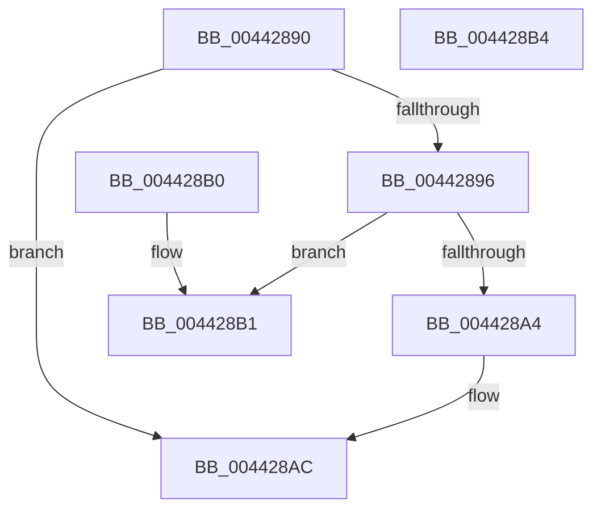

# SANITIZE_VA

- RVA: `0x00442890`–`0x004428B5` (길이 `37` bytes)
- VA: `0x0000000140442890`
- 실행 섹션: `.text`
- PDB 이름 있음: `예`; PDB Function 태그: `아니요`
- unwind 정보 RVA: `0x000DB714`
- 디코드: `14`개 명령, `37/37` bytes 표시
- 미해석 바이트: `0` (있으면 어셈블리에 `.byte`로 보존)

> 이 문서는 커널 이미지의 기계어와 PDB 기호를 분석해 생성했습니다. 4번과 5번은 함수 원형과 자료형을 바이너리 사용 방식에서 추정한 C 해석이며 원본 소스 복구 결과는 아닙니다.

## 1. Dependencies

- 직접 호출 지점: **0**; 고유 호출 대상: **0**
- 직접 호출자로 확인된 함수: **0**
- RIP 상대 이미지 참조: **0**

### Outgoing calls
- 직접 디코드된 call 명령이 없습니다.

### Direct callers
- 이 함수 시작 RVA로 연결되는 직접 call은 확인되지 않았습니다. 간접 호출은 완전히 역산할 수 없습니다.

### Static image references
- 디코드된 RIP-relative 메모리 참조가 없습니다.

## 2. Other-region calls and transfers

- 다른 실행 섹션으로 향하는 call: **0**
- 별도 외부 분기/꼬리 이동을 확인하지 못했습니다.

## 3. Assembly (complete function range)

```asm
00442890  41 80 F8 01                     cmp r8b, 1
00442894  75 16                           jne 0x1404428ac
00442896  66 83 EA 23                     sub dx, 0x23
0044289A  B8 F7 FF 00 00                  mov eax, 0xfff7
0044289F  66 85 D0                        test ax, dx
004428A2  74 0D                           je 0x1404428b1
004428A4  48 C1 E1 10                     shl rcx, 0x10
004428A8  48 C1 F9 10                     sar rcx, 0x10
004428AC  48 8B C1                        mov rax, rcx
004428AF  C3                              ret
004428B0  CC                              int3
004428B1  8B C1                           mov eax, ecx
004428B3  C3                              ret
004428B4  CC                              int3
```

## 4. C-style interpretation (structured pseudocode)

```c
__int64 __fastcall SANITIZE_VA(__int64 a1, unsigned __int16 a2, unsigned __int8 a3)
{
    if (a3 != 1) goto loc_004428AC;
    a2 = (unsigned __int16)((a2) - (35));
    if ((((unsigned __int16)((unsigned int)(0xFFF7ULL))) & (a2)) == 0) goto loc_004428B1;
    a1 = (a1) << (16);
    a1 = (a1) >> (16);
loc_004428AC:
    return a1;
loc_004428B1:
    return (unsigned int)((unsigned int)(a1));
}
```

## 5. (Beta) C Style

```c
int64_t SANITIZE_VA(int64_t Arg1, uint16_t Arg2, uint8_t Arg3)
{
    if (Arg3 != 1) goto loc_004428AC;
    Arg2 = (uint16_t)((Arg2) - (35));
    if ((((uint16_t)((uint32_t)(0xFFF7ULL))) & (Arg2)) == 0) goto loc_004428B1;
    Arg1 = (Arg1) << (16);
    Arg1 = (Arg1) >> (16);
loc_004428AC:
    return Arg1;
loc_004428B1:
    return (uint32_t)((uint32_t)(Arg1));
}
```

## 6. Execution-region graph

[열기: 2D/3D 그래프와 함수 탐색 컨트롤 패널](../../../control-panel.html?section=text&rva=0x00442890&view=graph)

- 2D 그래프는 위에서 아래로 흐르고, 3D 그래프는 빈 공간을 드래그해 회전합니다. Shift+드래그는 이동, 휠은 확대·축소, 함수 노드 선택은 대상 보고서 이동입니다.

### Static fallback


