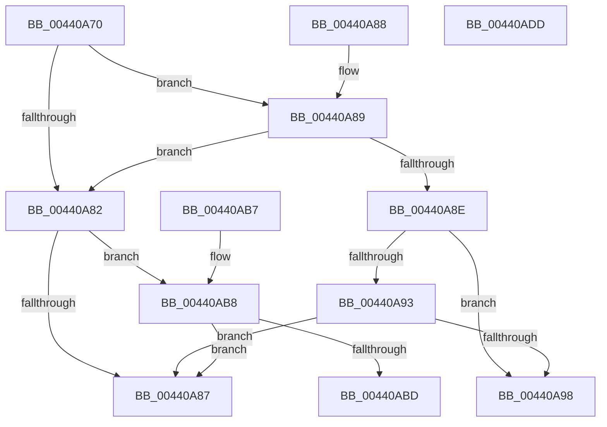

# ST_STORE&lt;SM_TRAITS&gt;::StDmUpdateRegionsToCompactBitmap

- RVA: `0x00440A70`–`0x00440ADE` (길이 `110` bytes)
- VA: `0x0000000140440A70`
- 실행 섹션: `.text`
- PDB 이름 있음: `예`; PDB Function 태그: `아니요`
- unwind 정보 RVA: `0x000DB714`
- 디코드: `38`개 명령, `110/110` bytes 표시
- 미해석 바이트: `0` (있으면 어셈블리에 `.byte`로 보존)

> 이 문서는 커널 이미지의 기계어와 PDB 기호를 분석해 생성했습니다. 4번과 5번은 함수 원형과 자료형을 바이너리 사용 방식에서 추정한 C 해석이며 원본 소스 복구 결과는 아닙니다.

## 1. Dependencies

- 직접 호출 지점: **0**; 고유 호출 대상: **0**
- 직접 호출자로 확인된 함수: **1**
- RIP 상대 이미지 참조: **0**

### Outgoing calls
- 직접 디코드된 call 명령이 없습니다.

### Direct callers
- [ST_STORE&lt;SM_TRAITS&gt;::StDmCurrentRegionSet](../3B/ST_STORE_SM_TRAITS_StDmCurrentRegionSet_function_003B1130.md) at `0x003B1256`
- [ST_STORE&lt;SM_TRAITS&gt;::StDmCurrentRegionSet](../3B/ST_STORE_SM_TRAITS_StDmCurrentRegionSet_function_003B1130.md) at `0x003B126F`

### Static image references
- 디코드된 RIP-relative 메모리 참조가 없습니다.

## 2. Other-region calls and transfers

- 다른 실행 섹션으로 향하는 call: **0**
- 별도 외부 분기/꼬리 이동을 확인하지 못했습니다.

## 3. Assembly (complete function range)

```asm
00440A70  8B 81 28 03 00 00               mov eax, dword ptr [rcx + 0x328]
00440A76  4C 8B D1                        mov r10, rcx
00440A79  FF C0                           inc eax
00440A7B  D1 E8                           shr eax, 1
00440A7D  44 3B C0                        cmp r8d, eax
00440A80  72 07                           jb 0x140440a89
00440A82  44 3B C8                        cmp r9d, eax
00440A85  72 31                           jb 0x140440ab8
00440A87  C3                              ret
00440A88  CC                              int3
00440A89  45 85 C0                        test r8d, r8d
00440A8C  74 F4                           je 0x140440a82
00440A8E  44 3B C8                        cmp r9d, eax
00440A91  73 05                           jae 0x140440a98
00440A93  45 85 C9                        test r9d, r9d
00440A96  75 EF                           jne 0x140440a87
00440A98  FF 89 B0 05 00 00               dec dword ptr [rcx + 0x5b0]
00440A9E  8B CA                           mov ecx, edx
00440AA0  83 E2 07                        and edx, 7
00440AA3  48 C1 E9 03                     shr rcx, 3
00440AA7  49 03 8A A8 05 00 00            add rcx, qword ptr [r10 + 0x5a8]
00440AAE  0F BE 01                        movsx eax, byte ptr [rcx]
00440AB1  0F AB D0                        bts eax, edx
00440AB4  88 01                           mov byte ptr [rcx], al
00440AB6  C3                              ret
00440AB7  CC                              int3
00440AB8  45 85 C9                        test r9d, r9d
00440ABB  74 CA                           je 0x140440a87
00440ABD  8B CA                           mov ecx, edx
00440ABF  83 E2 07                        and edx, 7
00440AC2  48 C1 E9 03                     shr rcx, 3
00440AC6  49 03 8A A8 05 00 00            add rcx, qword ptr [r10 + 0x5a8]
00440ACD  0F BE 01                        movsx eax, byte ptr [rcx]
00440AD0  0F B3 D0                        btr eax, edx
00440AD3  88 01                           mov byte ptr [rcx], al
00440AD5  41 FF 82 B0 05 00 00            inc dword ptr [r10 + 0x5b0]
00440ADC  C3                              ret
00440ADD  CC                              int3
```

## 4. C-style interpretation (structured pseudocode)

```c
__int64 __fastcall ST_STORE_SM_TRAITS___StDmUpdateRegionsToCompactBitmap(__int64 a1, int a2, int a3, int a4)
{
    __int64 result;

    result = (unsigned int)(((unsigned int)(*(unsigned int *)(a1 + 808))) + 1);
    result = (unsigned int)((result) >> (1));
    if (a3 < ((unsigned int)(result))) goto loc_00440A89;
loc_00440A82:
    if (a4 < ((unsigned int)(result))) goto loc_00440AB8;
loc_00440A87:
    return result;
loc_00440A89:
    if (a3 == 0) goto loc_00440A82;
    if (a4 >= ((unsigned int)(result))) goto loc_00440A98;
    if (a4 != 0) goto loc_00440A87;
loc_00440A98:
    a2 = (unsigned int)((a2) & (7));
    a1 = ((unsigned int)(a2)) >> (3);
    a1 = (a1) + (*(unsigned __int64 *)(a1 + 1448));
    *(unsigned __int8 *)(a1) = (unsigned __int8)((__int8)(*(unsigned __int8 *)(a1)));
    return (__int8)(*(unsigned __int8 *)(a1));
loc_00440AB8:
    if (a4 == 0) goto loc_00440A87;
    a2 = (unsigned int)((a2) & (7));
    a1 = ((unsigned int)(a2)) >> (3);
    a1 = (a1) + (*(unsigned __int64 *)(a1 + 1448));
    *(unsigned __int8 *)(a1) = (unsigned __int8)((__int8)(*(unsigned __int8 *)(a1)));
    return (__int8)(*(unsigned __int8 *)(a1));
}
```

## 5. (Beta) C Style

```c
int64_t ST_STORE_SM_TRAITS___StDmUpdateRegionsToCompactBitmap(void *Arg1, int32_t Arg2, int32_t Arg3, int32_t Arg4)
{
    uint8_t *arg1 = (uint8_t *)Arg1;

    int64_t result;

    result = (uint32_t)(((uint32_t)(*(uint32_t *)(arg1 + 0x328))) + 1);
    result = (uint32_t)((result) >> (1));
    if (Arg3 < ((uint32_t)(result))) goto loc_00440A89;
loc_00440A82:
    if (Arg4 < ((uint32_t)(result))) goto loc_00440AB8;
loc_00440A87:
    return result;
loc_00440A89:
    if (Arg3 == 0) goto loc_00440A82;
    if (Arg4 >= ((uint32_t)(result))) goto loc_00440A98;
    if (Arg4 != 0) goto loc_00440A87;
loc_00440A98:
    Arg2 = (uint32_t)((Arg2) & (7));
    Arg1 = ((uint32_t)(Arg2)) >> (3);
    Arg1 = (Arg1) + (*(uint64_t *)(arg1 + 0x5A8));
    *(uint8_t *)(arg1) = (uint8_t)((int8_t)(*(uint8_t *)(arg1)));
    return (int8_t)(*(uint8_t *)(arg1));
loc_00440AB8:
    if (Arg4 == 0) goto loc_00440A87;
    Arg2 = (uint32_t)((Arg2) & (7));
    Arg1 = ((uint32_t)(Arg2)) >> (3);
    Arg1 = (Arg1) + (*(uint64_t *)(arg1 + 0x5A8));
    *(uint8_t *)(arg1) = (uint8_t)((int8_t)(*(uint8_t *)(arg1)));
    return (int8_t)(*(uint8_t *)(arg1));
}
```

### 관측된 메모리 오프셋

구조체 형식이 확인되지 않은 접근은 인자 기준의 오프셋으로만 기록했습니다.

| 기준 인자 | 오프셋 표현 | 폭 (bit) | 접근 |
|---|---:|---:|---|
| `Arg1` | `+ 0x328` | `32` | `R` |
| `Arg1` | `+ 0x5A8` | `64` | `R` |
| `Arg1` | `+ 0x5B0` | `32` | `R/W` |

## 6. Execution-region graph

[열기: 2D/3D 그래프와 함수 탐색 컨트롤 패널](../../../control-panel.html?section=text&rva=0x00440A70&view=graph)

- 2D 그래프는 위에서 아래로 흐르고, 3D 그래프는 빈 공간을 드래그해 회전합니다. Shift+드래그는 이동, 휠은 확대·축소, 함수 노드 선택은 대상 보고서 이동입니다.

### Static fallback


