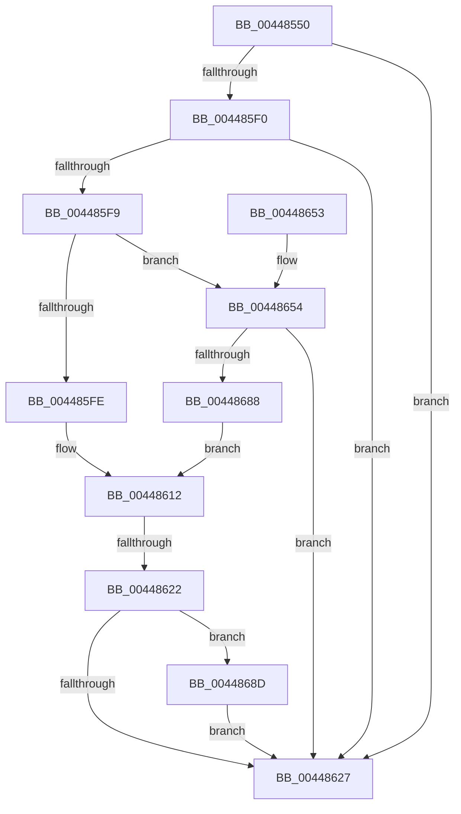

# SeLogAccessFailure

- RVA: `0x00448550`–`0x0044869C` (길이 `332` bytes)
- VA: `0x0000000140448550`
- 실행 섹션: `.text`
- PDB 이름 있음: `예`; PDB Function 태그: `예`
- unwind 정보 RVA: `0x000A6108`
- 디코드: `79`개 명령, `332/332` bytes 표시
- 미해석 바이트: `0` (있으면 어셈블리에 `.byte`로 보존)

> 이 문서는 커널 이미지의 기계어와 PDB 기호를 분석해 생성했습니다. 4번과 5번은 함수 원형과 자료형을 바이너리 사용 방식에서 추정한 C 해석이며 원본 소스 복구 결과는 아닙니다.

## 1. Dependencies

- 직접 호출 지점: **3**; 고유 호출 대상: **3**
- 직접 호출자로 확인된 함수: **4**
- RIP 상대 이미지 참조: **2**

### Outgoing calls
- `0x00448631` → [_security_check_cookie](../6A/_security_check_cookie_function_006AC640.md) (function, `0x006AC640`)
- `0x0044867B` → [PsReferenceEffectiveToken](../../page/9A/PsReferenceEffectiveToken_function_009A2B40.md) (function, `0x009A2B40`)
- `0x00448695` → [ObfDereferenceObjectWithTag](../2F/ObfDereferenceObjectWithTag_function_002F78E0.md) (function, `0x002F78E0`)

### Direct callers
- [SeAccessCheckWithHint](../3A/SeAccessCheckWithHint_function_003A6C30.md) at `0x003A76A2`
- [SeAccessCheckWithHint](../3A/SeAccessCheckWithHint_function_003A6C30.md) at `0x003A775D`
- [SeAccessCheckByType](SeAccessCheckByType_function_00440BC8.md) at `0x00442655`
- [SepCommonAccessCheckEx](../47/SepCommonAccessCheckEx_function_0047602C.md) at `0x0047636C`
- [SepCommonAccessCheckEx](../47/SepCommonAccessCheckEx_function_0047602C.md) at `0x00476441`
- [SepCommonAccessCheckEx](../47/SepCommonAccessCheckEx_function_0047602C.md) at `0x004772AF`
- [SepAccessCheckAndAuditAlarm](../../page/A1/SepAccessCheckAndAuditAlarm_function_00A1AF4C.md) at `0x00A1CF47`

### Static image references
- `0x00448572` → RVA `0x00E0A740` (`.data`; read)
- `0x004485F0` → RVA `0x00EFFA28` (`.data`; read)

## 2. Other-region calls and transfers

- 다른 실행 섹션으로 향하는 call: **1**
  - `0x0044867B` → [PsReferenceEffectiveToken](../../page/9A/PsReferenceEffectiveToken_function_009A2B40.md) (`.text` → `PAGE`)
- call이 아닌 외부 분기/꼬리 이동: **1**
  - `0x0044861C` → [sub_006F0328](../6F/Unknown_function_006F0328.md) (`tail-transfer`)

## 3. Assembly (complete function range)

```asm
00448550  48 89 5C 24 18                  mov qword ptr [rsp + 0x18], rbx
00448555  48 89 74 24 20                  mov qword ptr [rsp + 0x20], rsi
0044855A  55                              push rbp
0044855B  41 54                           push r12
0044855D  41 55                           push r13
0044855F  41 56                           push r14
00448561  41 57                           push r15
00448563  48 8D AC 24 40 FE FF FF         lea rbp, [rsp - 0x1c0]
0044856B  48 81 EC C0 02 00 00            sub rsp, 0x2c0
00448572  48 8B 05 C7 21 9C 00            mov rax, qword ptr [rip + 0x9c21c7]
00448579  48 33 C4                        xor rax, rsp
0044857C  48 89 85 B0 01 00 00            mov qword ptr [rbp + 0x1b0], rax
00448583  4C 8B B5 10 02 00 00            mov r14, qword ptr [rbp + 0x210]
0044858A  45 33 ED                        xor r13d, r13d
0044858D  40 32 F6                        xor sil, sil
00448590  4C 89 75 98                     mov qword ptr [rbp - 0x68], r14
00448594  40 88 74 24 41                  mov byte ptr [rsp + 0x41], sil
00448599  4D 8B E1                        mov r12, r9
0044859C  40 88 74 24 40                  mov byte ptr [rsp + 0x40], sil
004485A1  48 8B D9                        mov rbx, rcx
004485A4  45 8B FD                        mov r15d, r13d
004485A7  44 89 6C 24 54                  mov dword ptr [rsp + 0x54], r13d
004485AC  4C 89 6C 24 78                  mov qword ptr [rsp + 0x78], r13
004485B1  66 44 89 6C 24 48               mov word ptr [rsp + 0x48], r13w
004485B7  44 89 6C 24 6C                  mov dword ptr [rsp + 0x6c], r13d
004485BC  4C 89 6D 80                     mov qword ptr [rbp - 0x80], r13
004485C0  44 89 6C 24 70                  mov dword ptr [rsp + 0x70], r13d
004485C5  66 44 89 6C 24 4C               mov word ptr [rsp + 0x4c], r13w
004485CB  44 89 6C 24 60                  mov dword ptr [rsp + 0x60], r13d
004485D0  C7 44 24 68 01 00 00 00         mov dword ptr [rsp + 0x68], 1
004485D8  44 89 6C 24 5C                  mov dword ptr [rsp + 0x5c], r13d
004485DD  44 89 6C 24 50                  mov dword ptr [rsp + 0x50], r13d
004485E2  66 44 89 6C 24 44               mov word ptr [rsp + 0x44], r13w
004485E8  44 0F 20 C0                     mov rax, cr8
004485EC  3C 02                           cmp al, 2
004485EE  73 37                           jae 0x140448627
004485F0  4C 39 2D 31 74 AB 00            cmp qword ptr [rip + 0xab7431], r13
004485F7  74 2E                           je 0x140448627
004485F9  48 85 C9                        test rcx, rcx
004485FC  74 56                           je 0x140448654
004485FE  8B 81 C0 00 00 00               mov eax, dword ptr [rcx + 0xc0]
00448604  89 44 24 5C                     mov dword ptr [rsp + 0x5c], eax
00448608  8B 81 C4 00 00 00               mov eax, dword ptr [rcx + 0xc4]
0044860E  89 44 24 60                     mov dword ptr [rsp + 0x60], eax
00448612  F7 83 C8 00 00 00 00 00 00 01   test dword ptr [rbx + 0xc8], 0x1000000
0044861C  0F 85 06 7D 2A 00               jne 0x1406f0328
00448622  40 84 F6                        test sil, sil
00448625  75 66                           jne 0x14044868d
00448627  48 8B 8D B0 01 00 00            mov rcx, qword ptr [rbp + 0x1b0]
0044862E  48 33 CC                        xor rcx, rsp
00448631  E8 0A 40 26 00                  call 0x1406ac640
00448636  4C 8D 9C 24 C0 02 00 00         lea r11, [rsp + 0x2c0]
0044863E  49 8B 5B 40                     mov rbx, qword ptr [r11 + 0x40]
00448642  49 8B 73 48                     mov rsi, qword ptr [r11 + 0x48]
00448646  49 8B E3                        mov rsp, r11
00448649  41 5F                           pop r15
0044864B  41 5E                           pop r14
0044864D  41 5D                           pop r13
0044864F  41 5C                           pop r12
00448651  5D                              pop rbp
00448652  C3                              ret
00448653  CC                              int3
00448654  65 48 8B 0C 25 88 01 00 00      mov rcx, qword ptr gs:[0x188]
0044865D  48 8D 44 24 60                  lea rax, [rsp + 0x60]
00448662  4C 89 6C 24 28                  mov qword ptr [rsp + 0x28], r13
00448667  4C 8D 4C 24 58                  lea r9, [rsp + 0x58]
0044866C  4C 8D 44 24 5C                  lea r8, [rsp + 0x5c]
00448671  48 89 44 24 20                  mov qword ptr [rsp + 0x20], rax
00448676  BA 53 65 44 67                  mov edx, 0x67446553
0044867B  E8 C0 A4 55 00                  call 0x1409a2b40
00448680  48 8B D8                        mov rbx, rax
00448683  48 85 C0                        test rax, rax
00448686  74 9F                           je 0x140448627
00448688  40 B6 01                        mov sil, 1
0044868B  EB 85                           jmp 0x140448612
0044868D  BA 53 65 44 67                  mov edx, 0x67446553
00448692  48 8B CB                        mov rcx, rbx
00448695  E8 46 F2 EA FF                  call 0x1402f78e0
0044869A  EB 8B                           jmp 0x140448627
```

## 4. C-style interpretation (structured pseudocode)

```c
__int64 __fastcall SeLogAccessFailure(__int64 a1, __int64 a2, __int64 a3, __int64 a4, __int64 a5)
{
    __int64 result;
    __int64 v_r13;
    __int64 v_rsi;
    __int64 v_rsp;
    unsigned __int64 v_stack_m1E8;
    unsigned __int64 v_stack_m250;
    unsigned __int64 v_stack_m260;
    unsigned __int64 v_stack_m264;
    unsigned __int64 v_stack_m268;
    unsigned __int64 v_stack_m270;
    unsigned int v_stack_m278;
    unsigned int v_stack_m27C;
    unsigned __int64 v_stack_m28;
    unsigned int v_stack_m280;
    unsigned int v_stack_m288;
    unsigned int v_stack_m28C;
    unsigned int v_stack_m294;
    unsigned int v_stack_m298;
    unsigned __int16 v_stack_m29C;
    unsigned __int16 v_stack_m2A0;
    unsigned __int16 v_stack_m2A4;
    unsigned __int8 v_stack_m2A7;
    unsigned __int8 v_stack_m2A8;
    unsigned __int64 v_stack_m38;
    unsigned __int64 v_stack_p18;
    unsigned __int64 v_stack_p20;

    v_stack_p18 = v_rbx;
    v_stack_p20 = v_rsi;
    v_rsp = (v_rsp) - (704);
    result = (*(unsigned __int64 *)(v_rip + 10232263)) ^ (v_rsp);
    v_stack_m38 = result;
    v_r13 = 0;
    v_rsi = 0;
    v_stack_m250 = a5;
    v_stack_m2A7 = 0;
    v_stack_m2A8 = 0;
    v_stack_m294 = 0;
    v_stack_m270 = 0;
    v_stack_m2A0 = 0;
    v_stack_m27C = 0;
    v_stack_m268 = 0;
    v_stack_m278 = 0;
    v_stack_m29C = 0;
    v_stack_m288 = 0;
    v_stack_m280 = 1;
    v_stack_m28C = 0;
    v_stack_m298 = 0;
    v_stack_m2A4 = 0;
    if (((unsigned __int8)(v_cr8)) >= 2) goto loc_00448627;
    if ((*(unsigned __int64 *)(v_rip + 11236401)) == 0) goto loc_00448627;
    if (a1 == 0) goto loc_00448654;
    v_stack_m28C = (unsigned int)((unsigned int)(*(unsigned int *)(a1 + 192)));
    v_stack_m288 = (unsigned int)((unsigned int)(*(unsigned int *)(a1 + 196)));
loc_00448612:
    if (0 != 0) goto loc_0044868D;
loc_00448627:
    a1 = (v_stack_m38) ^ (v_rsp);
    result = _security_check_cookie(a1, a2, a3, a4);
    return result;
loc_00448654:
    v_stack_m298 = 0;
    v_stack_m2A0 = v_stack_m260;
    result = PsReferenceEffectiveToken(*(unsigned __int64 *)(gs_base + (0 + 392)), (unsigned int)(0x67446553ULL), v_stack_m264, v_stack_m268);
    if (result == 0) goto loc_00448627;
    goto loc_00448612;
loc_0044868D:
    result = ObfDereferenceObjectWithTag(result, (unsigned int)(0x67446553ULL), v_stack_m264, v_stack_m268);
    goto loc_00448627;
}
```

## 5. (Beta) C Style

```c
int64_t SeLogAccessFailure(int64_t Arg1, int64_t Arg2, int64_t Arg3, int64_t Arg4, int64_t Arg5)
{
    int64_t result;
    int64_t local_r13;
    int64_t local_rsi;
    int64_t local_rsp;
    uint64_t v_stack_m1E8;
    uint64_t v_stack_m250;
    uint64_t v_stack_m260;
    uint64_t v_stack_m264;
    uint64_t v_stack_m268;
    uint64_t v_stack_m270;
    uint32_t v_stack_m278;
    uint32_t v_stack_m27C;
    uint64_t v_stack_m28;
    uint32_t v_stack_m280;
    uint32_t v_stack_m288;
    uint32_t v_stack_m28C;
    uint32_t v_stack_m294;
    uint32_t v_stack_m298;
    uint16_t v_stack_m29C;
    uint16_t v_stack_m2A0;
    uint16_t v_stack_m2A4;
    uint8_t v_stack_m2A7;
    uint8_t v_stack_m2A8;
    uint64_t v_stack_m38;
    uint64_t v_stack_p18;
    uint64_t v_stack_p20;

    v_stack_p18 = local_rbx;
    v_stack_p20 = local_rsi;
    local_rsp = (local_rsp) - (704);
    result = (*(uint64_t *)(v_rip + 0x9C21C7)) ^ (local_rsp);
    v_stack_m38 = result;
    local_r13 = 0;
    local_rsi = 0;
    v_stack_m250 = Arg5;
    v_stack_m2A7 = 0;
    v_stack_m2A8 = 0;
    v_stack_m294 = 0;
    v_stack_m270 = 0;
    v_stack_m2A0 = 0;
    v_stack_m27C = 0;
    v_stack_m268 = 0;
    v_stack_m278 = 0;
    v_stack_m29C = 0;
    v_stack_m288 = 0;
    v_stack_m280 = 1;
    v_stack_m28C = 0;
    v_stack_m298 = 0;
    v_stack_m2A4 = 0;
    if (((uint8_t)(v_cr8)) >= 2) goto loc_00448627;
    if ((*(uint64_t *)(v_rip + 0xAB7431)) == 0) goto loc_00448627;
    if (Arg1 == 0) goto loc_00448654;
    v_stack_m28C = (uint32_t)((uint32_t)(*(uint32_t *)(Arg1 + 0xC0)));
    v_stack_m288 = (uint32_t)((uint32_t)(*(uint32_t *)(Arg1 + 0xC4)));
loc_00448612:
    if (0 != 0) goto loc_0044868D;
loc_00448627:
    Arg1 = (v_stack_m38) ^ (local_rsp);
    result = _security_check_cookie(Arg1, Arg2, Arg3, Arg4);
    return result;
loc_00448654:
    v_stack_m298 = 0;
    v_stack_m2A0 = v_stack_m260;
    result = PsReferenceEffectiveToken(*(uint64_t *)(gs_base + (0 + 0x188)), (uint32_t)(0x67446553ULL), v_stack_m264, v_stack_m268);
    if (result == 0) goto loc_00448627;
    goto loc_00448612;
loc_0044868D:
    result = ObfDereferenceObjectWithTag(result, (uint32_t)(0x67446553ULL), v_stack_m264, v_stack_m268);
    goto loc_00448627;
}
```

## 6. Execution-region graph

[열기: 2D/3D 그래프와 함수 탐색 컨트롤 패널](../../../control-panel.html?section=text&rva=0x00448550&view=graph)

- 2D 그래프는 위에서 아래로 흐르고, 3D 그래프는 빈 공간을 드래그해 회전합니다. Shift+드래그는 이동, 휠은 확대·축소, 함수 노드 선택은 대상 보고서 이동입니다.

### Static fallback


