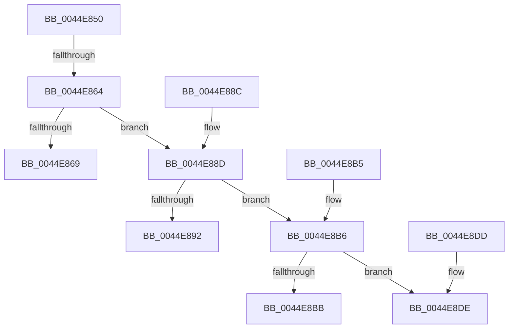

# SeSetAuditParameter

- RVA: `0x0044E850`–`0x0044E8E7` (길이 `151` bytes)
- VA: `0x000000014044E850`
- 실행 섹션: `.text`
- PDB 이름 있음: `예`; PDB Function 태그: `예`
- unwind 정보 RVA: `0x000A6A94`
- 디코드: `50`개 명령, `151/151` bytes 표시
- 미해석 바이트: `0` (있으면 어셈블리에 `.byte`로 보존)

> 이 문서는 커널 이미지의 기계어와 PDB 기호를 분석해 생성했습니다. 4번과 5번은 함수 원형과 자료형을 바이너리 사용 방식에서 추정한 C 해석이며 원본 소스 복구 결과는 아닙니다.

## 1. Dependencies

- 직접 호출 지점: **0**; 고유 호출 대상: **0**
- 직접 호출자로 확인된 함수: **1**
- RIP 상대 이미지 참조: **0**

### Outgoing calls
- 직접 디코드된 call 명령이 없습니다.

### Direct callers
- [CmpReportAuditVirtualizationEvent](../../page/7E/CmpReportAuditVirtualizationEvent_function_007ED758.md) at `0x007ED815`
- [CmpReportAuditVirtualizationEvent](../../page/7E/CmpReportAuditVirtualizationEvent_function_007ED758.md) at `0x007ED8D3`
- [CmpReportAuditVirtualizationEvent](../../page/7E/CmpReportAuditVirtualizationEvent_function_007ED758.md) at `0x007ED8FA`
- [CmpReportAuditVirtualizationEvent](../../page/7E/CmpReportAuditVirtualizationEvent_function_007ED758.md) at `0x007ED93F`
- [CmpReportAuditVirtualizationEvent](../../page/7E/CmpReportAuditVirtualizationEvent_function_007ED758.md) at `0x007ED966`

### Static image references
- 디코드된 RIP-relative 메모리 참조가 없습니다.

## 2. Other-region calls and transfers

- 다른 실행 섹션으로 향하는 call: **0**
- call이 아닌 외부 분기/꼬리 이동: **2**
  - `0x0044E85E` → [sub_0044E913 + 0x28](Unknown_function_0044E913.md) (`tail-transfer`)
  - `0x0044E8E1` → [sub_0044E913 + 0xB7](Unknown_function_0044E913.md) (`tail-transfer`)

## 3. Assembly (complete function range)

```asm
0044E850  40 53                           push rbx
0044E852  45 33 D2                        xor r10d, r10d
0044E855  48 8B D9                        mov rbx, rcx
0044E858  45 8B DA                        mov r11d, r10d
0044E85B  48 85 C9                        test rcx, rcx
0044E85E  0F 84 D7 00 00 00               je 0x14044e93b
0044E864  83 FA 1A                        cmp edx, 0x1a
0044E867  75 24                           jne 0x14044e88d
0044E869  49 8B 09                        mov rcx, qword ptr [r9]
0044E86C  41 8B C0                        mov eax, r8d
0044E86F  48 C1 E0 05                     shl rax, 5
0044E873  48 03 C3                        add rax, rbx
0044E876  48 89 48 20                     mov qword ptr [rax + 0x20], rcx
0044E87A  41 BB 08 00 00 00               mov r11d, 8
0044E880  89 50 18                        mov dword ptr [rax + 0x18], edx
0044E883  44 89 58 1C                     mov dword ptr [rax + 0x1c], r11d
0044E887  41 8B C2                        mov eax, r10d
0044E88A  5B                              pop rbx
0044E88B  C3                              ret
0044E88C  CC                              int3
0044E88D  83 FA 15                        cmp edx, 0x15
0044E890  75 24                           jne 0x14044e8b6
0044E892  41 8B 09                        mov ecx, dword ptr [r9]
0044E895  41 BB 04 00 00 00               mov r11d, 4
0044E89B  41 8B C0                        mov eax, r8d
0044E89E  48 C1 E0 05                     shl rax, 5
0044E8A2  48 03 C3                        add rax, rbx
0044E8A5  48 89 48 20                     mov qword ptr [rax + 0x20], rcx
0044E8A9  89 50 18                        mov dword ptr [rax + 0x18], edx
0044E8AC  44 89 58 1C                     mov dword ptr [rax + 0x1c], r11d
0044E8B0  41 8B C2                        mov eax, r10d
0044E8B3  5B                              pop rbx
0044E8B4  C3                              ret
0044E8B5  CC                              int3
0044E8B6  83 FA 22                        cmp edx, 0x22
0044E8B9  75 23                           jne 0x14044e8de
0044E8BB  45 0F B7 19                     movzx r11d, word ptr [r9]
0044E8BF  41 83 C3 10                     add r11d, 0x10
0044E8C3  41 8B C0                        mov eax, r8d
0044E8C6  48 C1 E0 05                     shl rax, 5
0044E8CA  48 03 C3                        add rax, rbx
0044E8CD  4C 89 48 30                     mov qword ptr [rax + 0x30], r9
0044E8D1  89 50 18                        mov dword ptr [rax + 0x18], edx
0044E8D4  44 89 58 1C                     mov dword ptr [rax + 0x1c], r11d
0044E8D8  41 8B C2                        mov eax, r10d
0044E8DB  5B                              pop rbx
0044E8DC  C3                              ret
0044E8DD  CC                              int3
0044E8DE  83 FA 23                        cmp edx, 0x23
0044E8E1  0F 87 E3 00 00 00               ja 0x14044e9ca
```

## 4. C-style interpretation (structured pseudocode)

```c
__int64 __fastcall SeSetAuditParameter(__int64 a1, int a2, int a3, __int64 a4)
{
    __int64 result;
    __int64 v_r10;
    __int64 v_r11;

    v_r10 = 0;
    if (a2 != 26) goto loc_0044E88D;
    result = ((unsigned int)(a3)) << (5);
    result = (result) + (a1);
    *(unsigned __int64 *)(result + 32) = *(unsigned __int64 *)(a4);
    *(unsigned int *)(result + 24) = a2;
    *(unsigned int *)(result + 28) = 8;
    return 0;
loc_0044E88D:
    if (a2 != 21) goto loc_0044E8B6;
    result = ((unsigned int)(a3)) << (5);
    result = (result) + (a1);
    *(unsigned __int64 *)(result + 32) = (unsigned int)(*(unsigned int *)(a4));
    *(unsigned int *)(result + 24) = a2;
    *(unsigned int *)(result + 28) = 4;
    return 0;
loc_0044E8B6:
    if (a2 != 34) goto loc_0044E8DE;
    v_r11 = (unsigned int)((*(unsigned __int16 *)(a4)) + (16));
    result = ((unsigned int)(a3)) << (5);
    result = (result) + (a1);
    *(unsigned __int64 *)(result + 48) = a4;
    *(unsigned int *)(result + 24) = a2;
    *(unsigned int *)(result + 28) = (unsigned int)(v_r11);
    return 0;
loc_0044E8DE:
}
```

## 5. (Beta) C Style

```c
int64_t SeSetAuditParameter(int64_t Arg1, int32_t Arg2, int32_t Arg3, void *Arg4)
{
    uint8_t *arg4 = (uint8_t *)Arg4;

    int64_t result;
    int64_t local_r10;
    int64_t local_r11;

    local_r10 = 0;
    if (Arg2 != 26) goto loc_0044E88D;
    result = ((uint32_t)(Arg3)) << (5);
    result = (result) + (Arg1);
    *(uint64_t *)(result + 0x20) = *(uint64_t *)(arg4);
    *(uint32_t *)(result + 0x18) = Arg2;
    *(uint32_t *)(result + 0x1C) = 8;
    return 0;
loc_0044E88D:
    if (Arg2 != 21) goto loc_0044E8B6;
    result = ((uint32_t)(Arg3)) << (5);
    result = (result) + (Arg1);
    *(uint64_t *)(result + 0x20) = (uint32_t)(*(uint32_t *)(arg4));
    *(uint32_t *)(result + 0x18) = Arg2;
    *(uint32_t *)(result + 0x1C) = 4;
    return 0;
loc_0044E8B6:
    if (Arg2 != 34) goto loc_0044E8DE;
    local_r11 = (uint32_t)((*(uint16_t *)(arg4)) + (16));
    result = ((uint32_t)(Arg3)) << (5);
    result = (result) + (Arg1);
    *(void **)(result + 0x30) = Arg4;
    *(uint32_t *)(result + 0x18) = Arg2;
    *(uint32_t *)(result + 0x1C) = (uint32_t)(local_r11);
    return 0;
loc_0044E8DE:
}
```

### 관측된 메모리 오프셋

구조체 형식이 확인되지 않은 접근은 인자 기준의 오프셋으로만 기록했습니다.

| 기준 인자 | 오프셋 표현 | 폭 (bit) | 접근 |
|---|---:|---:|---|
| `Arg4` | `+ 0x0` | `16` | `R` |
| `Arg4` | `+ 0x0` | `32` | `R` |
| `Arg4` | `+ 0x0` | `64` | `R` |

## 6. Execution-region graph

[열기: 2D/3D 그래프와 함수 탐색 컨트롤 패널](../../../control-panel.html?section=text&rva=0x0044E850&view=graph)

- 2D 그래프는 위에서 아래로 흐르고, 3D 그래프는 빈 공간을 드래그해 회전합니다. Shift+드래그는 이동, 휠은 확대·축소, 함수 노드 선택은 대상 보고서 이동입니다.

### Static fallback


