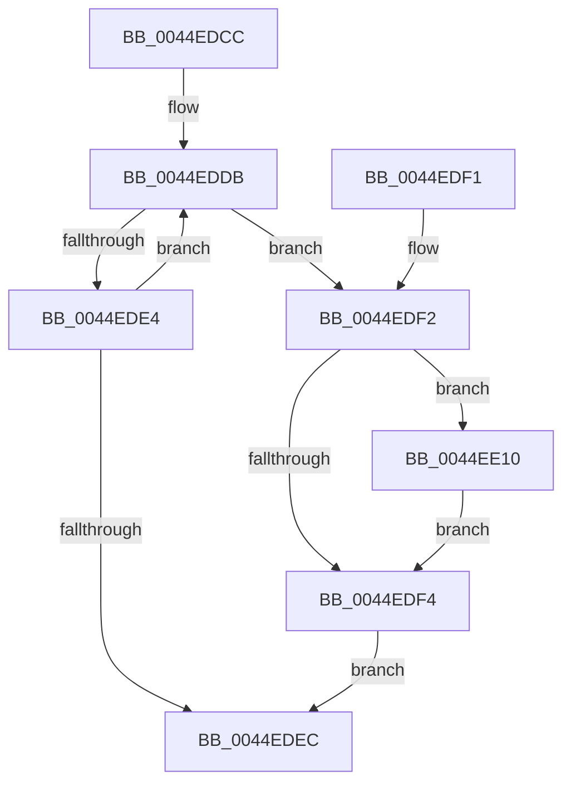

# SepDeReferenceLogonSessionDirect

- RVA: `0x0044EDCC`–`0x0044EE19` (길이 `77` bytes)
- VA: `0x000000014044EDCC`
- 실행 섹션: `.text`
- PDB 이름 있음: `예`; PDB Function 태그: `아니요`
- unwind 정보 RVA: `0x00098820`
- 디코드: `22`개 명령, `77/77` bytes 표시
- 미해석 바이트: `0` (있으면 어셈블리에 `.byte`로 보존)

> 이 문서는 커널 이미지의 기계어와 PDB 기호를 분석해 생성했습니다. 4번과 5번은 함수 원형과 자료형을 바이너리 사용 방식에서 추정한 C 해석이며 원본 소스 복구 결과는 아닙니다.

## 1. Dependencies

- 직접 호출 지점: **1**; 고유 호출 대상: **1**
- 직접 호출자로 확인된 함수: **9**
- RIP 상대 이미지 참조: **0**

### Outgoing calls
- `0x0044EE09` → [SepDeReferenceLogonSession](../../page/AF/SepDeReferenceLogonSession_function_00AF25EC.md) (function, `0x00AF25EC`)

### Direct callers
- [SepOneWayLinkLogonSessions](../60/SepOneWayLinkLogonSessions_function_006068D8.md) at `0x00606BDD`
- [sub_006FA500](../6F/Unknown_function_006FA500.md) at `0x006FA51F`
- [SeShutdownServerSilo](../../page/79/SeShutdownServerSilo_function_0079C4DC.md) at `0x0079C51A`
- [SeShutdownServerSilo](../../page/79/SeShutdownServerSilo_function_0079C4DC.md) at `0x0079C52C`
- [SeSetSessionIdTokenWithLinked](../../page/79/SeSetSessionIdTokenWithLinked_function_0079CF90.md) at `0x0079D0E2`
- [SeSetSessionIdTokenWithLinked](../../page/79/SeSetSessionIdTokenWithLinked_function_0079CF90.md) at `0x0079D0F0`
- [SepSetServerSiloToken](../../page/79/SepSetServerSiloToken_function_0079D2A8.md) at `0x0079D318`
- [SeGetLinkedToken](../../page/A3/SeGetLinkedToken_function_00A3B640.md) at `0x00A3B6C3`
- [SepStopReferencingLogonSession](../../page/A8/SepStopReferencingLogonSession_function_00A8E35C.md) at `0x00A8E37B`
- [NtQueryInformationToken](../../page/AE/NtQueryInformationToken_function_00AECDD0.md) at `0x00AED6AD`
- [NtQueryInformationToken](../../page/AE/NtQueryInformationToken_function_00AECDD0.md) at `0x00AED6F3`
- [NtQueryInformationToken](../../page/AE/NtQueryInformationToken_function_00AECDD0.md) at `0x00AEE6DC`
- [NtQueryInformationToken](../../page/AE/NtQueryInformationToken_function_00AECDD0.md) at `0x00AEE71A`
- [NtQueryInformationToken](../../page/AE/NtQueryInformationToken_function_00AECDD0.md) at `0x00AEE9BC`
- [SepTokenDeleteMethod](../../page/AF/SepTokenDeleteMethod_function_00AF23D0.md) at `0x00AF24FD`

### Static image references
- 디코드된 RIP-relative 메모리 참조가 없습니다.

## 2. Other-region calls and transfers

- 다른 실행 섹션으로 향하는 call: **1**
  - `0x0044EE09` → [SepDeReferenceLogonSession](../../page/AF/SepDeReferenceLogonSession_function_00AF25EC.md) (`.text` → `PAGE`)
- 별도 외부 분기/꼬리 이동을 확인하지 못했습니다.

## 3. Assembly (complete function range)

```asm
0044EDCC  48 83 EC 28                     sub rsp, 0x28
0044EDD0  48 8B D1                        mov rdx, rcx
0044EDD3  0F 0D 49 20                     prefetchw byte ptr [rcx + 0x20]
0044EDD7  48 8B 41 20                     mov rax, qword ptr [rcx + 0x20]
0044EDDB  48 8D 48 FF                     lea rcx, [rax - 1]
0044EDDF  48 85 C9                        test rcx, rcx
0044EDE2  7E 0E                           jle 0x14044edf2
0044EDE4  F0 48 0F B1 4A 20               lock cmpxchg qword ptr [rdx + 0x20], rcx
0044EDEA  75 EF                           jne 0x14044eddb
0044EDEC  48 83 C4 28                     add rsp, 0x28
0044EDF0  C3                              ret
0044EDF1  CC                              int3
0044EDF2  75 1C                           jne 0x14044ee10
0044EDF4  48 8B 42 08                     mov rax, qword ptr [rdx + 8]
0044EDF8  48 8D 4C 24 30                  lea rcx, [rsp + 0x30]
0044EDFD  48 8B 92 A8 00 00 00            mov rdx, qword ptr [rdx + 0xa8]
0044EE04  48 89 44 24 30                  mov qword ptr [rsp + 0x30], rax
0044EE09  E8 DE 37 6A 00                  call 0x140af25ec
0044EE0E  EB DC                           jmp 0x14044edec
0044EE10  B9 0E 00 00 00                  mov ecx, 0xe
0044EE15  CD 29                           int 0x29
0044EE17  EB DB                           jmp 0x14044edf4
```

## 4. C-style interpretation (structured pseudocode)

```c
__int64 __fastcall SepDeReferenceLogonSessionDirect(__int64 a1)
{
    __int64 result;
    __int64 v_rsp;
    unsigned __int64 v_stack_p30;

    v_rsp = (v_rsp) - (40);
loc_0044EDDB:
    if (condition_is_less_or_equal) goto loc_0044EDF2;
    if (*(unsigned __int64 *)(a1 + 32) - 1 != 0) goto loc_0044EDDB;
loc_0044EDEC:
    v_rsp = (v_rsp) + (40);
    return *(unsigned __int64 *)(a1 + 32);
loc_0044EDF2:
    if (condition_is_not_equal) goto loc_0044EE10;
loc_0044EDF4:
    v_stack_p30 = *(unsigned __int64 *)(a1 + 8);
    result = SepDeReferenceLogonSession(v_stack_p30, *(unsigned __int64 *)(a1 + 168), a3, a4);
    goto loc_0044EDEC;
loc_0044EE10:
    goto loc_0044EDF4;
}
```

## 5. (Beta) C Style

```c
int64_t SepDeReferenceLogonSessionDirect(void *Arg1)
{
    uint8_t *arg1 = (uint8_t *)Arg1;

    int64_t result;
    int64_t local_rsp;
    uint64_t v_stack_p30;

    local_rsp = (local_rsp) - (40);
loc_0044EDDB:
    if (condition_is_less_or_equal) goto loc_0044EDF2;
    if (*(uint64_t *)(arg1 + 0x20) - 1 != 0) goto loc_0044EDDB;
loc_0044EDEC:
    local_rsp = (local_rsp) + (40);
    return *(uint64_t *)(arg1 + 0x20);
loc_0044EDF2:
    if (condition_is_not_equal) goto loc_0044EE10;
loc_0044EDF4:
    v_stack_p30 = *(uint64_t *)(arg1 + 0x8);
    result = SepDeReferenceLogonSession(v_stack_p30, *(uint64_t *)(arg1 + 0xA8), a3, a4);
    goto loc_0044EDEC;
loc_0044EE10:
    goto loc_0044EDF4;
}
```

### 관측된 메모리 오프셋

구조체 형식이 확인되지 않은 접근은 인자 기준의 오프셋으로만 기록했습니다.

| 기준 인자 | 오프셋 표현 | 폭 (bit) | 접근 |
|---|---:|---:|---|
| `Arg1` | `+ 0x8` | `64` | `R` |
| `Arg1` | `+ 0x20` | `8` | `R` |
| `Arg1` | `+ 0x20` | `64` | `R` |
| `Arg1` | `+ 0xA8` | `64` | `R` |

## 6. Execution-region graph

[열기: 2D/3D 그래프와 함수 탐색 컨트롤 패널](../../../control-panel.html?section=text&rva=0x0044EDCC&view=graph)

- 2D 그래프는 위에서 아래로 흐르고, 3D 그래프는 빈 공간을 드래그해 회전합니다. Shift+드래그는 이동, 휠은 확대·축소, 함수 노드 선택은 대상 보고서 이동입니다.

### Static fallback


