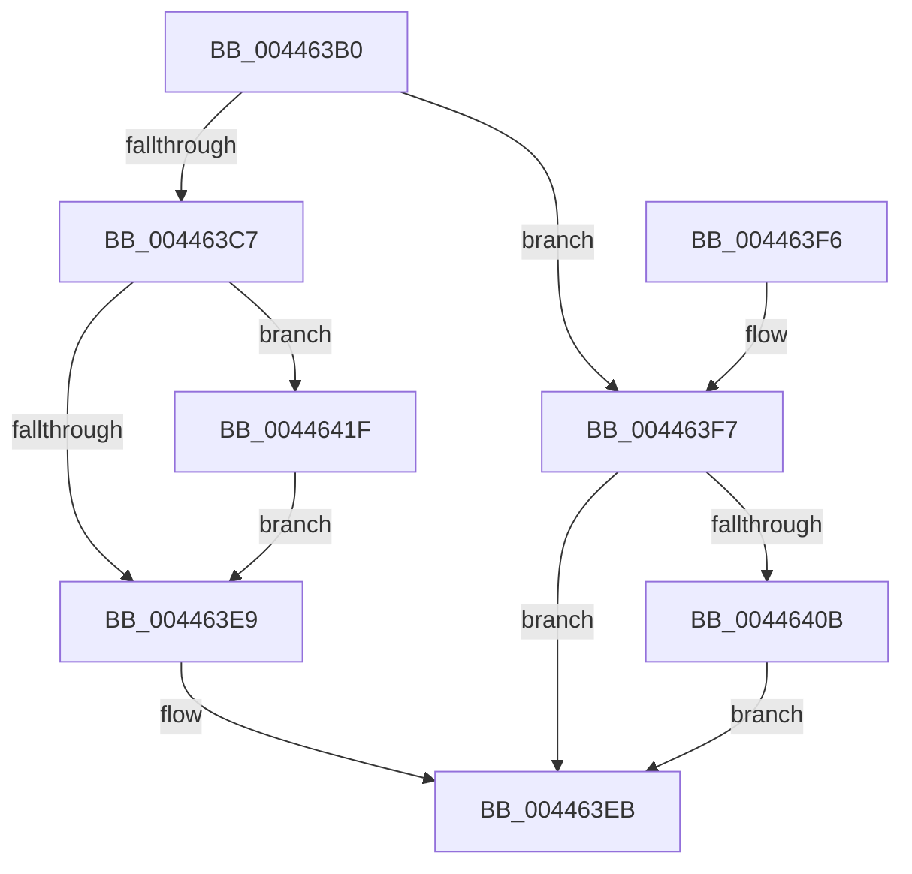

# SepDuplicateLogonSessionReference

- RVA: `0x004463B0`–`0x00446428` (길이 `120` bytes)
- VA: `0x00000001404463B0`
- 실행 섹션: `.text`
- PDB 이름 있음: `예`; PDB Function 태그: `아니요`
- unwind 정보 RVA: `0x00070B28`
- 디코드: `31`개 명령, `120/120` bytes 표시
- 미해석 바이트: `0` (있으면 어셈블리에 `.byte`로 보존)

> 이 문서는 커널 이미지의 기계어와 PDB 기호를 분석해 생성했습니다. 4번과 5번은 함수 원형과 자료형을 바이너리 사용 방식에서 추정한 C 해석이며 원본 소스 복구 결과는 아닙니다.

## 1. Dependencies

- 직접 호출 지점: **1**; 고유 호출 대상: **1**
- 직접 호출자로 확인된 함수: **2**
- RIP 상대 이미지 참조: **0**

### Outgoing calls
- `0x00446402` → [SepReferenceLogonSession](../../page/A3/SepReferenceLogonSession_function_00A3B74C.md) (function, `0x00A3B74C`)

### Direct callers
- [SepDuplicateToken](../../page/8B/SepDuplicateToken_function_008B87EC.md) at `0x008B8C01`
- [SepFilterToken](../../page/9C/SepFilterToken_function_009C6B80.md) at `0x009C707B`

### Static image references
- 디코드된 RIP-relative 메모리 참조가 없습니다.

## 2. Other-region calls and transfers

- 다른 실행 섹션으로 향하는 call: **1**
  - `0x00446402` → [SepReferenceLogonSession](../../page/A3/SepReferenceLogonSession_function_00A3B74C.md) (`.text` → `PAGE`)
- 별도 외부 분기/꼬리 이동을 확인하지 못했습니다.

## 3. Assembly (complete function range)

```asm
004463B0  48 89 5C 24 08                  mov qword ptr [rsp + 8], rbx
004463B5  57                              push rdi
004463B6  48 83 EC 20                     sub rsp, 0x20
004463BA  8B 82 C8 00 00 00               mov eax, dword ptr [rdx + 0xc8]
004463C0  48 8B F9                        mov rdi, rcx
004463C3  A8 20                           test al, 0x20
004463C5  75 30                           jne 0x1404463f7
004463C7  48 8B 8A D8 00 00 00            mov rcx, qword ptr [rdx + 0xd8]
004463CE  B8 01 00 00 00                  mov eax, 1
004463D3  48 89 8F D8 00 00 00            mov qword ptr [rdi + 0xd8], rcx
004463DA  F0 48 0F C1 41 20               lock xadd qword ptr [rcx + 0x20], rax
004463E0  48 FF C0                        inc rax
004463E3  48 83 F8 01                     cmp rax, 1
004463E7  7E 36                           jle 0x14044641f
004463E9  33 C0                           xor eax, eax
004463EB  48 8B 5C 24 30                  mov rbx, qword ptr [rsp + 0x30]
004463F0  48 83 C4 20                     add rsp, 0x20
004463F4  5F                              pop rdi
004463F5  C3                              ret
004463F6  CC                              int3
004463F7  48 8D 4A 18                     lea rcx, [rdx + 0x18]
004463FB  48 8D 97 D8 00 00 00            lea rdx, [rdi + 0xd8]
00446402  E8 45 53 5F 00                  call 0x140a3b74c
00446407  85 C0                           test eax, eax
00446409  79 E0                           jns 0x1404463eb
0044640B  83 8F C8 00 00 00 20            or dword ptr [rdi + 0xc8], 0x20
00446412  48 C7 87 D8 00 00 00 00 00 00 00  mov qword ptr [rdi + 0xd8], 0
0044641D  EB CC                           jmp 0x1404463eb
0044641F  B9 0E 00 00 00                  mov ecx, 0xe
00446424  CD 29                           int 0x29
00446426  EB C1                           jmp 0x1404463e9
```

## 4. C-style interpretation (structured pseudocode)

```c
__int64 __fastcall SepDuplicateLogonSessionReference(__int64 a1, __int64 a2)
{
    __int64 result;
    __int64 v_rsp;
    unsigned __int64 v_stack_p8;

    v_stack_p8 = v_rbx;
    v_rsp = (v_rsp) - (32);
    if ((((unsigned __int8)((unsigned int)(*(unsigned int *)(a2 + 200)))) & (32)) != 0) goto loc_004463F7;
    *(unsigned __int64 *)(a1 + 216) = *(unsigned __int64 *)(a2 + 216);
    result = (1) + 1;
    if (result <= 1) goto loc_0044641F;
loc_004463E9:
    result = 0;
loc_004463EB:
    v_rsp = (v_rsp) + (32);
    return result;
loc_004463F7:
    result = SepReferenceLogonSession(a2 + 24, a1 + 216, a3, a4);
    if (!sign_flag) goto loc_004463EB;
    *(unsigned __int64 *)(a1 + 216) = 0;
    goto loc_004463EB;
loc_0044641F:
    goto loc_004463E9;
}
```

## 5. (Beta) C Style

```c
int64_t SepDuplicateLogonSessionReference(void *Arg1, void *Arg2)
{
    uint8_t *arg1 = (uint8_t *)Arg1;
    uint8_t *arg2 = (uint8_t *)Arg2;

    int64_t result;
    int64_t local_rsp;
    uint64_t v_stack_p8;

    v_stack_p8 = local_rbx;
    local_rsp = (local_rsp) - (32);
    if ((((uint8_t)((uint32_t)(*(uint32_t *)(arg2 + 0xC8)))) & (32)) != 0) goto loc_004463F7;
    *(uint64_t *)(arg1 + 0xD8) = *(uint64_t *)(arg2 + 0xD8);
    result = (1) + 1;
    if (result <= 1) goto loc_0044641F;
loc_004463E9:
    result = 0;
loc_004463EB:
    local_rsp = (local_rsp) + (32);
    return result;
loc_004463F7:
    result = SepReferenceLogonSession(Arg2 + 24, Arg1 + 216, a3, a4);
    if (!sign_flag) goto loc_004463EB;
    *(uint64_t *)(arg1 + 0xD8) = 0;
    goto loc_004463EB;
loc_0044641F:
    goto loc_004463E9;
}
```

### 관측된 메모리 오프셋

구조체 형식이 확인되지 않은 접근은 인자 기준의 오프셋으로만 기록했습니다.

| 기준 인자 | 오프셋 표현 | 폭 (bit) | 접근 |
|---|---:|---:|---|
| `Arg1` | `+ 0xC8` | `32` | `R/W` |
| `Arg1` | `+ 0xD8` | `64` | `R` |
| `Arg1` | `+ 0xD8` | `64` | `W` |
| `Arg2` | `+ 0x18` | `64` | `R` |
| `Arg2` | `+ 0xC8` | `32` | `R` |
| `Arg2` | `+ 0xD8` | `64` | `R` |

## 6. Execution-region graph

[열기: 2D/3D 그래프와 함수 탐색 컨트롤 패널](../../../control-panel.html?section=text&rva=0x004463B0&view=graph)

- 2D 그래프는 위에서 아래로 흐르고, 3D 그래프는 빈 공간을 드래그해 회전합니다. Shift+드래그는 이동, 휠은 확대·축소, 함수 노드 선택은 대상 보고서 이동입니다.

### Static fallback


