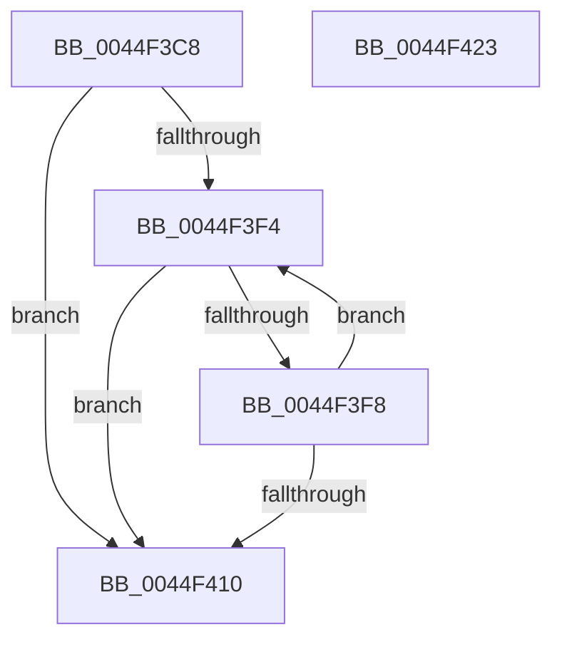

# SepGetTokenElevation

- RVA: `0x0044F3C8`–`0x0044F424` (길이 `92` bytes)
- VA: `0x000000014044F3C8`
- 실행 섹션: `.text`
- PDB 이름 있음: `예`; PDB Function 태그: `아니요`
- unwind 정보 RVA: `0x00060BC4`
- 디코드: `28`개 명령, `92/92` bytes 표시
- 미해석 바이트: `0` (있으면 어셈블리에 `.byte`로 보존)

> 이 문서는 커널 이미지의 기계어와 PDB 기호를 분석해 생성했습니다. 4번과 5번은 함수 원형과 자료형을 바이너리 사용 방식에서 추정한 C 해석이며 원본 소스 복구 결과는 아닙니다.

## 1. Dependencies

- 직접 호출 지점: **1**; 고유 호출 대상: **1**
- 직접 호출자로 확인된 함수: **3**
- RIP 상대 이미지 참조: **0**

### Outgoing calls
- `0x0044F405` → [RtlIsElevatedRid](../../page/9D/RtlIsElevatedRid_function_009D4B30.md) (function, `0x009D4B30`)

### Direct callers
- [SeQueryInformationToken](../../page/8B/SeQueryInformationToken_function_008B5090.md) at `0x008B58B5`
- [SepCopyTokenLoggingInformation](../../page/9A/SepCopyTokenLoggingInformation_function_009A8618.md) at `0x009A8643`
- [NtQueryInformationToken](../../page/AE/NtQueryInformationToken_function_00AECDD0.md) at `0x00AEEE3A`

### Static image references
- 디코드된 RIP-relative 메모리 참조가 없습니다.

## 2. Other-region calls and transfers

- 다른 실행 섹션으로 향하는 call: **1**
  - `0x0044F405` → [RtlIsElevatedRid](../../page/9D/RtlIsElevatedRid_function_009D4B30.md) (`.text` → `PAGE`)
- 별도 외부 분기/꼬리 이동을 확인하지 못했습니다.

## 3. Assembly (complete function range)

```asm
0044F3C8  48 89 5C 24 08                  mov qword ptr [rsp + 8], rbx
0044F3CD  48 89 74 24 10                  mov qword ptr [rsp + 0x10], rsi
0044F3D2  57                              push rdi
0044F3D3  48 83 EC 20                     sub rsp, 0x20
0044F3D7  48 8B F9                        mov rdi, rcx
0044F3DA  48 B9 84 06 16 20 11 00 00 00   movabs rcx, 0x1120160684
0044F3E4  48 85 4F 40                     test qword ptr [rdi + 0x40], rcx
0044F3E8  8B 77 7C                        mov esi, dword ptr [rdi + 0x7c]
0044F3EB  0F 95 C0                        setne al
0044F3EE  33 DB                           xor ebx, ebx
0044F3F0  85 F6                           test esi, esi
0044F3F2  74 1C                           je 0x14044f410
0044F3F4  84 C0                           test al, al
0044F3F6  75 18                           jne 0x14044f410
0044F3F8  8B CB                           mov ecx, ebx
0044F3FA  48 C1 E1 04                     shl rcx, 4
0044F3FE  48 03 8F 98 00 00 00            add rcx, qword ptr [rdi + 0x98]
0044F405  E8 26 57 58 00                  call 0x1409d4b30
0044F40A  FF C3                           inc ebx
0044F40C  3B DE                           cmp ebx, esi
0044F40E  72 E4                           jb 0x14044f3f4
0044F410  48 8B 5C 24 30                  mov rbx, qword ptr [rsp + 0x30]
0044F415  48 8B 74 24 38                  mov rsi, qword ptr [rsp + 0x38]
0044F41A  0F B6 C0                        movzx eax, al
0044F41D  48 83 C4 20                     add rsp, 0x20
0044F421  5F                              pop rdi
0044F422  C3                              ret
0044F423  CC                              int3
```

## 4. C-style interpretation (structured pseudocode)

```c
__int64 __fastcall SepGetTokenElevation(__int64 a1)
{
    __int64 result;
    __int64 v_rbx;
    __int64 v_rsp;
    unsigned __int64 v_stack_p10;
    unsigned __int64 v_stack_p8;

    v_stack_p8 = v_rbx;
    v_stack_p10 = v_rsi;
    v_rsp = (v_rsp) - (32);
    result = (((*(unsigned __int64 *)(a1 + 64)) & (a1)) != 0) ? 1 : 0;
    v_rbx = 0;
    if ((unsigned int)((unsigned int)(*(unsigned int *)(a1 + 124))) == 0) goto loc_0044F410;
loc_0044F3F4:
    if ((unsigned __int8)(result) != 0) goto loc_0044F410;
    a1 = (0) << (4);
    a1 = (a1) + (*(unsigned __int64 *)(a1 + 152));
    result = RtlIsElevatedRid(a1, a2, a3, a4);
    v_rbx = (unsigned int)((v_rbx) + 1);
    if (((unsigned int)(v_rbx)) < ((unsigned int)((unsigned int)(*(unsigned int *)(a1 + 124))))) goto loc_0044F3F4;
loc_0044F410:
    v_rsp = (v_rsp) + (32);
    return (unsigned __int8)(result);
}
```

## 5. (Beta) C Style

```c
int64_t SepGetTokenElevation(void *Arg1)
{
    uint8_t *arg1 = (uint8_t *)Arg1;

    int64_t result;
    int64_t local_rbx;
    int64_t local_rsp;
    uint64_t v_stack_p10;
    uint64_t v_stack_p8;

    v_stack_p8 = local_rbx;
    v_stack_p10 = local_rsi;
    local_rsp = (local_rsp) - (32);
    result = (((*(uint64_t *)(arg1 + 0x40)) & (Arg1)) != 0) ? 1 : 0;
    local_rbx = 0;
    if ((uint32_t)((uint32_t)(*(uint32_t *)(arg1 + 0x7C))) == 0) goto loc_0044F410;
loc_0044F3F4:
    if ((uint8_t)(result) != 0) goto loc_0044F410;
    Arg1 = (0) << (4);
    Arg1 = (Arg1) + (*(uint64_t *)(arg1 + 0x98));
    result = RtlIsElevatedRid(Arg1, a2, a3, a4);
    local_rbx = (uint32_t)((local_rbx) + 1);
    if (((uint32_t)(local_rbx)) < ((uint32_t)((uint32_t)(*(uint32_t *)(arg1 + 0x7C))))) goto loc_0044F3F4;
loc_0044F410:
    local_rsp = (local_rsp) + (32);
    return (uint8_t)(result);
}
```

### 관측된 메모리 오프셋

구조체 형식이 확인되지 않은 접근은 인자 기준의 오프셋으로만 기록했습니다.

| 기준 인자 | 오프셋 표현 | 폭 (bit) | 접근 |
|---|---:|---:|---|
| `Arg1` | `+ 0x40` | `64` | `R` |
| `Arg1` | `+ 0x7C` | `32` | `R` |
| `Arg1` | `+ 0x98` | `64` | `R` |

## 6. Execution-region graph

[열기: 2D/3D 그래프와 함수 탐색 컨트롤 패널](../../../control-panel.html?section=text&rva=0x0044F3C8&view=graph)

- 2D 그래프는 위에서 아래로 흐르고, 3D 그래프는 빈 공간을 드래그해 회전합니다. Shift+드래그는 이동, 휠은 확대·축소, 함수 노드 선택은 대상 보고서 이동입니다.

### Static fallback


