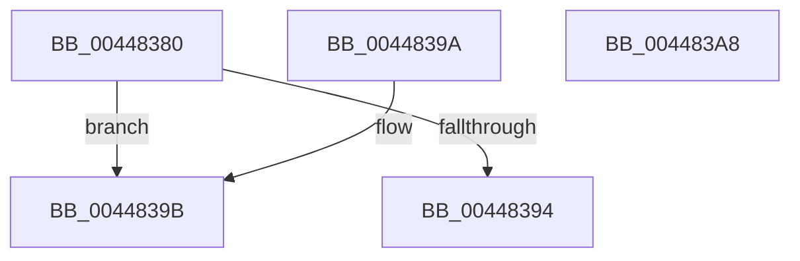

# ULongLongMult

- RVA: `0x00448380`–`0x004483A9` (길이 `41` bytes)
- VA: `0x0000000140448380`
- 실행 섹션: `.text`
- PDB 이름 있음: `예`; PDB Function 태그: `아니요`
- unwind 정보 RVA: `0x000DB714`
- 디코드: `13`개 명령, `41/41` bytes 표시
- 미해석 바이트: `0` (있으면 어셈블리에 `.byte`로 보존)

> 이 문서는 커널 이미지의 기계어와 PDB 기호를 분석해 생성했습니다. 4번과 5번은 함수 원형과 자료형을 바이너리 사용 방식에서 추정한 C 해석이며 원본 소스 복구 결과는 아닙니다.

## 1. Dependencies

- 직접 호출 지점: **0**; 고유 호출 대상: **0**
- 직접 호출자로 확인된 함수: **7**
- RIP 상대 이미지 참조: **0**

### Outgoing calls
- 직접 디코드된 call 명령이 없습니다.

### Direct callers
- [SdbpCheckApplicationTypeAttributes](../69/SdbpCheckApplicationTypeAttributes_function_0069C93C.md) at `0x0069CA1E`
- [SdbpFreeAppAttributes](../../page/81/SdbpFreeAppAttributes_function_0081587C.md) at `0x008158BE`
- [AslPathWildcardFindFirst](../../page/81/AslPathWildcardFindFirst_function_0081B534.md) at `0x0081B7C4`
- [AslPathWildcardFindFirst](../../page/81/AslPathWildcardFindFirst_function_0081B534.md) at `0x0081B7E2`
- [AslPathWildcardFindFirst](../../page/81/AslPathWildcardFindFirst_function_0081B534.md) at `0x0081B97F`
- [AslPathWildcardFindFirst](../../page/81/AslPathWildcardFindFirst_function_0081B534.md) at `0x0081B99D`
- [AslPathWildcardFindFirst](../../page/81/AslPathWildcardFindFirst_function_0081B534.md) at `0x0081BA56`
- [AslPathWildcardFindNext](../../page/81/AslPathWildcardFindNext_function_0081BB2C.md) at `0x0081BBE1`
- [AslPathWildcardFindNext](../../page/81/AslPathWildcardFindNext_function_0081BB2C.md) at `0x0081BC55`
- [AslPathWildcardFindNext](../../page/81/AslPathWildcardFindNext_function_0081BB2C.md) at `0x0081BCDA`
- [AslPathWildcardFindNext](../../page/81/AslPathWildcardFindNext_function_0081BB2C.md) at `0x0081BD17`
- [AslPathWildcardFindNext](../../page/81/AslPathWildcardFindNext_function_0081BB2C.md) at `0x0081BD34`
- [AslPathWildcardFindNext](../../page/81/AslPathWildcardFindNext_function_0081BB2C.md) at `0x0081BDC7`
- [AslPathWildcardFindNext](../../page/81/AslPathWildcardFindNext_function_0081BB2C.md) at `0x0081BDDF`
- [AslPathWildcardFindNext](../../page/81/AslPathWildcardFindNext_function_0081BB2C.md) at `0x0081C016`
- [AslPathWildcardFindNext](../../page/81/AslPathWildcardFindNext_function_0081BB2C.md) at `0x0081C031`
- [AslPathWildcardFindNext](../../page/81/AslPathWildcardFindNext_function_0081BB2C.md) at `0x0081C0E9`
- [AslpPathWildcardFreeFindContext](../../page/81/AslpPathWildcardFreeFindContext_function_0081C844.md) at `0x0081C88E`
- [sub_00B24914](../../page/B2/Unknown_function_00B24914.md) at `0x00B24951`
- [sub_00B24914](../../page/B2/Unknown_function_00B24914.md) at `0x00B24969`
- [sub_00B24B82](../../page/B2/Unknown_function_00B24B82.md) at `0x00B24BBB`
- [sub_00B24B82](../../page/B2/Unknown_function_00B24B82.md) at `0x00B24BCF`
- [sub_00B24B82](../../page/B2/Unknown_function_00B24B82.md) at `0x00B24CB3`
- [sub_00B24B82](../../page/B2/Unknown_function_00B24B82.md) at `0x00B24CC7`

### Static image references
- 디코드된 RIP-relative 메모리 참조가 없습니다.

## 2. Other-region calls and transfers

- 다른 실행 섹션으로 향하는 call: **0**
- 별도 외부 분기/꼬리 이동을 확인하지 못했습니다.

## 3. Assembly (complete function range)

```asm
00448380  48 8B C2                        mov rax, rdx
00448383  48 C7 44 24 20 00 00 00 00      mov qword ptr [rsp + 0x20], 0
0044838C  48 F7 E1                        mul rcx
0044838F  48 85 D2                        test rdx, rdx
00448392  75 07                           jne 0x14044839b
00448394  49 89 00                        mov qword ptr [r8], rax
00448397  33 C0                           xor eax, eax
00448399  C3                              ret
0044839A  CC                              int3
0044839B  49 C7 00 FF FF FF FF            mov qword ptr [r8], 0xffffffffffffffff
004483A2  B8 16 02 07 80                  mov eax, 0x80070216
004483A7  C3                              ret
004483A8  CC                              int3
```

## 4. C-style interpretation (structured pseudocode)

```c
__int64 __fastcall ULongLongMult(__int64 a1, __int64 a2, __int64 a3)
{
    __int64 result;
    unsigned __int64 v_stack_p20;

    v_stack_p20 = 0;
    if (a2 != 0) goto loc_0044839B;
    *(unsigned __int64 *)(a3) = a2;
    result = 0;
    return result;
loc_0044839B:
    *(unsigned __int64 *)(a3) = -1;
    return (unsigned int)(0x80070216ULL);
}
```

## 5. (Beta) C Style

```c
int64_t ULongLongMult(int64_t Arg1, int64_t Arg2, void *Arg3)
{
    uint8_t *arg3 = (uint8_t *)Arg3;

    int64_t result;
    uint64_t v_stack_p20;

    v_stack_p20 = 0;
    if (Arg2 != 0) goto loc_0044839B;
    *(uint64_t *)(arg3) = Arg2;
    result = 0;
    return result;
loc_0044839B:
    *(uint64_t *)(arg3) = -1;
    return (uint32_t)(0x80070216ULL);
}
```

### 관측된 메모리 오프셋

구조체 형식이 확인되지 않은 접근은 인자 기준의 오프셋으로만 기록했습니다.

| 기준 인자 | 오프셋 표현 | 폭 (bit) | 접근 |
|---|---:|---:|---|
| `Arg3` | `+ 0x0` | `64` | `W` |

## 6. Execution-region graph

[열기: 2D/3D 그래프와 함수 탐색 컨트롤 패널](../../../control-panel.html?section=text&rva=0x00448380&view=graph)

- 2D 그래프는 위에서 아래로 흐르고, 3D 그래프는 빈 공간을 드래그해 회전합니다. Shift+드래그는 이동, 휠은 확대·축소, 함수 노드 선택은 대상 보고서 이동입니다.

### Static fallback


